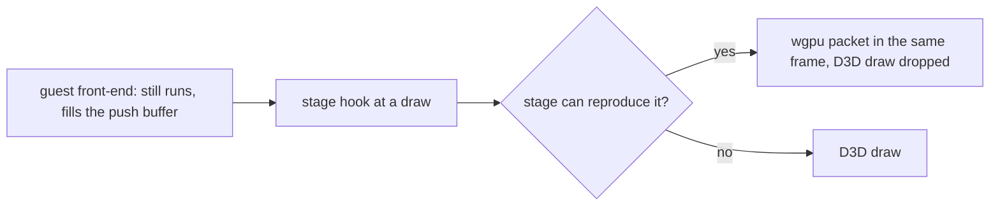
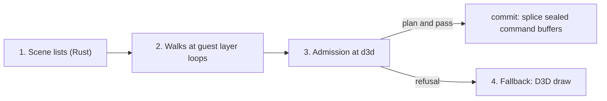

# Native GPU renderer

Status: Built. Every stage draws in the default configuration.
Code: `crates/rewrites/native-render/src` (wgpu passes and loaders), `crates/rewrites/render-bridge/src/native_*.rs` (the hooks that hand guest draws to them), `crates/platform/d3d/src/backend.rs` and `crates/platform/d3d/src/device.rs` (admission). Tests: `crates/rewrites/render-bridge/tests/native_defaults.rs`, `crates/hooking/hooks/src/switches.rs`, and the per-module tests in `crates/rewrites/native-render`.
Switch: `impl.render.native` (on), listed in [switches.md](../runtime/switches.md).

The native renderer draws the frame from GPU-resident data: the static
world, objects, transparents, lights, effects, fog, post and the HUD. It
does not replace the recompiled front-end wholesale. The guest's render code
still runs and still fills the push buffer, and a hook offers each draw to a
stage.

A stage that can reproduce a draw records a wgpu packet into the same frame
as the D3D draws and the device drops the original. Anything a stage refuses
stays a D3D draw. Every stage gives the same pixels on the reference copy
and the display copy of the frame, and a refusal leaves the guest exactly as
if the hook had not run.

Evidence labels as in [feature-engine.md](../engine/feature-engine.md):
**Code**, **Test**, **S**. Addresses and offsets are research points; no
game data is in the repo.

On the opted-in GPU path, the scene sink retains repeatable typed stages and
resolved guest draws at their original slots. The display worker presents a
complete game view from that seal, and the capture worker draws the same
inputs into private targets. A native producer's commit has no guest draw to
ride, so the sink carries the commit itself for the water composite, the
flares and the UI; post's glow and screen effects stay on the guest path in
a kept scene (framescene.md, "Slice 6"). The ownership rules and the gate
for changing the default are in
[FrameScene slice 6](framescene.md#slice-6-the-renderer-owns-game-view-frames).

A colour pass or screen effect the host does not arm counts
`scene_kept_post_colour_<cause>` or `scene_kept_post_screen_effect_<cause>`
(`native_post`).

## How a frame flows

1. **Scene lists** ([Scene list builders](#scene-list-builders)). The
   engine's visibility lists and render records are built in Rust from the
   live camera, datum arrays and tags, so the guest's gather and setup calls
   are skipped when the inputs resolve.
2. **Walks.** Stage hooks sit at researched instruction boundaries in the
   guest's layer loops ([Native scene walks](#native-scene-walks-for-effects-and-overlays)).
   Each reads the live list entry and either skips guest work for it or
   leaves it.
3. **Admission.** A draw that reaches `d3d` is shown to every registered
   `d3d::DrawAdmission` ([Admission](#admission)). The first that returns a
   plan and a pass wins. Preparation records every participating copy; commit
   splices the sealed command buffers into the D3D submission order.
4. **Fallback.** A refusal, a failed validation, a material or state the
   stage cannot reproduce, or a stood-down stage leaves the original D3D draw.
   Clears, target changes, query reports, menu traffic and the final
   display stay on D3D ([Residual render callers](#residual-render-callers)).

`render_frame_and_present` `0x00223240` is the Rust frame step
(`render_bridge::render_frame`): it calls the views or the frame outside a
game view, the frame wait and the present in the guest's order. A movie's
picture is uploaded from the decoder and drawn as an overlay `MovieFrame`
item; the guest's texture is never filled
([retire-d3d-display.md](retire-d3d-display.md)).

`impl.render.native=off` returns every stage, walk and scene list to the D3D
path together. `crates/hooking/hooks/src/switches.rs` (`NATIVE`,
`native_render_on`) reads it, looked up exactly: the `impl.render` group does
not reach it. `the_native_master_switch_gates_every_stage_and_walk` checks
that every stage gate follows it. There are no per-stage switches.

## Stages

| Stage | Page | Modules | What it replaces |
|---|---|---|---|
| Stage 1: the static world (and 1b, all layers) | [native-world.md](native-world.md) | `native-render`: `world`, `load`, `gpu`, `cull`, `skip`, `camera`, `world_layers`, `world_layers_gpu`, `world_ranges`. `feature`: `native_world`, `native_world_layers`, `native_map_work` | The structure BSP's layer-3 entries and the other base layers: builds, shader draws, submission |
| Stage 2: objects and skinning | [native-objects.md](native-objects.md) | `native-render`: `model`, `model_load`, `model_gpu`, `models`, `objects`, `object_walk`, `object_lighting`, `object_nodes`, `object_program`, `object_program_gpu`, `object_state`, `object_streams`. `feature`: `native_objects`, `native_first_person` | Layer-3 object draws and the guest's object setup |
| Stage 3: transparents | [native-transparents.md](native-transparents.md) | `native-render`: `transparent`, `transparent_streams`. `feature`: `native_transparents` | Indexed submission of the guest's sorted geometry |
| Particles, decals, effects | [native-particles.md](native-particles.md), [native-decals-research.md](native-decals-research.md) | `native-render`: `particles`, `particle_gpu`, `decal`, `decal_gpu`, `effect_geometry`, `effect_immediate`, `glow`. `feature`: `native_particles`, `native_decals`, `native_effects` | Quad, decal and contrail submission |
| Stage 4: lights and shadows | [native-lights.md](native-lights.md), [native-shadows.md](native-shadows.md), [native-shadow-layers.md](native-shadow-layers.md), [native-gels.md](native-gels.md) | `native-render`: `lights`, `light_gpu`, `light_list`, `light_look`, `light_scene`, `shadows`, `shadow_gpu`, `shadow_look`, `shadow_scene`, `shadow_filter_gpu`, `gels`, `gels_gpu`. `feature`: `native_lights`, `native_shadows`, `native_gels` | The per-light passes, shadow maps and shader gels |
| Stage 4b: water, fog and camouflage | [native-water-fog.md](native-water-fog.md) | `native-render`: `fog`, `fog_gpu`, `water_gpu`, `object_program_gpu`. `feature`: `native_fog`, `native_water`, `native_layers` | Layer 16 fog, layer 6 water edge blend on clusters and rigid placements, sorted late geometry ranges, the indexed water composite, layers 18 and 19 camouflage and layer 21 hologram |
| Stage 5: post and HUD | [native-post-hud.md](native-post-hud.md) | `native-render`: `post`, `screen_gpu`, `screen_look`, `flares`, `hud`, `ui_gpu`. `render-bridge`: `native_post`, `native_flares`, `native_hud` | Screen effects, bloom, lens-flare colour fans, the HUD and UI quads |
| Scene list builders | this page | `feature`: `native_scene_lists` | The engine's visibility gathers, object setup and render records |

Shared modules: `native-render`: `program`, `look`, `pass_state`, `instances`. Sections that code comments cite and on the stage pages: "Object lighting" and "Object programs" in [native-objects.md](native-objects.md); "Skip only the replaced work" in [native-world.md](native-world.md). "What a world pass reads" is a subsection of "Next: matching the look" in the same page.

## Map resource lifetime

A load is a generation. `render_bridge::native_map_work::reset` invalidates
the prior generation and detaches its BSP, object, light-model, viewmodel,
screen-effect and indexed draw caches before requesting the next BSP. A
same-map BSP switch or revert also detaches the old BSP and its indexed and
packed draw caches through `reload_bsp`.

Object and screen data for the map remain available. The packed transparent
binding cache holds up to 4,096 bindings and 16 MiB of payload
(`game::native_transparents_glue::Cache`). A queued draw can retain its own
resources until it finishes, and a late loader can publish only to its own
generation and mailbox.

The native map loader workers serialise their bulk decode and upload work
through `game::native_map::begin_load`, one build at a time in each of two
lanes (world, models; [Cache slots](../runtime/cache-slots.md)), and wait
for queued retirement on the worker thread. First-person loading opens the map for a batch of model
requests and releases its map readers and decoded images when the batch
ends. Material images share their backing allocation across passes, object
and shader readers share ordinary tag metadata within a model load, and sun
caster and receiver lookup holds weak references to the owning map state.

Memory probes and loader scopes are listed in
[Explain memory growth](../runtime/agent-api-host.md#explain-memory-growth). The
play-run measurements are in [Map-load memory](notes/2026-11-24-map-load-memory.md).

## Admission

Admission is how a native stage takes a guest draw: the device shows each
resolved draw to the registered `d3d::DrawAdmission`s in registration order,
records a wgpu pass on every participating copy, and drops the D3D packet
only when every copy recorded. The device replaces only the draw packet, so
the guest's shader setup and stencil tail still run. The entry points, the
plan and pass contract, the threaded backend path and the refusal rules are
in [native-renderer-admission.md](native-renderer-admission.md).

## Frame counters

`H2_FRAME_STATS`, its CSV, `profile.counters` and
`profile.capture` use the same stage names. Prefix each suffix below with
`native_<stage>_`, where stage is `world`, `objects`, `transparents`,
`lights`, `post`, `particles`, `decals`, `hud`, `gels`, `fog`, `water` or `ui`.

| Suffix | Measurement |
| --- | --- |
| `examined`, `suppressed` | Guest items considered and items committed. Multi-range passes override `ExternalPass::items(ranges)` to report their logical item count. |
| `refused_ownership`, `refused_resources`, `refused_inputs` | Unowned items, unavailable surfaces or bindings, and rejected stage preflight. |
| `refused_ranges`, `refused_masks`, `refused_validation`, `refused_replay` | Incomplete range count, failed reversible guest mask edit, wgpu validation error, and original draws retained for interpolation. |
| `prepare_ns`, `encode_ns` | Host wall nanoseconds in native selection/resource preparation on the game thread and private command recording, respectively. |
| `render_prepare_ns` | The same preparation on the render thread (`timeline::native::mark_render_thread`): scene stages, and passes the threaded backend prepares on its worker. |
| `extract_ns` | Game-thread time a scene stage spends deciding what the guest skips: its guest reads and the checks that can refuse. |
| `scene_stages`, `scene_dropped` | Scene stages queued to the render thread, and those it could not record after the guest skipped their items (`d3d::scene_stage`; the stage then reserves on the game thread). |
| `buffers`, `bind_groups`, `upload_bytes`, `pipeline_misses` | Actual creations and bytes charged through the submission arena and counted `gfx::churn` operations during the stage. |
| `cache_hits`, `cache_misses` | Draws whose pipeline and bindings were already resident, and draws that created one. |
| `command_buffers` | Committed recordings with a private command buffer (`record_ranges`). Each also ends the open encoder and adds a render pass. Packets (`record_draws`), encoded commands (`record_encoded`) and bundles add none. |
| `v<V>_<C>_recorded`, `v<V>_<C>_ranges` | Ranges the stage recorded on this copy, including discarded attempts, and ranges committed. |
| `v<V>_invariants`, `v<V>_<C>_invariants`, `v<V>_<C>_refused` | Range-count mismatches across copies, mismatches on this copy, and transactions refused by this copy. Each stage/view/copy mismatch logs once. |

`native_shader_animation_{layers,objects,layer3}_{drawn,refused}` count
material passes with animated constants
([shader-instances.md](../formats/shader-instances.md#animated-constants))
per path: the structure layer planner's items, the object passes' draws
(layer 3 and the world layers) and the world layer-3 selection's
materials. `drawn` counts passes planned with their registers sampled at
the render clock; `refused` counts those the sampler refused, which stay
on the D3D path.

The frame-wide `command_buffers` counter counts every command buffer the
wgpu backend hands to `queue.submit`, next to `submits` and `passes`.
`ordered_writes` counts packet runs whose persistent rows (the world's
view rows) could not go at the front of the submission, because it
already held other bytes for them or a command wrote them in draw order.
Each one copies the rows in order and starts a render pass, so it should
stay near the number of extra views per submission (split screen, two
target copies).

`V` is player view `0` through `3`, or `other`. `C` is `reference` or
`display`. Confirmed passes account for both physical copies and count a
suppressed guest item once, and stage ownership filters count the items they
reject before calling the device.

Single-stage draw admissions can override `DrawAdmission::stage() ->
Option<timeline::native::Stage>` to meter their selection time and ownership
refusals automatically. New stage implementations use
`gfx::churn::{create_buffer, create_buffer_init, create_bind_group, create_render_pipeline, upload_bytes}`
for resource accounting. Legacy enqueues have no suppression promise.

## Render front-end plan

1. Compare the Rust portal and object gather with the guest for each view.
   A set match admits membership tests. A consumer that draws in list
   order also needs matching order and multiplicity.
2. Build world and object draw lists from those regions, placements and
   object records. Compare the ordered draw keys and per-draw setup before
   selecting a Rust list under `impl.render.native`.
3. Build sorted transparent entries, including layer 15 for BSP geometry
   visible only through the display lens. Check the shared entries against
   the reference queue and keep display-only entries on the display copy.
4. Resolve decorator placements and instance ranges from the scene.
   Compare each placement, its order and its instance data at the draw
   boundary. Keep the guest path for any input the Rust builder declines.

Every stage reads the scene's own projection for the frame (the view's
camera and render scale), never a constant lens: the display copy's tangent
bounds widen around the same lens centre as the retail copy. Visibility
tests run at a widened FOV and render scale 0.75
(`scene-extract/src/visibility/tests.rs`).

Steps 1 and 4 have Rust producers that replace the guest's after an
identical compare: the portal walk, regions and windows, sphere and PVS
rows, and the decorator grid (`render-bridge/src/native_decorators/grid.rs`).
For step 3, `View::display_transparents` carries the sorted display queue:
the shared reference slots plus layer-15 cluster parts
(`native_world/section.rs`, `native_scene_lists/transparents/display.rs`).
`order_exact` is false when equal keys or a plane cycle make the merged order
depend on the wide gather's insertion order; the queue is not drawn then.
`DisplayTransparentQueue::runs` turns a drawable queue (`order_exact`, no
`unresolved_clusters`) into the display geometry grouped by the reference
ordinal it sorts after, which is the order the display copy draws it in
(`frame-scene/src/transparent.rs`); it refuses a queue whose reference
ordinals are not `0, 1, 2, ...`. `render.stats` counts each built queue as
`layer_plan_15_display_queue_{built,geometry,unresolved_clusters,inexact}`.

The display water pass consumes the queue from inside the sorted dispatch
(`render-bridge/src/native_water/display_runs.rs`). The layer-6 draw
(`0x0002c11b`) runs before the dispatch (`0x0002c19a`) builds the queue, so
it keeps drawing its lone display part there.

| Hook | Site | What the display runs do |
|---|---|---|
| queue build (`TRANSPARENT_ORDER_READY`) | after the sort, before the loop | plan the queue's parts the water set holds, less the part the layer-6 draw took, with `runs`; draw the head run (`after: None`) |
| `TRANSPARENT_DISPATCH_NEXT` (`0x0001e3f9`) | after each entry's handler (`0x0001e370` loop) or a skipped null one; `esi` is the ordinal just done | draw the run that sorts after it on the display copy |
| `SCENE_TRANSPARENTS_END` | loop exit | drop what the loop did not reach |

The loop's return from the handler (`0x0001e3f3`) is a call's continuation,
where a return resumes the generated code and no hook runs, so the hook is
the next instruction. A run is one display pass over the part list
(`native_water_glue::Glue::draw_display`), with the gates of the layer-6
display branch; the reference view and every guest handler are untouched.

A queue `runs` refuses draws nothing at the hook, so the layer-6 path is
then the only display water draw. `render.stats` counts the hook as
`layer_plan_15_display_queue_{runs_planned,runs_drawn,parts_drawn,runs_refused,runs_undrawn,old_path,hook_foreign_frame}`:
`old_path` is each refused queue, `runs_refused` a run the host did not
draw, `hook_foreign_frame` a hook whose `esp` is not the dispatch's.

The guest's own sorted loop (1,010 entries a frame on Old Mombasa) keeps
running. The stamps, the effects seed and the loop's state are made in
Rust beside it and compared (retire-d3d.md, "R2's shadow arm"); the
handler bodies stay the guest's. The water set holds layer-6 edge
passes only, not the layer-15 pool programs, so a queue part is drawn with
its edge passes at its sorted position.

## Scene list builders

The scene lists go off with the rest of the native renderer. This stage publishes the engine's original
visibility lists and render records. A draw can consume the same lists
through either renderer. The game supplies the camera, clipped cluster
frusta, live datum arrays and current tag definitions.

| Rust publication | Original work bypassed when the inputs resolve |
|---|---|
| Camera and light visibility | `0x00134390` publishes visible BSP clusters and placements. `0x00132220` walks both object reference partitions and the light reference partition. Both start after the portal or sphere cluster pass. |
| Object order and setup | `0x00134240` promotes model-linked entries with the original swaps of all four columns. `OBJECT_RENDER_SETUP` (`0x00133790`) is Rust's where it can build the call; a call it cannot build runs the guest body ([native-objects.md](native-objects.md), "Object setup"). It calculates the projection, opacity and flags, selects sections and handles residency (`0x0004b5d0`), builds palettes and walks children (`0x00133ab0`), then publishes the visibility bit and AL retry result. |
| Object render records | Whole-call setup uses the same Rust writer as the standalone append hook at `0x001341d0`. It publishes the model arm of `0x0002cbf0`, including attachment and group slots, projected scissors, lighting bytes and subpart allocation. The standalone hook also serves guest calls that reach the append from the one residency arm the cut leaves to the guest. |
| Dynamic light order and affected geometry | The pass at `0x0002c03e` calls `0x00031910`, which collects candidates, updates per-view history, ranks lights and fades their weights. Rust replaces this call and its helpers `0x0004a7c0` and `0x0004ac30`. After the per-light visibility pass, Rust applies the caster and receiver flags from `0x00031660` and the optional owner append from `0x00031c20`. The three are `engine::render::light_gather` ([native-light-gather.md](native-light-gather.md)); the seams here call them. |
| Ordered world and model geometry | For a Rust-gathered main view, the [layer builder](layer-draw.md) resolves BSP and model section records to complete sort slots. It skips the guest build and sort when all inputs match a list checked byte-for-byte at dispatch. |
| Transparent and effect lists | Rust publishes the geometry append at `0x00041381` and the effect and polygon records from `0x0001e4e0` and `0x0001e5e0`. In the pass at `0x0002c19a`, Rust fills the active u16 index interval and skips `TRANSPARENT_SORT` at `0x0001e3b2`. The original comparator's plane rules, partition swaps and short-sort ties determine the order, including entries with a null callback. |

The object walk uses the live salt, original partition order and visit
epoch. It writes the accepted object and placement stamps, light record
stamps, cluster ordinals, visibility bits and masks in guest memory.

The callers still advance the epochs. The light history retains its
candidate mask, removal swaps, protected entries and fade accumulators. The
transparent queue retains the guest's depth calculation, handlers and
payloads, so consumers read the same addresses and counts.

Object setup touches the requested sections in region order before
consulting the previous permutations. It tries the cached LOD without
requesting I/O when selection at the desired LOD fails. It preserves the
guest's per-view permutation bytes, LOD and palette tokens, resource epochs,
miss counts, lighting cache data, and object render stamps.

New palettes use the same transposed node matrices and per-section remaps.
The object walk emits each parent's sections before descending through its
child and sibling links. The no-draw exit updates the low byte of the
original visibility column, and the existing caller uses AL to process a
kind-1 retry, including the retry call's different render flags.

Setup stages writes across the entire object tree. A refusal restarts at the
original entry with the incoming registers and memory. New resource I/O,
synchronous waits, request reprioritisation, resource relocation, live
light-probe work, animated pose evaluation, and auxiliary model materials
use that path.

The Rust single-frustum portal walk, sphere gather and PVS gather supply
regions after comparison with the original producers. Each hook checks its
inputs and preserves the guest path for an unverified call. Dynamic light
frustum setup at `0x000c1d90` supplies the light lenses
([Visibility in Rust](native-visibility.md)). Effect producers decide when
effects are ready to queue.

Frame stats record `native_scene_lists_<stage>_native`, `_fallback` and
the associated `_memory`, `_layout` or `_unsupported` reason. Object
setup also reports `_residency`, `_lighting`, `_palette` and
`_object_model` for the corresponding guest service paths. Counts are
per list, setup or append, depending on the stage.

For timing, compare `impl.render.native=off` with the default, using
`H2_FEATURES=render-timing` in both captures. Include the `game_view` stage
for the main-camera object gather, and sites `0x0002bd2d`, `0x0002c03e` and
`0x0002c19a` for transparent production, dynamic lights and the sorted
dispatch.

The Old Mombasa census measured 1.88 ms/frame for the entire dynamic-light
bookkeeping site and about 0.01 ms/frame for the two old sort leaves
combined. It does not isolate the object setup or transparent allocation
costs, so a net saving needs a matching A/B ([render-loop.md](render-loop.md)).

The world stands down when its BSP loads yield no drawable native parts. The
lights stand down when the native world is disabled or its BSPs yield no
native lit parts. Fog and the layer-6 water edge blend stand down when their
translated passes yield no drawable parts.

This applies to whole-list replacement. A fog or water layer that shares
its list with an item the stage keeps draws per item over the guest's
sorted entries, interleaved with the kept ones
([retire-d3d-r5.md](retire-d3d-r5.md), "Fog and water per item").
Indexed fog ranges stay eligible at
their indexed draws, using the live shader and geometry after the guest
handler sets them up. Planar world passes sample the current view's combiner
colour and fade weights, and a BSP-backed stage stays eligible while any BSP
has work or has yet to be checked.

Objects stand down only when the map's tag index contains no object
definitions. Model loads and uploads stay lazy when definitions exist.
An empty map result logs once per stage. The hooks then return at an
atomic flag check until the next map activation or snapshot restore.

The structure's layer-3 pass accepts an explicit One/Zero/Add blend as
opaque. Layer-3 object and first-person draws also accept that combination
when the live device supplies its inherited fields. Scene object packets
carry the resolved stencil reference.

Object templates can leave blend and depth writes to the live state check.
They take render and sampler bindings driven by the shader instance's scalar
input, and the model loader retains the effective state writes for the
device-state checks.

Structure, scene layer-3 objects, decorators, water and fog can issue a
pass with all colour writes masked even when its blend enable or factors
are inherited. Depth writes and alpha testing still use the pass state.
Layers 6 and 16 check the stencil enable word at issue. When stencil is
off, unread comparison or operation words leave those layers eligible.

Layer 5 accepts a PRT declaration with the compiled registers and compatible
fetches. A three-component packed byte, short or normalized short can feed
a four-component input by supplying the encoded one in W. A shader that
forces W to one also accepts a narrower input with the same numeric type.

## Native scene walks for effects and overlays

The walks are on whenever the native renderer is. The effects walk shares the particles renderer.

| Stage | Instruction boundary and guest work skipped |
| --- | --- |
| Transparents | At `0x00041020` the saved sorted-loop ordinal resolves through the live u16 order array. The data pointer must match the handler argument. At `0x0004dad0` the standard emitter has a contiguous range in EDI/ESI. The subrange branches at `0x0004db40`, `0x0004dbdc` and `0x0004dc3a` supply topology, count and indices on the stack. The resolved indexed draw also covers an object whose lighting owner is unavailable. The hook checks the live handler, shader and part arguments. Each admitted range skips one indexed call and resumes at its return address. A refusal runs that call in sorted order. |
| First person | `0x0003fdf0` is a cut for both arguments from the first frame, and its body never runs. The call's prologue, its first-person effects (`0x00174220`, ported; each particle update a guest call) and its items are made in Rust into the first person's view, which takes the game view's render camera, and draw in slot 10 after the world's transparents; an unreadable or undrawable part is a named drop, and there is no D3D fallback ([native-objects.md](native-objects.md), "First person"). |
| Particles | At `0x0023ed5c` the guest allocator has succeeded and the emitter inputs are still live. Replace the one quad and skip its attribute writes and geometry publication in the guest. Restore EBP and return with the original stack cleanup. |
| Effects | The four-vertex copy callback's source is available at `0x0004b252`. Read it directly and skip the copy and publication. For contrails, read the completed callback output at `0x0004b28c` and skip publication. Both use the live inline declaration, then return `-1` with the original stack cleanup. |
| UI and HUD | The sorted widget dispatch, HUD and loading callbacks delimit ownership. The HUD, UI and loading census rows are partial. The overlay takes every HUD caller's shader quad, HUD glyphs and supported widget fans, inline screen quads and bars (strips with their corners put round the quad) with their bound textures; a proven HUD shader's quads skip its setup ([native-hud-overlay.md](native-hud-overlay.md)). Shared quads inside the loading callback count as loading draws. Refused draws follow the ordered UI packet or guest path; each is counted, in the HUD `scene_kept_overlay_<kind>_<cause>`, in the menu frame `scene_kept_ui_<kind>_<cause>` ([retire-d3d-menus.md](retire-d3d-menus.md#what-is-kept)), ([retire-d3d.md](retire-d3d.md#r6s-remainder)). |
| Post | At `0x0002d565` the screen strip's Begin is published. Read the active pass and two corner rows and evaluate them with the call's MXCSR. Each sampled framebuffer stage reads the alpha interpretation selected by its binding. Glow quads take their blend, blend constant and channel mask from the resolved packets. Supply the strip vertices to the ordered post transaction and resume at `0x0002d8b2`. |

A direct native draw drains preceding work and resolves the same streams,
program, sampler inputs, depth and colour attachment as the guest issue
path. Native recordings for every participating copy are sealed before the
hook skips guest instructions, and a refused draw returns to the guest at
the same place in the list.

The inline paths retain the last effective register values on commit and
restore their old values on refusal. Post retains the assembled original
strips for exact D3D replay if its complete call fails validation or
recording.

`world_layers_gpu::IndexedPass` translates each distinct resolved shader
and creates its GPU module on a compile worker. The frame requests the
pipeline for the live vertex layout, render state and attachment formats.
Until the pipeline has crossed a guest swap, the ordered draw takes its
original D3D path. A cold variant consumes no native geometry upload.

Program selection, material evaluation and target changes still run in the
guest for indexed geometry and HUD shader quads. Multi-range indexed
branches, unknown effect builders, query draws and unsupported states keep
their original paths. Particle iteration, property evaluation and contrail
ribbon construction stay in the guest.

### Post colour state and framebuffer aliases

A load-time screen program does not capture the inherited raster state at
issue, so the strip pipeline uses the resolved blend, blend constant,
colour writes, winding, cull and scissor. It still requires the compiled
alpha test to match, and checks the actual strip attributes against the plan
by bits. Each strip in one pass must have the same raster state, and other
shaders, effects and raster states keep their original draws.

The replacement uses one depth scale across its pinned targets. A change in
scale between held draws replays the call, including its side-target
writes. A call that only writes side targets can run without a framebuffer
slot when its stages and convolutions are independent of framebuffer pixels
and size.

A linear X8 alias of the framebuffer samples alpha as one. The native
feedback copy applies that alpha rule on its own scratch texture, as
D3D's framebuffer snapshot does. Slot identity, sampled dimensions and
the original replay path stay in the transaction. Mixed alpha
interpretations of the same framebuffer in one pass are refused.

## Checking a frame

`H2_FRAME_STATS=1` and the agent's frame counters carry the
`native_<stage>_walk_examined`, `walk_suppressed`, `walk_refused_inputs`,
`walk_refused_resume` and `walk_refused_reservation` counters
(`walk_refused_resume`: the sorted range's end is not a resume point of
the image, so the guest cannot be resumed past the skipped draw;
`walk_refused_reservation`: the reservation did not commit); for post, `walk_suppressed` counts
guest strip loops skipped.

A refused reservation also counts under its cause,
`native_<stage>_walk_refused_reservation_<cause>`
(`timeline::native::ReservationCause`); the causes sum to
`walk_refused_reservation` (for the objects run walk, to
`native_objects_walk_reservation`):

- `declined`: the device or the scene sink does not take the pass (the
  boundary is not drained, the sink will not keep it, or no host is
  installed). A sorted transparent range the device refuses counts here.
- `error`: the device returned an error, or its lock was poisoned.
- `stale`: the load the run was planned against is no longer current.
- `consumed`: the guest loop's cursor no longer matched at the commit.
- `unbound`: the device could not bind the pass's targets or pipeline.

A per-range draw (sorted transparents and object parts, through
`Device::try_native_indexed_draw_why`) names the first step it did not
pass (`d3d::NativeRefusal`), counted under:

- `boundary`: the device is not at a producer boundary.
- `geometry`: the index range's geometry did not resolve.
- `admission`: the producer's admission returned no pass.
- `binding`: the pass's targets do not bind as the guest draw's.
- `resources`: a sampled texture or independent samples are missing.
- `sink`: the scene sink would not keep the pass
  (`Backend::take_scene_refusal`).
- `backend`: the backend did not record every copy, or the guest cursor moved.

1. Use the agent API (`h2 agent`, [agent-api.md](../runtime/agent-api.md)):
   run the same replay or save and input with the default and with
   `H2_FEATURES=impl.render.native=off`, on the same image.
2. Capture matching presents and compare pixels; compare the native and
   replay counters, guest render CPU, D3D encode and render-worker waits.
3. Cover Old Mombasa gameplay and explosions, first-person weapon changes, a
   menu with blur and glyphs, a movie, an alternate view, and a two-view run
   at 1x and 2x.

Numbers from the all-native A/B are in
[notes/native-ab.md](notes/native-ab.md).

## Residual render callers

What stays on D3D: unsupported materials, exceptional handlers, clears,
target changes, query reports, menu traffic, the movie's texture creation
and release, final display, and
any shader or geometry setup a stage keeps when it replaces only the
resolved draws. The reachable sites in the retail image (conditional sites
counted once; runtime counts depend on visibility and admissions):

| View path | Residual sites |
|---|---|
| Scene kind 1 | 5 direct target selections, 1 layer-1 clear, 1 late layer-2 overlay, 1 sky call, 1 visibility issuance and 1 result reader |
| Scene kind 2 | the same 5 target sites, the layer-1 clear and the layer-2 overlay; exits after the first transparent site |
| Scene kinds 0, 3, 4, 6, 7 | 4 general layer begins (one is the layer-2 overlay), then the late sky and visibility sites |
| Scene kind 5 | 1 common exit; it may restore target 0 and the depth clip |
| Alternate view | view setup `0x0002c863`, UI call `0x0002c884`, view finish `0x0002c889` |
| Outside game views | the frame step's call of `0x002232a0`, 2 frame-finish calls, the present `0x00013f10` |

The frame tail at `0x00013b90` copies the view target and composites it, in
Rust over the overlay ([retire-d3d-display.md](retire-d3d-display.md#the-frame-tail)).
A tail it does not cover runs the guest's body, each helper scoped by its caller,
its pushed fans drawn by the native screen-space pass.

Refused draws, a kept tail's setup and a kept frame's `Swap` use the guest path;
the finish `0x00013cd0` is Rust ([retire-d3d-display.md](retire-d3d-display.md#the-frames-finish)).

The five base target sites are `0x0002bde2`, `0x0002be83`, `0x0002bf0e`,
`0x0002bf7f` and `0x0002bfe3`. The direct clear is `0x0002be01`; the clear
helper calls `D3DDevice_Clear` at `0x00014bb2`. Target changes converge on
`0x0001cd30`, which binds at `0x0001cd63` (same size) or `0x0001cd6c`
(resets the viewport). The scene exit `0x00013630` can restore a target at
`0x0001366b`.

The flare writer `0x00020bb0` polls an older result at `0x00020cbb`, begins
the count with inline NV2A methods, draws its callback and ends the test at
`0x00020d0f`. The late reader `0x00020770` polls the two-frame slot at
`0x00020840`. The GPU counter must preserve sample counts, readiness and
timestamps for both. That report is separate from the previous-frame depth
grid used for object culling.

**Lens-flare colour draws.** At each researched End call the bridge checks the saved caller and admits one fan. The guest supplies the projected corners, visibility fade, shader state and target order. The native pass uses the resolved stream and bindings for that draw, including the alternating filter targets. A fan left to the device (a refused check, a failed preparation or an undrained boundary) keeps its packet and counts `scene_kept_flare_<site>_<cause>`. There is no separate scene-list extraction. The [retail trace](notes/2026-11-24-lens-flares.md) identifies the six colour draw sites and the visibility callback.

With a flare in view, sample `h2 agent render.scene` twice. An increase in
`counters.scene_submitted_flares_reference_draws` or
`counters.scene_submitted_flares_display_draws` counts committed native
colour fans on that copy, and one flare can contribute several fans.

Private captures also contribute, so take the live samples during ordinary
gameplay. The same stage also submits the position-only visibility fan to
the GPU sample counter inside the guest's query.

**Alternate scene.** The layer planner draws admitted structure and object items in layers 1, 5 and 2. Layer 3 uses the BSP mask reservation and the sorted object walk with an alternate view key and the current render camera. First-person calls use the render camera and their own models. View setup, target selection, composition and finish still run in guest order.

**Object shadows.** With `impl.render.native`, the caster call identifies its object and fade from the ranked row in its own stack frame. A matching row admits the object to the existing shadow path. Layer 10 draws the mask and layer 11 applies it to admitted receivers. The guest sets up the targets and draws unsupported geometry. See [native-shadow-layers.md](native-shadow-layers.md).

**Residual geometry.** Layer 2's items at the main scene's call
(`0x0002c05b`), the alternate view's (`0x0002bda3`) and the first person's (`0x00040284`) draw from the scene's
plan as layers 1, 5, 7, 8 and 20 do (`frame-scene.layers`,
`layer_pass::OVERLAY_LAYER`; [framescene.md](framescene.md), slice 4); its
outcomes are `layer_plan_2_*`, `layer_plan_alt2_*` and `layer_plan_fp2_*` in `render.scene`.
What the plan takes but the order rule holds back at the main and
alternate calls (`order`) draws per item over the guest's sorted entries,
as fog and water do ([retire-d3d-r5.md](retire-d3d-r5.md), "Layer 2 from
the plan"). What the plan refuses keeps its guest draw, counted
`scene_kept_2_*` and `scene_kept_alt2_*`; no layer-2 draw is admitted at
its resolved inputs.

Layer 2, 17, 18, 19 and 21 draws from other callers stay on D3D, each item
counted `scene_kept_<layer>_<kind>_caller` (`native_layers::UNTAKEN_CALLER`).
Items the plan refuses in layer 17 and in the sorted handlers' 18, 19 and 21
keep their guest draw, counted `scene_kept_{17,18,19,21}_*`
(`native_layers::kept_counted`).

**Sky.** At the indexed strip call in the sky model renderer (`0x0004c976`),
`scene_extract::layout::sky::SkyItem` resolves the scenario sky for this
view: its model section, part, shader and pass ordinal. It reads the
section's rigid node or the region's remapped palette from the current
view's node block, and reconstructs position and UV decompression from the
model bounds and section flags.

`IndexedPass::for_sky` checks those rows against the draw's vertex constants
and supplies them to the vertex program. The material's constants are the
plan's, checked against the bound ones ([retire-d3d-r5.md](retire-d3d-r5.md),
"The sky from the plan"); the program and textures are the ones bound at
issue, and the pipeline takes the draw's own cull mode. A strip it refuses keeps its guest draw, counted
`scene_kept_sky_<cause>`.

The scene sets stencil mode 2 before the sky call at `0x0002c0bc` and
restores mode 0 afterwards. The native strip takes its stencil from the draw,
off on a target with no stencil (no depth, or `D16`) as on the D3D path
(`gfx::translate::depth_stencil_state`). Replay
retains the sky pass beside its original strip and records it against the
replay's own attachments and textures. If extraction, admission or recording
fails, the original strip draws in order.

**Clears, binds and visibility.** A whole-viewport, unmasked clear uses an
attachment load. For up to eight explicit colour rectangles, the native
planner clips their union to the viewport and target: a full union can use a
load, and a masked clear writes only its selected channels.

Depth and stencil tiles keep their individual scissors because the depth
surface may extend beyond the colour target. Longer lists use the linear
rectangle path.

Device-owned targets skip reference staging. Title-owned surfaces reuse
transaction storage while reading current guest reference counts, parent
links and GPU lock stamps on each bind. Final releases queue the original
resource destructor, and both bind forms retain their viewport behaviour.

Visibility issuance and results use the GPU pixel counter and report slots.
The inline begin still drains before the counted draw, and finish and result
calls keep index validation, pending answers, timestamps and write order. A
one-use marker lets these handlers consume the runtime's drain rather than
read the push cursor again. Callbacks, dirty ranges, deferred destruction
and ABI return writes run through the common adapter.

## Not verified

- Seams: the drawn world is welded (a removed tool, `bsp_cracks`, checked
  shared edges), so no load-time T-junction repair is needed. Shared
  edges must also match bit for bit on instanced geometry and the campaign
  BSPs, which it was not run over
  ([high-resolution.md](high-resolution.md), "Subpixel snapping and cracks").
- What reads the stencil marks of modes 1 and 2.
- Display frames between scenes (framescene.md, section 7): typed
  stages other than the indexed world, object and transparent passes are
  drawn at their tick's camera (`render.stats`' `display_rate.held_stages`).
- Split screen: one native pass per view with the view's camera.
- All-stage runtime counts of the residual callers
  ([retire-d3d.md](retire-d3d.md), "Measurement plan").

## Related

[native-renderer-admission.md](native-renderer-admission.md) (how a stage takes a draw),
[framescene.md](framescene.md) (the forward design),
[retire-d3d.md](retire-d3d.md) (retiring the D3D path),
[render-loop.md](render-loop.md) (the retail front-end and where its time
goes), [high-resolution.md](high-resolution.md),
[notes/native-ab.md](notes/native-ab.md), [switches.md](../runtime/switches.md).
