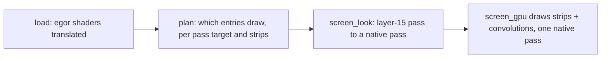

# Native screen effects

Status: Partly built. The scenario screen effects draw natively, with their convolutions; pixel identity with D3D needs a live check.
Code: `crates/rewrites/engine/src/screen_effects.rs`, `screen_effect.rs`, `function_eval.rs`, `glow.rs`, `screen_grid.rs`; `crates/rewrites/native-render/src/screen_look.rs`, `screen_gpu.rs`; `crates/extensions/game/src/native_post_glue.rs`, `native_post_load.rs`. Tests: `crates/rewrites/engine/tests/screen_effects_differential.rs`, `glow_differential.rs`, `screen_grid_differential.rs`.
Switch: `impl.render.native` (on), listed in [switches.md](../runtime/switches.md).

A scenario screen effect is an `egor` tag whose shader has layer-15 passes. The guest draws each one through `0x0002d140`; the host plans the same draws from the tag and the function values, and the native renderer draws them. The Rust body and its native pass are in [native-post.md](native-post.md#the-bodies); the call order is in [native-post-frame.md](native-post-frame.md).

| Piece | Where | Role |
|---|---|---|
| Entry gate | `engine::screen_effects` | which scenario entries draw, from function values |
| Function evaluator | `engine::function_eval` | `0x0013b390`, instruction for instruction |
| Effect plan | `engine::screen_effect::plan` | one `0x0002d140` call as an `Effect`: passes, strips, convolutions |
| Convolutions | `engine::glow::blur`, `glow::wide`, `engine::screen_grid` | the blur, the wide blur and its grid |
| Look | `native_render::screen_look` | a layer-15 pass as a native pass |
| GPU pass | `native_render::screen_gpu` | draws strips into view, target 1 and convolution targets |
| Load | `game::native_post_load` | translates every `egor` shader on a map load |

## What the guest does

`0x0002d140` runs with the function values (`0x00134fc0`) read at the call (Code, `h2 disasm`).

**The loop** (`0x00013a0d..0x00013b72`). The window `0x004b9dd0` is read as four floats twice (the corners). Per entry of the scenario block (`+0x3d0` count, `+0x3d4` address, `0x24` bytes) the entry is skipped when its tag datum `+0x14` is -1 or both function indices `+0x20`/`+0x22` are -1. Otherwise each index not -1 is evaluated by `0x00134fc0` (ECX the index; the function block `[0x004e6740]`, `0x20` bytes each, through the tag function evaluator `0x0013b390`) into two floats. With either non-zero, `0x0002d140(values, 2, 2, corners)` runs with EAX the datum (`ret 0x10`).

**`0x0002d140`** copies the four value words to `0x004c19b0..bc` and returns at once for a datum of -1, an empty window or a target override `[0x004858b8]` set. The datum is an `egor` tag; its shader reference (`+0x44`, a template through `0x00137bd0` when its group is `MTRP` or `3trp`) gives the implementation count. Per entry of its pass block (`+0x88` count, `+0x8c` address, `0xac` bytes):

| Step | What it does |
|---|---|
| Selection | the pass's implementation index (`+0x08`, -1 the loop index) and one of four bytes `+0x0c..0x0f` chosen by which of the two values are zero (-1: skipped) |
| Target | by `+0x60` (the jump table at `0x0002db68`: the view at full size, or a half or quarter of the window, `0x0001ddd0`) |
| Shader pass | `0x00016610(shader, 15, index, byte, ...)`, the shader's layer-15 pass (a template pass, as the world's and the transparents') |
| Strip | pushed by hand: `0x417fc` (`SET_BEGIN_END`, 6), per vertex up to four `SET_VERTEX_DATA4F` texture coordinates (kinds at `+0x50`, jump table `0x0002db78`: from the corners, the window over its size, or scaled by `[0x0045dbbc]`/`[0x0045dc20]`) and the position (`0x101a00`, z and w `[0x0045dd40]`). S: a strip of `2 x 2` vertices for the call's `(2, 2)`; `0x003fb480` ends it |
| Convolutions | per entry of its block (`+0xa4` count, `+0xa8` address, `0x5c` bytes): a size from the target's (`0x0001dd60`) times `+0x58`, at least 64 and its area capped at `0x12c00` by a square root (`0x00322b0c` rounds), targets `0x19`/`0x1a` (first) or `0x1b`; with flag bit 2 `0x00021360` (`engine::glow::wide`), else the blur `0x000211a0` (`engine::glow::blur`). The result is in `[0x00485a78 + 4 i]` |
| End of the call | targets 1, `0x19`, `0x19` and `0x1b` are set back, `[0x004670bc]` set, the draw state reset (`0x00016b10`) and `0x00485a78`/`7c` cleared |

No guest body runs: `native_post::screen_effect` is the call (`implement`), and hands the host EAX and the four stack words. The host plans the drawn passes, makes the call's size writes and its end, and draws the passes as one native pass; an input it does not cover panics, `post: screen effect: <cause>`.

## Which entries draw

`engine::screen_effects`:

- `function_value` (`0x00134fc0` and `0x00134fe0`) is the state's input plus its `+0x1c`. Without a parent (`+0x16` -1 or past the count) it is the function through `0x0013bb90`, its output range unless a flag in `0xf0`. With one (itself without a parent, else 0) it is the parent's value times its own raw value, then its range.
- `full_screen_single_view` (`0x00022710`): the viewport `0x00485648` is 0, 0, 480, 640 and at most one view `[0x004ba04c]`.
- `gated`, `corners` and `drawn` are the loop: each entry's datum and four values.

Tests: unit tests, and `engine/tests/screen_effects_differential.rs` (`0x00134fc0` over random functions of every type with parents, and the loop from `0x000139ba` with `0x0002d140` stubbed, against the lifted original, bit for bit).

### The evaluator

`engine::function_eval` follows `0x0013b390` instruction for instruction, in SSE with the original's operand order, so a NaN keeps the sign and payload the original's does (the blend is `second * r + (1 - r) * first`, type 9's `(1 - r) * first + second * r`).

- Shape `0x0017ca10` and wave `0x0017c900` read the image's tables, with the CRT `fmod(v, 1.0)` (`0x00373b6a`: `fprem` for finite non-zero, `fldz` for a zero, a quieted NaN, the indefinite for an infinity) and an x87 `fistp`.
- Type 9 and spline 2 use the CRT `pow` (`0x00372d48`) on the x87 model: `fyl2x` and `0x00327f84`'s `frndint`/`f2xm1`/`fscale`. Negative bases follow `0x00372f31`'s integer and odd test, zero bases and NaNs (`faddp`) their own cases, infinities `_powhlp` (`0x003738a8`), with the range check `0x0032806d` (scaled by 2^1536 or 2^-1536) and `_handle_exc` (`0x003246b5`): overflow to the rounding mode's infinity or largest value, underflow to a denormal by truncation or zero, the others kept.
- Spline 2's exponent is `rsqrtss` of one segment's squared length times the halving-trick root of the other's, as the original computes it.
- Control words with an x87 exception unmasked are refused.

Tests: unit tests, and the differential above with `_getptd` (`0x00326079`) stubbed so the CRT's error paths run lifted.

## What each effect draws

`engine::screen_effect::plan` turns one call of `0x0002d140` into an `Effect`:

| Part | Content |
|---|---|
| Shader and count | the shader and layer 15's implementation count (the template datum the shader's `+0x24` points at, its definition's `+0x5c` element: the word at `[+4] & 0x1ff`, then the word that many plus 15 into `[+0xc]`, its high 7 bits). `Err(Data)` for `MTRP`/`3trp`, which go through a virtual call |
| Per drawn pass | its index, implementation and selector (`0x00016610`'s third and fourth arguments; skipped as the original skips them), its target kind and target 1's size (window width and height, halved or quartered toward zero) |
| Strips | per row of corners, per column the corner and the one below; four texture coordinates by kind (0 the corner's uv, 1 the window fraction, 2 pixels from the window's top left, 3 the corner's x and y, 4 the vector at `[[0x004687c0]]`; z 0 and w 1 except kind 4). Plus the offsets `+0x5c` when `+0x58` is above 0, u and v times `[0x004b9de4]` when the set's flag bit 0 is set. The position is raw, from the window's top left, or that times `[0x0045dbbc]` or `[0x0045dc20]`. `Pass::pushed` holds the exact words |
| Convolutions | kept, the blur with `glow::blur`'s draws, or `0x00021360`'s registers and arguments, each with its size (the area cap: x87 `fild`, `fdivr`, `fsqrt`, `_ftol2` toward zero, both 64 when either side is under 64) |

At the end the original sets target `0x19` twice, the second time to `0x1a`'s saved size (as it does; a native draw need not copy it). Tests: unit tests, and `effect_plans_match_the_lifted_original` (`0x0002d140` lifted, its callees stubbed and recorded: the template passes, every size set, the convolution calls and the words pushed must be the plan's).

## The wide convolution

`0x00021360` (`engine::glow::wide`) is the blur's sibling (Code). EAX is the source, ECX the draw count, XMM0 a scale, then stack words passed to each draw: the two buffers, the last target and a byte that first sets the combiner `0x00020f30` (XMM0 0, XMM3 its eighth word), `ret 0x20`. `s = scale * [0x0045e4e0]`.

Per draw (count above 0) the source is bound to stages 0..3 (`0x00014f60`, the blur's sampler states) and `0x00034d90` draws into the destination with EDI pointing at `s`, `s * [0x0045e1f4]`, `s * [0x0045e4dc]` and `0 - s`. The buffers ping-pong as the blur's and `s` grows by `[0x0045dc0c]`. The result and the copy into the last target are the blur's, and `MAX_WIDE_TAPS` (64) bounds it.

`0x00034d90` is `0x00034a90`'s sibling: the target's size (`0x0001dd60`, -1 the bound one `[0x004858b8]`), the target's rectangle or the window by a byte argument, the per-stage size ratios (`0x00485af4`/`0x00485b04` over the target's) and EDI's four floats where `0x00034a90` takes a spread. The grid's strips give the four moves of each tap.

Tests: unit test `the_wide_convolution_ping_pongs_with_a_growing_scale`, and `glow_differential::wide_matches_the_lifted_original` (stubbed as the blur's: draws, offsets, the quad's stack words, combiner, copy and result).

### The grid

`engine::screen_grid` makes the grid each step of `0x00021360` draws: 30 strips of 21 x 2 vertices (`0x00034770` with the attribute function `0x00034100`). Each tap is the rectangle at (u, v) pulled toward its centre by its EDI float.

It is weighted, when the radii (words 5 and 6) differ, by where the vertex's distance from the centre (x87 `fsqrt`) falls between them, times the stage's bound-over-target ratio, and the position goes through `0x000350e0`. The result is a radial (zoom) blur. `strips()` and `pushed()` give the exact words. Test: `screen_grid_differential::the_grid_matches_the_lifted_original` and unit tests.

## The look of a template pass

`native_render::screen_look`:

- `screen_look` takes the egor's shader resolved plus a layer pass and implementation and gives that pass of layer 15 (at the first level of detail): its vertex shader, stages as the shader's bitmaps or engine textures the draw supplies, stage and render states, pixel shader and constants.
- It names the reason a pass stays on D3D: no layer, no such pass or implementation, animated, engine inputs beyond the instance's, engine-driven states from a source other than the instance's scalar 21 (`engine_states::apply_static`), unset or default textures, a lightmap, or states the native pass does not fit.
- `compile_screen` translates it through `program::translate_pass` over the strips' inputs: `v0` the position and `v1`..`v4` the four texture coordinates (`0x00101a00`, `0x00101a10 + 16 s`).

### Which pass, implementation and program

`0x00016610(shader, layer, pass, implementation, target, flag)` (Code): the layer's passes are the template's word at its layer index (low 9 bits the first, high 7 the count, which is `screen_effect::Effect::implementations`). `pass` -1 draws them all, else that one (`screen_effect::Pass::implementation` names a layer pass), each with implementation `implementation` (`Pass::selector`; `0x132` bytes each, the vertex shader at `+0x100`, -1 not drawn).

After `0x0001bbf0`, `0x0001c590` loads that vertex shader with classification 0 (`0x0001c2e0`, `0x1c` bytes per classification). The load translates only the first program (`screen_look::SCREEN_CLASSIFICATION`), per (layer pass, implementation). `effects\screen_effects\blur` has two layer-15 passes (`copy_fb_to_texaccum`, `copy_texaccum_to_fb`), so a layer with several passes is accepted.

What the real egors (`blur`, `desaturate`) show the look must take:

- Their passes set `ZENABLE` 0 and no ZWRITEENABLE. `pass_state` takes the depth buffer off as enough; a screen pass testing or writing depth is refused (`ScreenRefusal::Depth`).
- `screen_xform_4` moves `v5`, `v6` and `v7.w` into the colours and fog, registers the strips do not push. `compile_screen` gives them the uniforms' defaults only for a pixel side that reads no colour or fog (`screen_look::reads_vertex_colours`, which also counts a missing final combiner as reading them).
- The WGSL writes no depth (`PassParts::w_buffer` off).

### The engine textures

`0x00019530`, the jump table at `0x00019b68` by id - 1 (`native_render::screen_look::engine_texture`):

| Id | Source |
|---|---|
| 1, 9, 14, 15 | the rasterizer data's bitmaps (`+0xc`, `+4`, `+0x14`) |
| 2, 3 | target 1 (via `0x00014f60`) |
| 6 | target 3 |
| 8 | target 10 |
| 13 | target 9 |
| 17, 19, 20, 21, 22, 23 | targets `0x13`, `0x15`, `0x16`, 13, `0x11`, `0x17` |
| 5 | the view's bound target `[0x004858b8]` |
| 24, 25 | the target the word `[0x00485a18 + 4 id]` names (`0x19`..`0x1b` sized through `0x0001dd60`: the screen effects' own targets) |
| 4 | clears the stage |
| 10, 12 | the light's |
| 16, 18, 27 | chosen at run time |
| 26 | a bitmap parameter of the drawn shader, bound by the material resolver (`tags::material::PROPERTY_BITMAP_TEXTURE`) |
| 7, 11 | null entries |

A template pass binding the light's, a run-time one or an invalid id is refused (`ScreenRefusal::EngineTexture`); the rest the draw supplies.

### The call's engine constants

`screen_look::ScreenConstants`: `0x0002d140` copies its four values to `0x004c19b0`, and the scalar evaluator `0x000336f0` (its table at `0x000338d4`) returns `[0x004c19b0]` for scalar 41 and `[0x004c19b4]` for 42 (`screen_look::SCREEN_SCALARS`), so a pass reading those is supplied. The blur's `copy_texaccum_to_fb` reads 41 into `c0.a` (pixel mode 3), the mix of its two stages, and sets `c18`..`c21` from its stages' sizes (vertex modes 14 and 15 of stages 1 and 2: `[w, 0, 0, 0]`, `[0, h, 0, 0]`), which carry its coordinates into texels.

Per call the pass gets each combiner constant reading a value, packed as `0x00019ca0` packs it (the binding's transform, then `pack_engine_colour`, into its lanes). It also gets each vertex constant reading a value or an engine stage's size, evaluated as `0x00019be0` evaluates it (`tags::material::EngineVertexConstant`, from the `spas`, keeping what no later binding of the register writes). The size is the guest size of the target the stage binds (`screen_gpu::stage_sizes`: the view's, target 1's as the call drew it).

The rest stay as resolved at load: the instance's scalar 21, the pixel side's sizes (`0x00019ca0` takes 1 by 1) and a bitmap stage's size. A vertex register the resolver took from the engine that no external of the implementation names is refused (`ScreenRefusal::EngineVertexConstants`).

## The GPU pass

`native_render::screen_gpu` translates the layer-15 program at the target's guest size with the live draw's depth scale. Engine stages read the view, target 1 or a convolution result; a stage reading the view takes an ordered copy before the pass. Each attachment uses its live format and loads existing contents, so partial strips, colour masks and consecutive writes preserve the surrounding pixels.

Once a strip pins the view slot, the call can finish on target 1 or a convolution stand-in. The wide and blur calls at `0x0002da77` and `0x0002da96` precede the guest size restores, and the final bind does not redirect the earlier strips. A call that draws only into side targets runs natively when all its stage sizes, sampled textures and convolution sources are independent of the view. A view dependency without a view strip stays on D3D (`ViewTarget`), as does a target 1 pass without a positive size (`PassTarget`).

**Target 1** (`screen_gpu::Dest`). A pass of kind 1..3 uses slot 2 at the window's size, a half or a quarter. Engine textures 2 and 3 can sample that output in later passes of the call. Reading target 1 before the call draws into it, or while the same pass writes it, refuses the replacement.

**The end of the call draws nothing** (`0x0002dae8..0x0002db64`). `0x0001ddd0` writes the sizes of targets 1, `0x19` and `0x1b` back into the target table (`+0x80`, `+0x84`, the surface words `+0x14`, `+0x28`) from what `0x0002d26e..0x0002d344` saved on entry (0 for a target without a surface; `0x19` is written twice, the second time with `0x1a`'s saved size, and `0x1a` never). `0x00016b10` applies the last pass's restore states and clears the draw-state cache at `0x00485b48`, `[0x004670bc]` is set and `0x00485a78`/`7c` cleared. The game runs this on both paths, and the backend records into the physical surface each original draw used, even when the tail changes the guest size fields.

### The blur's convolution

`screen_gpu::ScreenConvolution`, `native_post_glue::screen_convolution`. `0x0002d140` calls `0x000211a0` with its seventh word 1 and the eighth to tenth 0, so the combiner is `0x00020f30`'s at strength 0 and `y` 0 (`engine::glow::blur_combiner`). Each quad goes through `0x00034a90` with its tenth argument 0: the window's rectangle in the target's pixels, four taps, each stage's coordinates scaled by its source's size over the target's (`0x00034bf7`..`0x00034c27`). The quad is the one `glow::quad` gives the glow's, drawn by the glow's `glow::QuadDrawer`.

The quads bind the live levels `0x19`..`0x1b` (slots 3..5), and engine textures 24 and 25 resolve the results in the order the call produces them. A convolution whose colour state or source differs keeps the original draws.

### The wide convolution on the GPU

`screen_gpu::ConvolutionGrid`, `native_post_glue::wide_grid`, `grid_of`. `0x0002d140` passes `0x00021360` the words `+0x50`, `+0x54`, the convolution targets, -1, 1, 0, 0. Its combiner is the blur's (`0x00020f30` with XMM0 0 and XMM3 its eighth word, 0) and its stages are bound as the blur's (clamp, linear). Each draw is `0x00034d90` (`0x00021455..0x00021485`) with the same screen vertex shader (`0x0001c590`) and states as the quad's: the window's rectangle (word 7's low byte clear), depth `1.0`, the two words its radii and EDI the draw's offsets.

Each stage's ratio is the size `0x00014f60` bound the source at (`0x0001dd60` of it: the pass's target as the call sized it, `screen_effect::target_size`, or a convolution target at the pair's size) over the target's. The glue makes each draw's 30 strips of 42 vertices with `engine::screen_grid::strips` (the original's arithmetic, under the call's MXCSR and x87 control word), the taps in texels of that bound size. `glow::QuadDrawer::draw_grid` draws them through `glow::GRID_VERTEX` (attribute 0 the position in the target's pixels, 1..4 the taps; z and w ignored as the quad's are: no depth test and w the same at every vertex) and the blur's combiner with its stages scaled by the bound size. Each strip is a range of the call's pass into the target's slot.

A grid that cannot be made keeps the call on D3D (`Missing::Wide`), as does a missing frame, and a grid with a strip under a triangle is refused (`ScreenRefused::NoStrips`). A wide convolution is armed whenever the native post is.

## The load

`game::native_post_load` resolves every `egor` tag's shader (the definition's `+0x44`), looks at each implementation of each of its layer-15 passes, translates it with its vertex shader's classification-0 program and decodes the stages' bitmaps. Refusals are counted by reason with one line on stderr.

The post glue runs it on a thread of its own at the first screen-effect call on a map load (`native_post_glue::EffectsSlot`, keyed by the map's name and `native_map_work::generation`, so a map opened again loads its effects again), with or without the native world.

## Rules and limits

- Screen-effect residency follows the loaded effect set, including its feedback copies and convolution programs. The screen and glow drawers cap the raster variants they retain per program.
- The menu and gameplay call `0x0002d140` with different bound targets and grid sizes, so a menu A/B with no committed screen replacement shows identical images. `H2_FRAME_STATS` includes the native post examined, suppressed, refused and recorded-range columns.

## Not verified

- Pixel identity of the same view and call with `impl.render.native` on and off (fixed save, view and time, captured through `H2_BOOT_GFX` or the agent API's `render.frame`): the glow and screen replacements commit with no unexpected refusals or replays, and every changed intermediate, its next D3D consumer and the final image match.
- The cost of `render_screen_effects` against a D3D measurement.

## Related

[native-post-hud.md](native-post-hud.md), [native-post.md](native-post.md), [native-post-frame.md](native-post-frame.md), [shaders.md](shaders.md).
