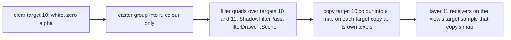

# Native shadows

Status: Built. Replaces sorted BSP and model draws in layers 10, 11 and 14 at any render scale, draws whole groups of all three layers from the scene without guest geometry handlers, and replaces the object filter's quads; pixel parity and timing are not verified.
Code: `crates/rewrites/render-bridge/src/native_shadows.rs`, `crates/extensions/game/src/native_shadows_glue.rs`, `native_shadows_scope.rs`, `native_shadows_draw.rs`, `native_lights_glue.rs`, `crates/rewrites/native-render/src/shadows.rs`, `shadow_gpu.rs`, `shadow_look.rs`, `shadow_scene.rs`, `shadow_filter_gpu.rs`, `shadow_chain.rs`, `crates/extensions/game/src/native_shadow_chain.rs`. Tests: `crates/rewrites/native-render/tests/shadow_gpu.rs`, `native_render::shadow_look`, `shadow_scene`, `shadow_filter_gpu`, `light_gpu`, `crates/rewrites/render-bridge/tests/native_shadows.rs`, `crates/rewrites/engine/tests/shadow_constants*.rs`.
Switch: `impl.render.native` (on), listed in [switches.md](../runtime/switches.md).

| Layer | Target | What it draws |
|---|---|---|
| 10 | 9 (depth map) or 10 (object mask) | casters, from list 2 (`0x004c1a78`) |
| 11 | the view's target | receivers, from list 1 (`0x004c1a60`) |
| 14 | target 1 and the shared depth surface | receivers when list bit 14 asks |

The shadow draw stage consumes the gathered lists from [native-light-gather.md](native-light-gather.md). It keeps template selection, material setup, push-buffer decoding and vertex resolution, and replaces the resolved draws with independent GPU packets recorded into the D3D frame. A draw the stage cannot prove stays on D3D. Part of [native-renderer.md](native-renderer.md); the light path it sits in is [native-lights.md](native-lights.md).

At each layer's build, a whole scene group instead goes through `shadow_look` and `shadow_scene`: structure and model parts compile from the map, the group's projection fills `c[40..48]`, and `native_lights_glue::shadow_alone` seals the packet run before the guest entry loop is emptied. Receivers bind the boundary's frozen map. The guest's target begin, clear and end still run.

An object mask drawn alone takes a private chain: its casters, filter quads and final copy go into a pair the stage owns, and its receivers bind that mask with no freeze ([native-shadow-layers.md](native-shadow-layers.md), "A private chain"). The object shadow list `0x000335e0` is a cut producer (`render_bridge::cut`, row `object_shadows`): the Rust list answers every call and its layers draw in slot 3 before layer 7. A list, row gather or caster it cannot take is `scene_dropped_object_shadows`, never a guest body or a D3D draw.

## How it works

### Caster enumeration and projection

`0x00044383` selects list 2 for layer 10 (`0x004c1a78`). The descriptor's OR word at +8 supplies scene bit 10. Layers 11 and 14 draw list 1 (`0x004c1a60`).

Each list has an independent active interval [first, count). Its layer mask selects candidates. A build can reject an item, the game sorts the surviving entries, and the entry loop drops an entry whose section is unavailable.

The geometry chooser `0x00030cd0` excludes render-record bit 10. With a matching template, BSP uses implementation 2. Models use 0 for the small colour mask or 1 for depth.

Alpha kill in a material can punch holes in either silhouette. A query-counting draw and unknown build/draw pairs stay on D3D.

`0x00048ee0` produces 36 words at `0x004c9798`, uploaded to hardware vertex constants 40 through 48. Layers 10 and 11 admit a range only when all 36 floating-point words match bit for bit with the resolved draw's constants. The range recorder uses the same vertex program, constants, winding, streams, depth/stencil state and scissors as the resolved draw.

- **Depth map.** Target 9 pairs the colour alias with a D24S8 level, cleared to depth 1 and stencil 0. `0x000495e0` enables solid polygon offset. Its constant offset comes from the float at `0x0045e46c`, its slope from `0x0045dc0c`. Pass bit 4 selects the depth clip control. `0x000496a0` restores the state. A shader writing W depth already applies the bias and disables the extra pipeline bias. The sampled result encodes D24 in RGB, most significant byte first, and stencil in alpha.
- **Object mask.** Pass bit 4 set with bit 5 clear selects target 10, with white RGB and zero alpha as its clear. It is a colour texture. The receiver reads the filtered mask after the game finishes the intermediate passes.

### Application and layer 14

Layer 11 retains `0x000496f0`'s `GREATER` shadow comparison (stored depth greater than projected reference), per-stage filtering/addressing, receiver shader, inherited stencil test and per-channel writes. The layer end restores the shadow comparison.

| Implementation | Sampled input | Effect on a passing fragment |
| --- | --- | --- |
| 0, 1, 6 | One or three projected samples of engine texture 13 and the gel at 10 | Write alpha only, blending off, equal depth, depth writes off |
| 2 | Gel | Same alpha-only write |
| 3 | Depth map at 13 | Multiply destination RGB by source RGB, alpha test GREATER, equal depth, preserve destination alpha |
| 4 | Filtered colour mask at 8 | Multiply destination RGB by source RGB, equal depth, preserve destination alpha |

The colour passes use source factor destination colour, destination factor zero, and ADD. The material chooses the shaders and combiner constants. The engine selects the receiver implementation from its flags, definition bit 5, material word at +0x3e and record bit 10. The original per-draw stencil reference, read/write masks and operations reach the same depth/stencil attachment.

**Layer 14 can draw.** List bit 14 requests target 1 and the shared depth surface. The caller resets stencil before drawing. The mask tested by `0x00044550` includes bit 14. `0x00015d70` chooses implementation 0 for a present layer-14 template, and the geometry builder passes it through. The stage records these ranges for shadowed lights at the verified target; other implementations, targets and callbacks keep the original draw. The light graph keeps this pass before 12/13 whenever the list requests it.

### Object chain

`0x000335e0` requires an active, checksum-matched lightmap with a bitmap (`0x000226d0`) and permission from the render override (`0x000335c0`). It enables object-shadow mode and sets up target 9 at 256×256. `0x00033400` walks the view's objects.

Mode 0 accepts all list flags, mode 1 requires bit 14 and mode 2 requires bit 15. Other modes admit none. It takes the first 32 eligible objects.

Eligibility and projection have separate tests:

- `0x0003d7f0` tests body byte +6 bit 0 (must be clear). Object
  definition word +0x18 selects mode 0 for bipeds and vehicles, or mode
  2 for any type. The fade comes from the scaled camera distance, the
  model's distance thresholds (`0x0004baf0`), and for units, body
  +0x2b0. A biped with body +0x10a bit 2 also has a tick-based fade.
  An attached object that fails its own test can inherit the parent's
  result.
- The 20-byte gather row carries the object in both the history key and
  caster slots, the eligibility fade and a projected-radius priority.
  The per-view history (`0x0003359b`, `0x000335ad`) targets four
  objects with a fade step of 0.005 and returns its current fade in the
  row. Fading entries can still reach the draw. Before accepting
  `0x00032350`, the observer verifies the list’s caster return site and both mode
  bytes. It checks ESI and the EDI countdown against the ranked rows above
  the saved registers in this call’s frame and matches both arguments
  against row words +8 and +12 (caster and fade).
- `0x00032350` tests eligibility again, requires a root object (body
  +0x14 is the none handle) and requires shadows enabled. The visibility
  check `0x0003d7c0` rejects a chain with object-header +2 bit 4 or
  body +4 bit 0 set. Creature type 12 takes `0x00032ce0`, which tests
  for a ground hit and draws separate geometry. In the main mask branch,
  `0x00031f50` expands the caster's extents over its descendants and
  `0x000320b0` checks the resulting transformed bounds.

**Direction and strength.** `0x0003dc90` selects the default lighting
sample at the default record's +0x1c for body +7 bit 0. Otherwise it follows an attachment to its root and returns render-cache entry +0x54 when the entry is valid (byte +3 set). The mask branch requires a sample.

Its +0x0c vector becomes the projection's **forward**, along the cast shadow: `0x00032493` copies it, `0x000324b1` normalises it, and `0x00032905` passes that frame to the shadow setup. The receiver's hardware `c[41].xyz` is the opposite, toward the light (`0x00048f85`, `engine::shadow_constants`).

The sample's +0x1c must be positive. `0x00032438` multiplies it by the current eligibility fade and the ranked fade, and requires the product to exceed 0.09. `0x00032912` publishes that product as the light weight.

In the lighting-cache copy used by object materials the vector and scalar are at +0x1c and +0x2c respectively. The sample producer's default path sets the scalar to one (`0x000d4682`). Its tuned path evaluates a tag function from a clamped weighted colour at the caster (`0x000d3e46`, `0x000d3e92`).

Neither path measures brightness at the receiver. `engine::render::object_shadow::{Candidate, Lighting}` reads the gather row and resolved sample in `crates/rewrites/engine/src/render/object_shadow.rs`.

The main branch sets pass flags `0x14`, renders the layer-10 silhouette, calls `0x000222a0` for the two filter passes through targets 10 → 11 → 10, and applies layer 11 with the filtered target 10. The native freeze is ordered at the start of 11. A native caster can therefore share its map with D3D casters and with the guest filter.

`light_gather::object_shadows::caster` drives admitted mask casters through projection setup and the tail at `0x0004a780`. A refused caster runs the guest function whole, including creature shadows. `object_shadows::run` restores both mode bytes after the last caster.

Each object and each additional-caster suffix at `0x00030ed0` starts a new generation.

### The object shadows from the scene

`render_bridge::native_lights::object_shadow_scene` gathers the open view's object shadows (each `0x00032350`: its layer 10 and 11 groups and the filter between them) and hands them to the host in slot 3, ahead of layer 7's draw (`native_layers::before_layer`). The game host (`native_lights_glue`'s `draw_object_shadows`, `native_lights_glue/scene.rs`, `object_ops`) makes each shadow one external sequence, committed whole or not at all:

Under the scene path (`native_lights::scene_path_ready`) the caster body `0x00032350` (`engine::render::light_gather::object_shadows::caster`, `run_with`) stops after its item lists `0x00040e90`: its layer 10 begin, draw and end, the filter `0x000222a0`, layer 11 and the tail `0x0004a780` do not run. The volume, records, constants and shadow setup before them still run, so the lists, pass flags, definition and projection block are this caster's. `object_shadow_scene::cut` then plans the shadow from them as the cut light passes plan theirs (`typed_groups::plan` with `GroupSite::ObjectShadow`): layer 10 into target 10 and layer 11 on the view's target, when the casters hold layer 10 and the receivers layer 11, with the published weight and the filter `scene_extract::light_groups::shadow_filter` computes.

A shadow that does not plan is `scene_dropped_object_shadows`. Off the scene path the guest body draws its own layers and the host is not asked, so each shadow draws once. A creature's ground shadow, a shadow that is not a mask caster followed by its receivers, or a caster region off its target's corner refuses the shadow.

`the_cut_casters_object_shadow_groups_equal_the_guests_layer_build` (`native_lights/walk.rs`) checks the planned groups against the guest's layer build.

### Shadow entries

Layers 10, 11 and 14 take the same entries as diffuse and specular:

| Entry | How the shadow layer draws it |
|---|---|
| visible subparts | the spans' native ranges, a draw of its own (`light_scene::plan_entries`); a range at an odd strip start with the front face reversed (`split_wound`, `Planned::cull`) |
| state (`frame_scene::EntryState`) | `native_lights_glue::entry_state`: the toggle's rows on a model entry, an unmasked fade and the structure's upload while the device holds them, else the light is dropped (`scene_dropped_light_host`) |
| a LOD and pass selector | the material's pass at that level and selector (`shadow_look::shadow_look`, `receiver_look`), keyed by it in the resolver (`materials::Variant::selection`); a level or pass the material lacks is a named refusal (`LightRefusal::NoLayer`, `NoPass`) |

## Interfaces

`native_render::shadow_gpu::Producer` accepts the ordered caster batches on their encoder and returns a generation-owned `SampledMap`. The GPU differential (`crates/rewrites/native-render/tests/shadow_gpu.rs`) compares all four channels, including stencil for D24.

The guest targets hold the result of all admitted and fallback casters. Boot publishes a handle at the matching layer-11 boundary through `boot::native_shadows_glue::observe_receivers(Some(observer))`. The observer receives a `ReceiverTerm` with the present, view, caster generation, site, identity (light and definition datums or both object arguments), projection, map kind and guest texture header. The consumer stores the handle in its ordered graph node during the callback, because the guest memory guard is held and calling back into the runtime would reacquire it.

The consumer resolves `term.sampled()` in render order, after the caster/filter freeze, on the same device. `None` keeps that light's original chain. For `MapKind::Depth`, `SampledMap::shadow_stage(linear, address)` supplies the D24 comparison input for the NV2A pixel translator, for every stage occurrence the receiver requests, with its gel, colour mask, stencil and blend state.

For `ColourMask`, the frozen colour view binds at the receiver's engine-8 stage. Retaining the handle keeps one generation alive across target reuse. An unshadowed light has no handle.

The shared sorted point is `LIGHT_GEOMETRY_DRAW` at `0x0004d0b0`; its seven stack arguments and 28-byte return are declared in `engine::points`.

## Rules and limits

Range admission requires the original sorted entry, matching shader and part, a proven target and pipeline, and every texture and scissor range. A missing freeze or resource, a changed owner or projection, a pending guest callback or an incomplete external recording leaves the draw with D3D. A scaled view draws its shadow layers from the scene like an unscaled one, and the device side records on each target copy at its own size: a range's scissors scale with `RenderScale` from the guest surface to the copy, `Freeze` and a private chain's filter keep one map per copy size (`native_shadows_draw::Maps`), and a private chain owns one `Pair` per copy (`Pair::scaled`, whose filter quads stay in guest units).

The mixed GPU fixture runs a shadowed receiver, guest draws and a typed diffuse/specular light on one target. It compares the pixels against seven original D3D draws. A missing shadow map keeps its receiver on D3D.

Missing specular indices return both layers of the typed light to their guest slots.

## Not verified

- Pixel parity against D3D for the layer 10, 11 and 14 replacements, on the Old Mombasa level and on the E3 lighting setting at render scale 2.
- Object filter and application sites that those scenes do not exercise.
- The frame cost of row gathering, mask setup, decoding and per-range preparation.

## Related

[native-lights.md](native-lights.md), [native-shadow-layers.md](native-shadow-layers.md) (the design for recording these layers from the scene), [layer-draw.md](layer-draw.md), [e3-lighting.md](e3-lighting.md), [native-ab.md](notes/native-ab.md).
