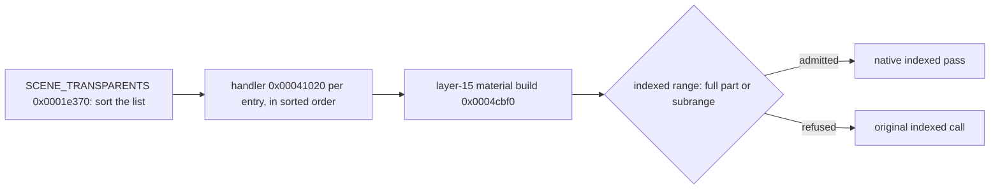

# Native renderer stage 3: transparents

Status: Built. Sorted transparent geometry draws keep their guest handlers; the standard emitter submits full parts and selected subranges through the native indexed pipeline. Pixel parity and the time saved are not verified.
Code: `crates/rewrites/render-bridge/src/native_transparents.rs`, `crates/extensions/game/src/native_transparents_glue.rs`, `crates/rewrites/native-render/src/transparent.rs`, `transparent_streams.rs`, `world_layers_gpu.rs`. Tests: `crates/rewrites/render-bridge/tests/native_transparents.rs`.
Switch: `impl.render.native` (on), listed in [switches.md](../runtime/switches.md).

After the opaque layers and late passes, `render_scene_passes` calls `SCENE_TRANSPARENTS` (`0x0001e370`). The call sorts its own list and invokes one handler per entry; the geometry handlers set up their layer-15 passes and depth-test against what the opaque layers left. The stage lets every handler run and offers each standard indexed range to the native renderer. Part of [native-renderer.md](native-renderer.md).

| Section | Covers |
|---|---|
| The list | the sorted entries and what a geometry entry carries |
| Admission and order | what the stage accepts and the order it keeps |
| Vertex bindings | the packed stream cache and its counters |
| GPU submission | the shared uniform arena and repack plan |

## Stage 3: transparents

### The list (Code, `h2 disasm`)

- `[0x004b6288]`: entries of `0x70` bytes, the live ones from index `[0x004b6284]` to `[0x004b6280]` (at most `0x400`), allocated by `0x0001e2d0` (and `0x0001e4e0`/`0x0001e5e0` for other kinds).
- `0x0001e370` fills the `u16` index array `[0x004b628c]` and sorts it
  with `TRANSPARENT_SORT` (`0x0013df80`). Comparator `0x0001e700` uses
  class `+0`, the plane at `+0x10` when either entry has `+0xc` set,
  and otherwise depth `+4` then the integer key `+8`. The dispatcher
  calls `[entry+0x20]` with `entry+0x24` for each index in order,
  skipping a null handler.
- A geometry entry (`0x00041040`'s transparent branch, `0x00041381`):
  `+0` a class from `0x00040e10`, `+4` the view depth, `+0xc` a byte
  (plane present), `+0x20` the handler `0x00041020`, `+0x24` the shader
  datum, `+0x28` the argument the opaque items carry at `+0xc` (render
  record index `<< 8`, low byte the part), `+0x64` the position.
- The handler `0x00041020` (`points::TRANSPARENT_GEOMETRY`, `ret 4`) runs
  `0x00040f60`: the shader's template layer-15 pass range (`[template
  layers + 0x1e]`, `count << 9 | first`), and per pass the opaque path's
  build `0x0004cbf0` and, when it returns non-zero, the draw `0x0004d0b0`
  (with layer `0xf`). So an entry is drawn exactly like an opaque item,
  but with layer 15's passes, one entry at a time in sorted order.
- The render record at `+0x28 >> 8` says what the geometry is: `+4` an
  object's render model datum (the object itself through `+0x10`, as in
  the objects stage), or `-1` for the BSP with `+0xc` bits 9..17 the cluster
  and 18..28 the instanced-geometry placement (`0x7ff` for a cluster;
  "What a world pass reads").

Effects, particles and contrails use their own draw boundaries in [native-particles.md](native-particles.md).

### Admission and order

The standard handler runs its layer-15 material builds, bindings and restores. The sorted ordinal must resolve to its live entry, and the emitter and handler frames must identify that entry's draw. The full-part branch supplies its range in registers. The three subrange call sites supply the topology, index count and pointer on the stack after state setup.

Each triangle list or strip goes through the existing indexed pass with the resolved shaders, fog, blend and depth state and the current attachments. The resolved packet supplies the live inputs even when the item's object lighting owner is unavailable. A triangle list keeps trailing indices in its snapshot and rasterises complete triangles. Admission preserves the order of the individual ranges and the handlers between them. A refused range runs its original indexed call, which can still use the immutable vertex binding adapter.

Camouflage and hologram use the same indexed path for ranges that reach the guest emitter. The indexed API return and two nested return sites identify the emitter and layer dispatcher, and the live layer must match the layer argument. The handler's return address identifies its regular layer replays or the specific draw of layer 18, 19 or 21.

Layer begin, material state, texture snapshots and target changes execute in their original order. Items already admitted by `frame-scene.layers` never reach this path. A sealed frame retains each replacement beside its original indexed packet and resolves the sampled textures for that replay. When a verified camera moves between ticks, the replacement uses the same updated constants as the original packet.

### Vertex bindings

`native_render::transparent_streams` packs multiple immutable streams into one buffer when their live declarations and strides allow it. It keeps the raw guest bytes, including packed normals and normalized endpoints. The cache uses immutable stream snapshots and the exact declaration, scoped to the game activation and active BSP. A transparent view can use the cache before any layer-3 item. Object entries pack only when the objects stage is on. Object inputs and node rows come from the actual draw, as do cluster and placement inputs. The resident opaque world uses a 96-byte vertex. Its layer-3 declaration binds `v6` as `Float32x2` for lightmap coordinates or `Unorm8x4` for baked colour.

The `indexed draws with native bindings` log counts accepted draw bindings since startup and reports every 1,800 acceptances. The `native_transparents_cache_hits` and `native_transparents_cache_misses` frame counters track reuse and packing attempts.

### GPU submission

The ordered draw path batches uniforms in the renderer's upload arena and reuses texture and sampler groups keyed by the live views and samplers. The packed vertex buffer can stay on the GPU across views. No transparent draw allocates its own pair of uniform buffers and group.

The ordered indexed path shares one repack plan between shader translation and buffer preparation and keeps up to 256 layout and stride combinations per cache. The fallback adapter checks the packed byte count before allocating an interleaved buffer.

## Rules and limits

Guest handler and state-resolution costs still apply. A refusal leaves the original D3D draw in place.

## Not verified

- Pixel comparison of the same Old Mombasa frame with `impl.render.native` on and off, with other switches and capture settings equal.
- That the stage reports native bindings, and the time of the `0x0002c19a` site.

## Related

[native-renderer.md](native-renderer.md), [native-world.md](native-world.md), [native-objects.md](native-objects.md), [native-particles.md](native-particles.md).
