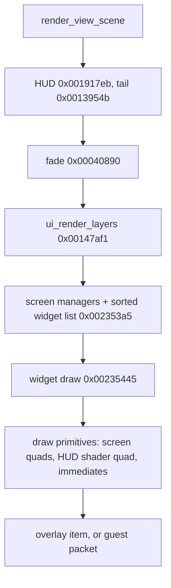

# Native UI: the guest's draws and where Rust takes them

Status: Partly built. Supported UI and HUD draws go to the overlay at their producers; widgets the overlay does not read keep the guest's draw packets.
Code: `crates/rewrites/render-bridge/src/native_hud.rs`, `native_hud/`, `crates/extensions/game/src/native_hud_glue.rs`, `crates/rewrites/native-render/src/hud.rs`, `ui_gpu.rs`. Tests: `crates/rewrites/render-bridge/tests/native_hud.rs`.
Switch: `impl.render.native` (on), listed in [switches.md](../runtime/switches.md).

The guest selects the visible screens and widgets, sorts them, and sets up layout, animation, text shaping, bitmap selection and shaders. Rust takes the draws at the producers below, and the overlay stage draws them. [native-hud-overlay.md](native-hud-overlay.md) covers the HUD, [native-menus-overlay.md](native-menus-overlay.md) the menus, the fade and the blur.

## Where they are drawn

`render_view_scene` (`0x0002ba10`) calls `0x001917eb` at `0x0002bc93` when `[0x004b9ed8]` (the view's user) is not -1. It asks `0x0014de70` and `0x00159170` for the user's unit, draws per-user overlays (`0x0019188c`, `0x00192129`, `0x0024da7d`, `0x0024cf66`) and tail-jumps to the HUD render `0x0013954b`. Then come the fade `0x00040890` and `ui_render_layers` `0x00147af1`, which the alternate view `0x0002c790` also calls at `0x0002c884`, as does `0x0002c8a0` at `0x0002c9bc`.

`0x00147af1` takes the user in EAX (-1 every user, the word at `[ebp+8]` when EAX is -1), stores it at `0x0054d598` and returns early when `0x00155f60` says so. For an index 0 to 4 it calls the render slot (`+0x14`) of three layer objects (`0x0054d62c + 0x40 * index`, `0x0054d76c + 0x38 * index`, `0x0054d884 + 0x38 * index`).

Index 4 also draws the screen managers around them (`0x00234f8c` on `0x0054d5c4` and `0x0054dba8`, `0x0023583e` on `0x0054d9e0`, `0x00234f8c` on `0x0054d99c`). These collect and sort the screen's widgets (`0x002353a5`, [native-menus-overlay.md](native-menus-overlay.md#the-menus-on-the-overlay)) and call each widget's draw. Last comes a fade-in by the clock at `0x0054d5b8` against `0x0054d5c0` (3 s and 4 s windows).

## The draw primitives

Every draw the HUD and the menus make that was followed ends in one of three (Code, `h2 disasm`):

| Primitive | What it pushes | Who calls it |
|---|---|---|
| Screen quads: begin `0x00035b90` (record of `0x98` bytes), quad `0x000363a0`, end `0x00036560` (`points::SCREEN_QUADS_BEGIN`, `SCREEN_QUAD`, `SCREEN_QUADS_END`) | The begin sets up to three bitmaps (`0x00012310`, address mode wrap or clamp per stage, point or linear filter), colour writes without alpha (`SET_COLOR_MASK`), depth test off, the blend by mode (`0x000142f0`: mode 10 off, else three 12-entry tables of source factor, destination factor and equation), and two vertex constant blocks (a pixel-centred screen transform over the rectangle at `0x00485648`, and a second block from the record's flips and pairs). With stage 0 bound and `+0x97` clear, it writes a fixed combiner into the PSDEF at `0x00484f68` with the record's colours packed in (`0x00131e50`). Each quad commits the state (`0x0001cf50`) and pushes one inline `Begin(7)`, four vertices of diffuse (`SET_VERTEX_DATA4UB`), coordinate and position (`SET_VERTEX_DATA2F`), and `End`: no D3D entry | Text: `0x0001f070` (from `0x0001fa50`, 22 call sites, and `0x0001fb10`, the HUD's `0x0022aca8`), over the glyph cache `[0x004b62ac]`, one quad per glyph through the layout `0x0013f0e0`, its callback `0x0001f490` and `0x0001f3a0`; a proven site's strings are drawn by Rust instead ([strings](native-hud-overlay.md#strings)). A full-screen bitmap at `0x00156960` |
| HUD shader quad `0x0022a664` (`points::HUD_SHADER_QUAD`) | The HUD's bitmap into `0x004e6978`/`0x004e697c` (datum, index: the shader's engine texture), the shader draw `0x0001bbf0` (EDI the shader), then `D3DDevice_Begin(7)`, per corner `SetVertexData2f(3, u, v)` and `SetVertexData4f(-1, x, y, z, w)` (z and w the float at `0x0045dd40`), `D3DDevice_End`. The coordinates are the rectangle at EAX `(u0, u1, v0, v1)`, times the bitmap's size when it is linear | The HUD widgets (`0x0022b397` to `0x0022bca4`), the UI's shader bitmaps (`0x002b12ae`), `0x001e936a` to `0x001e95b6`, `0x0020077f`, `0x0024eca0` to `0x0024f556` |
| Other immediate draws (`D3DDevice_Begin` callers) | Not traced: `0x002548f0` (`0x00254e28`, `0x00255083`, with `0x00014bc0` target switches and `0x00014f60` texture binds: the motion sensor calls it at `0x001a295b`), the fade's `0x00040d86`, and `0x00029b00`, `0x0003bf20` | |

Text is one batch per string with a quad per glyph, each a separate D3D draw; a native batch removes that work (one draw per run of glyphs, the glyph cache mirrored as a texture). The HUD's bitmaps are shader draws: native, they need the shader's program (the stage 3 compiler) with the HUD's engine bitmap, in screen space.

## The end of the frame

| Call | What it does |
|---|---|
| `0x00013b90` | calls `0x0001fd20`, then, when `0x0001dc40` and `0x0001de20` say so, copies the view's target `[0x004858b8]` through `0x000351a0`, then `0x0001fd00`, `0x0001fcd0` and `0x00022070` |
| `0x00013cd0` (`ret`) | clears the four stage requests and commits them (`0x0001cf50`, `D3DDevice_SetTexture`), drops the device's index buffer (`D3D_DestroyResource` `0x003fb520` at its last reference) and tail-jumps to `D3DDevice_SetPixelShader(0)`; Rust with the native targets ([retire-d3d-display.md](retire-d3d-display.md#the-frames-finish)) |
| `0x00013f10` (`ret 8`) | locks a surface for the optional readback (no caller asks one) (`0x003fdb20`, `0x003fad50`, `0x003fdbc0`; bitmaps `0x001358c0`, `0x00135a30`), calls `0x00013d80` and swaps at `0x000140fc` (`0x003f9d00`, between two `0x003f9df0`) |

## Native UI

At the sorted virtual draw call `0x00235445`, the hook reads the ordinal, list record, widget and vtable and verifies that they name the called entry. The scope closes at `0x0023544d`, reached by fall-through from the call's return address. List entries keep their original order, depth bounds and pre/post callbacks.

`UI_RENDER_LAYERS` scopes the surrounding screen managers and layer callbacks, which covers the retail and UI-kit menus through the same runtime objects. The per-user HUD scope starts at `0x001917eb` and ends at either return of its tail-called HUD function. The loading draw at `0x000289e0` has a scope through both return paths, and the fade and solid rectangle helpers own their separate scopes.

| Producer | What Rust reads | Guest instructions skipped after a successful reservation |
|---|---|---|
| Screen quads, including glyphs and full-screen bitmaps | The four corners at `0x000363c4`, after the engine and XDK state commits. The original writes RGBA to register 9, UV to 3 and position to 0 | The inline Begin, vertex writes and End, and the push-pointer updates for those words. A wrap or pending fence keeps the original |
| Shader bitmaps and HUD widgets | The four completed positions and UVs at `0x0022a7f6`, after the shader setup | Begin and vertex setter calls through End, resuming at `0x0022a854` |
| Full-screen fade | The two signed-short extents at `0x00040d86`, with the fade's selected combiner and blend already set | Begin, four position setters and End. The fade epilogue runs at `0x00040db8` |
| Menu fade rectangles, cinematic bars and split-screen dividers | The completed quad copy at the `0x0004b252` uploader with return address `0x00052ce7`. The callback, mode, topology and copy length must agree | The copy callback and inline packet publication. The common uploader's caller runs its original state tail |
| Loading spinners and background/sweep bitmaps | The spinner's two sets of completed UVs at `0x0002a1f4`. The bitmap at `0x0002ae60` supplies its two rectangles and UV divisors and Rust evaluates the multiplications with the live MXCSR | The immediate-mode submission of each fan. The loading animation, clears, target binds and presentation remain in guest order |
| Motion sensor wash, tint, and composite | The wash uses the live tint and sample spread at `0x00254b95`. The tint at `0x00254e28` reads the loaded executable's immediate operands. The composite at `0x00255083` reads the selected centre and half extent | Each fan's geometry builder through End. Material and target changes keep their original order |
| Model widgets | At the sorted call, Rust checks the selector and definition. For an active view it verifies the selected object and light handles, camera scale, animated offsets, field of view and viewport against the camera arguments. It walks the live mesh section, material group and visibility mask at `0x0004d621` | The entire virtual draw for an inactive widget or an empty name list. An accepted material group skips the indexed geometry builder at `0x0004daa0` and resumes at `0x0004d626` |
| Debug/widget outlines | Five signed-short points and the converted colour at `0x0001ed98`, with the caller and the open line-strip Begin verified | The packed colour and vertex loop. The guest End closes the empty stream and restores line state |
| Host-drawn widgets | At the sorted call, the host is asked whether it draws the validated widget itself (`native_hud::Host::replace_widget`). The Skulls page's model picture is the one such widget: the noted picture widget, its block and its alpha at `+0x64` ([skulls.md](../game/skulls.md#the-model-picture)) | The entire virtual draw, resuming at `0x00235448` as an idle model widget does. The host's pass is queued at that point in the walk (`Device::external_pass_now`) |

Active model widgets still use the guest's scenario-object updates, view and layer construction, and the material and transform uploads. When textures change, the same guest commit runs before native recording and updates the applied mirror. A refused range lets the guest emitter run at that draw position.

Separate masked strips and disjoint triangle-list ranges reserve together, in guest order, and require that all draws can use the first draw's texture views. Each material group commits independently, so an active model widget can contain both native and guest groups. The menu backdrop reserves each fan independently, and the outline keeps the guest's rectangle transformation and state setup.

Uncovered HUD and widget helpers still build their draw packets. The scoped recorder can consume these packets with the resolved D3D draw available as ordered fallback. The host debug menu is drawn by the host over the presented frame ([debug-menu.md](../runtime/debug-menu.md)).

### The model view in Rust

An active model widget's view is read in Rust at its item call, before the guest's draw runs (`native_hud::model::predict`), and checked against the view the draw passes its camera call `0x0002c560` at `0x002b0e12` (`native_hud::model::check`).

| Part | Rust read | Code |
|---|---|---|
| Objects | each non-empty name's first equal row of the scenario's object names (rows below 640), that row's handle when not the absent datum, in name order | `ui_overlay::model::objects` |
| Camera | centre, viewport about the parent view (the item call's argument) and field of view | `engine::ui_model::camera` |
| Axes | forward +Y, up +Z, as the draw builds them | `scene_extract::ui::MODEL_FORWARD`, `MODEL_UP` |
| Item | one `ModelView` into the camera's viewport, not the widget's rectangle; a viewport past the canvas is not listed | `scene_extract::ui::UiModel` |

A matching view is the one the host and the scene's overlay take. A difference sends every later view to the guest's read for the session. Every call is compared, since the guest's draw still runs whole: no stage draws a `ModelView` item yet (`native_ui_overlay_refused_model_view`, [native-menus-overlay.md](native-menus-overlay.md#model-views)), and lights are not read. Tests: `scene_extract::ui::tests::a_model_widget_is_one_model_view_item`, `native_hud::model::tests::the_rust_view_is_the_view_the_game_draws`, `a_view_that_differs_falls_back_for_the_session`, `ui_overlay::model::tests::the_names_select_their_live_handles_in_order`.

### Draw state

Native packets take their vertex and combiner programs, textures, flat shading, alpha comparison, fog and stipple from the same NV2A inputs as D3D. The GPU pipeline takes depth test/write, stencil operations and reference, fill, winding, clip, colour writes and blend from the live draw. Point or wireframe fill requires the matching device feature. The 1x and display copies have separate clip transforms, and the display uses the existing glyph shader option when enabled.

Native UI uses the live textures, including the glyph cache. The guest lays out the string before `native_hud::ui::screen_quad` reads the corners, so a leading glyph quad with zero alpha keeps its draw position and the next glyph uses the guest's pen advance and kerning.

Within an eligible HUD, UI layer or widget callback, the overlay also takes generic shader-helper fans and inline screen quads using the sampled textures and combiner at the draw. Tag and glyph captures take precedence.

The shader helper observes API Begin state; the inline screen quad requires room in the guest push buffer and observes pushed state. An overlay refusal continues through the native UI packet path, and `native_ui_overlay_widget_quads` counts admitted generic fans. Ordered native packets can join the same GPU pass as adjacent compatible draws.

### Fallback

Each early producer observes the state point of the original operation, including the distinction between API Begin and inline pushed state. Register carry is installed only on commit. Every single-draw pass keeps its resolved D3D packet for ordered fallback.

- Behind the render thread the producer's draw is queued with that packet and commits at once: the render thread records it or draws the packet, which is the draw the guest would have issued ([render-thread.md](render-thread.md), "Keeping guest-visible semantics exact").
- A model draw with sibling ranges, or any draw on the synchronous backend, is validated against every required target copy and commits before the hook changes control flow. A refusal there leaves the guest to issue its original draw.
- A scene that keeps the frame for a two-copy replay ([framescene.md](framescene.md), slice 6) carries the UI pass with it: a single-draw pass as its packet, a model draw with sibling ranges as its head and each sibling under one admission (`ExternalPass::resolved_packets`). Replay records the pass again at the head.

Outstanding push callbacks, visibility queries, replay, unavailable resources or attachments, unsupported shaders or methods, and GPU preparation failure all preserve the original path. The built-in diffuse shader, backend-specific shadow textures and enabled shader overrides use the original renderer.

### Counters

`H2_FRAME_STATS=1` adds `native_ui_*` counters:

| Counter | Counts |
|---|---|
| `items`, `item_refused` | widget visits and list validation refusals |
| `builds_skipped`, `walk_suppressed` | early geometry submissions skipped |
| `fallback_*` | geometry, order, target, state, shader, texture, upload and reservation reasons; a preparation refusal may accompany a failed early reservation |
| `guest_builder_draw`, `model_guest_builder_draw` | draws that still arrive as guest packets, and those inside a model widget |
| `backdrop_fallback_*`, `outline_fallback_*` | a missing entry, incompatible inputs and failed reservations |
| `model_fallback_widget`, `model_fallback_*` | widgets with a recorded refusal, and the entry, camera, caller, geometry, range limit, texture commit or reservation reason |
| `model_view_rust_matched`, `model_view_rust_mismatch_{objects,camera}`, `model_view_rust_refused`, `model_view_rust_fallback` | views whose Rust read matched the guest's; differed, by the first part (then the session takes the guest's); the Rust read refused; taken from the guest's after a mismatch ([The model view in Rust](#the-model-view-in-rust)) |
| `scene_kept_overlay_<kind>_<cause>` (`render.scene`) | HUD items the overlay leaves to the guest's draw or packet, by kind and cause ([retire-d3d.md](retire-d3d.md#r6s-remainder)) |
| `scene_kept_ui_<kind>_<cause>` (`render.scene`) | menu-frame draws the overlay leaves to the guest's draw or packet, by kind and cause ([retire-d3d-menus.md](retire-d3d-menus.md#what-is-kept)) |
| `native_ui_overlay_*` | the typed overlay stage, which draws from the scene and not from these producers ([retire-d3d.md](retire-d3d.md#what-replaces-each-subsystem)); `render.stats` reports them |

Native ranges committed on each copy and the standard per-copy resource, validation and replay counters still apply. The generated image must expose the instruction sites for the native walk.

## Related

[native-post-hud.md](native-post-hud.md), [native-hud-overlay.md](native-hud-overlay.md), [native-menus-overlay.md](native-menus-overlay.md), [formats/ui.md](../formats/ui.md), [debug-menu.md](../runtime/debug-menu.md).
