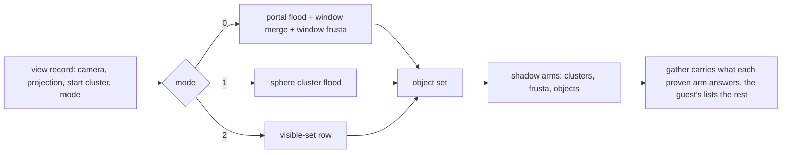

# Visibility in Rust

Status: Built, not verified. The main view's records (camera, projection, start cluster, mode) are built in Rust, and its cluster set, window frusta and object set are walked from them. Shadow arms audit each set: 1 frame in 64 is compared, an arm answers after 16 clean samples and falls back to the guest for the map on a difference. A refusal is counted by name and the guest answers that frame. The light views are computed and compared only. Byte arms do the same for the guest's own writes: the view records at `0x002234e0` and the light frusta at `0x000c1d90` are built in Rust into a shadow buffer and written by Rust once proven. The native scene-list hooks answer portal walks, window merges and window records once their arm is proven (1 call in 64 compared, a difference falls back for the session), publish sphere regions and PVS regions after comparing the guest producer's output, and the projection builder `0x0002fb70` runs in Rust at every call it accepts. The gather's setup `0x00132b80`, its store of the active struct and the reset `0x001348e0` are a byte arm too: once proven, the gather skips them.
Code: `crates/rewrites/scene-extract/src/visibility/` (`compute`, `answer`, `shadow`, `view`, `light`), `crates/rewrites/engine/src/view_projection.rs`, `crates/rewrites/engine/src/visibility_setup.rs` with its arm in `crates/rewrites/render-bridge/src/native_scene_lists/visibility_setup.rs`, the arms in `crates/rewrites/render-bridge/src/scene_step.rs` (`view_record_arm`, `visibility_arm`, `light_visibility_arm`). Tests: `crates/rewrites/scene-extract/src/visibility/` (`tests.rs` and each module's own), `scene_step`'s `the_shadow_arms_answer_after_clean_samples_and_fall_back_on_a_difference`, `engine::view_projection`'s, `crates/rewrites/engine/tests/view_projection_differential.rs`, `engine::visibility_setup`'s and the bridge module's, `native_scene_lists`' `a_portal_arm_answers_after_its_proof_samples_one_call_in_64_and_falls_back_on_a_difference`.
Switch: `impl.render.native.visibility` (on, with `impl.render.native`). Off, the guest's `0x0002fb70` and its portal, window, sphere and PVS producers run, and the shadow arms compare their samples and never answer. Both are listed in [switches.md](../runtime/switches.md).

Slice R4 of [retire-d3d.md](retire-d3d.md). For every game view the scene step builds, beside the guest's, the view's records (its render camera, projection, start cluster and mode), which BSP clusters the view sees and which objects it lists. At each dynamic light's passes it does the same for the light's view. At first-person replay it compares the ordered light slots and their records.

| Mode | Guest producer | Clusters | Objects listed when |
|---|---|---|---|
| 0, frusta | `0x00173130`, walk `0x00172840` | portal flood from the start cluster through screen windows | the sphere reaches a window frustum of a cluster it is referenced from |
| 1, sphere | `0x00132d60` | cluster flood `0x0014a5b0` under the view's sphere | `(r + R)² ≥ d²` |
| 2, computed set | `0x001733e0` over `0x0016de20` | the start cluster's visible-set row, at most 128 clusters | always |

Each comparison counts differences and names the first. The scene's gather carries the main-view parts whose shadow arm answers, and the guest's lists for the rest. A view whose lists do not read carries no gather; it uses Rust camera records and recorded light handles only on equality. The scene comparison reads guest memory.

The scene-list producers also publish the ordered scratch records and visit stamps that their callers consume.

## Single-copy play and the display supplement

In single-copy play, the Rust comparison uses the horizontal extent set by the displayed camera projection hook ([High resolution](high-resolution.md#widescreen-projection)). In exact mode the scene step projects the portals and builds object planes with both lenses. It removes IDs in either the guest lists or the Rust gather at the retail lens.

It tests rigid BSP placements against their clusters' portal windows and deduplicates placements referenced by several clusters. It keeps only the clusters whose every layer has a display draw (`native_world::display_cluster_complete`). The native passes receive the additional IDs through `View::display_visibility`.

| Pass | Display-only draw |
|---|---|
| World layer 3 (`native_world_glue`) | Clusters and fully visible placements, whole owners only |
| Objects (`native_objects_glue/display.rs`) | Objects |
| Water edge, layer 6 (`native_water_glue`) | Kind-4 parts of whole clusters, when the guest layer is empty |
| Fog, layer 16 (`native_fog_glue`) | One part of a whole cluster, when the guest layer is empty |

The rest draw only what the guest listed: the frame scene's layers 1, 5, 7, 8, 20, 2 and 17, the decorators, the layer-15 sorted transparents (the pool surfaces among them), layers 18, 19 and 21, decals and the dynamic lights' passes. A cluster that needs one of those layers is left out of the supplement whole.

## How it works

### The graph

`visibility::graph::read` decodes the active structure (`[0x004e0348]`) into a `PortalGraph`:

| Part | Holds |
|---|---|
| Per cluster | its portal indices, and whether its visible set is computed at run time (flags byte `+0x80` bit 1) |
| Per portal | its two clusters, its plane (from the structure's collision BSP plane block), its flags, its bounding sphere (`+8`) and its polygon |
| Potentially visible set | one bit row of `(clusters + 31) / 32` words per cluster (`+0x58`) |

When the set's byte size (`+0x54`) is above one table, a second table of the same shape follows the first, and a computed row starts from it (`0x0016e150`). A size above one table but short of two declines (`layout`). `GraphCache` keeps the graph for the map epoch, the structure's address and its cluster and portal counts; a structure that declines for its layout is not decoded again.

### The view records

`visibility::view::build` builds the main view's records the way `render_game_views` `0x002234e0` does through `0x00223080` and `0x0002f800`.

| Part | Rule |
|---|---|
| View | the record at `0x0047f210 + 0x118 · [0x004ba050]`. A record whose `+0` is set is a cinematic view (`cinematic`). Its `+8` names the local player; none, or no structure (`[0x004686c4]` is `0xffff`), takes `0x0002f800`'s default camera (`no_observer`). An active camera override (`[0x004e6948]`, byte `+0x1120` set and `+8` equal to 3) declines (`override`) |
| Camera | the player's observer camera (`0x004e9c8c + 0x358 · player`): position `+0`, forward `+0x20`, up `+0x2c`, and the field of view `+0x4c` times a factor. The factor is `[0x0045083c]`, or `[0x0045dbbc]` and `[0x0044ae88]` for a view whose shape ratio (`width share · 100 / height share`, in whole numbers) is 200 or 50. The shares come from the span in grid cells divided by the grid size, before pixel rounding. The near and far planes are `[0x00485ad4]` and `[0x00485ad8]` |
| Split | the display flag forces one view. Otherwise the local player count at `[[0x004e8c20] + 8]` is clamped to one through four. The split uses columns on widescreen and rows on a standard screen or under the lens override. `0x0002f600` sizes the grid and `0x0002f640` places each view. With three players the first view spans two cells. For the render camera viewport (`+0x30`), `0x0002f6b0` divides the inner rectangle at `0x00485a92` into whole-pixel cells and takes the outside edges from the screen rectangle at `0x00485a8a` |
| Projection | scales and offsets from `0x0002fb70` with the default extents (see below) |
| Start cluster | `0x0011bed0` from the camera's position: the walk `0x0014a280` over the collision BSP at `[0x004e033c]` from node 0 takes the front child when `((nz·z + ny·y) + nx·x) − d ≥ 0`, and a leaf's cluster is the `i16` at `[[0x004e0348] + 0x30] + 8 · leaf`. Solid is `0xffff` |
| Mode | `0x00132b80`'s: 2 for a view of kind 0 under view flag `0x80`; 1 with no frusta, or with a sphere radius under `[0x0045dbd4]` and no flag `0x100`; else 0 |

**Projection.** The default extents are `[min, one, min, one]` from `0x0045dbcc` and `0x0045dbc0`. `t = tan(fov · half)` (`0x0045dbbc`, the x87's `fptan`, stored once). The aspect is `width / height`, times the anamorphic factor `0x0045dfdc` when the widescreen byte `0x00485ac2` is set and the override's lens test does not hold. Under the display flag (`[0x00510c50] + 5`), `t` is also times that factor and `0x0045e108`.

The x scale is `one / ((xr · aspect) · t)` and the y scale `one / (yr · t)`. The two offsets are `0 - (e1 + e0) / xr · s` and `0 - (e2 + e3) / yr · s` (`s` from `0x0045dbc4`), as `0x0002fd90` stores them at `0x004b9e14 + 0x78`, `+0x8c`, `+0x98` and `+0x9c`.

The main view's sets are walked from the Rust record (`visibility::Origin`): its start cluster and mode, and its camera in modes 1 and 2. Mode 0 walks the input frustum copied at gather time, including its actual tangent extents. `view::compare` audits the record against the render camera (`0x004b9da0`), the visibility struct's start cluster (`+8`) and mode (`+0x2a7c`), bit for bit. `scene_step::view_record_arm` counts each view and keeps the first difference. A record that declines (`scene_view_record_declined_*`) leaves that frame's visibility to the guest (`scene_visibility_declined_record`).

**The guest's writes.** `engine::view_records::build` ports `0x002234e0` up to its `render_views` call, with `0x00223080`, `0x0002f600`, `0x0002f640`, `0x0002f6b0`, `0x0002f800` and `0x0002c490`: the five records at `0x0047f210`, the split globals, the countdowns, the registers and the three arguments. `render_bridge::native_scene_lists::view_records` implements `RENDER_GAME_VIEWS` as a byte arm (see the shadow arms). Answering, it writes the buffer, lays the guest's frame at `0x00223714` and calls `render_views` with the guest's return address, so the body's tail returns. It refuses (`_refused_<why>`) a cinematic or override camera, the one-shot, a zero divide or out-of-range tangent, an MXCSR or x87 control other than the default, unreadable memory, and a dispatch without `render_views` and its return.

### The projection builder

`0x0002fb70` (`VIEW_PROJECTION_BUILD`) takes the render camera in ECX, the tangent extents in EDX (null for `[min, one, min, one]`) and a 0x40-byte buffer in EAX, and returns with `ret`. Its one caller is `0x0002fd90`. `engine::view_projection::build` computes the whole buffer, ECX and EDX, and `native_scene_lists::projection` publishes them at the call.

| Words | Value |
|---|---|
| `+0x00`..`+0x0c` | the extents `e0`..`e3`; `e2`, `e3` times `height · [0x0045dd50]` under the display flag off the widescreen branch |
| `+0x10`, `+0x14` | width and height of the viewport (`+0x30`) |
| `+0x18`, `+0x1c` | `xr = (e1 − e0) · half`, `yr = (e3 − e2) · half` |
| `+0x20`, `+0x24` | `ox = (e1 + e0) / xr · s`, `oy = (e2 + e3) / yr · s` |
| `+0x28`, `+0x2c` | `sx = one / ((xr · aspect) · t)`, `sy = one / (yr · t)` |
| `+0x30`..`+0x3c` | `0 − (ox + one) · (one / sx)`, `0 − (ox − one) · (one / sx)`, and the same for `oy` with `one / sy` |
| ECX | `t`, popped from the scratch slot |
| EDX | the last extent word when given, its low byte the last flag byte read (`[override + 1]`, then `[display + 5]`) |

`half` is `[0x0045dbbc]`, `s` `[0x0045dbc4]` and `one` `[0x0045dbc0]`. `t` is the x87 tangent of `fov · half` (`x87::tan`, double precision, stored to single). The widescreen branch (the widescreen byte set and the override's lens test not holding) multiplies the aspect by `0x0045dfdc`, and `t` by it and `0x0045e108` under the display flag.

The port declines, and the guest's body runs, for an MXCSR other than masked round-to-nearest, an x87 control word other than `0x027f`, a used x87 stack, a NaN among the inputs or results, and a buffer overlapping what the builder reads after writing. The x87 status word and the MXCSR's sticky flags are not modelled. The caller's own code then reaches `VIEW_PROJECTION_TERMS` (`0x0002fda3`), so the display fit ([high-resolution.md](high-resolution.md#widescreen-projection)) widens the Rust terms as it does the guest's.

### The gather's setup

The gather `0x001320f0` (EAX 0 the main struct `0x00547f88`, 1 the light's `0x0054aa68`) calls the setup `0x00132b80` at `0x00132129`, stores the struct at `0x004c0b80`, calls the reset `0x001348e0` and then the mode's producer. `engine::visibility_setup::build` ports the three as one `Proposal`.

| Input | Written |
|---|---|
| ECX, the view flags | `+0x2a60`; flag `0x200` set with a clip plane, cleared without; flag 1 set with a source view |
| BX, the frustum count | `+0x2a64`, and `[[V]]` |
| argument 1, the kind | `+0x2a78` |
| argument 2, the frusta (`0x1bc` bytes each) | copied to `[V]+4` unless already there; with a clip plane its `+0x74` vec4 to `+0x2a88`, and `+0x2a94` plus argument 8 |
| argument 3, the start cluster | its low word at `+8`; -1 locates the centre (`0x0011bed0`: leaf at `+4`, cluster at `+8`, `[0x004686c4]` at `+0xa`) |
| argument 4, the source view | `+0x2ad0`; nonzero zeroes `+0x2a98..+0x2acc` |
| arguments 5, 6, 8 | the centre `+0x2a68`, the radius `+0x2a74`, the clip offset `+0x2a84` |
| the mode (see "The view records") | `+0x2a7c` and EAX |

The reset zeroes the counts at `+4` of the lists `[V+0xc]` to `[V+0x18]`, the cluster bits at `+0x21c` (64 bytes), the `[V+0xa5c]` words at `+0x25c` and the counts at `+0xa5c` and `+0xa5e`, and fills `+0x1c..+0x21c` with `0xff`.

`native_scene_lists::visibility_setup` hooks the setup's entry. It takes only the gather's call (return `0x0013212e`, ESI the struct), main and light alike.

| Call | What runs |
|---|---|
| sampled | the guest; compared at the entry of the producer the gather enters (`0x00173130`, `0x00132d60`, `0x001733e0`), which must be the Rust mode's (`_differ_mode`); no producer reached counts `_differ_producer` |
| proven, unsampled | Rust writes the proposal, pops the setup's frame and resumes at the reset's return `0x0013213d` with EAX -1, ECX 0, EDX the struct, EDI the mode and the setup's XMM0, XMM1 and XMM3 |

The counters are `scene_visibility_setup_*` (see "Byte arms").

| Refusal (`scene_visibility_setup_refused_<why>`) | Case |
|---|---|
| `caller` | another return address, or ESI not the struct |
| `float_state` | MXCSR other than `0x1f80`, flags aside |
| `layout` | more than six frusta, frusta overlapping their destination, more than 512 reset words |
| `nan` | a NaN in the clip plane sum |
| `walk` | a location walk past 4096 nodes |
| `unread`, `dispatch` | memory that does not read or write; no resume entry at `0x0013213d` |

### The flood

Mode 0 is `0x00173130`, whose walk is `0x00172840`. `visibility::flood::flood` is breadth first from the view's start cluster (visibility struct `+8`, the location `0x00132b80` stores). A node is a cluster seen through a window: a convex polygon on the screen, its bounding rectangle, and the set of portals its path has crossed. The root is the start cluster with the whole screen.

For each portal of a node's cluster, in the tag's order:

1. The portal is projected once for the view (`project`, the guest's `0x00173520` and `0x00173890`). The camera's signed distance from its plane picks how it faces. Beyond the straddle distance, a camera behind the plane makes it `Back` and one in front `Front`. Its polygon is clipped to the near plane. Wholly clipped away, it is culled; one or two corners left make it `Straddle`. Within the straddle distance it is `Straddle`: when the camera's foot on the plane is inside the polygon, its window is the whole screen; otherwise it is the projected rectangle widened, as a quad. A `Back` polygon is reversed. A portal whose nearest corner exceeds the view frustum's `+0x88` distance is culled when its `+0x84` byte is set.
2. It is skipped when culled, when the path has crossed it, or when it is shut (the open-portal bits at `[0x004f93a4]`, which doors clear).
3. A `Back` portal is crossed only from its first cluster and only when not closed from the back (flag `0x2`); a `Front` one only from its second and not closed from the front (flag `0x10`). A `Straddle` portal is crossed either way.
4. Its rectangle must overlap the node's (edges touching count). The portal's polygon is clipped to the node's window. Three or more corners left make a node in the cluster across, with the path's crossed set plus this portal.

A cluster is visible when a node reaches it. Each cluster's windows are then merged as `0x00172c70` does: per cluster, ascending, its nodes newest first, each merges into the first later one whose union with it is smaller than the merge factor times their two areas, and that one takes the union.

The light-view comparison uses the reconstructed lens in `visibility::flood`. The main view uses the tangent-space walk below. The three values the guest's code reads from its data are read from the running image each frame (`guest::tuning`), never committed: the straddle distance (`0x0045e060`, a double), the widening (`0x0045dfa0`) and the merge factor (`0x0043ff08`).

### Portal traversal at the guest call

| Hook (`native_scene_lists::`) | Guest site | Counters | Publishes the Rust result when |
|---|---|---|---|
| `portal_walk` | `0x00172840`, the main view's single-frustum walk | `native_scene_lists_portal_walk_*` | the arm is proven (see "The portal arms") |
| `portal_merge` | the merge after the walk | `native_scene_lists_portal_window_merge_*` | the arm is proven |
| `portal_regions` | `0x001730a0` | `native_scene_lists_portal_regions_*` | ordered paths, frustum inputs, depths, planes and BSP generation repeat |
| `window` | `0x00163db0` at the merged node's call | `native_scene_lists_window_record_*` | the arm is proven |
| `sphere_regions` | `0x00132d60` | `native_scene_lists_sphere_regions_*` | BSP generation, start, centre, radius, axis rows and cluster sequence repeat |
| `regions` | `0x001733e0`, called by `0x00132152` | `native_scene_lists_pvs_regions_` | start, computed row and open-portal bits repeat |
| `projection` | `0x0002fb70`, called by `0x0002fd90` | `native_scene_lists_view_projection_*` | every call the port accepts (see "The projection builder") |

Each counter family counts comparisons, differences or mismatches, native calls and fallbacks.

**The portal arms.** The walk, the merge and the window record each keep an arm (`native_scene_lists::Audit`):

| Arm state | A call | Counted |
|---|---|---|
| unproven | the guest runs; its result is compared with Rust's | `fallback`, then `compared` |
| proven (16 clean comparisons in a row) | Rust answers every call for the BSP; the guest does not run | `native` |
| fallen back (a difference) | the guest runs, uncompared, for the session | `fallback`; the difference once as `mismatch`, and one log line |

A new BSP generation asks for a new proof and never lifts a fallback. A refusal (`memory`, `layout`, `unsupported`) runs the guest that call, uncompared. The arm proves the producer, not one input, so a moving camera or a door keeps the Rust answer.

**The walk.** `native_scene_lists::portal_walk` reads the active frustum's tangent-space root polygon and transform, the BSP graph and the open-door bits. It emits the ordered node pool with each path's parent, portal, depth, polygon and crossed bits, the per-cluster chains and the drained queue. The caller retains its frustum indexing, window merge and region setup boundaries.

At the merge entry a compared call checks the guest's active records bit for bit, including repeated visits to a cluster, polygon order and signed zero. The hook validates the freshly seeded root, scratch layout and floating point environment before every call, compared or answered.

**The merge.** At the subsequent merge, `native_scene_lists::portal_merge` validates the membership bits, chain heads and links. It merges a window into the first older window satisfying the area test, carrying the nearer depth. At the region writer's call a compared merge checks the resulting rectangle, depth and merge target of every node by bits. A cluster with one path requires no pairwise test.

**The object walk.** At base layer 3, `portal_walk::scene_visibility` uses the same traversal, merge arithmetic and window planes to gather the view's objects. Each region appears at its newest node's ordinal, with its surviving windows in chain order. The display walk widens the four root corners around their horizontal centre and clips anew. Accepted single-copy views use the horizontal bounds already present in the input frustum.

### Portal region publication

At `0x001730a0`, `native_scene_lists::portal_regions` consumes the node pool and its merged cluster chains for the main single-frustum view. It creates regions in ascending order of their chain heads, visiting each head's windows newest first. A merged node contributes no slot. An empty rectangle reserves a slot and leaves its bytes and the node's backlink untouched.

Each accepted window stores the region ordinal, incoming portal plane (or the root sentinel), depth and a frustum built by `visibility::window_record`. The region records carry the six counts and first-window indices. The caller sorts a separate ordinal table.

The comparison at `0x00173302`, the instruction after the writer call's return, checks the proposed writes while the node backlinks and cluster-to-region lookup still exist and before the ordinal sort. A repeat with the same ordered paths, frustum inputs, depths, planes and BSP generation can publish the Rust records. The plane-validation diagnostic, nonempty prior tables, unsupported floating point modes and inconsistent links retain the original producer.

### The window frusta

`0x00172ee0` builds one frustum per window left after the merge with `0x00163db0`, from the window's rectangle, not its polygon. `visibility::frusta::Frustum::build` does the same from the rectangle in tangent units (`Lens::tangent`) and the lens as the view matrix (scale one; axes right, up and back), out to the distance `k` at view frustum `+0x88`:

- An empty rectangle (max not above min, or NaN) makes no frustum.
- The box is the six floats `[0x004687e0]` points at, grown by the eye and the rectangle's four corners `(x·k, y·k, −k)` taken to the world.
- The side planes are local `(c, 0, −x0)`, `(u, 0, x1)`, `(0, c, −y0)` and `(0, u, y1)`, each normalised by `0x00030bf0` (left as is when its length is under the epsilon `0x0045dbdc`, else scaled by `u / length`); `u` is `[0x0045dbc0]` and `c` `[0x0045dbcc]`.
- The eye plane is local `(0, 0, u)`, or, when the view frustum's byte `+0x6c` is set, its clip plane `+0x74` negated. The far plane is local `(0, 0, c)` at `k`.
- A local plane goes to the world as `n = (r2·z + r1·y) + r0·x`, `d = ((t.y·n.y + d) + t.z·n.z) + t.x·n.x`.

At the merged node's call to `0x00163db0`, the native record builder uses the live frustum's scaled matrix and tangent rectangle. It writes the view ordinal, rectangle, four corners, eye, bounds, six planes and four vectors from the eye to the corners.

A compared call is checked at `0x00172f73`, after the call's return and its `test al, al`: all 0x108 slot bytes, the argument word used as scratch, and the returned general registers.

An armed plane diagnostic, unsupported FP state or unread input leaves the guest call in place. See `scene_extract::visibility::window_record` and `render_bridge::native_scene_lists::window`.

The object spheres, object types and the view's player unit are read through `sim-state` views (`object`, `local_users`, `players`) over the sim's object and player tables (`GuestRead::with_sim_objects`, `with_sim_players`), one way from sim to render; only the camera kind test and the cluster reference lists are still guest words. In mode 0 an object is listed when its sphere reaches a frustum of the cluster it is referenced from (`0x00165010` over `0x00181800`): it is out when wholly past a side of the box, or when `((nz·cz + ny·cy) + nx·cx) − d > r` for a plane. NaN does not reject. `guest::frustum_inputs` reads the image's values each frame.

### The sphere mode

Mode 1 is `0x00132d60`. A start cluster of `0xffff` lists none. A radius (`+0x2a74`) not above `[0x0045dbd8]` lists the start cluster alone. Otherwise `visibility::sphere::sphere_clusters` is the cluster flood `0x0014a5b0` from the start, capacity `0x200`: depth first, through each portal of a cluster to a cluster not yet reached, in the tag's order.

A portal is crossed when the sphere (`+0x2a68`) straddles the portal's plane (its distance under the radius either way), reaches the portal's bounding sphere, and its cross-section on the plane is not wholly outside an edge of the portal's polygon (`0x0023a160`). The polygon is dropped onto the two axes the image's projection rows (`0x00440b94`, read each frame) pick for the normal's largest component. The plane distance and the cross-section radius are taken in double precision, the rest in single, in the guest's order.

An object is listed in mode 1 when `(r + R)² ≥ d²`, `d` from the view's centre to the object's, `R` the view's radius (`0x00132e60`).

The render wrapper at `0x00132d60` admits a Rust sphere list after a matching guest call. At the geometry gather, `native_scene_lists::sphere_regions` compares the DFS-ordered cluster IDs, region count, per-region frustum counts, sorted ordinals and the sphere epoch and visited-cluster stamps. Further floods reuse that proof for the same BSP generation, start, centre, radius, axis rows and computed ID sequence. Outside and single-cluster views have separate proofs.

Rust stages the region writes and the marks the sim shares with the renderer. A stamp already equal to the next epoch, differing collision BSPs, or a region count beyond the table's capacity returns the call to the guest.

### Computed visible sets

Mode 2 is `0x001733e0` over `0x0016de20`: the start cluster's row, ascending, at most 128 clusters. For a cluster whose visible set is computed at run time, `visibility::pvs::row` computes it as `0x0016de20` does. The row starts from the cluster's row of the second table.

Each pass walks the clusters the row holds, ascending (`0x00044690`), and each of their portals not yet looked at. A portal with flag `0x4` that is open adds the union of its two clusters' second-table rows, masked by the start cluster's row of the first table. Each portal is looked at once.

A pass that adds nothing ends it. The result is the smallest row closed under that rule, whatever the walk's order.

At the mode-2 producer (`0x001733e0`, called by `0x00132152`), `render_bridge::native_scene_lists::regions` uses the caller's start argument. The sentinel selects an empty list even when the view has a resolved start cluster. On the first call for a start, the original producer runs.

At the following geometry gather Rust compares the camera copy, ordered region IDs, sorted ordinals, counts, window links and the fields shared by all valid windows. On a match, Rust owns those records on subsequent calls with the same start, computed row and open-portal bits. A BSP activation or reload clears the comparison.

A nonempty list calls the guest frustum builder at `0x00163db0` for the first window. For a valid rectangle Rust copies its view index, rectangle, corners, bounds, planes and edge vectors into each following window, preserving padding in every destination.

### Objects

`visibility::objects::object_set` is `0x00132220` with its per-object test `0x00133050`. For each visible cluster in the order reached, the first reference partition (heads `[0x004de2e0]`, pool `[0x004de2e4]`) and then the second (`[0x004de2d4]`, `[0x004de2d8]`) are walked. Under view flag `0x400` the first keeps only objects of type 7 (body `+0xaa`).

| Rule | Detail |
|---|---|
| Once | an object is listed once, by its datum index. A rejected object can be listed through a later cluster |
| Clip | the mode's clip admits its sphere (body `+0x30`, `+0x3c` for the main view; `+0x50`, `+0x5c` for a view of another kind): the window frusta in mode 0, the view's sphere in mode 1, always in mode 2, and always under view flag `0x80` |
| Sky | the sky cluster's objects (`0x004b9ee9`, `0x004686c4`, `0x004b9eec` and the structure's table at `+0xb0`) are added unclipped |
| No objects | view flag `0x40` lists none |
| Player unit | the view's player unit is appended when it is not listed, as `0x0003f33c` does |

`0x004b9ed8` holds the view's local user index, not a unit. `0x0002b990` maps it to a unit when the user has a player (`[0x004e8c20] + 0xc + 4 · user`) and `0x00155760` answers 0 for the user's camera: kind `0x0023c110` (the first-person camera, `+0xc` of the user's `0x140`-byte record at `0x004e8c44`) with `+0x4` equal to the image's `0.0`. The unit is the player's `+0x2c` (players at `[[0x004e8c24] + 0x44]`, `0x21c` bytes each). Any other case appends nothing (`guest::view_player_unit`). `guest::object_world` reads the references and spheres into Rust-owned maps first.

### The light views

The light frame (`0x00031c80`) runs the gather `0x001320f0` with EAX 1 for each drawn light, so one struct, `0x0054aa68`, holds the light being drawn. `0x00132b80` fills it with kind 1, the flags `(definition flags >> 12) & 0x400`, the frusta `0x000c1d90` builds (six cube faces for a volume of kind 0, else one projective frustum), the light's cluster (or the one its centre is in), its centre and its radius. A light never takes mode 2: no frusta, or a radius under `[0x0045dbd4]`, is mode 1; otherwise mode 0.

`engine::light_frusta::build` ports `0x000c1d90`: the count and each frustum's 0x108-byte window, basis, lens and points. Step 10 of the light frame (`light_gather::frame`) writes them on a proven, unsampled frame and calls the guest otherwise; a sample compares the buffer after the guest's call.

In mode 0, `visibility::light_frusta` derives the six cube lenses or the projected lens from the pose and volume passed to the light's draw. Each lens floods from the light's cluster. The region list is the union across faces, and a sphere can reach any window for its cluster. A projected light with an unusable tangent rectangle declines.

The source-window intersection at `0x00132900` writes overlap records at visibility struct `+0x2a98`. The set comparison covers region IDs and object handles, which the gather walks from the light's own regions.

`visibility::light::compute` takes mode 1: the sphere mode's clusters, the objects whose second sphere reaches the light's, no sky cluster and no player unit. Under flag `0x400` step 13 (`0x00031c20`) appends the owner's first ancestor of type 0, or with no parent, when the list has room, and so does the Rust set.

`scene_step::light_visibility_arm` runs at the start of each light's passes (`scene_step::light`), after that light's gather and before the next light's, and compares the sets with the struct's region list and object list.

### First-person lights

The loop at `0x000404b0` replays each nonempty slot in order. It has no BSP traversal of its own.

At the dynamic passes' constants call (`0x000311c8` return site), the source record tail includes the attachments that the item walk processes. Rust assigns one slot per dynamic light in order, copies each bit-10 record, and stops copying when the slot fills. Lights past the slot cap contribute records to the last slot.

At first-person entry, `first_person::slots` compares the number of slots, light handles and complete record sequences with the guest table. The E3 light choice uses the Rust handles when equal and the guest handles otherwise. The replay and its mode filter are described in [native-light-gather.md](native-light-gather.md#the-first-person-lights-e-0x000404b0-0x000402b0-0x0003fd70).

### The differential

The guest's sets are its region list (`[vis] + 0xa6e`, `0x1a` apart) and its object list (`[vis + 0x14]`), read by `extract::cluster_gather` at the view's base layer 3 (the main view) or `light::guest_lists` (a light). `parity::compare` walks the two ascending sets and counts what only the guest has and what only Rust has, clusters before objects, naming the first.

The guest's window frusta are its region windows, read by `guest::window_frusta` in mode 0: per region, the `0x108`-byte windows `first..first + count` from `[vis] + 0x1974`, as `0x00165010` reads them (row `+2` the count, `+0xe` the first). `frusta::compare` compares the box and six planes bit for bit, as a multiset per cluster, since the merge's order is not the regions'.

A light's comparison is counted only: no light list is carried into the scene.

### The shadow arms

`scene_step::visibility_arm` walks the main view from its Rust record and runs three audit arms (`visibility::shadow`): the cluster set (the portal traversal, mode 0; the sphere and PVS floods in modes 1 and 2), the window frusta (mode 0 only) and the object set.

| Arm state | Sampled frame (`FRAME % 64 == 0`) | Other frames |
|---|---|---|
| learning | compute and compare; the guest answers | the guest answers; nothing is computed |
| proven (16 clean samples) | compute and compare; Rust answers when equal | Rust answers, uncompared |
| fallen (any difference) | compute and compare, counted; the guest answers | the guest answers |

- A difference falls the arm back for the rest of the map. A map load (`scene_step::map_changed`) or snapshot restore (`scene_step::forget`) sets every arm to learning; the counts stay.
- With `impl.render.native.visibility=off` (`scene_step::set_native_visibility`, from the scene-list feature's install) the arms compare their samples and never answer.
- `visibility::answer` puts the answering arms' sets in the gather, and the record's mode with the clusters. The source is `rust` only when both the cluster and object arms answer, so a gather marked `rust` holds ascending sets.
- The frusta handed to the decorators and the light clip are the Rust ones when that arm answers, else the guest's from `guest::window_frusta`.
- A frame no arm needs computes nothing, unless the display supplement wants the retail sets.
- A refusal (no record, the computation's decline, or the guest's lists or windows not reading) keeps the guest's result for that frame only and is counted. It is not a difference: the arm's state stays.

| Counter (`render.scene`), per arm `clusters`, `frusta`, `objects` | Counts |
|---|---|
| `scene_visibility_<arm>_matched` | sampled views, equal |
| `scene_visibility_<arm>_differ` | sampled views, different |
| `scene_visibility_<arm>_answered` | unsampled views Rust answered |
| `scene_visibility_<arm>_guest` | unsampled views the guest answered |
| `scene_visibility_<arm>_declined` | views either side made no result for |
| `scene_visibility_<arm>_proven`, `_fallen` | 1 while the arm answers, or after it fell back, on this map |

**Byte arms.** `engine::shadow_arm::ByteArm` runs the same states over a `Proposal`, named fields of guest bytes. A sample compares each byte with the guest's at the guest's return, and each differing field counts by name. Its counters are `<prefix>_matched`, `_differ`, `_answered`, `_guest`, `_declined`, `_proven`, `_fallen`, `_refused_<why>` and `_differ_<field>`, with the prefixes `scene_view_records` (compared at `render_views`' entry, an observer, before the hooks that move the cameras), `scene_light_frusta` and `scene_visibility_setup` (compared at the producer's entry).

`scene_visibility_checked`, `_equal` and `_differ` count the sampled views; `scene_visibility_rust_taken` the views whose gather is `rust`. `visibility_first_mismatch` names the first sampled difference since the map loaded, clusters and objects before frusta.

## Interfaces

- Called from `render_bridge::scene_step::open_kind_at_layer` when a game view's base layer 3 is read (`view_record_arm`, then `visibility_arm`), whether or not `extract::cluster_gather`'s lists read: they are the comparison's other side and the fallback. Also from `scene_step::light` at each dynamic light's passes. First-person slot collection runs at the dynamic constants call and compares at replay.
- Reads, all through `GuestRead`: the visibility structs `0x00547f88` and `0x0054aa68` (`+8` start cluster, `+0x14` object list, `+0x2a60` flags, `+0x2a64` frustum count, `+0x2a68` and `+0x2a74` the sphere, `+0x2a78` view kind, `+0x2a7c` mode), `[0x004c0b80]` (the active struct), the structure tag and its collision BSP, the open-portal bits, the object and reference datum arrays, the light records, the sky globals, the view's local user, the local player map, the users' camera kinds, the players' units, the view records, the observer cameras, the render camera, and the image's values named above.
- The scene differential reads the lists. The native publication hooks write the scratch records described above.
- `render.scene` reports it ([agent-api.md](../runtime/agent-api-render-checks.md#framescene-checks-compare-capture-scene-parity-hashes)): per game view `visibility_source` and `visibility_objects`; the top level `visibility_first_mismatch`, `light_visibility_first_mismatch`, `first_person_visibility_first_mismatch` and `view_record_first_mismatch`; and the `scene_visibility_*` (the shadow arms' `scene_visibility_{clusters,frusta,objects}_*` among them), `scene_light_visibility_*`, `scene_first_person_visibility_*` and `scene_view_record_*` counters.

## Rules and limits

- **Membership and draw order.** The region records retain their production order. The comparator at `0x00134950` sorts a separate array of region ordinals. The scene's Rust membership sets are ascending, and a consumer that needs the guest's order reads it from a `guest` view. The native publication hooks compare the ordered records at their consumer.
- **The guest is the fallback.** A view whose record or computation refuses keeps the guest's gather for that frame. A difference falls its arm back to the guest for the map, counted and named; the render records are built from the guest's lists either way. A view whose lists do not read carries no gather. The first-person light handles stay taken only on equality.
- **Still the guest's in a game view.** The gather `0x001320f0`'s own body (its dispatch on the mode and the epoch stamps before `0x00132220`); `0x00173130`'s frame around the hooked walk, merge and region writer (per frustum `0x00172bb0`, `0x00173b00`, and the ordinal sort `0x0013de30` with `0x00134950`); the sphere wrapper `0x00132d60` and the PVS producer until their repeat is proven. The setup and reset stop running once their arm is proven.
- **Not ported.** The overlap records for light windows against source-view windows (`0x00132900`, a merge over both region lists calling `0x00132780` and `0x001648d0`); cinematic and override cameras, which refuse; `0x00040e90`'s main-view body, which zeroes five words and dispatches to the gather, item and draw calls: its lists are written by `0x001320f0`'s producers, which the scene-list hooks publish. The scene step's `view::build` reconstructs only the default extents; the builder at the guest call takes any.
- **Shared stamps.** The sphere gather checks the active collision BSP before taking over shared visit stamps. A light's reconstructed lens can still differ from its source frusta. The light differential reports those differences.

| Decline | Cases |
|---|---|
| `unread` | memory that does not read |
| `layout` | counts, links or indices past the guest's arrays (more than 512 clusters or portals, more than 64 corners a portal, a short second table, projection rows past 2) |
| `mode` | an unknown mode |
| `frusta` | an unsupported frustum count |
| `overflow` | a limit where the guest drops by its own order (256 nodes, 255 queued, the corner pools, 128 regions, 512 windows, a full object list) |
| `camera` | a camera that makes no lens |
| `not_main` | a struct other than the one the arm is for (also for a light) |
| `cinematic`, `no_observer`, `override` | the view records; the visibility counts them as `record` |

## Evidence

- The flood, the projection, the facing test, the merge, the mode 2 copy, the computed row, the window frusta, the sphere mode, the view setup and the camera and lens builders: **Code**, read in the disassembly (`h2 disasm`) at the addresses above.
- The open-portal bits are indexed by portal: **Code** (`0x00172927`).
- `0x004b9ed8` holding the view's local user index, and the unit `0x0002b990` appends: **Code** (`0x0002ba10`, `0x0002bc6b`, `0x0002b990`, `0x00155760`).
- That the item lists `0x00040e90` leave the light struct's lists alone between a light's gather and its passes: **S**.
- That `0x0002fb70` has one caller (`0x0002fd99`): **Code**, a scan of `.text` for calls and jumps to it.
- `0x0002fb70`'s buffer and registers equal the lifted original's over seeded cameras, extents, override and display states: **Test** (`view_projection_differential`, needs the XBE).
- Every behaviour above on invented fixtures: **Test** (`visibility::tests`, and the `flood`, `frusta`, `sphere`, `pvs`, `objects`, `view`, `light`, `parity`, `shadow` and `graph` tests).
- The setup, the store and the reset, their mode, location and refusals, on invented fixtures: **Test** (`engine::visibility_setup::tests`, `native_scene_lists::visibility_setup::tests`). The argument layout and the producers' return addresses and frame offsets: **Code** (`0x00132b80`, `0x001320f0`, `0x001348e0`, `0x0011bed0`, `0x0014a280`).
- `engine::view_records` and `engine::light_frusta` write what the lifted `0x002234e0` (to the `render_views` call) and `0x000c1d90` write, over seeded states: **Test** (`view_records_differential`, `light_frusta_differential`, need the XBE).
- The arms' sampling, proof, fall-back, switch and declines over the scene step: **Test** (`scene_step::tests::the_shadow_arms_answer_after_clean_samples_and_fall_back_on_a_difference`, `a_refused_view_counts_and_the_guest_answers_that_frame`).
- The sets walked from the record, not the guest's struct: **Test** (`visibility::tests::the_rust_cluster_set_from_the_view_record_equals_the_guests`).

## Not verified

- That the sets and records equal the guest's on real scenes. The acceptance of R4 is `scene_visibility_differ`, `scene_light_visibility_differ`, `scene_first_person_visibility_differ` `scene_view_record_differ`, `scene_view_records_differ`, `scene_light_frusta_differ` and `scene_visibility_setup_differ` at zero, over the gate corpus, with all four `*_first_mismatch` fields absent, and `scene_visibility_{clusters,frusta,objects}_proven` at 1 with `_fallen` at 0. The `scene_visibility_declined_*` counters name the views that keep the guest's.
- That 16 clean samples (about 17 seconds at 60 frames a second) is enough proof before an arm answers.
- That the render camera and projection at layer 3 are the lens the gather used: the display copy can change the projection after the gather (occlusion-culling.md).
- Which maps use modes 1 and 2, how often a start cluster's set is computed, how many lights take mode 0, and whether any view has more than one frustum.
- The time per view (`scene_visibility_ns` over `scene_visibility_checked` plus the declines) and per light (`scene_light_visibility_ns`).

## Related

- [retire-d3d.md](retire-d3d.md): slice R4 and the "Visibility" and "Views and cameras" rows.
- [occlusion-culling.md](occlusion-culling.md): the gather's call tree, the object fields and the camera.
- [render-loop.md](render-loop.md): `render_game_views` and the view records.
- [native-light-gather.md](native-light-gather.md): the light frame whose step 11 fills the light's struct.
- [native-renderer.md](native-renderer.md#scene-list-builders): the Rust scene lists that consume the guest's regions.
- [framescene.md](framescene.md): the scene and its `cluster_gathers`.
- [collision-queries.md](../engine/collision-queries.md): the sphere flood (entry G) and the location (entry B) over the same structure, for the sim.
