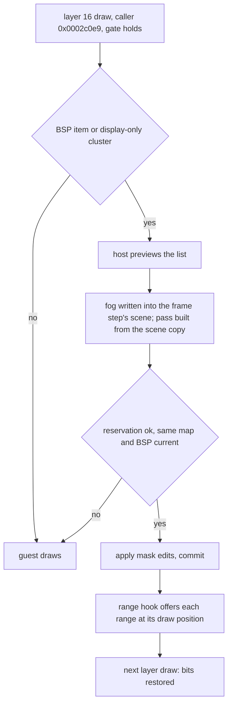
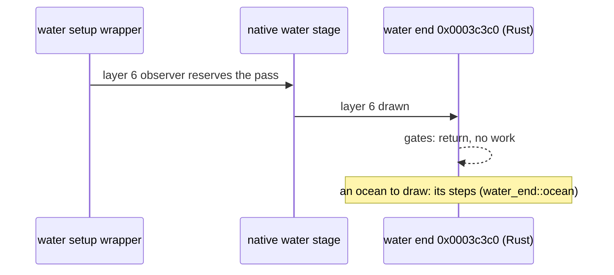

# Native renderer stage 4b: water, fog and camouflage

Status: Partly built. The native renderer draws planar fog (layer 16), the water edge blend (layer 6), active camouflage (layers 18 and 19) and holograms (layer 21). Parity with D3D remains unverified.
Code: `crates/rewrites/render-bridge/src/native_fog.rs`, `native_water.rs`, `native_layers.rs`, `crates/extensions/game/src/native_fog_glue.rs`, `native_water_glue.rs`, `native_layers_glue.rs`, `native_objects_glue.rs`, `crates/rewrites/native-render/src/fog.rs`, `fog_gpu.rs`, `water_gpu.rs`, `object_program_gpu.rs`, `crates/rewrites/scene-extract/src/layout/world_layers.rs` (`sorted_site`). Tests: `crates/rewrites/render-bridge/tests/native_fog.rs`, the unit tests of `render_bridge::native_layers`, `native_render::object_program` and `object_program_gpu`, `scene_extract::layout::world_layers`.
Switch: `impl.render.native` (on), listed in [switches.md](../runtime/switches.md).

Part of [native-renderer.md](native-renderer.md).

| Layer | What | Caller | Native stage |
|---|---|---|---|
| 16 | planar fog | the late scene passes (`[esp] == 0x0002c0e9`) | `native_fog` over the world's loaded BSP |
| 6 | water edge blend | the late scene passes (`[esp] == 0x0002c120`) | `native_water`, inside the setup wrapper's window |
| 15 | pool surfaces | the sorted layer-15 handler | `IndexedPass::for_pool`, or D3D under a named refusal |
| 18, 19 | active camouflage | the sorted handler `0x00041cc0` | `native_layers` (`LayerCaller::Sorted`) |
| 21 | hologram | the sorted handler `0x000423c0` | `native_layers` |

## Stage 4b: water, fog and camouflage

The late scene-list passes include the water edge blend (6), planar fog (16), active camouflage (18, 19) and holograms (21). They use the layer draw (`0x00044550`) and scene list (`0x004c1a48`) also used by layer 3. A whole-layer native replacement clears the layer bit for the items it draws and restores the bit at the next layer draw. The water passes can read scene-copy and reflection inputs.

### The census

Evidence: Code, from the lifted `render_scene_passes` and layer draw ports (`engine::render_loop::scene` and `layer`). Pass counts are V on the owner's disc (e3-lighting.md, "Pass taxonomy").

The late passes of `render_scene_passes` (`0x0002bcd0`), in order. View kinds 1 and 2's mode 2 skips them, and the fog byte `0x00485a76` gates the player chain after.

| Calls | What | Evidence |
|---|---|---|
| `0x00025d50`, then the layer draw of 16 | **Planar fog.** `0x25d50` (no stack cleanup) runs between the state call at `0x0002c0bc`'s return and the layer-16 begin call at `0x0002c0db`; the layer draw is at `0x0002c0e4` (returns `0x0002c0e9`). When the fog byte at `0x00485a75` is clear, it selects a callback from the view mode (`0x00026520` for modes 2/3 on the branch at `0x00025d77`, `0x00025e50` on the other setup branch) and submits through `0x00034420`. | Code: the block machine `0x0002c0cc`..`0x0002c0ee` |
| `0x0003ba90(esi, ecx=6)`, the layer draw of 6, `0x0003c3c0(al, 1)` | **The water edge blend.** Unless bit 4 of `[0x004b9fe0]` is set, `0x0003c3c0(0, 0)` runs instead and layer 6 does not draw. `0x0003ba90` (`ret 4`) returns AL, stored and passed back to `0x0003c3c0` (`ret 8`). `0x0003c3c0` contains the alpha-only clear `0x3c515` with EAX `0x10` (d3d.md, "Channels"): the teardown clears the bound target's alpha, so the water edge blend's mask is the alpha channel the draws before it left. The teardown can also issue an indexed quad draw at `0x0003c598` and continues with resource updates. | Code: `0x0002c0ee`..`0x0002c137`; d3d.md |

**Layer 16's own gate** (Code, the layer-draw port `0x00044582`). The layer draw draws layer 16 only when `[0x0048574c] == 3` or either fog byte `0x00485a75`/`0x00485a76` is set (the same test as layers in `DRAWN_LAYERS` `0x00bffdee`, which holds bits 16, 18, 19 and 21). A native fog pass applies the same gate, or it fogs views the game left clear.

**By caller and material.**

- The layer-16 items are the scene list's structure and object items with bit 16 set. Every shader with a layer-16 pass has them: 16,668 resolved `(lod, layer)` passes on the disc's 30 maps, against layer 3's 16,622. The fog pass is a per-material pass like the lightmap one, drawn where the same geometry drew in layer 3.
- Retail pool templates (`water_pool`, `water_pool_static`) have a sorted layer-15 pass.
- Layer 6 selects `water_edge_blend` on Old Mombasa and Zanzibar. The static ocean and opaque water templates select layer 3.
- Layers 18 and 19 (111 and 30 passes) belong to the active-camouflage materials and layer 21 (6 passes) to the hologram. Their items are object render records, stage 2's.

**Scene-copy and reflection inputs.** A template pass binds its stages from the instance bitmaps or the engine textures (`ResolvedImplementation::textures`). The engine-texture table (`0x00019530`, the jump table at `0x00019b68`) names every render target a pass can sample:

| Engine texture | Source |
|---|---|
| 5 | the view's bound target (a scene copy) |
| 2, 3 | target 1 (the texaccum) |
| 6 | target 3 |
| 13 | target 9 (the shadow map) |
| 8 | target 10 |
| 14, 15 | the rasterizer data's bitmap at `+0x14` (`0x000197dd`, `0x000197fb`: `[[0x00485a80]+0x14]` through `0x000143c0`): 14 its image 0 (clears `ecx`, the image argument), 15 its image 1 (leaves the 1 loaded at `0x00019538`) |

The fog and water loaders resolve the rasterizer bitmap from the globals tag (`fog_gpu::Selection::rasterizer`, `look::rasterizer_image`) and sample it as an ordinary bitmap stage. A pass sampling a target the native side has no copy of stays on the D3D path.

The fog pass draws before layer 6 and touches no target but the bound one. The water edge blend reads the alpha of the bound target (the teardown clears it after), so its native pass runs inside the wrapper's window, before `0x0003c3c0`'s clear. The pass is issued at the next D3D entry, and the teardown's clear is an entry.

**Viewport and scissor.** The water edge blend and planar fog use the active player's physical viewport as their scissor. The water scene copy covers its entire colour attachment, so a shader can address the copy with the same coordinates as the source. The packet path and the direct encoder use the same viewport edges at fractional raster scales.

**Display-only clusters.** In exact mode, `scene_step::late_display_visibility` can supply a display-only cluster to layers 6 and 16 when the guest layer is empty. The cluster must be wholly inside a display portal window and supply one eligible part with a visible, single-LOD material. Fog also checks that the record flags and planar gate select the loaded implementation.

### Planar fog

Code: `feature::native_fog`, `boot::native_fog_glue`, `native_render::fog` and `fog_gpu`. It is the most self-contained of the four stages: the same geometry the native world already loaded, drawn with each material's own translated layer-16 pass.

At guest admission, `GpuWorld::prewarm_fog` and `prewarm_water` request the pipelines for the bound colour and depth formats. D3D keeps the layer while its programs compile. Once the formats are ready, later views use the cached pipelines with their own uniforms and sampled textures.

#### The look

`fog_gpu::fog_passes` takes every pass of the material's layer 16 at the first level of detail, in order, each through `look::implementation_look`. A fog pass is the "combiner that reads the fog register" that layer 3's `world_parity` refuses: its colour is `SET_FOG_COLOR` and its factor the fog unit's, both device state at the layer.

| Case | Outcome |
|---|---|
| An engine input mask requests an evaluation whose value reaches no register, fragment selector or render state | the pass can use a static shader |
| Per-draw engine inputs outside the planar combiner bindings, unsupplied engine textures, animated passes | refused |
| Engine-driven states from a source other than the instance's scalar 21, or a driven fog colour with the fog on (`engine_states::apply_static`) | refused |
| A definition without its own final combiner (D3D builds one from the fog and specular states), bump-env/BRDF modes, border addressing | refused |
| The fog register | not refused: the pass supplies it |
| A pass that leaves blend to the previous draw while writing colour, or inherits depth writes while depth is enabled | stays on D3D |

The pipeline state must be the implementation's own (`pass_state`'s rule; the fog words decode to no pipeline state). `CULLMODE` is the exception, below.

#### Planar combiner inputs

In deltatowers, cyclotron, mainmenu and lockout, implementation 2 of the planar pass binds vector 31 to RGB and scalars 35 and 36 to alpha.

| Selector | Reads |
|---|---|
| RGB | `MATERIAL + 0x84` |
| strength | `MATERIAL + 0x90` |
| fade | `FADE` |

The two weights are `(1 - fade) * strength` and `fade * strength` (`scene_extract::layout::layer_inputs`). The host samples these at the layer call for both guest-list replacements and display-only draws.

Each pass applies its binding's transform, half-range packing and channel mask to the combiner bank and slot named by the material. The program takes its plane and camera calculations from the device's vertex constants. Each target copy uses its own projection for position. The display's horizontal projection scale does not multiply the weights.

#### The implementation

`fog::layer_implementation` (Code `0x0004cbf0`). Layer 16's passes carry four implementations. The geometry build has its own case for layer 16 (jump table `0x0004d054`, byte table `0x0004d068`, entry `0x0004cdc8`), not `0x00015d70`'s answer, and stores its choice in the entry's byte `+4`:

| Render record flag word `+0` | Entry |
|---|---|
| bit 7 clear | none (the layer draws nothing of the item) |
| bit 7 set, bit 8 clear | 2 with the planar gate, 0 without it |
| both set | 1 without the gate, none with it |

The gate (`fog::planar_gate`) is `[0x004ba004]` non-zero with both fog bytes (`0x00485a75`, `0x00485a76`) clear. The skip (`fog::clear_fog`) computes the same from the record and carries it on `FogItem`. A structure or object record with no entry keeps its mask and contributes no draw.

The load compiles implementation 2 (`native_fog_glue::LOADED_IMPLEMENTATION`, the gate's) for every pass that has more than one (`fog_gpu::layer_passes_selected`). A pass with one draws it whatever the item binds. `FogView::draws` accepts an item of a material with a choice only when its record binds 2, so a view with a fog byte set (the gate shut: implementations 0 and 1) stays on D3D.

#### The cull

`fog_gpu::Selection::layer_cull`. A pass that leaves `CULLMODE` unset draws with the cull the layer starts with. The shader draw begin (`0x0001bbf0`) runs the layer setup on the first draw after a layer draw (byte `0x004670bc`), which calls `0x003f53d0` and `0x003f5450` with `0x900` (`SET_CULL_FACE_ENABLE` `0x40308`, `SET_FRONT_FACE` `0x403a0`). `CULLMODE` and `FRONTFACE` are both `CW` (`fog_gpu::layer_cull`; `RenderState`'s own default is `CCW`).

Nothing restores the cull between draws, so a later unset pass inherits what an earlier pass set. The load therefore admits an unset pass only when no implementation of any pass of that layer, in any world material, sets `CULLMODE` or `FRONTFACE` to something else (`fog_gpu::layer_sets_other_cull`; `restore_states` are not credited with putting it back). A whole-layer native pass starts from the layer setup. The world layers (`layers_load`: 1, 5, 7, 8 and 20) apply the same rule.

#### The fog state

`fog_gpu::FogWords`: the effective fog unit of a draw is the implementation's own render states overlaid on the device's (`d3d::nv2a::d3d_fog` over `D3DRS_FOGENABLE`, `FOGCOLOR`, `FOGTABLEMODE`, `FOGSTART`, `FOGEND`, `FOGDENSITY`, `RANGEFOGENABLE`, read through `Device::render_state` as `stencil_state` reads the stencil). The glue resolves it at the layer-16 call and fills the programs' `PixelUniforms::fog` and `fog_color`. Unreadable, the view stays on the D3D path.

The vertex side needs nothing: the pass's own program writes `oFog` as the D3D path's does (the translated module is the D3D path's, text for text). The constants check is the world's. A constant outside the view's `c[0..18]`, the instance's, `c[50..52]` and `c[172]` keeps the material on D3D, and uploads by `0x25d50` outside that set show as these refusals.

#### The skip

`feature::native_fog` is one context-only observer before `LAYER_DRAW`, after the world's. It restores the last skip. Then, when all of these hold, it asks the host:

- the current layer is 16;
- the caller is the late passes' call (`[esp] == 0x0002c0e9`);
- the layer-draw's own gate holds (`[0x0048574c] == 3` or a fog byte set);
- a BSP item or a display-only cluster is available.

For a guest-list replacement the host plans the skip over a preview, writes the view's fog into the frame step's scene and builds the pass from the scene's copy (framescene.md, slice 5). It reserves the pass (a scene stage the render thread prepares and records when it takes them, else through the ordered handoff, recording on every copy before anything is surrendered), checks that the same map and BSP load is current, applies the mask edits and commits.

- The fog and water mask walk surrenders a list only when the stage can draw every entry. A mixed list keeps all its masks for the guest sort.
- The native range hook offers each supported geometry range, including selected subparts, at its original draw position, after the handler commits its state.
- The first-person call returning to `0x00040289` ordinarily begins layer 2 (`0x00040276`). It can supply an indexed fog range when both the live handler argument and current layer identify 16 and the emitter and entry-loop returns match.
- A refused range continues through its guest draw. The hook restores a surrendered list's bits at the next layer draw.
- A placement's part draws with its pass's rigid classification (the `vrtx` tag's classification 1, the model rows `c[50..52]` at its slot's dynamic offset, as its layer 3 does). A material whose rigid program does not compile, or whose placement's rows did not read, keeps those parts on the D3D path (by count in the load's log).
- Objects' layer-16 items are never cleared: their fog is stage 2's.

#### The draw

`fog_gpu::FogSet`, `GpuWorld::encode_fog`: the world's parts selected by the mask preview, in list order, each with its layer-16 passes blended over the loaded depth with the pass's own `PassState`. The 03a fog passes are `ZFUNC` equal without depth writes, so they use the depth the world's native pass already wrote bit for bit.

The load line names the materials that stayed on D3D and why. Every 1,800 layer-16 views a line gives the skip counts.

### Water and the rest

Code: `feature::native_water`, `native_render::water_gpu` and `game::native_water_glue`.

#### Pool surfaces (layer 15)

The BSP loader follows the compiled shader instance to its template and reads the first LOD's layer-15 range. Delta Towers and Ivory Tower use this route. The sorted geometry handler (`0x00041020` through `0x00040f60`) selects and binds each pass before issuing its indexed range.

`native_transparents::pool_issue` checks the sorted entry, shader, emitter frame and indexed call. The native transparents walk leaves these shaders to the guest handler, and `game::native_residual_glue` offers the resolved draw to `IndexedPass::for_pool`. That translates the resolved programs, ripple frame, bump matrices, reflection, refraction and Fresnel bindings.

The pool's inputs against the scene are explicit:

| Input | Rule |
|---|---|
| Depth | The pass is recorded over the attachments with depth and stencil loaded. It tests the depth the world left and writes none. A draw with no depth buffer (`no_depth`), a disabled or always/never test (`depth_not_tested`) or a depth or stencil write (`writes_depth`) is refused. |
| Lens | The first sampled 2D stage the device resolved as a frame sample (`pool_lens_stage`: `StageExtras::samples_frame`, the bound colour, a snapshot of it or a frame-sized render level), whatever its texture mode. A draw with no such stage is refused (`no_lens`). A colour that cannot be copied or sampled refuses the recording (`lens_source_cannot_be_copied`, `lens_source_is_unfilterable`). |
| Ripples, reflection, fog | The guest's bound images and constants, replayed with the packet (`replays_scene`) |

**Why the lens is chosen by sampling, not by mode.** `tower_pool` samples its signed ripple bitmap projectively at t0 and reads the refraction target (engine texture 20) at t2 as a bump environment map offset by t0 (`h2 shader 05b_deltatowers 'scenarios\shaders\solo\deltatemple\tower_pool'`). A copy bound at the projective stage would replace the ripple with the scene, so every bump offset and the Fresnel lookup would follow the scene's colour: a bright patch with a hard curved edge where that colour crosses the signed midpoint.

The guest image's size is not compared, and its coordinates are normalised by its header. The lens samples a copy of the bound colour made in each Reference and Display recording, immediately before the pool draws (`IndexedPass::record_pool`: the copy, then a render pass of the pool's packets, as the layer-6 water's `record_encoded` does). It does not sample the guest's own resolve, which can predate the native stages.

**Counters** (`render.stats`, layer 15):

| Counter | Counts |
|---|---|
| `layer_plan_15_pool_admitted` | pool draws taken |
| `layer_plan_15_pool_recorded` | recordings made |
| `layer_plan_15_pool_refused_<cause>` | refusals. Admission: `index_count`, `no_depth`, `depth_not_tested`, `writes_depth`, `no_lens`, `geometry`. Recording: the causes above and the pass's prepare errors, e.g. `sample_aliases_attachment` |
| `layer_plan_15_pool_on_d3d` | every pool draw the admission leaves to the guest |

The first admitted lens and the first `no_lens` each log every stage's mode, whether it samples the frame, its image and size against the guest target, once (stderr).

A pool that writes depth needs the write proven against the world's depth first. Mainmenu's aerial water is an alpha-tested environment material. Lockout has no pool template. Neither requires a layer-6 pool pass.

#### The water edge blend, drawn natively (layer 6)

The skip, the scene and the reservation are the fog's: one context-only observer before the layer draw, ordered after the world's and the fog's. It runs for layer 6 when the caller is the late passes' call (`[esp] == 0x0002c120`), gated by the water branch's own gate (bit 4 of `0x004b9fe0` clear). The reservation drains the setup wrapper's pushes before the native draw.

The water end after it is Rust (`render_bridge::water_end`, [retire-d3d-display.md](retire-d3d-display.md#the-water-end)). Its gates return with no work; the ocean is `water_end::ocean`: its alpha clear `0x0003c515` through `native_targets::cut_clear`, its grid, gates, first copy and texture stamps Rust, and its layer-3 pass compiled from the map and drawn natively over the grid's quads (`frame_scene::late::Ocean`, `native_render::ocean_gpu`, `native_ocean_glue`). Its reflection `0x0003bd00` is Rust too: the sky replayed into target `0x15` from the mirrored camera. A step it cannot make panics, `water ocean: <cause>`.

**Layer-6 counters.** `scene_water_views`, `scene_water_drawn`, `scene_water_parts` and `native_water_walk_*` count only layer 6 and its composite, which Old Mombasa and Zanzibar use. They stay zero on Delta Towers, which has no layer-6 edge materials. Its `tower_pool` surfaces are drawn by the sorted pool pass (above), counted under `layer_plan_15_pool_*`. Its bay's open water is the BSP water definition's ocean grid (`water_ocean`), which the water end's ocean draws (`water_end::ocean`). That grid is attached to the camera; its width in a wide window is in [high-resolution.md](high-resolution.md#widescreen-projection).

**Parts.** Layer 6 draws the kind-4 transparent parts of clusters and placements. A placement uses its own model rows at the rigid program's dynamic uniform offset. Each pass must compile the rigid classification and the part must supply every vertex input it reads. Missing rows, streams or rigid programs leave the placement on the guest path. The look is the material's own layer-6 pass (`fog_gpu::supplied_layer_passes`), accepted by the fog layer's rule: the states the implementation sets itself, a final combiner of its own, no device-state texture modes.

#### Scene-copy and reflection inputs

A layer-6 pass binds engine textures, and each is supplied per view (`water_gpu::Supply`): the view's own target (id 5) as a copy of the bound colour made inside each Reference and Display recording. Each copy caches its own scratch texture by size and format. Render targets use the reservation's `sampled` levels.

The guest texture header is embedded at `+4` in Halo's descriptor table (`0x004b4b58`, stride `0x98`). The resolver at `0x0001dcc0` requires a nonzero surface at `+0x88` and a clear byte at `+0x95`. The reservation refuses if a required copy has an unresolved sample, a sample that aliases an attachment, an unfilterable sample, or an unsuitable source for the scene copy.

Rasterizer stages 14 and 15 sample images 0 and 1 of the globals bitmap. Any other engine id (run-time chosen, the light's, a rasterizer bitmap, a cleared stage) refuses the material at the load (`FogRefusal::Unsupplied`).

#### The caller

Evidence: Code, `h2 disasm`. Layers 18, 19 and 21 are drawn by the sorted transparent list's object-layer handlers, not by the scene passes (`0x0002bcd0` draws 1, 3, 5, 8, 20, 7, 2, 16, 6 and 15) or the first-person render (`0x0003fdf0`). The list calls an entry's handler at `+0x20` with `entry+0x24` (native-decals-research.md, "The sorted-list handlers are not decals").

| Handler | Added by | Records | Does |
|---|---|---|---|
| `0x00041cc0` | `0x000420a0` | those whose `+0x1c` is 1: the active camouflage | Starts a list of its own (`0x000352e0`), adds the records' items through `0x00044c90` (its layer mask `0x0011818e`: layers 1, 2, 3, 7, 8, 15, 16 and 20, plus the camouflage mask `0x40000`, layer 18, or `0xc0000`, 18 and 19, when the modulate state below holds). It replays layers 1, 3, 8, 20, 7, 2 and 16, then 18 (the draw at `0x00042010`, returning `0x00042015`), then 19 when `[0x004b9f5c] != -1`, `[0x004b9f88] == 0` and the larger of `[0x004b9f78]` and `[0x004b9f7c]` exceeds `[0x0045dbd8]` (the draw at `0x0004205a`, returning `0x0004205f`), then 15. |
| `0x000423c0` | `0x00042760` | those whose `+0x1c` is 3: the hologram | One `0x00044c90` call over every layer, then layers 1, 3, 8, 7, 2, 16, 15 and 21 (the draw at `0x0004271c`, returning `0x00042721`). |

Every layer goes through the layer begin `0x00044370`, the layer draw `0x00044550` and the end `0x000445d0` with no wrapper of its own. The begin's descriptor (`0x0043fa1c`, `0x24` bytes a layer) gives 18 and 21 the bound target (`+0`: -1) and 19 render target 3. Its per-layer jump table covers layers 3 to 17 only, so 18, 19 and 21 have no setup but the target and the state call `0x00015680` (descriptor `+0x18`: 1 for 18, 0 for 19 and 21). The end's table also stops at 17.

**The shader a record draws** (Code). The record producer `0x0002cbf0` takes a shader argument from the object render (`0x001341d0`). When it is not -1 it stores it in the table at `0x004c1228`, its index byte at `0x004c0ed6 + record` (-1 for none; at most `0xc0` a frame, counted at `0x004c1528`). `0x00044c90` hands it to the item build `0x00041040`, which draws the item with that shader in place of its part's material (`[esp+0x3c]` there). The camouflage handler does so when the record's `+0` bit 15 is set, and the hologram's always (its last argument 1). The record's fade byte `+0x1a` below `0xff` sets the polygon stipple in the geometry draw's prologue (`0x0004d640`, `SetStipple` `0x003f8cc0`).

#### Layers 18, 19 and 21

`frame-scene.layers` takes them (`render_bridge::native_layers`, `LayerCaller::Sorted`; `sorted_site` names the handler from the layer draw's return). The items are object records only and draw from the scene's resident models, with the plan, skip and restore of the other object layers (framescene.md, slice 4).

- The bit goes back at the next layer draw only on an item that still holds the mask, shader and argument it left. Layer 18, 19 or 21 can be the handler's last taken layer, and the next entry's handler rebuilds the same items.
- The begin runs before the layer draw, so the stage's pass draws on what it bound: the view's target for 18 and 21, render target 3 for 19.
- A hologram item always draws the shader its record names, a camouflage item when the record's `+0` bit 15 is set. Either way the item's shader is the one its passes are looked up by.

| Input | Where | How it is supplied |
|---|---|---|
| Override shaders | `object_program_gpu::override_sections`, `native_objects_glue::override_materials` | The map's shaders with passes in layer 18, 19 or 21 (`OVERRIDE_LAYERS`) are read once per map. Each model compiles their passes over every drawn part, after its own (`LitModelInput::append`), keyed by part and shader, so an item draws the passes of the shader its record names. One whose passes do not compile keeps its D3D draws, and the first reason per shader and layer is logged. |
| The view's own target (engine texture 5, `object_program::VIEW_TEXTURE`) | `LitObjects::view_copy`, one scratch texture per target copy | A stage of layer 18, 19 or 21 that samples it binds a copy of the bound colour. The pass is recorded as commands (`record_encoded`): the copy first, then a render pass of its own on the bound attachments with the draws (`gfx::renderer::encode_in_pass`). Coordinates are texels of the target's guest size, as a linear render target is read (`texaccum_dimensions`, `texaccum_scale`). In any other layer a stage sampling the view refuses at load. |
| The scene copy (engine texture 17, `object_program::SCENE_COPY_TEXTURE`, `EngineBound::scene_copy`, `EngineStages::scene_copy`) | `LitObjects::scene_copy`, `SceneCopy::record` | The camouflage bump (layer 18) and the hologram projection (layer 21) sample the downsample the guest's `0x000352e0` makes at a sorted handler's entry with a four-stage copy of the view's colour: 320 by 240 times the render scale (`object_program_gpu::scene_copy_extent`). A layer 18 or 21 pass that samples it makes the copy once (a linear `gfx::blit::Blitter` read into a scratch texture per target copy, recorded ahead of the pass's draws), and every draw of the call binds it, its coordinates texels of 320 by 240 (`object_program::SCENE_COPY_SIZE`, `texaccum_scale`). In any other layer a stage sampling it refuses at load. |

## Rules and limits

- The fog pass applies the layer draw's own gate (`[0x0048574c] == 3` or a fog byte set); otherwise it would fog views the game left clear.
- Objects retain their layer-16 mask. In a mixed list, range admission uses the shader, geometry and texture bindings established by the sorted guest handler. A range that cannot sample its bound textures safely stays on the guest path.
- Any engine texture id that is run-time chosen, the light's, a rasterizer bitmap other than 14 and 15 (which resolve) or a cleared stage refuses the material at load (`FogRefusal::Unsupplied`). The load line names the materials left on D3D and why, and every 1,800 layer-16 views a line gives the skip counts.
- Layers 18 and 19 are taken only from the camouflage handler's calls (returns `0x00042015` and `0x0004205f`), 21 only from the hologram handler's (`0x00042721`). The handlers' regular layer replays run through the sorted indexed draw path.
- A refused item (such as a fade byte while the device's stipple is on, a missing resident model or a shader that cannot compile) leaves that item and the remaining items to the guest dispatcher. Its resolved indexed ranges can still submit natively with the live material and stipple state.

## Not verified

- The meaning of the render record's `+0` bits 7 and 8 and of `[0x004ba004]` (only their use in layer 16's build is read), the fog implementations 0 and 1 (views with a fog byte set stay on D3D), and that no draw between a layer's setup and the native passes changes the cull (read from the layer draw's order, not a captured trace).
- Pixel parity of fog and the water edge blend against D3D, including the alpha channel the teardown clears.
- Pixel parity of layers 18, 19 and 21 against D3D (19 drawn into render target 3). The view copy is made once before the layer, so a later item reads the target as it was before the earlier items drew, where the D3D path samples the target it draws into. That the camouflage and hologram shaders' engine inputs are ones the object path supplies (their refusals are logged at load).
- What `0x00015680` sets from the layer descriptor's `+0x18` (read from the device at the call, not from the descriptor).

## Related

[native-renderer.md](native-renderer.md), [native-world.md](native-world.md), [native-transparents.md](native-transparents.md), [layer-draw.md](layer-draw.md), [d3d.md](d3d.md).
