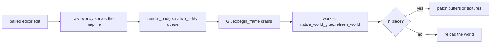

# Native world: display lightmaps and live edits

Status: Built. Part of [native-world.md](native-world.md).
Code: `crates/rewrites/render-bridge/src/native_edits.rs`, `crates/extensions/game/src/native_world_glue.rs` (`refresh_world`, `refresh_shaders`), `crates/rewrites/native-render/src/{gpu,program,load}.rs`. Tests: `crates/rewrites/native-render/tests/edits_gpu.rs`.

Two ways the loaded world changes after the load: a reconstructed lightmap atlas replaces the retail pages on the display copy, and a paired editor's edits patch the resident world.

## Reconstructed display lightmaps

With an owner-baked lamp arm selected at launch, `load_ready` checks both replacement atlases for the active BSP. A failed geometry or page decode, or a page-lit opaque part outside the native stage, keeps that BSP on retail lighting.

| Step | What |
|---|---|
| Match | `ProgramSet::install_relight` builds both texture groups for each material and page/palette pair that samples a lightmap |
| Reserve | The scene reserves the native `WorldPass` for these draws |
| Record | Each target copy selects its group: the display takes the requested arm and the guest reference takes retail |
| Refresh | A live section, shader or image refresh discards the replacement groups |

The offline fit and the room comparison are in [dynamic-lighting.md](dynamic-lighting.md).

## Live edits

A live edit changes the map file as the raw overlay serves it ([realtime-edits.md](../editor/realtime-edits.md), "The native refresh"), and the loaded world is a copy of that file. The hot-edit glue pushes each edited owner onto `render_bridge::native_edits`. At the frame boundary (`Glue::begin_frame`) the world's glue drains its share once the world is resident and no refresh is running, and a worker applies it.

| Edit | Applied how |
|---|---|
| A section, same counts | The cluster or instanced definition is decoded again from the file as the load decodes it (`native_render::load::load_sections`, a definition once per rigid placement). It replaces its vertices in both vertex buffers (`GpuWorld::replace_section`, `World::replace_section`), and the draw bounds the cull and the guest's admission read (`Ready::part_bounds`) and the world's bounds are recomputed. A placement keeps its lightmap bucket's coordinates, lighting vectors and baked colours. Colours supplied by the definition refresh with the section. |
| A section that grew, or that the world cannot take in place (another vertex count, other triangles in a drawn part) | The world reloads (`native_map_work::reload_bsp`), as on a BSP switch. Until the reload publishes, the key is not current and the D3D path draws the world from guest memory. |
| An image, same size and format | Decoded again at each stage that samples it (`stage_images::decode_stages`). Every material program texture made from it is rewritten in place, each signed variant biased as at load (`GpuWorld::rewrite_image`, `ProgramSet::rewrite_image`, `gpu::rewrite_texture`). Another size, level count or format is refused with a log line, and the texture keeps its pixels until the map reloads. |
| A shader, template, pass or vertex shader (`Edit::Shader`) | Each native material built from it is compiled again from the overlaid map as the load compiles it (`native_world_glue::refresh_shaders`) and put in place (`GpuWorld::refresh_programs`, `ProgramSet::refresh`). A constants-only change rewrites its uniform buffers. Any other change rebuilds its programs, stage textures and batch groups. When the fog, water, layers, lights, decorators or opaque pass draw the shader, or the material would draw other parts, the world reloads instead. |

The same image refresh reaches other holders:

| Holder | Entry |
|---|---|
| Lightmap pages | `GpuWorld::rewrite_page`: the page decoded again through each palette the load held, written into every texture that holds it |
| Fog, water and layer stage images | `GpuWorld::held` |
| The lights' gels | `GpuWorld::rewrite_gel` |
| The lights' pass textures and the decorators' | their own glue; a decorator's geometry is prepared again after a model or section edit ([realtime-edits.md](../editor/realtime-edits.md), "The native refresh") |

E3's sun receivers (`native_render::sun_casters::SunWorld`) keep the geometry they loaded until the world reloads. The editor's preview (`GpuWorld::set_section_vertices`) moves vertices without recomputing bounds.

## Related

[native-world.md](native-world.md), [realtime-edits.md](../editor/realtime-edits.md), [dynamic-lighting.md](dynamic-lighting.md).
