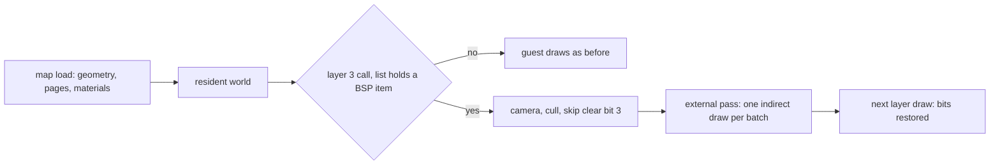
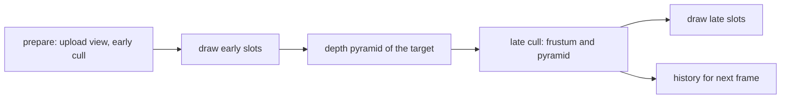
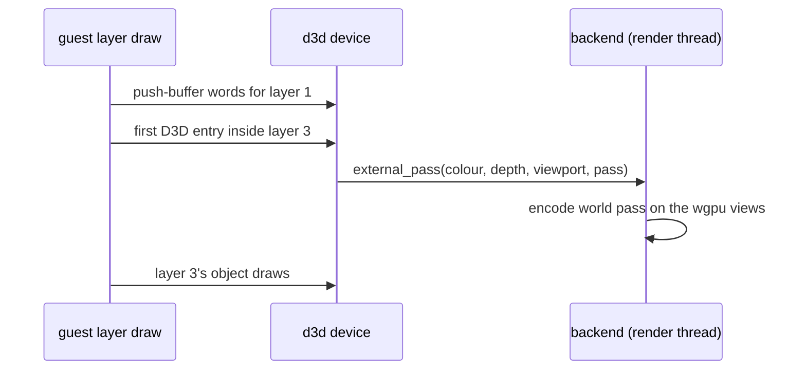

# Native renderer stage 1: the static world

Status: Built. The static world draws natively in the default configuration.
Code: `crates/rewrites/native-render/src/{world,load,camera,cull,cull_gpu,skip,gpu,program,look}.rs`, `crates/rewrites/native-render/src/{cull,cull_pyramid}.wgsl`, `crates/rewrites/render-bridge/src/{native_world,native_edits}.rs`, `crates/extensions/game/src/native_world_glue.rs`. Tests: `crates/rewrites/native-render/tests/gpu.rs`, `crates/rewrites/native-render/tests/cull_gpu.rs`, `crates/rewrites/native-render/tests/edits_gpu.rs`, `crates/rewrites/render-bridge/tests/native_world.rs`.
Switch: `impl.render.native` (on), listed in [switches.md](../runtime/switches.md).

Stage 1 of [native-renderer.md](native-renderer.md). The structure BSP's opaque geometry is read from the map's tags once, uploaded once, and drawn each frame from the game's render camera with frustum-culled indirect draws. The game skips its own layer-3 entries for the parts drawn natively. The rule that must hold: a part the native pass draws is exactly what the D3D path would have drawn, including depth, stencil and the state the layer leaves behind.

| Page | Holds |
|---|---|
| this page | load, per-frame draw, the skip, depth, the look rules, wiring, diagnosis, the guest's inputs to a world pass |
| [native-world-materials.md](native-world-materials.md) | how a material's pass is translated and what it refuses |
| [native-world-live.md](native-world-live.md) | display lightmap replacement and live edits |
| [native-world-walk.md](native-world-walk.md) | stage 1b: the other world layers, the BSP scene walk, the sorted handler, counters, draw sites |

## Stage 1: the static world

### Load once

The load runs at map load and on a BSP switch. The active BSP is `0x004e0348` and the lightmap `0x004e0344` ([structure-bsp.md](../formats/structure-bsp.md)).

| Part | What the load does |
|---|---|
| Geometry | Every cluster section and instanced-geometry placement (`tags::structure::StructureRender`), decoded by `tags::geometry` as the viewer and editor decode them. One shared vertex buffer (position, base-map UV, lightmap UV, normal) and one index buffer. Instances are placed at load (rigid transform plus uniform scale), so every draw is in world space. |
| Draws | One per drawn part (`Part::is_drawn`, not kind 4 transparent): cluster or instance, material, lightmap page and palette, index range, world bounds. Draws sort by batch (material, lightmap page), so a batch is a contiguous slot range of the indirect buffer. |
| Lightmaps | The `ltmp` group whose checksum matches the BSP. Each cluster's and instance's render info picks a P8 page and palette ([lighting.md](../formats/lighting.md)). A page expands through its palette before filtering (the palette is an index lookup, not a multiplier) into an RGBA8 texture array, one layer per (page, palette) pair used. |
| Materials | The part's material indexes `sbsp+0xa4` (stride `0x20`, shader at `+0xc`). Each shader's template and bitmaps decide the native program. A material the native path does not support is marked fallback and keeps its D3D draws. |
| Pipelines | Made once per supported template. |

### Per frame

| Step | What happens |
|---|---|
| Camera | Reads the render camera record and builds the view and projection |
| Cull | On the GPU, by the frustum then the depth pyramid: the guest's whole layer-3 list (a game view) and the whole-world pass |
| Skip | Clears layer 3's bit on the BSP items the native pass draws |
| Draw | One render pass into the game's colour target and depth with the game's viewport; per batch, bind textures, then `multi_draw_indexed_indirect` over its slot range |

**Camera.** The render camera record is `0x004b9da0` (0x74 bytes, filled by `0x0002f800` per view): position `+0`, forward `+0xc`, up `+0x18`, vertical FOV `+0x28`, viewport `+0x30` (i16 top, left, bottom, right), near `+0x40`, far `+0x44` ([occlusion-culling.md](occlusion-culling.md), "Camera and view"). The view matrix and projection use the game's aspect rule (`0x0002fb70`). The paired projection at `0x004b9e14`, when available, supplies both diagonal scales and the off-centre terms. The display copy adjusts the horizontal row for the presented viewport and the retail copy keeps the original lens ([widescreen projection](high-resolution.md#widescreen-projection)).

**Cull.** Two passes draw the world, and they cull in different places:

| Pass | Who uses it | Cull |
|---|---|---|
| Game view (`select_unculled`, `culled_selection_draws`) | the game: the guest's layer-3 list, material programs | On the GPU by `Frustum::sides` of the admission lens, then the pyramid of the guest's depth: every loaded part of the list is claimed and its slot drawn indirect |
| Selected parts (`select_parts`, `selection_draws`) | the fixed stage, tests | On the CPU: a part outside the frustum refuses the list |
| Whole world (`prepare`, `encode`) | the theater's host view, the editor's native view | On the GPU ([`cull_gpu`](../../crates/rewrites/native-render/src/cull_gpu.rs), `cull.wgsl`): compute passes write each draw's `instance_count` into the indirect slots |

The whole-world pass uploads each draw's world bounds once at load (again after `replace_section`) and, per frame, only the view: the planes, the view-projection, the depth rule and the viewport (`CullView`). Every draw owns one 20-byte slot in each of two indirect buffers, `early` and `late`, and each batch is a contiguous slot range drawn with one `multi_draw_indexed_indirect`.

| Phase | Writes |
|---|---|
| Early (`prepare`) | `early`: draws in the frustum that the last test kept (`history`); with no pyramid this view, the frustum's whole set |
| Pyramid (`encode`) | The depth target after the early draws, reduced by max into an R32 mip chain (`cull_pyramid.wgsl`); a level's last column and row take the odd one below, so texel `x` of level `k` covers level 0's `[x·2^k, (x+1)·2^k)` |
| Late (`encode`) | `late`: draws in the frustum the pyramid does not hide, less what `early` drew; `history` for the next frame |

A draw that comes into view is not in `early`, so the late phase draws it the same frame. Draw order changes only between the two runs: a draw revealed this frame draws after the early set.

The pyramid test is conservative: it takes the box's least stored depth from the view's `DepthModel` (its nearest corner's W-buffer value, clamped and floored as the draws store it), the box's screen rectangle widened by a pixel and clamped to the viewport, and the largest pyramid depth over that rectangle at the level where it spans two texels. It culls only when the box's nearest depth is past that by more than `1e-5`, so every fragment would fail the `LessEqual` depth test anyway. A box across the eye's plane is never occluded.

A view the pyramid cannot serve draws the frustum's whole set and is counted by why (`GpuWorld::occlusion_skips`):

| Counter | When |
|---|---|
| `programs` | The world draws with material programs. Their depth is the guest's W-buffer range, which the test does not model. |
| `depth_unsampled` | The depth target lacks `TEXTURE_BINDING`, is multisampled, or has more than one level or layer. `gfx::presenter::OffscreenTarget` (the theater's) creates its depth sampleable. |
| `viewport_moved` | `encode` drew with another viewport than `prepare` uploaded. |

`GpuWorld::read_cull_stats` (frustum kept, drawn, occluded) and `read_drawn` read the last view's results back, blocking: for tests and tools.

**A game view.** The admission (`native_world_glue`) claims every part of the guest's list whose bounds the world holds, and selects them without a camera test (`GpuWorld::select_unculled`). The world pass is a stage that encodes its own commands (`WorldPass::record_encoded`, `gfx::external::ExternalEncoded`), in the frame's encoder after the pending pass:

| Step | What |
|---|---|
| Copies | The programs' view rows and the cull's view and start set, staged at prepare and copied in draw order, so each view's slots are written just before its draws read them |
| Early | `early_history` over the guest cull's slots (`GuestDispatch::record`): a draw is drawn when the guest's list holds it (`start`), `Frustum::sides` of the admission lens (the reference and display copies' union, `cull_camera`) may see it, and the last view kept it or its order matters; `early_frustum` (no history) when the pyramid does not run |
| Early draws | One pass that loads and keeps the attachments; one packet per run of consecutive slots under one binding, in the list's order, `multi_draw_indexed_indirect` over the whole index buffer (`RecordedDraw::with_indirect`). A part the list repeats is drawn again |
| Late | `GuestDispatch::record_late`: the pyramid of the guest's depth after the early draws, then `late_occlusion`: the list's draws in the frustum the pyramid does not hide, less what `early` drew, and the history for the next view |
| Late draws | A second pass of the same packets over the `late` slots, without the bindings whose order matters |

A part the lens cannot see is still the native pass's, and the guest does not draw it; it was clipped on the D3D path too. The late test reads:

| Input | Where |
|---|---|
| The programs' depth, modelled | `DepthModel::program`: the W-buffer value is the device's `c[3]` row dotted with the world position, clamped to the pass's W clip range, floored, over `z_scale` (`xps_w_depth`; `program::frame_pixel` gives world passes no polygon offset). The late test takes a box's least value at its nearest corner. |
| The screen rectangle | `ScreenMap::viewport`: the copy's lens (`display_camera`) into the request's rectangle (`external_viewport`), widened by two pixels plus the copy's scale over the guest's, for a scaled copy's sample shift |
| The guest's depth, sampleable | Guest depth surfaces are `TEXTURE_BINDING` (`gfx::surface`); a multisampled one is not served (`depth_servable`). The pyramids are cached per depth texture, up to four. |

**Order.** A binding whose draws must keep their place in the guest's list is never in the late set (`gpu::keeps_order`): one that blends, writes no depth, tests depth other than `Less` or `LessEqual` (a depth-equal decal pass included), or writes stencil when the depth test fails. Its slots start `ORDERED` (2, against `OCCLUDABLE` 1) and the frustum alone culls them, in the early run, in the list's order. An opaque draw the late run reveals draws after the early set, which changes nothing among depth-tested opaque draws. One case is left: an opaque draw revealed behind a blended one draws after it, so for that one view the blend covers what lay behind the revealed draw.

A game view the pyramid cannot serve draws the frustum's whole set early and is counted (`GpuWorld::guest_occlusion_skips`): `depth_unsampled` as above, and `depth_model` when the view's `c[3]` row is not the lens's w row times a positive scale (`DepthModel::agrees_with`), so the programs' depth and the screen map would disagree.

**Later layers.** The structure runs of a scene view's layers 1, 5, 7, 8 and 20 (`native_layers_glue`, `LayerViewPass::encoded`) cull on the GPU too, as a stage of their own commands: the runs' uniform writes, one dispatch of the layer cull (`GpuWorld::culled_layer_draws`, a third `GpuCull`), then a pass per segment (`layer_segments`: one, unless an object draw reads the bound colour or makes the refraction copy) that loads and keeps the attachments with the runs' packets in the list's order, each part one indirect draw of its slot.

| Step | What |
|---|---|
| Frustum | `Frustum::sides` of the lens layer 3's admission takes (the union of both copies', `display_camera` at the target's factor), over every run's parts |
| Pyramid | `layer_occlusion`: an item every pass of which draws nothing where hidden (`gpu::hidden_draws_nothing`: a `Less`, `LessEqual` or `Equal` test, blended or not, and no stencil write on depth fail) is tested against the pyramid this view's layer 3 built on the same target. Its depth is at least the view's final depth at every pixel, as later draws only lower it. Any other item is `ORDERED`: the frustum's alone |
| Token | The pyramid is read only for the same view and frame (`native_world_glue::view_token`: the swap's run and the guest's view index), screen and depth model (`GpuCull::served_pyramid`). Its build stamps the token on the GPU after it runs (`PyramidBuild::stamp`), and the layer cull compares it there (`pyramid_token`), so a build planned but never recorded culls nothing |

Layer 1 draws before its view's layer 3, so it finds no pyramid: the frustum alone culls it, counted with every other such view as `layer_view` (`GpuWorld::layer_occlusion_skips`). A layer whose objects sample the view or the accumulation target, layer 2's sorted runs, and a view without a camera draw their structure unculled.

The admission's frustum test kept the selected-parts pass equal to the D3D path by these rules, which the GPU's `Frustum::sides` keeps:

| Rule | Detail |
|---|---|
| Planes tested | The four sides and the eye's plane only (`Frustum::sides`). The camera's `near`/`far` are not the range the programs clip to, because distant geometry lies past the camera's `far`. |
| Clip range | The programs clip w to the device's pushed clip range (`SET_CLIP_MIN`/`MAX`, `nv2a::w_clip_range`) and `D3DRS_DEPTHCLIPCONTROL`'s clamp, which the game sets per view (`0x00015720`). The device gives the pass both at issue (`ExternalPass::depth_clip`, `Device::depth_clip`) and the world's programs draw with them (`ViewInputs::w_clip`). `ObjectsPass::depth_clip`, the transparent pass and the stage 4 cluster light pass take the device range too. |
| Non-W-buffered view | A view whose draws are not W-buffered (`SET_CONTROL0` without z-perspective) is left to the D3D path (counted in the log), because the programs write and clip w. |
| Keying | The world is keyed and loaded by the game's active BSP index (game globals `+2`, `i16`; `native_world_glue::active_bsp_index`), which must load at that address. A level's BSPs share one address across views. A placement's placed copy is unscaled, as the game draws it (`load`). |
| Packed vectors | The lighting vector (`v5`) and frame vectors (`v2..v4`) are `NORMPACKED3` words in the stream format table (`0x0043f408`, type `0x30`). A world vertex carries them as words (`WorldVertex::packed`) and the material programs decode them as the D3D path does (`program::INPUTS`, `WORLD_FETCH`), so a world program's module equals the D3D path's for the same draw, text for text (`a_world_program_s_module_is_the_d3d_path_s`). The CPU midpoint decode (`load::program_lighting_vector`) is not used for lighting. |
| Block-compressed stages | Stage bitmaps keep their BC blocks (`assets::decode_image_blocks`, `Image::with_blocks`) and upload where the device takes BC, on the D3D path's rule (no signed channel: `bias_signed` drops them). The CPU DXT decode truncates interpolated colours and would be one level darker. `program::describe_image` prints a stage's native upload (format, size, levels, a hash of level 0) beside the D3D texture. |
| Inherited cull | A pass that does not set `CULLMODE` takes the device's `CULLMODE` and `FRONTFACE` at the layer-3 call (`look::WorldPass::inherits_cull`, `native_targets_glue::cull_state`, read from the guest's render-state shadow at `0x00407498` as the stencil is; `program::InheritedCull`). Clusters and placements both take it. |
| Placement fade | A placement the guest's walk fades carries a fade byte in its render record (`+0x1a`; `0xff` is solid). `scene_extract::layout::skip::placement_records` reads it per placement of layer 3; `render_bridge::native_world::placement_fades` rescales it by the display's LOD Distance word (`world_walk::placement_display_alpha`; Highest draws solid) and picks the pattern of the engine's stipple table (`0x00487288`, 17 patterns of 32 rows, `opaque_material::stipple_table`). `GpuWorld::set_fades` marks those placements on the selection; the selection's rigid draws of them bind the rigid program's stipple variant (`program::RigidStipple`, `object_program::stipple_module`) with the placement's vertex slot and the pattern's pixel block (dynamic offsets), so only a faded placement tests the rows. A solid placement draws as without fades. |
| Unmatched pixel fields | `explicit_final` (only when both final-combiner input words are zero, which a world pass's are not), an all-ones `stipple`, `fog_color` and `bump_mat`/`bump_lum` (read only by a fog-reading combiner and the bump-environment modes, which `world_parity` refuses) are not matched. |

### Skip only the replaced work (Code)

The scene list `0x004c1a48` (layer lists at `0x004c1a48 + 0x18·n`) holds items of `0x18` bytes at `[list+0x14]`, appended by `0x0003b9d0`:

| Item | Meaning |
|---|---|
| `+0x00` | build function (called by `0x0003bab0` per layer) |
| `+0x04` | draw function (called by `0x0003bc30` per entry) |
| `+0x08` | shader datum |
| `+0x0c` | argument: render record index `<< 8`, low byte a part index |
| `+0x10` | layer mask (bit `n`: drawn in layer `n`); the list's `+8` is the OR of all |
| `+0x14`, `+0x15` | bytes passed to both functions |

Structure and model geometry are queued by `0x00041040` through `0x00040e30` with build `0x0004cbf0` and draw `0x0004d0b0` (pushed at `0x000412fa`/`0x0004132b`; the transparent path records `0x00041020`). The render record is `0x004ba138 + 0x20·index` (`0x0002cbf0` fills it). Its `+4` is an object's render model tag datum (not its handle; "Stage 2" in [native-objects.md](native-objects.md) says how a record names its object) and `-1` for the BSP. The cluster records (`0x00133390`, call at `0x00133504`) and instanced-geometry records (`0x00133520`, call at `0x001336d3`) both pass `-1`, and the build function tests `[record+4] != -1` (`0x0004cc2c`).

A structure item in layer 3 is therefore: build `0x0004cbf0`, `[0x004ba138 + 0x20·(item[+0xc] >> 8) + 4] == -1`, mask bit 3 set. The skip is one hook per layer draw, not one per item:

| When | What |
|---|---|
| Before the layer draw `0x00044550` with the current layer `[0x00467130] == 3` | Walk the current list (`[0x00467138]`; `+4` count, `+0xc` first, `+0x14` items), clear bit 3 of each structure item the native pass draws, remember them, and ask `d3d` for the native pass. The list's OR word `+8` stays, so the layer still walks its items and finds the drawn parts' masks clear. |
| Same, for an item the pass does not draw | Leave its bit: the guest draws it. Counted `scene_kept_3_world_<cause>` ([native-world-walk.md](native-world-walk.md), "What the scene cannot draw keeps its guest draw"). |
| Before the next layer draw (5 and up follow 3 on the scene list, in the same view) | Set the bits back, on each item that still holds the mask the skip left. It is not done after the layer itself, because the chain calls the body's tail through a Rust continuation that a second executor cannot run. |

The layer draw then builds no entry for the world: no build call, no shader draw, no geometry submission, no push-buffer words. Objects, transparents, lights and the HUD keep their entries. Guest memory after the layer matches the run without the switch except for what the skipped draws would have written (the shader draw's state cache, D3D's shadows). That is render state only: the simulation never reads it, co-op lockstep hashes none of it, and the native renderer never writes guest memory.

**Stencil.** The structure draw switches the stencil around an item in layers 1 and 3 (`0x0004d0b0`; modes by `0x00015370`'s table at `0x00015658`):

| Moment | Condition | Mode |
|---|---|---|
| Before the item (`0x0004d640`) | either flag byte `0x00485a75`, `0x00485a76` set | 0 (stencil off) |
| Before the item | else the render record's `+0` bit 14 | 2 (`ALWAYS`, reference `0xff`, `REPLACE` on pass, masks `0xff`) |
| After the item (`0x0004d720`) | either condition | 1 (the same with reference 0) |

Bit 14 is the item's visibility flag `0x200` moved up (`0x001332f0`), the same for clusters and placements. An item with neither draws with the stencil as the layer found it.

The feature reads how layer 3's items switch the stencil before asking the host (`skip::stencil_plan`: the flags, the marked BSP sections by cluster or placement, whether any item switches). Unreadable, the view's structure items keep their guest draw, counted `scene_kept_3_world_stencil_plan` (`native_world::stencil_views`). The native pass draws its parts before the layer's items and clears their items, so their switches do not run. `native_world_glue::pass_stencil` makes that exact:

| Case | The native pass draws with |
|---|---|
| No item switches | the stencil the guest's render-state shadow holds when asked (`native_targets_glue::stencil_state`, translated as a draw's pipeline translates it, `gpu::PassStencil`) |
| Some item switches, layer not in mode 1 | nothing: the D3D path draws the view (counted in the log). An item leaves mode 1, so the layer must start in mode 1 (`PassStencil::is_structure_mode`) for the items left to D3D to draw as they would. |
| Some item switches, a flag set | every part with the stencil off (mode 0) |
| Some item switches, no flag | a marked section's parts with reference `0xff` (mode 2, its own run in the batch, `PassStencil::reference_of`), the rest with mode 1 |

Each part writes what its own item would where it is drawn (`ALWAYS`, `REPLACE` on pass), so which part is last at a pixel is the depth test's, as on the D3D path (S: coplanar ties may differ). The native pass sets no device state, so the layer's D3D items and everything after it see the state the layer started in: mode 1 whenever an item switches, which is what the game's last switching item leaves (`0x0004d720`). `native_world_glue`'s test checks the per-mode writes and that state against `engine::render::stencil::for_mode` over every stored value.

Nothing after layer 3 tests the stencil from engine code. Every caller of `0x00015370` passes mode 0, 1 or 2 (the light passes 0), and only `0x00015370` and the quad `0x0003bf20` set `STENCILFUNC` (e3-lighting.md, "Stencil: every use, named"). The transparents and objects draw without the stencil (S).

**Only the world's layer 3.** The layer draw also runs for the first-person render (`0x0003fdf0`, after the transparents): layers 1, 3, 8, 20 and 7 of a list holding the player's first-person models only, under its own projection. Its caller sets `0x00485a76` (so the stencil plan says "off") and no depth clear happens under that flag (`0x0004004f`..`0x00040066`). About a third of all layer-3 draws are these.

The feature asks for the native pass only when the layer's list holds a BSP item (`skip::has_structure_items`). Otherwise the whole world would be drawn again over the finished scene with the first-person constants, nearer than the scene's depth, and paint bare world over decals, the dynamic lights' `ZFUNC` equal passes and the transparents (03a's fire and smoke).

### Where the native pass goes, and depth

The ask is recorded in order with the draws. The device issues it at the next drain of the push buffer, which is the first D3D entry inside the layer draw, so it lands after layer 1's draws and before layer 3's object draws.

The device knows the bound colour surface, depth surface and viewport then, and the backend runs the pass's encoder on the render thread with the wgpu views of those surfaces (`Backend::external_pass`). With the render scale on it runs in the scaled view.

With E1 reprojection the interpolating backend must record it with the frame so a replay redraws it with the warped camera (S: not built).

Depth must agree with what the D3D path writes, because later passes depth-test against it (layers 5, 7, 8 on the same surfaces, objects, transparents). The game W-buffers: the stored depth is `floor(w · zs / far) / zs`, with `zs` the D24 full scale and `far` the camera's far plane ([occlusion-culling.md](occlusion-culling.md), "The W scale").

The translated pixel programs write that as `frag_depth` (`shaders::psh::wgsl`, `xps_w_depth`) and so does the native fragment shader, from the same perspective-correct `1 / position.w`.

A world draw whose layer-1 pass already wrote depth is tested `LessEqual` against it, and one without writes it. Equal-depth passes the D3D path still draws over the world line up only when the native clip position equals the translated vertex program's bit for bit; [native-world-walk.md](native-world-walk.md) removes that dependency by drawing layers 7 and 8 natively too.

Every world template also has, after layer 3, shadow application (11), the lights (12, 13) and planar fog (16), all `ZFUNC` equal (`0x202`) without depth writes (`h2 shader`). The native pass must match the D3D path's depth per part:

| Part | How the native pass matches |
|---|---|
| Clusters | Classification 0 of the pass's vertex program, `v0` the section's position. The world keeps a cluster's position bits as decoded (`WorldBuilder::add_section`, no identity arithmetic: `0 + -0` is `+0`, `x + 0·inf` is NaN). The program, view constants (`c[0..18]` at the issue) and W depth (`floor(w)/16777215` for D24, `xps_w_depth`) are the D3D path's. |
| Instanced placements | The structure draw takes the rigid classification (render record `+0` bits 3 and 12, set by the placement caller `0x001336d3` of `0x0002cbf0`; the cluster caller `0x00133504` sets neither). Its program decompresses `v0` with `c[170..171]` and places it with `c[50..52]`. `0x0004d830` uploads those rows from the matrix at render record `+0x1c`, which for a placement is the placement's tag element (`[sbsp+0x144] + 0x58·i`): forward, left and up by column and the position, copied bit for bit, the scale at `+0` not applied. |

For placements the load reads each placement's rows from its tag element (`world::model_rows`, `World::rows`). The material's pass is compiled with classification 1 as well (`look::rigid_program`, `program::compile_rigid`, which requires that it read `c[50..52]`; `program::rigid_fit`). Each placement's parts draw with it from the definition's vertices as their streams hold them (`World::program_vertices`), with the placement's uniforms at its slot's dynamic offset in one buffer per material (`program::rigid_vertex`, the frame's view then the rows). Within a batch the draws sort by owner, so the clusters draw as one run and each placement as another.

`tests/model_rows_differential.rs` runs the lifted `0x0004d830` on seeded placements and checks that the floats it hands the constant upload `0x003f7330` (at `c[50]`, twelve) equal the port's, bit for bit. A material without a rigid program, or whose placements lack a stream it reads, keeps its placements on the D3D path, by reason in the load's log. The lights take only materials with none left there.

### Match the look

The render record selects the layer-3 lighting implementation for each cluster or placement. A shader can sample a lightmap page, combine its base and detail maps with baked vertex colour, or use dynamic lighting. Layer 16 applies fog later.

The native pass compiles the selected vertex program (`vrtx`) and pixel shader definition (`spas`) with the translator the D3D path uses, and takes the device's view constants at issue. A material whose pass does not translate stays on the D3D path. There is no hand-written look in between.

### How correctness is checked

| Check | What it covers |
|---|---|
| Unit tests (no disc) | World building from invented sections (draw ranges, batches, instance placement, bounds), the camera read from an invented guest record, frustum culling against known boxes, the scene list walk and restore on invented guest memory |
| GPU tests (headless wgpu, skipped without an adapter) | A native draw of an invented world into an offscreen target; its W depth equals the formula. The GPU cull against the reference box test, and its occlusion |
| Frame A/B (the game) | The same 03a frame with and without the native renderer (`impl.render.native=off`), compared by pixel diff, through the headless capture (`H2_BOOT_GFX`) or the agent API's `capture`. Report the share of differing pixels, the largest difference and an image of the differences. Frame stats `cpu`, `d3d`, `encode`, `submit` and the `render-timing` site `0x0002bed0` (layer 3) give the CPU saved. |

### Modules

`crates/rewrites/native-render/src`:

| Module | Does | Tested by |
|---|---|---|
| `world` | One vertex and index buffer for the whole BSP, one draw per opaque part in world space, sorted into batches of one material and one lightmap page. Transparent parts and bad triangles are counted and left out. | Test |
| `load` | The scenario's (BSP, lightmap) pairs, the BSP's material shaders, every cluster and placed instance through `tags::structure`, each with its lightmap page and palette from the group whose checksum matches; P8 pages expanded through their palette | Test for the expansion and the render-info rules; the map read needs the disc |
| `camera` | The render camera record read from guest memory (rejects NaN, empty viewports, `far <= near`), the view, the projection by the game's aspect rule, the W-buffer depth formula | Test |
| `cull` | Frustum planes and the conservative box test (the admission's, the models', and the reference for `cull.wgsl`) | Test |
| `cull_gpu` | The whole-world pass's cull: bounds uploaded once, two indirect slot buffers, the early and late compute passes, the depth pyramid, the skip counters | `tests/cull_gpu.rs`: the compute cull keeps exactly what `Frustum::may_see` keeps on a random scene, with and without the pyramid; a box behind a wall is culled; a box revealed by a step aside is drawn that frame |
| `skip` | The current list's walk, the structure-item test, clear and restore | Test, on invented guest memory |
| `gpu` | Buffers and bind groups made once, one pipeline per (colour, depth) format pair, `prepare` (uniform, view, early cull) and `encode` (the early run, the pyramid and late cull, the late run; each run one pass that loads and keeps the target and depth, one `multi_draw_indexed_indirect` per batch) | `tests/gpu.rs` draws an invented wall at view depth 10 and a culled one behind the camera; colour is base times page and depth is `w_depth(10, far, D24)` within one step |
| `program`, `look`, `pass_state` | The material translation ([native-world-materials.md](native-world-materials.md)) | |

### Wired into the game

**`d3d` external pass.** World and object replacements use the ordered reservation in [native-renderer.md](native-renderer.md), "Admission". `Device::request_external_pass` schedules legacy passes at the next push-buffer drain. `crates/platform/d3d/tests/external_pass.rs` covers both entry points, direct and threaded recording, scaled attachment refusal and replay.

**The feature `native-world`** (`crates/rewrites/render-bridge/src/native_world.rs`). `LAYER_DRAW` is an opaque point, so the hook is one observer before it:

1. It sets back the bits the last layer 3 cleared, on items that still hold the mask it left.
2. With layer 3 current, it reads the camera and the active BSP (`0x004e0348`) and asks the host.
3. When the host accepts, it clears layer 3's bit on the BSP items whose part the world draws (`skip::clear_parts`).

The observer sits inside `render-timing`'s observers (`after_feature`). It runs on the pipelined render thread (context-only, nothing after the body), once per layer draw and nothing per draw.

It touches the guest memory its context sees (item masks, camera, active BSP, map name), the published host resources and the D3D device's current targets. The loader opens the map through the VFS and works from the map and the captured device palettes. The host drains previous commands, previews the list and confirms one batched reservation for the view before applying masks.

Tests are in `crates/rewrites/render-bridge/tests/native_world.rs`: the plan with `render-timing`, deep, and the layer-draw port all on; alone, the chain runs on a second executor; on by default; `impl.render.native=off` places nothing; the skip and its restore at the next layer draw on synthetic memory, a rebuilt list left alone, and a part left to D3D keeping its bit though its shader is drawn.

**Boot glue** (`crates/extensions/game/src/native_world_glue.rs`). On a new (map name, active BSP address) a worker runs this sequence:

1. Opens the loaded map through the VFS with its shared maps and picks the scenario BSP whose tag data sits at that address.
2. Builds the world, decodes each lightmap page (with its mip chain) and translates each material's layer-3 pass.
3. Checks each part against the inputs of its vertex classification and its lightmap page. Parts that lack an input keep their D3D draws.
4. Uploads the world on the backend's device and queue, then makes the light, fog, water, scene-layer and decorator resources.

Each ready stage transfers at `RENDER_VIEWS` before the first view. A busy GPU world defers the transfer to another frame. A BSP switch or revert opens a fresh receiver and D3D draws its parts until the new stage is ready.

The final packet releases the BSP's resources to a sleeping utility worker for destruction. Each layer-3 view then asks the device for a `WorldPass` with the view's camera.

The skip goes by part. The host returns each drawn part, by cluster or placement and part index, with its material's shader, and `skip::clear_parts` clears an item only when its part is one of them with that shader. An item names its part exactly as the build `0x0004cbf0` reads it (`0x0004cec1`..`0x0004cf21`):

| Record `+0` bit 12 | Reads |
|---|---|
| clear | the cluster at `+0xc` bits 9..17 (`[sbsp+0xa0] + 0xb0·cluster`, its section at `+0x50`) |
| set | the placement at bits 18..28 (`[sbsp+0x144] + 0x58·placement`, its definition at `+0x34`, `[sbsp+0x13c] + 0xc8·definition`, section at `+0x50`) |

The item argument's low byte then indexes the section's parts (`[section+4] + 0x48·part`, the order `tags::geometry` decodes and `native_render::load` keeps, undrawn parts included). A material that shares its shader with one left to D3D is native too. The lights' split clears by shader (`feature::native_lights`), so the lights take only the materials whose shader is native whole.

Log lines per load:

- `native-world: N of M materials draw natively with their own programs (P of Q parts); K stay on the D3D path for R reasons`, then one line per reason, most parts first.
- `native-world: <map> BSP at <addr>: N draws in B batches, P parts native, in S s`.
- Every 1,800 layer-3 views, a drawn-natively tally.

A pass that comes without the device's view constants draws nothing and says so once.

### Diagnosing a frame that differs

On native surfaces only (the D3D ones are the game's own):

| Symptom | Likely cause |
|---|---|
| Speckle or holes on world surfaces, objects showing through | Depth. Layer 1 (D3D) wrote the world's depth and the native layer 3 tests `LessEqual` against it, so the native W depth must equal the D3D path's bit for bit; one step deeper fails the test. |
| A whole material too dark, too bright or flat | Its lightmap (the P8 page through its palette, bound at stage 3), its bump map (`P8Bump` through the device palette at stage 2) or a constant |
| Shimmer or blur at a distance | Sampling (the bump stage is 4x anisotropic; mip chains) |
| Cut-out foliage or grates filled in or missing | The pass's alpha test |
| Stencil-driven effects after layer 3 | "Skip only the replaced work", above |
| Decals, lights, fire and smoke gone, walls right | The world drawn over the finished scene by a native pass in a layer 3 that is not the world's (the first-person render's; `skip::has_structure_items`) |

### What a world pass reads

Evidence: Code, `h2 disasm`, `h2 shader`, `vsh` disassembly.

A world material's layer-3 pass is what `tags::material` resolves. On 03a the opaque world templates are `tex_bump` and its variants (`_env`, `_detail_blend`, `_three_detail_blend`, `_two_detail`, ...). A `tex_bump` layer 3 is one pass (`lightmap_tex_detail`) with implementations for per-pixel lightmaps (stage 3), per-vertex colour and dynamic lighting. The record builder picks the implementation per draw.

| Condition | Implementation |
|---|---|
| A matching first lightmap group, cluster | 0 |
| A matching first lightmap group, placement whose lighting mode at `+0x56` is zero | 0 |
| A matching first lightmap group, other placements | 1 |
| No matching group | 3, for both |

The native loader follows the same rule as `world_walk::Plan::lighting`. Two parts that share a BSP material but select different implementations get separate layer-3 program slots.

The pass's vertex program comes from its `vrtx` tag's geometry classification. Classification 0 is world space (S: its program reads `v0` as a world position and applies no model transform). For the per-pixel `tex_detail` program it reads:

| Input | Meaning | Our source |
|---|---|---|
| `v0` | world position | section positions |
| `v1` | texture coordinate | section texcoords |
| `v2`, `v3`, `v4` | the tangent frame (normal, binormal, tangent) | section tangent-frame stream |
| `v5` | the lightmap bucket's signed lighting vector (stream `30`, [lighting.md](../formats/lighting.md)) | bucket stream's words, decoded in the shader as the D3D path does (`NORMPACKED3`, not the CPU's midpoint decode) |
| `v6` | lightmap coordinate | bucket stream `1f` |

and these constants (hardware numbering, D3D register + 96):

| Constants | What | Set by | For the native pass |
|---|---|---|---|
| `c[0..3]` | view-projection rows (`dph` with `v0`) | per view, in one block upload | the device's values at the pass |
| `c[5].w`, `c[6]` | the scale that packs a unit vector into a colour (S: `0.5`, `n·s + s`); a world-space vector (dotted with the tangent frame into `oD0`) | per view | the device's values |
| `c[10]`, `c[11]` | the viewport scale and offset (`oPos` fix-up) | per view | the device's values |
| `c[12..17]` | six registers in one block | `0x00025c70` | the device's values |
| `c[18..20]` | stage 0..2 texture-coordinate scale (xy) and offset (zw) | the instance (`0x00018e80`) | `tags::material`'s instance constants |
| `c[50..52]` | model transform rows | `0x0004d830` from the render record's matrix, skipped for clusters (`[record+8] == -1`) | identity for clusters; for a placement (rigid program) its rows per draw, `world::model_rows` |
| `c[170..172]` | position and texcoord decompression (scale, offset) | `0x0001cdd0`; `0x0004d7c0` passes no compression for the BSP (record `+4` is `-1`), so the default upload (`0x0001cf29`, scale 1, offset 0) | `c[170]` all 1, `c[171]` 0, `c[172]` `(1, 1, 0, 0)`: BSP vertices are uncompressed |

**Without a game.** The editor has no device, so `program::ViewInputs::from_camera` builds the per-view block from a camera:

- `c[0..3]` is the view-projection rows scaled by `zs / far` (so `w` is the W-buffer's, "The W scale" in [occlusion-culling.md](occlusion-culling.md)) with the z row equal to the w row.
- `c[5].w` is 0.5, and `c[10]` and `c[11]` hold the guest viewport (x, y, z).
- The clip range is the game's `[near / far, 1] · zs`.

The other registers and components (`c[4]`, `c[5].xyz`, `c[6]`, `c[7..9]`, the `w` of `c[10]` and `c[11]`, and the block at `c[12..17]`) are not known well enough to synthesise and are not given (`program::CAMERA_GIVEN`). The editor loads the layers with that mask (`layers_load::load_with`). A pass whose vertex program reads a component outside it, by any lane of a swizzle or by a relative read based in the block, is refused and named with the register (`program::ungiven_view_read`), never drawn with zeros.

**Where `v5` and `v6` come from** depends on the render record (`0x004ba138 + 0x20·i`). `0x0002cbf0` packs its `+0xc` as bits 0..3 an argument, 4..8 an index into the `0x24`-byte table at `0x004c152c` (`0x1f` none), 9..17 the cluster index, 18..28 a placement index. Record `+0` bit 12 says which (the structure draw's choice at `0x0004d18b`). The cluster records (`0x00133390`) pass `-1` for the placement, so bits 18..28 are `0x7ff`. The structure draw's layer-3 part (`0x0004d285`..`0x0004d420`) then reads:

| Record | Condition | Source |
|---|---|---|
| A cluster | bits 18..28 `0x7ff`, `[record+4] == -1` | No bucket. The section's own streams carry `1f` and `30` (structure-bsp.md: `30` is present exactly when the section's lighting flag bit 1 is set), and the cluster render info (group `+0x2c`) at the cluster index picks the lightmap page and palette. |
| An instanced placement | `[record+4] == -1`, bits 18..28 the placement | `instance_bucket_refs[placement]` (group `+0x54`), its first offset times 4 bytes written into the bucket's first descriptor when bucket flag bit 0 is set (`0x0004d3a1`), then `0x0004dc60` binds the bucket's streams. Page and palette from `instance_render_info[placement]` (group `+0x4c`). The definition's section is shared by every placement, so its lightmap coordinates and lighting vectors are the placement's, in the bucket. |
| An object | `[record+4] != -1`, bits 18..28 not `0x7ff` | `cluster_bucket_refs[bits 18..28]` (group `+0x64`; despite the name, the engine reaches it only for object records here), the offset at entry bits 9..17. Not the world's concern. |

In the per-vertex implementation, the classification can declare baked colour (semantic 14) at `v6`. The colour descriptor supplies packed ARGB (`2e`) or three RGB bytes (`2f`, alpha 1). Its bucket offset is in vertices, and the rigid pipeline fetches normalised RGBA at that location. A placement whose shader uses the special BSP parameter setup stays with the sorted handler, which runs that setup and skips the bucket bind.

A cluster reads its section's own `lightmap_texcoords`. A definition has no `1f` of its own, so a placement reads its run of the bucket (`load::instance_run`, `load::bucket_slice`), and the lighting vectors (`30`) the same way (S: the bucket's `30` stream is indexed like its `1f`).

**Per-view constants.** `c[0..17]` are the same for every draw of a view, and nothing in layer 3 writes them per draw (the per-draw uploads found are `c[18..]`, `c[21]`, `c[22]`, `c[24]`, `c[25]`, `c[31]`, `c[50..52]`, `c[170..172]`, `c[174]`). The native pass reads them from the device's constant state when the pass is issued, after the drain, so the view's own upload is in. That is exact by construction, with no camera maths of ours to keep in step with the game's.

**The pixel side** is the implementation's final pixel shader definition (variants built, instance colours patched), translated by `shaders::psh`. For `lightmap_tex_detail` it combines base (stage 0) and detail (stage 1, `x2`), the bump map (stage 2) dotted with the tangent-space lighting vector (`v1`) and view vector (`v0`), and the lightmap (stage 3). Its `c0` constants of the specular stages (4 and 5) are marked engine-driven (`h2 shader` prints "engine constants", mask `0x30`). Code (`h2 disasm`, the 03a pass's bindings read off the disc) traces them:

- The per-pixel implementation has one spas `+0x38` binding through `0x00019ca0`: mode 3 (the alpha channel), no transform, engine scalar 21. Its input masks (spas `+0x104..+0x114`, the inputs `0x0001ae70` evaluates before the draw, bit `n` input `n`) are scalar 21 and integer 5 (the fragment selector), nothing else.
- Scalar 21 is `0x000337e0`, which returns `0x485a6c`. Integers 4 and 5 are `0x485a64/0x485a68`. `0x0001bbf0` copies all three from the `shad` (`+0x44`, `+0x3e`, `+0x40`) before each draw.
- So the "engine" constant is the instance's own specular scalar, the same on every draw of the shader, and `tags::material` already resolves it into the pixel shader definition (`EngineInputs::for_shader`). The stage-5 `c0.rgb` is an instance colour.
- `ResolvedImplementation::per_draw_inputs` says when an implementation reads anything else (another scalar, any vector, another integer, by mask, binding or fragment selector). Only those stay on the fallback.
- The per-vertex implementation has the same masks. Dynamic implementations can also read engine lighting vectors.

### Material translation

[native-world-materials.md](native-world-materials.md) holds the rules: the render states taken from the pass, what `program::compile_world` and `world_parity` refuse, palettised stage bitmaps, samplers, per-frame inputs and the texaccum samples.

## Not verified

- Coplanar ties between parts at a pixel may differ from the D3D path (S: which part is last is the depth test's).
- The transparents and objects draw without the stencil (S).
- A tag's or engine render-state list that tests the stencil after layer 3.
- Reprojected frames redrawing the native pass with the warped camera.

## Related

[native-renderer.md](native-renderer.md), [native-objects.md](native-objects.md),
[occlusion-culling.md](occlusion-culling.md), [lighting.md](../formats/lighting.md),
[structure-bsp.md](../formats/structure-bsp.md),
[notes/native-ab.md](notes/native-ab.md).
