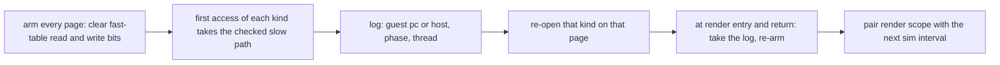

# Pipelined rendering: the census and its results

Evidence for [second-executor.md](../../runtime/second-executor.md). Index and verdicts: [pipelined-render.md](pipelined-render.md).

Two runs of the `render-census` feature on 2026-11-18, Old Mombasa, headless, on the owner's disc. Commit: not recorded (the source page was last revised at `b8b163968`). Method: below. Reproduce with the command under "Running it". Not re-run. The TSV and log stay outside the repository.

## The census

Code: `crates/rewrites/render-bridge/src/render_census.rs`, on the runtime's access trap `crates/runtime/runtime/src/trap.rs`. Off by default; it needs a new `h2` binary only, with no generated-code or image change.



Every inline guest access (generated C in `h2fastmem.h`, Rust `Guest::read_bytes`/`write_bytes`) checks the page's bit in the fast page table first. A guest hit re-opens that kind on that page, so a page costs at most one slow read and one slow write a scope. A host hit is logged and the page stays armed, so guest writes after our D3D layer are still seen. No `mprotect`, no fault handler. The write watch's dirty bits could not do this: no reads, no `pc`, no way to tell our D3D layer's stores from the game's.

Per frame the render scope's read and write sets are paired with the sim interval between two renders:

| Field | Pages that are... |
|---|---|
| `rw` | written in the render scope; split `guest`, `d3d_only`, `host_only` |
| `render_read` | read in the render scope |
| `sim_written`, `sim_read` | written / read in the sim interval |
| `rs` | render-written, then read by the next sim interval |
| `rs_core` | `rs`, less the stack and pages only our D3D layer wrote |
| `ww`, `ww_core` | render-written, then written by the next sim interval |
| `sr` | sim-written, then read by the next render: what the snapshot freezes |
| `other_thread_hits` | hits from another guest thread's slice inside the render scope (left out) |
| `sim_d3d_hits` | D3D-layer hits in sim intervals: D3D calls the sim makes |

Per page it keeps the first writer and reader of each relation (guest `pc`, or `d3d`/`host`) and, for sticky pages, the 64-byte lines the render wrote, the sim read and their overlap (`dep_lines`). Regions: `stack` (256 KB below the render entry's `esp`), `push_buffer`, `d3d_scratch`, `d3d_globals` (`0x00403000..0x00409000`), `datum:<name>` (datum arrays found by their `d@t@` signature), `game_state` (the `0x3fe000`-byte block at `[0x004e6080]`), `world_pool` (`0x80061000..0x83145000` and its `0xf...` alias), `xbe_image`, `contiguous`, `write_combined`, `other`.

### Version 2

Version 2 fixed the three caveats of the first run's line data:

| Change | Rule |
|---|---|
| Sticky pages per region group | The pages most often in `rs_core` are made sticky in each of `xbe`, `game_state`, `datum`, `world_pool` and `other`. The stack and our D3D layer's memory are never sticky. `H2_RENDER_CENSUS_LINES` is the budget per group (default 64, `0` none, `all` every `rs_core` page). The trap keeps a sticky page's line masks per guest thread (`runtime::LineRec`), so the budget costs slow accesses but no log space. `coverage group=...` lines give each group's coverage; `rs_core_lined` is the total |
| Order | A sim read counts toward `sr_lines`/`dep_lines` only if the same thread had not written that line earlier in the interval. `sr_lines_any`/`dep_lines_any` keep the unordered count |
| Threads | Every hit carries its guest thread (from the frame stats). The game thread runs the render entry. Other threads' hits leave the page sets in both scopes and are counted per thread (`other_thread scope=... thread=...`). Another thread reading a page the render wrote is `rs_other` (`dep_lines_other` for its lines). Without frame stats the census falls back to the phase rule |
| HLE calls | The runner counts each Rust-handler call by target and guest thread, with the calls that ended in a STOP. The census names them (`kernel:<export>`, or the override's name): `hle scope=render name=... calls/frame game=... other=... stops ...`, the top `H2_RENDER_CENSUS_TOP` per scope plus every wait |
| Host writes by subsystem | A host hit carries the Rust handler it ran in. `host_writes scope=render by=<name>` counts pages a frame by first host writer; the TSV's `host_writer` column names it. `<source>:no-handler` is host code outside any handler |

The TSV keeps the first 20 columns and adds `rs_core`, `rs_other`, `host_writer`, `sr_lines_any`, `dep_lines_any`, `other_read_lines`, `dep_lines_other` and `sticky_frames`.

Limits: raw RAM readers that bypass the accessors (`Guest::physical_ram`: the lockstep hash, snapshots) are not seen, and none is guest code. Atomics (`runtime::atomic`) count as the host. A hit from another guest thread consumes that page's arming for the scope, so the owner's first access is missed at page level. Without frame stats every host hit is `host`. The run is slower while the census is on; its numbers are page sets, not times.

Output: every `H2_RENDER_CENSUS_EVERY` frames (default 300) and at game end, `window` and `run` summary lines (per-frame averages), `region` counts, the top `rs`, `ww` and `sr` pages (`H2_RENDER_CENSUS_TOP`, default 20), and the version 2 lines. `H2_RENDER_CENSUS_OUT=<path>` rewrites the full per-page table as TSV at each report. A map activation reports the remaining window and starts a fresh census.

### Running it

```sh
H2_FEATURES=render-census H2_FRAME_STATS=1 H2_RENDER_CENSUS_LINES=64 H2_RENDER_CENSUS_OUT=$TMPDIR/census.tsv h2 run ...
```

`H2_FRAME_STATS=1` is required for version 2's thread split. Add `render-timing` to `H2_FEATURES` to get both in one run; the census then leaves the render scope to it.

## Census v1 (2026-11-18)

One run: 4,200 frames, `render-census` with frame stats, default sticky set (16 pages, re-picked every 300 frames). Writer and reader names come from the generated C of master's image, the Ghidra function table and a direct-call graph from the main loop's callees (docs/game/high-framerate.md, section 1).

| Per frame | pages |
|---|---|
| `rw` render-written | 226.2 (guest 162.7, `d3d_only` 62.0, `host_only` 1.6) |
| `render_read` | 796.0 |
| `sim_written` / `sim_read` | 167.6 / 670.8 |
| `rs` / `rs_core` | 54.1 / 46.5 |
| `ww` / `ww_core` | 42.3 / 35.2 |
| `sr` | 88.7 |
| `other_thread_hits` | 48.7 (204,512 over the run) |
| `sim_d3d_hits` | 404 over the run (about 0.1 a frame) |

`rs` pages outside the stack, by region, per frame: `xbe_image` 21.3, `game_state` 9.1, `world_pool` 6.8, `other` 3.8, `datum:lights` 2.0, the particle and effect datum arrays 2.6 together, `contiguous` 1.0. At line granularity 71 64-byte lines on 15 pages are both written by the render and read by the next sim interval: 69 on 13 `xbe_image` pages (data and bss), one on a heap page (`0x7fce6000`), one on a contiguous page (`0x8000b000`).

Three caveats limited the reading:

1. Only 17 pages had line data, all but two in the XBE image. About 20 pages are `rs` every frame, ties broke by lowest address, so `game_state`, `datum:*` and `world_pool` were never sticky. Their zero `dep_lines` meant "not measured". That is about 25 of the 46.5 `rs_core` pages, and the region that decides between hard and infeasible.
2. The sim interval holds every guest thread. A "sim read" can be the async I/O worker reading a request the render queued (the `0x004e0000` pool lines).
3. `dep_lines` ignored order: scratch both sides overwrite before use counted as a dependency.

### Every dependency line

Class: (a) cosmetic or dead for the sim; (b) the sim can take it a frame late, or the value is reproducible on the sim side; (c) shared state that has to move to one side or be buffered; (d) not identified.

| page | lines | what (writer → sim reader) | class | remedy |
|---|---|---|---|---|
| `0x004de000` | 16: line 11, 19-24, 40-41, 53-60 | **Object visit marks.** `0x004de2fc` is a counter and `0x004de2f8` a flag; `0x004de300` is a `u32` stamp per object index (2048 × 4 bytes, up to `0x004e0300`). The render's `0x001320f0` (under `render_views` → `0x0002b990` → `0x0003f2c0`, an object gather) bumps the counter (`0x001321b0`), sets the flag, stamps the objects it visits and clears the flag. The tick's object code does the same (`0x000bb050` from objects-before-physics `0x000b6f10`; `0x000bb430` from player-control preparation `0x001870a0`): it skips an object whose stamp equals the current counter. | (a) with a condition | The stamps only matter for equality with the current counter, and the counter only grows, so a stale render stamp never matches a later sim counter value. Make the counter and stamp array **render-private**: leave them out of the hand-back. Live then only holds sim stamps, which are all at or below the sim's counter. If the render's stamps were merged back, the sim (which never saw the render's increments) could reuse their values and skip objects. That would be a tick change. |
| `0x004e7000` | 10: 16-20, 23, 48-49, 51, 53 | Two more mark schemes of the same shape. Counter `0x004e7414`, flag `0x004e7411`, stamps from `0x004e7418`: the render's `0x00132d60` (called by `0x001320f0`) uses it, as do the tick's `0x000bb050`, `0x0016a440` and `0x0014a6d0`. Counter `0x004e7c1c`, flag `0x004e7c18`, stamps from `0x004e7c20`: the render's `0x001320f0` (`0x00132186`), the observer's `0x001697c0` and the tick's `0x0016a440`. | (a) with the same condition | Same as above. One check is still open: `0x00244c10` reads `0x004e7c1c`. Confirm that it compares the counter and does not use it as a number. |
| `0x004e0000` | 1: line 12 | `0x004e0300` is the object header table pointer (written at init, read everywhere). The render writes a fourth mark pair in the same line: flag `0x004e0304`, counter `0x004e0308` (`0x001321bc`/`0x001321c2`). | (a); the line is shared | Exclude the mark pair from the hand-back. The header pointer is never written after init. |
| `0x004e0000` | 20: 13-21, 25-26, 28-36 | **Async I/O request pool and queue** (`async_io_initialize` `0x00120a90`): mutex `0x004e0358`, semaphore `0x004e035c` (150), worker thread `0x004e0360` (entry `0x00120c30`), queue words `0x004e0354`/`0x004e0364`, and 150 requests of `0x40` bytes from `0x004e0368`, linked through `+0x3c` with the free-list head at `0x004e28e8`. Render-scope cache reads allocate a request (`0x001208b0`: wait on the mutex, pop, release, clear; census writer `0x001208d4`) and queue it (`0x001209c0`). The worker (`0x00120c40`, a separate guest thread) reads them during the next sim interval and returns them to the free list. | (c) | The requests have to reach the live pool and the live worker, and they come from a thread that may not take kernel objects. Override the request path on the render thread: log each request and submit it on the game thread at the join, so a stream request lands one frame later. Better, override it at the cache request functions so that the texture and geometry cache bookkeeping stays on one side (next row). |
| `0x004e6000` | 2: 17-18 | **Texture and geometry cache globals** (`0x0012c0d0`/`0x0012d8b0` initialize them): `0x004e6440..0x004e64bf`. Both sides write them: the render through `0x0012c2e0`, `0x0012c600`, `0x0012ce00`, `0x0012de70`, `0x0012e480`, `0x0012e5e0` and `render_game_views` `0x002234e0`; the tick through `0x0016f200`; the observer and the tick through `0x0012ce00` (for example observer `0x0016f280` → `0x0003f450` → `0x0003bcb0` → `0x0012ce00`). | (c), structural | The render front-end drives streaming: it requests pages, ages entries and moves data into `world_pool` (the render writers of the `world_pool` `rs` pages are the same functions: `0x0012c889`, `0x0012e425`, `0x0012d65d`). A 3-way merge of an allocator both threads mutate is not sound. Make the caches single-owner: the game thread owns them; the render thread reads residency from its snapshot and queues requests, which are replayed at the join. This is the largest item, and the one that decides between hard and infeasible. |
| `0x004e6000` | 1: 14 | **Frame timing.** The frame wait (`0x0012b2e0`, inside `render_frame_and_present`) writes `0x004e63a8..0x004e63bc`: the vblank count at the wait. Frame timing (`0x0012b0e0`) reads it to turn vblanks into `dt`, which becomes the tick budget. Bink's stop path (`0x00156560`, reached from the render through `0x0002c8a0`) writes the flags at `0x004e6388`/`0x004e6389`, which `0x0012b0e0` also reads. | (c) | Tick-visible: `dt` sets the tick count. Run the frame wait on the game thread at the launch, as the design already requires, so its writes go to live memory at the serial point. Turn pipelining off while a Bink movie plays. |
| `0x00485000` | 2: 42-43 | **Present counter and vblank.** `rasterizer_present` `0x00013f10` increments the 64-bit `0x00485aa0`/`0x00485aa4` (copied to `0x00467008`). The tick reads it: `0x0017ef10` (game tick → `0x00176e40` → … → `0x0017ee20`) stores it into a record at `+0x28`. In the same lines: the vblank counter `0x00485ab0` (the host's vblank source writes it, the frame wait spins on it, `0x0012b0e0` reads it), and the render frame-begin fields `0x00485ad4..0x00485ae0` and `0x00485af0..0x00485af4` (`0x00012a50`, `0x00013450`, `0x000151e0`). | (b), exact if done on the sim side | Only the render adds 1 per present. Increment the counter on the game thread at the launch and leave the render's write out of the hand-back; the tick then sees the serial value. The vblank counter is the host's and stays on the game thread. Merge the frame-begin fields byte by byte (only the render writes them). |
| `0x00485000` | 1: 24 | `0x00485600..0x0048563f`: a block the render writes through a pointer (the page's first writer is the frame-begin `0x00012a78`) and many render functions read. Director `0x00039e50` (from `0x00137ed0`) and particle code `0x00248df0` (director → `0x00176f60` → … → `0x00173ba0`) also read it: by the readers, the current view or camera parameters. | (b) | Director and particle code run per frame, not in a tick. A one-frame-old view is what they would get from the previous render anyway, but this has to be confirmed (the director writes camera state the next render reads). |
| `0x004ba000` | 2: 0-1 | `render_views` state (docs/graphics/render-loop.md): the frame context `0x004ba030`, the render frame counter `0x004ba034` (incremented per `render_views`), the arguments `0x004ba048`/`0x004ba04c`, and `0x004ba050` (`render_game_view`). Particle update `0x00248620`/`0x00248750` (director → `0x00176f60` → `0x00174990` → `0x00174a30`) reads the frame counter. In line 1, the director's own double at `0x004ba040` (written by `0x00137ed0`) shares the line with the render's words. | (b); line 1 is (a) | Particles are cosmetic, so a counter one frame late is acceptable. To keep it exact, increment it on the sim side at the launch, as with the present counter. Line 1 is false sharing: merge by byte. |
| `0x00467000` | 2: 3-4 | Rasterizer and pass state. `0x004670e4` (`0x0002c490`, per view), `0x00467130..0x00467138` (each scene and light pass, from `0x0002bcd0`, `0x00031170`, `0x0003fdf0`, …) and `0x004670cc..0x004670e0` (loading screen `0x000289e0`) are read only by render code. `0x004670fc`/`0x00467100` are written by `0x000398d0` (render, under the scene passes) and read by `0x0018ae80` (director → `0x0018c060` → `0x0018bb80`). `0x00467104..0x00467124` is the director's `0x00039e50` reading and writing its own state. | (a), except `0x004670fc` (d) | Merge by byte. Find out what `0x000398d0` publishes to `0x0018ae80` (the next row has the same pair). |
| `0x00509000` | 4: 14-17 | Rasterizer globals (device pointer, render state). `0x005093e8..0x005093f4` are written by the light-probe interpolation `0x00022850` (time-cycled lightmap coefficients, docs/formats/lighting.md) and read by `0x000241c0`/`0x00024490`. `0x00509420` is written by `0x000398d0` and read by `0x0018ae80`, the same pair as `0x004670fc`. The tick's readers in these lines (`0x0003ddd0`, `0x001794e0`, `0x0017b5d0` at `0x00509434`; `0x000439d0` at `0x00509444`) read words the render does not write. | (a) for most; `0x00509420` (d) | Merge by byte. Light-probe values the sim reads are object lighting, which is cosmetic (to confirm). |
| `0x00479000` | 2: 33-34 | **Game-time bracket.** `render_views` calls `0x00146de0` on entry when `0x0047989c` is non-zero, and `0x00146b80` on exit (render-loop.md). They update `0x0047989c`, `0x0047988c`, `0x004798a0` and call the cache's `0x0012d520`. The game-time code that Havok's step reaches (`0x001c3d30` → `0x00146bf0` → `0x00146ac0`/`0x00146fd0`) reads and writes the same words. | (d), likely (c) | This lives next to `game_time_initialize` `0x00146550` and the tick budget `0x00146660`, and is read inside the physics step. Read `0x00146a20..0x00147320` before building anything. |
| `0x00510000` | 1: 49 | The system-pointer table `0x00510c40..0x00510c7f` (`0x00510c54` is the game-time record). The render writes the byte `0x00510c48` (`0x00146b80`/`0x00146de0`, the bracket above) and `0x00510c40`. The sim's many readers read the pointers. | (d), tied to the previous row | Same investigation. The pointers themselves are written only at init. |
| `0x7fce6000` | 1 (2096 frames) | A heap line written by `0x001470f8` in the render scope and read by `0x00146ff4` (from Havok's step): the same game-time module. | (d) | Same investigation. |
| `0x004e6000` | 1: 2 | `0x004e6098`, a one-shot byte flag. Game-state code sets it (`0x00123d10`); the render clears it per view (`0x002231a4`, in `0x00223080`); the geometry cache reads it (`0x0012dd14`). `0x004e6080` (the game-state block pointer) shares the line. | (b) | Apply the render's clear to live memory at the launch (an eager hand-back of a known word), so the sim sees what it would see serially. |
| `0x004e6000` | 1: 37 | `0x004e6948` (the engine-globals pointer, read everywhere) shares the line with words only the render writes, `0x004e6968..0x004e697c` (`0x00200462`, `0x0022bbca`, `0x0024e9c7`, …). | (a) | False sharing. Merge by byte. |
| `0x0054d000` | 1: 22 | UI and progress state around `0x0054d580..0x0054d5bc` (`0x001476c7`, `0x001479c3`, `0x001483c3`). `render_views` sets `0x0054d598` to -1 at frame begin; `0x001483c3` writes `0x0054d59c`, and the UI side reads it. | (a), to confirm | UI only. |
| `0x00484000` | 1: 55 (29 frames) | `0x00484dc0`, written by the pass-end `0x000445d0`. | (a) | Rare. Merge by byte. |
| `0x004e9000` | 1: 9 (1 frame) | Bink state `0x004e9258..0x004e926c`. | (a) | Pipelining is off during Bink. |
| `0x8000b000` | 1: 0 (1800 frames) | The first line of a contiguous allocation. The host writes it in the render scope (our D3D or kernel layer), and a generic copy helper `0x003314b0` reads it. | (d) | Probably device state: it moves with the device. Tag host writes by subsystem to confirm. |

Of the 71 lines: 27 are visit marks (dead for the sim if kept out of the hand-back), 20 the async I/O pool, 2 the cache globals, 3 frame timing and the present counter, 1 view state (line 24 of `0x00485000`), 13 false sharing, render-only words, rare lines or a one-word fix (`0x004e6098`, the render frame counter), and 5 not identified (4 around the game-time bracket). Several classes are stateful protocols between the two sides (marks, cache, I/O, timing), not values read once.

Lines both sides write (`ww_core` 35.2 pages a frame): on the line pages the overlap is the table above (the mark counters and stamps, the I/O pool where the worker writes completions, `0x004ba000` line 1, and the `0x00467000`/`0x00509000` rasterizer lines with different words). Outside the sticky pages there are no lines. The `ww` pages in `game_state` (`0x82e04000..0x82e1f000`, first render writer `0x0003dfb1` inside `0x0003ddd0`, which the tick also reaches through `0x001794e0`), `datum:lights` (`0x000c132e`) and the particle arrays (`0x001747aa`, `0x00174837`) were the next candidates for real aliasing.

### Other threads inside the render scope

`other_thread_hits` is 48.7 a frame, from two mechanisms:

| Mechanism | Detail |
|---|---|
| Preemption | The kernel preempts on a logical access count (docs/runtime/snapshots.md, "How guest threads run"), and the render is three quarters of the game thread's accesses, so most preemptions land in it. On a second host thread those slices would run beside the render: harmless |
| Synchronisation the render starts | Every async I/O request in the render scope waits on the pool mutex (`0x001208b0` → `0x002d63fa`, infinite timeout) then releases it (`0x002d62c4`); the enqueue (`0x001209c0`) signals the worker, which takes the same mutex when it frees a request (`0x00120c40`). So the render can block on the I/O worker through a kernel mutex. The Bink stop path (`0x00156560`, via `0x0002c8a0` → `0x00156040`) reaches thread-priority and wait exports, and the direct-call graph from `0x00223240` reaches more XAPI entries (file reads through `0x0021ec00` → `0x001915f0`, critical sections). Static reachability over-approximates |

No evidence showed the render waiting on another thread's result inside its scope. It does take kernel objects another thread holds, so on a second host thread those calls are overridden or forbidden.

## Census v2 (2026-11-18)

One run: 3,300 frames, `H2_RENDER_CENSUS_LINES=64`. Writers and readers were identified as in v1, plus field offsets from the generated C at each logged pc.

| Per frame, averaged | Value |
|---|---|
| Line coverage | 81-93% of `rs_core` pages in each group (`xbe`, `game_state`, `datum`, `world_pool`, `other`) |
| `rs_core` | 44.1 pages, 39.5 with line data |
| `sim_written` | 147.9 |
| `rs_other` | 0.1 |
| `dep_lines`, ordered | 74.1 (150.4 counting every read: half of v1's lines were the sim reading its own writes) |
| Other threads | thread 3 makes 2-4 hits a frame in each scope; hits with no thread id make 8.4 in the render scope. The 48.7 of v1 were preemption slices, not dependencies |
| `sim_d3d_hits` | 502 over the run |

### The new dependency sites

The XBE lines are in the v1 table (marks, async I/O pool, cache globals, frame timing, present counter, game-time bracket). These are the sites the per-region sticky pages added, biggest first. Offsets are fields within the record the instruction addresses.

| writer (render) → sim readers | lines, line-frames | what | class | remedy |
|---|---|---|---|---|
| `0x0003dfb1` (in `0x0003ddd0`) → `0x000bc50d` (`0x000bc470`, object update), `0x001a588b`, `0x001511f0` | 25 / 29 / 13 lines over about 3000 frames | **Object render-state handle.** `0x0003ddd0` stores a cached render-state handle at object `+0xcc` and stamps it with the render frame counter `0x004ba034`. The sim readers load `+0x68`, `+0x0c` and `+0xaa`, never `+0xcc`; object records are not 64-byte aligned, so these are other fields, often of a neighbouring object, in the same line. | (a), false sharing | Render-owned field. Merge `game_state` pages byte by byte; the render's `+0xcc` write never meets a sim write. |
| `0x000c132e` (in `0x000c12d0`, from `0x000c15a0` ← `0x0002ba10` under `render_views`) → `0x000c3238` (`0x000c3220`), `0x000c0ca7` (`0x000c0c80`, light update from the tick through `0x000c1400`) | 12 / 7 lines, every frame | **Lights.** The render writes per-light render fields at `+0xf8..+0x108` of the 0x110-byte light record (`0x000c12d0` is the only function that touches them). The tick's light update reads `+0x02` and `+0x4c`. With a 0x110 stride, `+0x100` of one light shares a line with `+0x02`/`+0x4c` of the next. | (a), false sharing | Byte-level merge of `datum:lights`. The fields are render-only. |
| `0x001747aa`, `0x00174837` (in `0x00174420`, from `0x00174220`/`0x00176cb0` ← the object and effect draw paths `0x0003fdf0`/`0x00040e90`) → `0x00179128` (`0x00179020` ← `0x001792b0` ← `0x00176e40`, the effect update in the tick), `0x0017531c` (`0x00175270`), `0x00248756` (`0x00248750`; both under `0x00174a30`) | 35 lines over 1820 frames, 14, and 64 over 1579 | **Particle systems.** The render pass updates particle systems as it draws them: `0x00174420` clears a flag bit at `+0x0d` and rewrites `+0x10`, `+0x30` and `+0x44` in `datum:particle_system`, `particle_emitter`, `particle_location` and `effect location`. The sim's effect and particle updates read and write the same fields (`+0x0c`, `+0x10`, `+0x30`, `+0x44`). This is real two-writer state, not false sharing. | (c), cosmetic | Make the four particle datums render-owned. The sim's particle-side updates (`0x00174a30` and `0x00179020`'s particle work) run on the render thread at the launch, against the sim's committed state, and effect creation and deletion reach them through a queue. Particles do not feed gameplay, so the order change is visible only as a one-frame shift in particle motion. Until that exists, a pipelined frame has to skip these datums in the merge and accept conflicts, which is not correct. |
| `0x0012387a` (in `0x001237e0`, `animation_resource_get`) → `0x0012377e` (`0x001236f0`, `animation_resource_request`, from the animation code in the tick) | 25 lines over 2835 frames | **Animation cache.** The render's get updates the cache entry's use stamp (`+0x14` + 24 × index) in the cache records at `0x7ff60000`. The tick's request loads the entry-array header through `+0x64` and reads the same use stamp at `0x0012378c`. When the data is not resident, the get loads it and waits (`0x001237a0`, a `SwitchToThread` loop). | (c) | Same as the texture and geometry caches (step 3.5 of the first plan): cache bookkeeping is written only on the game thread, the render's stamp updates and requests are queued and replayed at the join. |
| host, `other` (3 lines); `0x002df76e` → host | small | **Per-thread kernel scratch.** The pages at the top of the thread stacks (`0xa1005000`, `0xa1048000`, `0xa1049000`) and `0xa1001000`, which the host's kernel code writes for the calling thread. | (a) | The render thread gets its own (the second `ExecCtx` already needs its own stack and TLS). |

Smaller lines (each under 10 a frame): the cached object render-state records on the heap at `0x7fe4....` (`0x0016b840`, `0x0016bc00`), read by the geometry cache (`0x0012d1aa`, `0x0013d4a8`) when heap blocks are reused, are (a) with the same byte-level merge. The `world_pool` lines from the texture cache writers (`0x0012c889`, `0x0012e425`, `0x0012d65d`) belong to the cache ownership change (c).

### Waits inside the render scope

By kernel export:

| Export | Rate | Source |
|---|---|---|
| `NtYieldExecution` | 8.9 calls a frame, all on the game thread; 2,677 stopped the thread (0.8 a frame) | The frame wait `0x0012b2e0` (the clocked override `FrameWait::HALO2_CLOCKED`, `crates/platform/d3d/src/vblank.rs`, yields until the vblank counter reaches its target: logical-clock pacing, and it leaves the render thread anyway). Guest `SwitchToThread` loops (`0x002d2084`) reachable from the render: the async I/O pool when full (`0x001208b0`), the texture cache (`0x0012c990`, `0x0012de70`), the cache drain `0x0012d400` (calls `CDevice_KickOff` and yields while reads are pending, within a time budget from `0x00223bb0`), the animation cache load (`0x001237a0`), and a few more under `0x00120d80`, `0x001224c0`, `0x00140f00..0x00141350`, `0x001a0af0` and `0x00218850`. The census counts by export, so it cannot split the 8.9; the stops say most return at once |
| `D3DDevice_IsBusy` | 253 calls a frame, never stops | the host device answers at once; no GPU spin |
| `NtWaitForSingleObjectEx` | 1.9-4.4 calls a frame on the game thread, 0-1 stops in the run | the async I/O pool mutex (`0x001208b0` → `0x002d63fa`) then `NtReleaseMutant`: never contended in practice, but a kernel object the I/O worker also takes. Other threads' waits in the render scope (9.1 a frame, about 200 stops) are the I/O worker and audio threads on their own semaphores |

The render waits on another thread in two places, the cache drain `0x0012d400` and the animation load `0x001237a0`, both for the async I/O worker to finish a read. In steady play the data is resident and the drain has a time budget.

### Verdict v2: hard, feasible with ports

Not feasible as it stands (`rs_core` 44 pages, 74 ordered lines a frame). Not infeasible: with 81-93% of pages measured, no line shows the render writing gameplay state the tick reads. Every dependency is one of:

| Kind | Items | Remedy |
|---|---|---|
| False sharing | object `+0xcc`, light render fields, heap render states | byte-level merge |
| Render-private bookkeeping | visit marks, per-thread kernel scratch | keep out of the hand-back |
| A value the game thread produces at the launch | present counter, render frame counter, frame wait | increment or run on the game thread |
| Shared by design | texture, geometry and animation caches with the async I/O queue; particle systems | real ports: a request queue and a single writer (the drain and animation load need data from the game thread or skip the draw that frame); the sim's particle updates move to the render thread |

The runtime prerequisites are the largest single item. The game-time bracket (`0x00146de0`/`0x00146b80`) is not identified and is the one open item that could still be real sim state.
