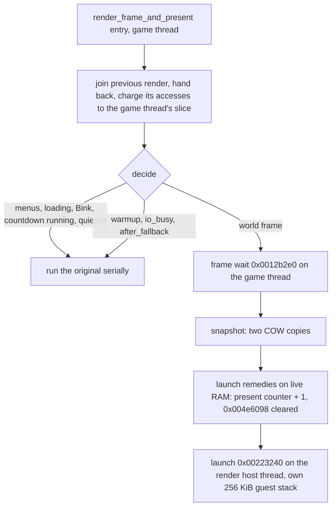

# Pipelined rendering: the prototype

Evidence for [second-executor.md](../../runtime/second-executor.md). Index and verdicts: [pipelined-render.md](pipelined-render.md); the census it was built from: [pipelined-render-census.md](pipelined-render-census.md).

The prototype ran build plan steps 2, 3 and 7 of the index as `crates/rewrites/render-bridge/src/pipeline_render.rs`, wired by `d3d_glue::pipeline_render`. Both were deleted on 2026-11-22 (git history up to `1afa616a6`). Entries are from 2026-11-18, Old Mombasa and level 03a, headless, on the owner's disc.

Commit: not recorded; the source page was last revised at `b8b163968`. Not re-run. It was off under lockstep (`H2_LOCKSTEP`, `H2_INPUT_RECORD`, `H2_INPUT_REPLAY`) and with `render-census`, and needed a new `h2` binary only.

## The frame



`render_frame_and_present` (`0x00223240`) is the world path `0x002234e0` or fallback `0x002232a0`, then the frame wait, then `rasterizer_present(0, 0)` when both resource-cache countdowns (`0x004e6470`/`0x004e64a0`) are `<= 0`. The render stack is as large as the main thread's in the XBE header: a function under the render (`_chkstk`, `0x00320560`) probes a frame of over 128 KiB, and a 128 KiB stack faulted on the first world frame.

On the render thread the executor's dispatch has the generated original at `0x00223240` and a no-op at `0x0012b2e0`. It runs the D3D layer's overrides (entries with their write barrier, CreateDevice's shadow page, the port I/O stubs) and marked context-only overrides. Any other kernel import, XAPI call or hook is refused, which ends the render there.

## Serial guards

The world-path test is decided by the three tests at `0x00223240` and by `0x00068290`, read in Rust: menus, loading screens and Bink take the serial path.

| Reason | Condition |
|---|---|
| `warmup` | the first `Addrs::warmup` (150) world frames after a frame that was not one: the load burst of cache requests is over before the first launch |
| `io_busy` | the async I/O queue head (`0x004e28ec`) is not empty, or a request is off the free list (`Addrs::io_free`: head `0x004e28e8`, linked at `+0x3c`, 150 requests from `0x004e0368`). The worker's own pool calls are not ordered against the render's, so it must be idle at the launch |
| `after_fallback` | the `Addrs::after_fallback` (30) frames after a fallback |

The snapshot policy reports a render in flight and asks for the next frame to run serially, so a snapshot at the next tick boundary passes.

## Hand-back

| State | Rule |
|---|---|
| Render stack pages | dropped |
| Visit marks (`0x004de2f8..0x004e0300`, `0x004e0304..0x004e030b`, `0x004e7411`, `0x004e7418..0x004e7c18`, `0x004e7c18`, `0x004e7c20..0x004e8000`) | render-private. Their counters (`0x004de2fc`, `0x004e0308`, `0x004e7414`, `0x004e7c1c`) get the render's delta added to live RAM |
| Present counter `0x00485aa0` | the render's delta less the prediction (a difference is a `mispredict`) |
| Render frame counter `0x004ba034` | credited at the launch with the last completed frame's count; the join corrects by the difference. The sim reads it (particles at `0x0017469d`, `0x00117eda`, `0x002486a3`) |
| `0x004e6098` and the host-owned vblank words (`0x00485ab0..0x00485ac0`, `0x0055e6b8..0x0055e6c0`) | never come back |
| Random seeds `[0x004e7408]` (+0 the game's, +4 the effects'; the render steps them in `0x00027be0`; step `x * 0x19660d + 0x3c6ef35f`) | the join counts the render's steps from the snapshot value and applies as many to live RAM's seed (`Addrs::random`); flushes leave them out |
| Every other byte | `Guest::hand_back`: a render-only page comes back whole; on a page both wrote, unchanged bytes keep the sim's value, and an aligned word both changed keeps the sim's whole word and is a counted conflict (serially the tick runs after the render) |
| Render-owned ranges (`Addrs::render_owned`: the D3D device `0x00404fe0`, `0x928` words, and the device pointer `0x00407488`; boot adds the push buffer and the device's surface scratch) | a word both changed takes the render's whole word (`Guest::hand_back_owned`), counted as a conflict and as render-owned. Between launch and join only the render may change the device, because the sim's D3D calls join first |

The stamp array from `0x004e7c20` is assumed to end at the page (the census saw up to `0x004e7d7f`); its real end was not read.

Flushes (`Guest::merge_page`) let the view win per byte, since they hand the render's bytes over mid-frame before the sim's later writes.

## D3D and serviced calls

D3D handlers read guest memory through `ctx.memory()`, so on the render thread they read the snapshot and write the view. The write barrier drains its watch by id; the executor takes the live `Guest`'s `boot:d3d` subscription at each snapshot (`Guest::adopt_watch`). The sim's D3D calls on the game thread (the `0x3f...` entries, wrapped at the first frame) join the render first; one from another guest thread is not ordered (`d3d_other_thread`).

The async I/O pool's lock calls (`NtWaitForSingleObjectEx` on its mutex, `NtReleaseMutant`, `NtReleaseSemaphore` to wake the worker) and `MmSetAddressProtect` are serviced, not fallbacks. At the join the game thread makes the call itself on its own context, with the render's stack copied to live RAM from `esp`'s page up and the pool's bytes (`Addrs::live_bytes`, `0x004e0354..0x004e28ec`) brought in step. The render carries on against its snapshot (`SecondExecutor::resume`), and the join settles again. For `MmSetAddressProtect`, each page of the range takes live RAM's permissions in the view.

Before each serviced call everything the render wrote goes to live RAM (`SecondExecutor::flush`, against the bytes each page had at its last flush), because a service can wake the I/O worker (`0x00120c40`), which reads the request fields (`[request+8..+0x30]`, the completion byte `[request+0x38]`) from the requester's memory. Before the final hand-back `SecondExecutor::unflush` restores every byte unchanged since its flush to the snapshot's value, so the merge leaves what live RAM did with it (the worker's completion byte) alone. A final flush against what earlier flushes gave live RAM makes live RAM end at the render's final bytes.

### Fallbacks

A refused call does not rerun the frame (draws would repeat and device state cannot roll back). The render's writes, stack included, go to live RAM whole, the present counter loses its prediction, and the game thread makes the call with the render's CPU (`SecondExecutor::refused_cpu`) and finishes the render through the generated code's resume points. Its last `ret` lands in a continuation that restores the game thread.

The frame wait inside it is skipped. Callbacks created by `Call::answer_render_async` move with the stack; other live Rust callbacks (a D3D push callback, a destroy delivery) stop a fallback with `unresumable:<call>`. A fallback runs against live RAM, a tick ahead of the render's frame, so it is unsound for state the tick changed.

### I/O without stalls

`Addrs::io_handles` names the pool's three handle words. On the render thread a wait on one of them with no timeout, a mutex release with no previous count, and a semaphore release (previous count 0) return success at once and are logged. At the join (`settle`) the game thread pushes what the render wrote to live RAM, makes the logged calls for real in the render's order (`replay`, `replay_next`) and pulls the live ranges back. A different real result is counted (`io_mismatches`). `H2_PIPELINE_DEFER_IO=0` restored the serviced path for an A/B.

The first side to use the pool in a frame owns it until the join (`PoolUse`):

| First user | Effect |
|---|---|
| render defers a call | a later game-thread pool wait joins the render (`io_joins`), so the render's requests reach the pool before the tick's, as serially |
| sim waits first | the sim goes on (`io_sim_first`); the render's pool calls that frame stop it and are made at the join (`io_refused`), so the sim's request comes first |
| only one side | never waits |

Joining on every game-thread pool wait while a render was in flight made every frame join, because the game thread takes the pool mutex every tick: `join_wait` was about the whole render and pipelining ran at 40.7 fps against 48.6 stock (03a, presents 6900 to 7000). Before deferral, headless runs under load measured 72 to 82 ms a frame against about 30 ms stock.

## Joining the tick first

With the pool owner rule 03a pipelined without stalls, but 4 of 8 captured frames differed from the serial run (particle fire, first-person arms' pose, cutscene faces) and conflicts rose from 0 to about 16,000 per 30-40 frames. The earlier first pool wait of each frame had been joining the render before the tick read anything the render writes, so frames were effectively serial. With the join gone, tick `k+1` ran beside render `k` and read state the render writes in place (particle systems stepped by the draw pass at `0x00174420`, the animation cache's use stamps at `0x001237e0`, object and effect state). No hand-back rule fixes that, since the render's step is lost in the tick's read.

`Addrs::sim_joins` names sim code that reads what the render writes; a game-thread call of one while a render is in flight joins first (`sim_joins` on the output line). For Halo 2 it is `game_tick` (`0x00137fe0`). A port that makes a subsystem single-writer lets the entry move later in the tick. `lead` is the game thread's time from each launch to its join.

## Faults found

| Symptom | Cause | Rule |
|---|---|---|
| Crash at present 2803: `MemoryFault ... addr: 3c` in `OBJECT_RENDER_SETUP` (`0x00133790`) | a fallback ran the rest of the render against live RAM, a tick ahead: the frame's object list named an object the tick had deleted. About 40% of gameplay frames in Old Mombasa fell back before pool calls were serviced | service the pool calls |
| Worker crash at `0x00120c79` (`call [esi+0x34]`) on the first frame | the sync range `0x004e0354..0x004e28ec` stopped one word short of the queue head `0x004e28ec` | flushes before serviced calls |
| Render-thread fault at `0x00103823` at present 1825 after two `MmSetAddressProtect` fallbacks | the stack went back by the byte merge, but a serviced call had already copied it to live RAM, so a return address equal to the snapshot's kept stale bytes. Pages flushed earlier and not stored to since were also missing from the fallback's hand-back | the stack goes whole at a fallback; flushed pages are handed back with the rest |
| After a cinematic every pipelined frame fell back at `0x001a0180` (`community:strings`, and `community:descriptions` at `0x0019fd00`), then at `plan:LOCALE_FIND[engine-leaves]` | hooks that act only on their own context were refused | context-only overrides, below |
| Stop at present 3917 in `D3DDevice_SetRenderState_Dxt1NoiseEnable`: the push-buffer put pointer (device `+0`, `0x00404fe0`) was behind what the host had consumed | the previous hand-back kept live RAM's older word | render-owned ranges |
| Game-thread fault at `0x1958f` (`mov edx,[0x485A80]` at `0x19585`) after 6 pipelined frames; `0x00485a80` read `0x804d9f58` at every check | the view stack depth had leaked one: the view push (`rep movsd` at `0x2bc19` copies `0x298` bytes to `0x004850d0 + 0x298 * depth` after `inc [0x0046701c]`; pops at `0x13c44`; pushes also at `0x2c736`, `0x2c83d`, `0x2cace`) covers `0x00485a80` at depth 3. A render pushed a view, made a serviced call (whose flush gave live RAM the pushed depth), popped it, and its hand-back saw the depth at the snapshot value and left live RAM at the pushed one | the join flushes once more against what earlier flushes gave live RAM; the stack is left out of that flush |
| First-person weapon and hands drawn dark (977 draws serial, 670 pipelined; the 60 dynamic-light draws with a 32x32 `Al8` volume texture and 64x64 cube were missing) | the visible-light pass (`0x00132190`) increments the light visit counter `0x004e0308` (`0x001321bc`); a light becomes a candidate in `[0x00547f98]` only when its stamp at `+0x0c` differs from the counter (`0x00132a5e`, `0x001325e5`), and visiting stores it (`0x000c3110`; new lights start at the counter less one, `0x000c0328`, `0x000c07f6`). The counter was render-private so live RAM kept the pre-render value, while the stamps (the light array `[0x004e030c]`, `0x110` bytes a record) were handed back, so each render found every light visited | the join adds each counter's delta to live RAM, as serial counts |

The object render-state cache (`0x0003ddd0`; `0x100`-byte records in the array at `[0x00509434]`, owner at `+4`, lit-at frame at `+8`, last use at `+0xc`, lights at `+0xa8..+0xb8` (`0x0003dd10`), lighting at `+0x44..` and `+0xc0..`; body `+0xcc` names the record) was a suspect: the render calls it for every object it draws (`0x0003db00` from `0x0004b5d0`) and the tick's effect updates call it to read lighting (`0x001794e0`, `0x0017b5d0`). Both can take the same free record from the same snapshot (two allocators in one array). A guard made a game-thread call that would allocate join first (`Addrs::shared_caches`, `cache_joins`). The rerun had `cache_joins 0` and the rifle still dark, so it was not the cause; the light visit counter was.

Conflict log (2026-11-18): `0x00504410..0x005044d0` is the animation sampler's scratch (frame indices, blend fields at `0x00504464..0x005044b0`, codec selector `0x00504450` read by the dispatch at `0x00279860`, temporary vectors at `0x00504410` and `0x00504430`, a pointer at `0x005044c0`), written by the animation evaluation `0x002798a0` and the codec readers in `0x0027a6e0..0x0028d000`, `0x001c73a0` and `0x001e12b0` for both the tick and the first-person model. It looks like per-call scratch (unchecked). The heap words in `0x82e055xx..0x82e14cxx` repeat at a `0x34`-byte stride, a `real_matrix4x3`, probably node matrices both sides write. `0x004dc2xx..0x004dc3xx` were not identified.

Which live-side write moved the push-buffer put pointer is open. All the device's direct references are in the D3D library (`0x003fxxxx`), but game code pushes inline through `[0x00407488]` (for example `0x00116de0..0x00117000`, `0x0019f880..0x0019fc20`). If that runs in the tick while a render is in flight, the sim writes the same push buffer from the same put pointer and its commands are lost. A steady render-owned count would show it, and those pushes would need a join like the D3D calls.

## Render-safe hooks

An override marked context-only (`Dispatch::mark_context_only`) acts only on the context it runs on (registers, guest stack, the memory that context sees, host state it only reads), and returns synchronously or suspends through `Call::answer_render_async` with owned render state. The executor's fork keeps every marked override whatever `allow` says; a new override at the same address clears the mark. Plan hooks say it on declaration (`HookRef::context_only`); the plan marks a chain when every hook says so and nothing runs after the body (`Chain::render_thread`), because an `after` hook calls the body through the shadow with a Rust continuation a fallback cannot resume.

| Marked | Why it is safe |
|---|---|
| `engine-leaves` (every adapter, `LOCALE_FIND` and `LOCALE_EXISTS` included); the `locale` bridge's `before` on `LOCALE_FIND` when engine-leaves is off | functions of the registers and guest memory; string sources answer with addresses from boot state |
| `skulls-mp`'s Blind hooks on `HUD_SHOWN` and `FIRST_PERSON_RENDER` | read the skull set fixed at the start of the game |
| `community:strings`, `community:descriptions` | direct overrides that mark themselves |
| `native-world`'s observer before `LAYER_DRAW` (docs/graphics/native-renderer.md) | clears the layer-3 item bits in the memory its context sees and restores them before the next layer draw; its pass request goes to the D3D device in render order |
| `native-objects`' observer before `LAYER_DRAW` | copies the drawn objects' node matrices out of the memory its context sees, which is the frame's snapshot |
| `native-lights`' `before` on `RENDER_LIGHT_PASSES` and observer before `RENDER_DYNAMIC_LIGHTS` | the `before` answers `ret 0x10` for a light the native renderer draws, copying the record from the snapshot. Not placed with `render-timing` on |

Everything else is in `boot::render_thread::REFUSED` with its reason: `native-transparents` (clears the sorted-entry scope on `SCENE_TRANSPARENTS`'s return, a continuation), `render-timing` and `render-census` (need after continuations), `RENDER_FRAME`'s own implementation and map-slots' observer, and the game-thread points with after parts (health, precision, level-boot, aim-assist, skulls, skulls-mp, custom skulls, touch glue, the Controls row text; skulls' `OPTIONS_QUEUE` writes the settings store). A boot test builds the plan from every feature with every hook switch on and fails on a hook that is neither context-only nor listed, and on a listed entry nothing places. Direct overrides outside the plan (layouts, d3d, kernel wrappers) are not covered: the render thread keeps only the D3D entries, their shadows, the port I/O stubs and marked overrides.

## Bisect switches and watch

All read at boot, default on.

| Switch | Effect |
|---|---|
| `H2_PIPELINE_PREDICT_FRAMES=0` | the launch does not credit the frame counter |
| `H2_PIPELINE_SEED_REPLAY=0` | seeds merge as bytes, the render's value winning |
| `H2_PIPELINE_REFUSE=<hex>,...` | the render thread refuses these guest functions; a render that reaches one falls back there |
| `H2_PIPELINE_CONFLICTS=1` | tallies conflicts by word; every 300 hand-backs prints the 32 most frequent with physical and virtual addresses and the last live, render and snapshot bytes |
| `H2_PIPELINE_WATCH=0x485a80,0x4e034c` | the first sight of each listed word prints its value and whether the page it points at is mapped; each change prints `old -> new after <step>` (200 lines at most). With the pipeline off it still runs at each frame entry, as the run to compare with. The words' pages also take a write trap on live memory (`Guest::set_trap_focus`, `crates/runtime/runtime/src/trap.rs`): every write prints `trap: focus <word> = <value> written by pc <pc> (<addr>+<len>, thread, hle <handler>, host thread)` (400 lines at most; `pc 0` is the host) |
| `H2_PIPELINE_DEFER_IO=0` | serviced path for the pool calls |
| `H2_PIPELINE_ROUNDS` | rounds of the rig test (default 120; 2,000 pass) |

The bisect at `afde6702` ruled out the prediction, the seed replay and the lightmap sample: `H2_PIPELINE_REFUSE=0xd1850` gave 0 fallbacks, and the run reported about 21,000 conflicts a second, roughly 350 bytes a frame, against single digits in the first prototype runs.

## Output

Once a second, from the game thread, at a decision:

```text
pipeline: frames pipelined 58 completed 41 serial [loading 2] fallbacks 17 [kernel:<export> 12, <override> 5] serviced 40 [kernel:NtReleaseMutant 20, kernel:NtWaitForSingleObjectEx 20] d3d_joins 0 d3d_other_thread 0 join_wait 11.20ms hand_back 0.40ms snapshot 1.10ms render 25.70ms pages 231.0 conflicts 3 mispredicts 0
io_stalls N (T ms) [render R (Tr ms), sim_join J (Tj ms)] io_deferred D io_refused F io_joins J io_sim_first S io_mismatches M io_other_thread O
```

This is an illustration of the shape, not a measurement. `completed` frames ran entirely on the render thread; `serviced` counts the calls the game thread made for the render; times are per pipelined frame; `io_stalls` counts frames in which one side waited for the other because of the pool, split into `render` (the render stopped at a pool call, plus the game thread waiting for the rest) and `sim_join`. A line at each switch (`pipeline: pipelining from here (...)`, `pipeline: serial from here (...)`) says which kind ran last.

## Tests

| Test | What it shows |
|---|---|
| `crates/rewrites/render-bridge/tests/pipeline_render.rs` | a synthetic render front-end and sim, serial and pipelined, over 120 rounds: the same final memory but the marks; fallback frames finish on the game thread with the kernel called once each and one frame wait a frame; D3D reads the launch snapshot while the sim has moved on; a refusal under a continuation stops by name; a render probing a game-sized stack faults with 128 KiB; menu frames run serially with the same memory as off; a serviced call keeps the render on its own frame where a fallback faults at `0x3c`; every serial-mode frame leaves guest memory equal to the switched-off run's |
| `a_word_both_sides_wrote_keeps_the_sims_write_whole_and_is_reported` | the word rule; fails at its serial comparison under a byte merge |
| `a_render_owned_word_the_sim_also_changed_keeps_the_renders_value` | the render-owned rule |
| `the_frame_counter_and_seed_steps_the_sim_sees_are_the_serial_runs` | the count every render reaches; fails one high when the snapshot is taken after the credit |
| `a_stamp_handed_back_never_matches_the_next_renders_visit_count` | the light visit counter; under the old join the rig drew the light on 3 of 13 renders |
| `the_renders_pool_requests_overlap_the_sim_and_complete_in_the_serial_order`, `a_sim_using_the_pool_every_tick_with_no_render_io_never_stalls`, `a_render_pool_call_after_the_sims_is_made_at_the_join`, `a_render_queueing_io_every_frame_never_stalls`, `with_deferral_off_each_pool_call_stops_the_render_and_counts_a_stall`, `a_request_off_the_free_list_makes_the_frame_serial` | the pool owner rules (`pipeline_render.rs`) |
| `a_tick_reading_the_renders_writes_joins_first_and_runs_as_serially` | `sim_joins`; without the entry the render's step is lost and conflicts count |
| `crates/recompiler/emit/tests/second_executor.rs` | lifted x86 refused at a kernel call carries on on the main context from the refused CPU (twenty rounds) |
| `crates/platform/d3d/tests/registration.rs` | a real D3D entry on the executor reads the snapshot and writes the view |

## Measurements (2026-11-18)

Level 03a, headless GPU backend, `H2_OPT=2` with PGO, gameplay around present 38,000; totals over 38,107 pipelined frames from `render.stats`, tick joining first:

| Measure | Value |
|---|---|
| `sim_joins` | equals the frames; conflicts 0 in every steady-state report (serial-equivalent) |
| `lead` | 1.3 ms |
| `join_wait` | 21-28 ms against a render of 23-28 ms |
| hand-back | 1.3 ms |
| snapshot | about 0.5 ms |
| COW pages | about 188 a frame |
| frame rate | 33-34 fps (cpu 23-29 ms a frame), no better than stock |

An earlier p4 run had the render at 22-25 ms on the render thread and `join_wait` 17-19 ms, so the game thread had about 5 ms of its own work to overlap. Stock 03a costs about 6 ms of sim and about 21 ms of render front-end plus D3D a frame. The snapshot (0.5 ms), hand-back (1-1.6 ms) and the render's COW faults (about 190 pages a frame) cost about as much as the overlap, which is at most about 20% and only once the tick may run beside the render.

What would move the join later, so the tick runs beside the render:

1. Particle systems on the render side: the sim's particle updates (`0x00174a30`, the particle work of `0x00179020` under `0x00176e40`) run on the render thread at the launch against the sim's committed state; effect creation and deletion queue to it; the four particle datums become render-owned. Particle motion shifts by one frame.
2. Animation cache bookkeeping queued: `animation_resource_get` (`0x001237e0`) logs its use-stamp updates and loads and the game thread applies them at the join, so the tick's `animation_resource_request` (`0x001236f0`) is the cache's only writer meanwhile. The same shape as the I/O deferral.
3. Re-check the conflict report for the remaining render-written object and effect state, then move the `sim_joins` entry from `game_tick` to the first tick update that still reads any of it.

Estimated win if all of that lands and the whole tick overlaps: the sim's share (about 6 ms of a 28-30 ms frame) less hand-back, snapshot and COW (about 2-3 ms), so about 3-4 ms a frame (10-15%). Items 1 and 2 are each a port the size of the I/O deferral or larger, so a cheaper render front-end (docs/perf/gameplay-budget.md), which pays on every frame, comes first. Pipelining stays off by default: a research switch, not a speed-up.

Not done: executor-safe kernel time reads; async I/O requests made without the game thread; texture and geometry caches (index step 4); the game-time bracket (step 6); census v2's `game_state`/`datum`/`world_pool` lines; render-loop ports on the render thread (refused at their entry); the render thread's frame stats; the COW fault cost on the real working set. The vblank count to a given present matched across serial and pipelined runs (10533 to present 7000); the logical clock moves by executed work and the render's accesses are charged at the join one frame later, so streaming and LOD differ.
