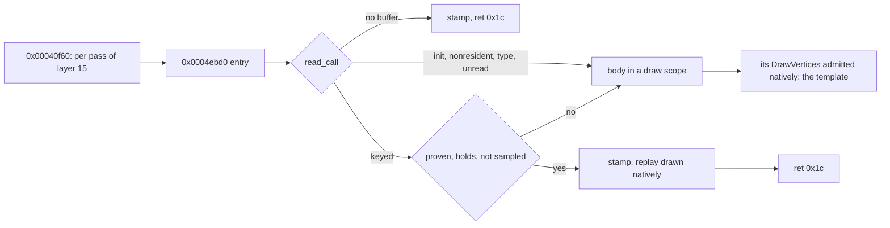

# Retiring D3D: the decal decorators' draw

Status: Built. Not verified in a run: the entries a frame saves, how often a call finds the last body's template, and the arm on live placements.
Code: `crates/rewrites/render-bridge/src/native_decal_decorators.rs` (`read_call`, `turn`, `record`, the hook), `crates/extensions/game/src/native_decal_decorators_glue.rs` (the host: `Admission`, `Words`, `replay`, `indexed`, `draw_differences`). Tests: `native_decal_decorators/tests.rs` and `native_decal_decorators_glue/tests.rs` beside them, and the stage row in `crates/rewrites/render-bridge/tests/native_defaults.rs`.
Switch: `impl.render.native-decal-decorators` (on), listed in [switches.md](../runtime/switches.md).

A slice of [retire-d3d-remainders.md](retire-d3d-remainders.md), "The
residual callers" (caller `0x4ebd0`). Decorator types 1 and 2 (decals,
built by `0x0004dfa0`) draw in the sorted transparent layer through
`0x0004ebd0`, which no other stage takes
([native-decorators.md](native-decorators.md) types only type 0). The
stage draws each call's `DrawVertices` natively at the call, so in the
guest's sorted order. Once a frame has proven it, a call that the last
body's template stands for returns without its body. The rule: a call
returns only when the device and the guest's shader caches hold exactly
what the last body left, so the body would change nothing and draw the
template with this placement's vertices.

## How it works

| Step | Rust | Guest equivalent |
|---|---|---|
| The read (`read_call`) | the stack `(shader, 0, 0, layer, pass, argument, entry)`; the BSP decorator block `[[0x004e0348] + 0x238]`, placement `(argument >> 8) & 0x3fffff` (`+0x1c`, `0x18` bytes), its geometry record (`+0x14`, `0x2c` bytes, index `i16 +6`), the class (scenario palette `+0x37c`, set `+0x14`, `0x14` bytes, index `+1`) and its type byte `+4`, the record's block `+0x28` with its stream descriptor at `+0x18`, `c[53]` from the detail level (`argument >> 30`), the range `u16 +0xc`, `+0xe` | `0x0004ec48`..`0x0004edbc` |
| The stamp | `scene_extract::layout::decorators::cache_stamp`: written by the cut before its draw | `0x0012de70`'s resident path |
| The body's draw (`Admission`) | inside `begin_draw_scope`, the resolved `DrawVertices` as an indexed triangle list (`indexed`: a quad `a b c d` as `a b c`, `a c d`), recorded as a sorted-layer range (`IndexedPass::for_sorted_layer`, stage `Transparents`) | `ZBias` 1, `DrawVertices(QUADLIST` or `TRIANGLELIST)`, `ZBias` 0 |
| The template | the admitted draw, the call's `Key` (stack words 0 to 4, the entry's implementation, the block, the type, the stream, `c[53]`) and the words the body left (`Words`) | |
| The words (`Words`) | the push buffer's put and the device's resolved draws, D3D's render-state, texture-state, dirty, stream and constant arrays, the shader draw's cache (`0x00485b48`..`+0x28`), the engine input pointer `0x00485a58`, the stream state `0x0051f0f0` (`0x2d8` bytes) and the stage textures `0x0051f3c8` (`0x20`) | what `0x0001bd50`, `0x0001c590`, `0x0001c620`, `0x0001c710`, `0x0001bbf0`, `0x0001cf50` and the D3D setters leave |
| The cut (`Host::holds`, `Host::draw`) | the template's key is the call's and the words are the template's, bit for bit: nothing ran since that body. The template's draw with the placement's vertices (`replay`, `count` of the stride from `data + offset + start * stride`), reserved at the boundary and committed | the whole body |

The lazy constants (`0x0004ebd0`..`0x0004ec48`, flags `[0x0055ee5c]`
bits 0 and 1) are stored by the first body; a call before both bits are
set runs its body.

### The proof

The cut opens once a frame (a change of the present count) has had
bodies and every one of their draws committed natively. A new map
(`native_map_work::generation`) forgets it.

### The arm

One eligible call in 64 (`SAMPLE`) runs its body anyway. Before it, the
host makes the draw the cut would have made and reads the words; after
it, it compares the body's draw field by field (`draw_differences`:
`entry`, `primitive`, `vertices`, `state`, `target`, `textures`,
`shader`, `viewport`, `lens`) and the words (`words_<region>`, the put
and draw count left out). Any difference is
`decal_decorator_mismatch_<field>`, and every later call runs its body
for the session (`decal_decorator_fallback` 1).

## Interfaces

- **Hook:** `points::DECAL_DECORATOR_DRAW` (`0x0004ebd0`, `ret 0x1c`), an
  implementation that runs the original body or returns.
- **Written by the cut:** the geometry cache entry's stamp. Nothing else
  of the guest's; the device gets the native pass.
- **Counters** in `render.scene`:

  | Counter | Counts |
  |---|---|
  | `decal_decorator_calls`, `_returned`, `_empty` | calls; calls that returned; of those, blocks with no buffer |
  | `decal_decorator_eligible`, `_checked` | calls the template held for; sampled bodies compared |
  | `decal_decorator_bodies_native`, `_proven`, `_fallback` | bodies drawn natively; the proof; the arm's stop |
  | `scene_kept_decal_decorator_<cause>` | calls that ran the body: `init`, `nonresident`, `vertices`, `unread`, `type`, `stamp`, `host`, `unproven`, `fallback`, `template`, `state`, `sampled`, `words_unread`, `vertices_unread`, `streams`, `stride`, `topology`, `empty`, `indexed`, `pass`, `boundary`, `device` |
  | `decal_decorator_guest_d3d_<cause>` | bodies whose draw stayed on D3D: `admission_entry`, `admission_feedback`, `admission_topology`, `admission_empty`, `admission_indexed`, `admission_pass`, `reservation`, `unseen`, `draws`, `scope`, `device` |
  | `decal_decorator_mismatch_<field>` | the arm's differences |

## Rules and limits

- A call is cut only after a body of the same key with nothing between,
  so only runs of consecutive same-key calls save anything: the first
  call of a run runs its body. A shader with two or more passes in layer
  15 alternates keys within each placement and never cuts.
- A class type other than 1 or 2 runs its body: it begins the shader and
  sets `ZBias` without a draw.
- A cut leaves `c[53]`, the stream and the shader's state as the body
  before it left them, which by the rule are what the body would set.

## Evidence

- The body's reads and calls are **Code** (`h2 disasm disc/default.xbe
  0x4ebd0 140`, `0x40fb0 60`, `0x1c620 40`). The caller's numbers are in
  [notes/residual-callers.md](notes/residual-callers.md): 325
  `DrawVertices`, 650 `ZBias` and 325 `c[53]` over 120 frames of a
  16-bot game, about 11 entries a frame at the call's own sites before
  the shader begin's.

## Not verified

- How many calls a frame find the last body's template: the entries
  saved a frame are between none and the call's own (about 11) plus its
  shader begin's.
- That a sampled body leaves its words unchanged (the arm's premise that
  a body over its own words is idempotent).
- That the native draw of a body matches its D3D draw on screen.
- That the words cover every guest write the shader begin makes.

## Related

[retire-d3d-remainders.md](retire-d3d-remainders.md), [retire-d3d-decals.md](retire-d3d-decals.md), [native-decorators.md](native-decorators.md), [notes/residual-callers.md](notes/residual-callers.md).
