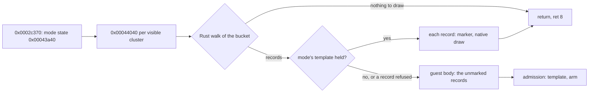

# Retiring D3D: R1, the decal call

Status: Built. The entries a frame saves and the arm on live decals are not measured.
Code: `crates/rewrites/render-bridge/src/native_decals/cut.rs` (`walk`, `turn`), `crates/extensions/game/src/native_decals_glue.rs` (the host `Cut`, `Template`, `decode_bitmap`, the arm), `crates/rewrites/native-render/src/decal_material.rs` (`decal_texture`, `tint`). Tests: in those files.
Switch: `native-decals.cut` (on with the native renderer), listed in [switches.md](../runtime/switches.md).

A slice of [retire-d3d.md](retire-d3d.md); the callback and its records are in [native-decals-research.md](native-decals-research.md).

A call of the decal callback `0x00044040` whose records the native
renderer draws returns without the guest body, so its texture binds, tint
sets and `D3DDevice_DrawVertices` never reach D3D. Each record draws from
its mode's template, the first draw the guest made in that mode of the
view, with its own vertices, tint and stage-0 texture. The rule: a call
returns only once every record it would draw is drawn and marked.

## How it works

| Piece | Rust | Guest equivalent |
|---|---|---|
| The walk (`cut::walk`) | bucket `mode * 512 + list` of `[0x004ea94c]`, link `+0x34`; a record whose owner's marker (`+8`) is the frame word's low half (`0x004ba038`) is skipped, else drawn | `0x00044040` to `0x000441a1` |
| The marker | written before the record's draw, put back when the host refuses it | `0x000440b5` |
| The texture (`decal_material::decal_texture`) | the decal tag's bitmap (`+0x8c`), the selector modulo its image count where that image is 2D, else image 1 of the default bitmap; resident only; decoded from guest memory per map load (`decode_bitmap`) | `0x000144f0`, `0x00137550`, `0x00014390`, `0x00012310`, then `0x0001cf50` |
| The tint (`decal_material::tint`) | `v10` as `(r, g, b, a) / 255` | `D3DDevice_SetVertexData4ub(10, ...)` at `0x00044132` |
| The draw | the mode's template (the first draw admitted in that `0x0002c370` call) with the record's vertices, tint, texture and texel scale, reserved at the call (`prepare_external_pass`) | `D3DDevice_DrawVertices(QUADLIST, start, 4 * quads)` at `0x00044190` |

The body's caches (`0x004c878c`, `0x004c8788`, `0x004c8784`, the stage
textures `0x0051f3c8`/`0x0051f3d8`) are left as they were: they still
agree with the device, which no cut record binds into, and `0x00043a40`
resets them for each mode.

A call runs the guest body, counted `scene_kept_decal_call_<cause>`,
for: `template` (the mode's first call with records), `host`,
`fallback`, `bucket`, `chain`, `quads`, `unread`, `marker`, and a
record's own: `texture_streaming`, `texture_unbound`, `texture_image`,
`texture_unread`, `texture_resource`, `texture_kind`, `texture_format`,
`texture_size`, `texture_decode`, `texture_host_format`,
`vertices_unread`, `reservation`, `device`. The body then draws only the
records not yet marked.

## The arm

Each draw a guest body makes after a modelled walk is checked
against the walk's record (`count`, `texture` (the bound header),
`tint`, `vertices`, `unexpected`, `unseen`) and against the mode's
template (`render`, `stages`, `extras`, `combiner`, `program`, `inputs`,
`two_sided`, `stipple`, `vertex`, `w_buffer`, `depth_format`, `clips`,
`reference`). Any difference is `decal_cut_mismatch_<field>`; every later
call runs the guest body for the session (`decal_cut_fallback` 1).
`render.scene` also carries `decal_call_{calls,returned,empty,checked}`
and `decal_cut_records`.

## Tests and limits

Tests: `native_decals/cut.rs`
(`the_walk_follows_the_chain_and_skips_marked_owners`,
`a_cut_call_marks_its_records_draws_them_natively_and_returns_without_the_body`,
`an_empty_bucket_returns_with_no_host`,
`a_record_the_host_refuses_runs_the_body_for_it_and_the_rest`,
`no_host_runs_the_body_and_a_bad_bucket_is_not_modelled`),
`decal_material.rs`
(`a_decal_binds_its_image_modulo_the_count_else_the_default_image_1`,
`the_tint_is_set_as_red_green_blue_alpha_over_255`),
`native_decals_glue.rs` (`a_draw_matching_the_walk_and_template_is_clean`,
`a_draw_that_differs_from_the_walk_or_template_is_named_by_field`).

Not verified in a run: the entries a frame saves, and whether the arm
holds on live decals (a texture-dependent stage state would show as
`decal_cut_mismatch_stages` and send the session to the guest body).

