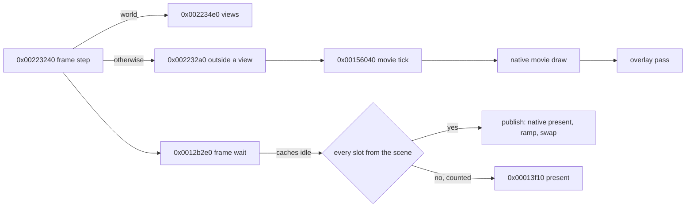

# Retiring D3D: movies, frames outside a game view and the display (R8)

Status: Partly built. The frame step, the movie's picture, the publish (in the frame step and the three frame loops outside it), the frame tail, the frame's finish and the view setup and view end are native, and the frame wait calls no D3D entry; a frame tail or view setup it does not cover and a frame with a carried slot keep the guest's D3D calls, each under a named `render.residual` row.
Code: `crates/rewrites/render-bridge/src/render_frame.rs` (the frame step), `native_targets.rs` (the finish), `render_frame/publish.rs`, `d3d::Device::publish` and `game::d3d_glue::SinkDrain` (the publish), `crates/platform/bink-hle/src/display.rs` and `crates/rewrites/render-bridge/src/native_movie.rs` (the movie), `crates/extensions/game/src/movie_display_glue.rs` and `hud_overlay::place_movie` (the glue), `render_frame::loop_present` (the frame loops' present), `frame_tail.rs` with `hud_overlay::place_tail` and `frame_scene::OverlayKind::Hold` (the frame tail), `view_setup.rs` and `native-render/src/frame_graph/targets.rs` (the view setup and view end, the graph's targets), `residual_census::REGISTRY` (the rows). Tests: in each, `the_frame_finish_makes_no_d3d_entry` (`native_targets.rs`), `a_frame_with_a_screen_effect_makes_no_d3d_entry` and `uncovered_tails_are_refused_by_name` (`frame_tail.rs`), `the_view_setup_makes_no_d3d_entry`, `uncovered_setups_are_refused_by_name` and `a_check_compares_the_guest_bodys_state` (`view_setup/tests.rs`), `the_graph_owns_its_targets_across_frames` (`frame_graph/targets.rs`), `a_held_texture_survives_into_the_next_frame` (`native-render/src/ui_gpu.rs`), `the_frame_wait_is_outside_the_render` and `the_frames_own_calls_are_named_rows_inside_and_outside_the_frame_step` (`residual_census.rs`), `a_loop_frame_from_the_scene_is_published_with_no_d3d_entry` (`render_frame.rs`), `a_native_display_takes_the_picture_and_leaves_the_guest_texture_alone` (`crates/platform/bink-hle/tests/synthetic.rs`) and `a_published_frame_presents_with_the_frame_steps_ramp_and_the_next_vblank_reports_its_swap` (`crates/platform/d3d/tests/round7.rs`).
Switch: `impl.render.native` (on), listed in [switches.md](../runtime/switches.md). Off, the frame is the guest's and the movie fills and draws the guest's texture.

Slice R8 of [retire-d3d.md](retire-d3d.md). `render_frame_and_present` `0x00223240` is Rust: the frame step calls each part of the guest's frame in its order, so each part goes native in place. The exit: from boot to gameplay and back to the menu, `render.residual`'s `d3d_entries` grow only under `outside_render`. R7 owns the menus, R6 the HUD; R8 takes the frame itself, the movie, and what neither draws.



## The frame step

`render_bridge::render_frame::RenderFrame` implements `RENDER_FRAME` (**Code**, the guest's body at `0x00223240..0x0022329f`):

| Step | Guest call | When |
|---|---|---|
| 1 | `0x00068290`, the UI's world skip | engine globals active: `[0x004e6948]` set, its `+0x1120` byte set, its `+2` word not `0xffff` |
| 2 | `0x002234e0`, the views | the skip returned 0 |
| 2 | `0x002232a0`, the frame outside a view | otherwise |
| 3 | `0x0012b2e0`, the frame wait | always |
| 4 | `0x00013f10(0, 0)`, the present | both cache countdowns (`0x004e6470`, `0x004e64a0`), read after step 2, at or below 0, and the publish keeps the frame ([below](#the-final-display)) |

`render_frame::next` is the table as data, tested against the guest's order; `render_frame::after_wait` skips step 4 for a published frame. Each step is a `call_guest_named` from the frame's own stack; the frame returns to its caller after the last. Every other feature's hooks on `RENDER_FRAME` (render timing, the bots' pads, the map slots) still run around it. A light host's `sim-frame` owns the point, so the frame step is not added there (`crates/apps/boot/src/lib.rs`).

`render.residual` files the frame wait under `outside_render` (`residual_census::frame_wait`, called around step 3): the wait (`d3d::FrameWait`, a Rust override) calls no D3D entry, and the vblank callback `0x00014280` it delivers only counts. What other threads call while it yields is theirs, not the frame's.

Besides the present, the step replaces nothing by itself. What makes a frame native is the step's callees: the views' stages ([retire-d3d.md](retire-d3d.md), R1 to R5), the overlay's producers (R6, R7) and the movie (below).

## Movies

With the native renderer on, `movies_glue` sets `BinkHle::use_native_display`, and playback mode adds two overrides to the Bink API's ten ([bink-hle.md](../audio/bink-hle.md)):

| Guest | Guest body | Native body |
|---|---|---|
| `0x001568d0` decode and blit | `BinkDoFrame`, `BinkNextFrame`, lock the texture (`0x003fad50`, `0x003fdbc0`), `BinkCopyToBuffer` | `BinkDoFrame`'s and `BinkNextFrame`'s bodies on `[0x004e9194]`; EAX 0 |
| `0x00156960` draw | one screen quad (`0x00035b90` with the record at `0x004e91c4`, `0x000363a0`), then `0x0001e930(1)` when `0x004c1a18` is set | the quad and the decoded picture to the host (`bink_hle::MovieDisplay`) |

The guest's texture is never locked or written. The quad (`bink_hle::display::movie_quad`, **Code** `0x00156960..0x00156a79`) is the guest's integer arithmetic over the rectangle at `0x00485a8a` (top, left, bottom, right): with start flag bit 4 the rectangle's edges, otherwise the movie at its own size, centred, `(span - size) / 2` to `(span + size) / 2` from 0, halved toward zero. Every movie the game starts (intro `0x1c6`, attract `0xe`, credits `0x40c`) is centred. Corner 0 is the top left, then clockwise; coordinates run from 0 to the movie's size in texels; each corner is white.

`render_bridge::native_movie::overlay` reads the record as the begin reads it (`native_render::hud::Record`) and makes one `MovieFrame` item over the 640 x 480 canvas: corners through the begin's screen transform and the full-screen viewport (`native_render::hud::text_quad`), coordinates as the texels of the guest's texture over the picture's size, the record's blend, filter and address mode, `Combiner::Texture`, red, green and blue writes. `hud_overlay::place_movie` places it as an overlay pass at the guest's point in the frame, with the UI fit the guest's draws carry there; the pass uploads the picture first (`OverlayResidency::sync_movie`: a `Bgra8Unorm` texture of the picture's size, written when the frame number moves, kept across a map change).

A draw that is not placed shows nothing, since no guest texture is behind it. Each is counted in `render.stats`:

| Counter | Cause |
|---|---|
| `native_ui_movie_placed` | placed |
| `native_ui_movie_refused_record` | the record or its bitmap does not read, keeps the caller's state, binds another stage, has a second constant block or a pixel offset |
| `native_ui_movie_refused_frame` | the screen quads' viewport `0x00485648` is not the full screen |
| `native_ui_movie_refused_picture` | no frame decoded for showing (logged once) |
| `native_ui_movie_refused_host` | no display installed (logged once) |
| `native_ui_movie_refused_pass` | the device did not take the pass |
| `native_ui_overlay_movie_frames`, `native_ui_overlay_refused_movie` | items the overlay drew, and those with no upload |

`render.residual`'s registry has the tick `0x00156040` as `movie`, `partial`: the service's stop path (`0x001565a0`, `0x001565e0`) releases the guest's texture, and the start `0x00156090` creates it.

## Frames outside a game view

`0x002232a0` draws what is not a game view: the menus, the loading screen and the movie. The tick `0x00156040` has two callers, `0x0002bc31` and `0x0002c99d` (**Code**; **S**: which views they sit in). Its draws are the overlay producers' ([native-post-hud.md](native-post-hud.md#the-fade-the-bars-and-the-loading-screen), [native-menus-overlay.md](native-menus-overlay.md)) and the movie's. Its own setup (the target, the clear, the viewport, through `0x0002c8a0`) is the view setup's ([below](#the-view-setup-and-view-end)).

The `views`, `outside_view` and `frame_loop` rows reach D3D only through two shared calls, the view setup `0x000132d0(view)` (`ret 4`; callers `0x0002c990` in `0x0002c8a0`, `0x0002cafd` in `0x0002ca00`, `0x00013c60` in the view end, and `0x0002bc1b`, `0x0002c755`, `0x0002c863` in the game views) and the view end `0x00013c20()` (`ret`; the tail of each caller above: `0x0002bc36`, `0x0002bcb8`, `0x0002c76e`, `0x0002c889`, `0x0002c9e4`, `0x0002cb0f`). Both are Rust ([below](#the-view-setup-and-view-end)), so the three rows are `kept`: their work is only what a refused setup's body does.

## The view setup and view end

`render_bridge::view_setup` implements both (`points::RENDER_VIEW_SETUP`, `RENDER_VIEW_END`), placed by `native_targets` with its host. The setup is planned from guest memory with nothing written (`plan`), then made (`apply`): the game-side words, then the device's calls in the body's order through `native_targets::Host`, staged in the guest stack below the call as the body's frame would hold them (**Code** `0x000132d0..0x0001344d`):

| Guest | What it does | The cut |
|---|---|---|
| `rep movsd` | the view's `0x298` bytes to the render context `0x00485600`; `[0x004858b8]` = `0x12` for view kind `+2` = 1, else 0 | the same writes; kind 1 refused (`target`) |
| `0x00015370` (BX 0, its case 0 only) | `[0x004b843c]` = 0, `SetRenderState_StencilEnable(0)`, word `[0x00467010]` = 0 | the writes, `Host::render_state(144, 0)` |
| | `[0x005093b4]` = `0x901`, `[0x005093b8]` = `0x900` | the same writes |
| `0x00012fa0` (ECX `+0x18`, EAX `+0x8c`, byte `+7`, word `+2`), `ret 8` | `0x00012d50` with BL 0: the device's clip range `+0x1c10` = `[0x0045dbc0] * [0x00485adc]`, `+0x1c14` = `[0x00485ae0]`, `+0x1c18` bit 1, the viewport push `0x003f6190`, the view-projection rows; then 48 words to `c[-96]` (`SetVertexShaderConstantNotInlineFast`), shadowed at `0x00407738` unless `[0x00404fe8]` bit 4 | `view_setup::transform` (the rows as `aux_depth::rows` orders them, the view's words from `+0xc4` and `+0x18`, the window's mapping); the clip words, `Host::push_viewport`, `Host::constants(0, 48)` |
| `0x00014bc0(1, [0x004858b8], 0)` | target 0: `0x0001cd30` with `[0x0050935c]`, `[0x00509364]`, flag 1; the viewport: 128 square for view kind 2, else the window `0x00485648` times the scale | `native_targets::cut_select`; `Host::viewport` with the window; a scale other than 1.0 refused (`scale`) |
| `0x00014b60`, with `+8` set | flags 1, or `0x61` with the colour `0x00131ed0(0x0048560c)` when `[0x004670cd]` is 0; Z 1.0 | `native_targets::cut_clear`; a clear whose prelude would run refused (`prelude`) |
| the raw push | method `0x1af0`, four words: 0, `[0x0045dbbc]`, `[0x0045dbc0]`, `[0x0045e3b0]` (`MakeRequestedSpace` at the limit) | the same words at put, `Host::make_space` at the limit |
| `[0x004b8428]` = `0x1b02` | `SetRenderState_FillMode(0x1b02)` | the write, `Host::render_state(139, 0x1b02)` |
| `[0x004670bc]` = 1, `0x00016b10` (ESI `0x00485b48`) | the draw state's reset; `0x00018900` when `+0x24` is set | the same writes; a restore list that is not empty refused (`restore`) |
| with `+0x26c` set | `0x48` words from `+0x14c` to `0x0048574c`; `0x00025a10`: 24 words to `c[-84]` (shadowed at `0x004077f8`), the fog colour `0x00131ed0(+0x168)` to `[0x004b8424]` and `SetRenderState_FogColor`, then `0x00027aa0` | `view_setup::fog`; `Host::constants(12, 24)`, `Host::render_state(138, colour)`; `0x00027aa0` runs only with `+0x1b8` not 0 or -1, refused (`fog_effect`) |

The view end (**Code** `0x00013c20..0x00013cc6`): with `[0x004ba04c]` above 1, `D3DDevice_Clear(0, 0, 0x80, 0, 1.0, 0)` through `Host::clear`; the view stack `[0x0046701c]` popped; a view left (`0x004850d0 + 0x298 * n`), the guest call of the setup above for it, its kind to `[0x004b9ed4]`, its `+0x14c` to `0x004b9ef0` and `+0x18` to the camera `0x004b9da0`, and the guest calls of its camera `0x0002f970` and `0x0002fd90`, which call no D3D entry. It returns with EBX, ESI, EDI and EBP as they came in.

One setup in 64 runs the guest body and compares what it left with the plan (`view_setup::check`): every planned word, the clip words, `c[0..12]` and the fog's `c[12..18]`, render states 144, 139 and 138, and the bound target (the pair, the viewport's origin and depth range exactly; its width and height at most the plan's, since the device clips the far edges to the target). A difference sends every later setup to the guest body. The raw and viewport pushes are not compared.

A setup it does not cover runs the guest body, counted `scene_kept_view_setup_<cause>` in `render.scene`: `host`, `target`, `scale`, `prelude`, `restore`, `fog_effect`, `unread`, `unwritable`, `device` (a refused call: the body sets the same state again), `mismatch`, `fallback`. `view_setup_calls`, `view_setup_cut` and `view_setup_checked` count the rest; the end counts `view_end_calls`, `view_end_cut` and `scene_kept_view_end_<cause>` (`host`, `device`, `unread`, `unwritable`).

The bind and the clear land on the frame graph's targets: the scene sink files them as the `TargetRef`s `frame_graph::targets::declare` names, and `targets::Owned` is the graph's own set of them, one surface per declared target across frames (the same shape keeps its surface, a new one frees it and makes another), counted `graph_targets_made`, `_kept`, `_released` and `graph_targets_refused_<cause>` (`unsized`, `allocation`). A refused target has no surface: nothing stands in. The replay still takes its map from the threaded owner (`d3d::threaded::owner`), not from `Owned`.

**S**: that the FPU's precision makes the product of two floats exact in `0x00131ed0`'s `fistp` (it is in 53 or 64 bits); that nothing reads the guest stack below the call that the cut stages its arguments in.

Three frame loops run outside `0x00223240` (**Code**):

| Loop | View | Then |
|---|---|---|
| `0x0012b6f0` (`ret 4`) | `0x0002ca00` with the callback `0x002233a0` | the frame wait, the present at `0x0012b784` |
| the map load, movie playing (`[0x004e9194]` and `[0x004e9188]` set) | `0x002232a0` at `0x00163a1a` | the frame wait, the present at `0x00163a28` |
| the map load, after it | `0x002232a0` at `0x00163acd` | the frame wait, the present at `0x00163adb` |

Each present asks the publish as the frame step's does (`render_frame::loop_present`, an implementation of `points::RENDER_PRESENT` that acts only for these three return addresses and no readback): shown from the scene, it returns as the guest's `ret 8` with no guest D3D entry, the counter moved; kept, the guest's body runs. `render_frame::Stats` counts both (`loop_published`, `loop_presents`); `publish_*` counts the outcome by name.

`render.residual` names the frame's own calls so none of their work is `unknown` in the frame step or `outside_render` in a loop:

| Row | Entry | Status | What it still holds |
|---|---|---|---|
| `views` | `render_views` `0x0002b5d0` | `kept` | a refused view setup's or view end's body |
| `outside_view` | `0x002232a0` | `kept` | the same, for `0x0002c8a0`'s view |
| `frame_loop` | `0x0012b6f0` | `kept` | the same, for its view `0x0002ca00` |
| `present` | `0x00013f10` | `kept` | a kept frame's `Swap` |

## The final display

At step 4 the frame step asks the publish (`render_frame::publish::present`) first. The present with first argument 0 asks no readback and runs from `0x000140e6` (**Code**):

| Guest | What | The publish |
|---|---|---|
| `0x00013d80` | with an image `[0x005093c8]` set, its CPU blit into the rectangle at `0x005093c0` of the back buffer ([below](#the-back-buffers-blit)) | one overlay picture over the back buffer |
| `0x003f9df0(1, 1)`, `Swap(0)`, `0x003f9df0(1, 1)` | the back buffer scale and the swap | `d3d::Device::publish`: the back buffer to the backend with the frame step's ramp, the swap counted |
| `0x00014110..0x00014194` | `[0x00485acc]` against `[0x00467008]`, byte `[0x00485ad0]` against `[0x0046700c]`; when either differs, the TV encoder option, the flicker filter `0x003f8c70` and the latch | kept |
| `0x00014196..0x000141ae` | the present counter `0x00485aa0`, 64-bit, +1 | `engine::render_loop::tick_writes::present_counter` |

```text
present step
  host's open frame (SceneSink, after the push buffer drains)
    a slot with a guest op ........ kept: publish_kept_<slot>
    a write with no slot .......... kept: publish_kept_untracked
  TV option or flicker changed .... kept: publish_kept_display
  blit not placed ................. kept: publish_kept_border_<cause>
  no host ......................... kept: publish_kept_host
  host's present fails ............ kept: publish_failed
  otherwise ....................... publish_native, 0x00013f10 skipped
```

A kept frame runs the guest's `0x00013f10(0, 0)` as before. Every outcome is counted in `render.scene` by the names above; `<slot>` is the first slot in the frame's order with a guest op (`opaque` to `outside`, as `frame_types::Slot::name`).

- **The open frame.** `d3d::scene_sink` marks each slot it files a guest op in, and a write while no slot is declared, from one present to the next (`scene_sink::open_frame`). A native producer's draw files nothing, so a frame drawn only by the scene's stages and the overlay has no mark. The host (`game::d3d_glue::SinkDrain`) runs the device's push buffer before it reads the marks.
- **The present.** `Device::publish` presents the back buffer the scene drew into through the backend with flags 5, so the scene sink ends the frame and the frame owner takes it as at a `Swap`. The frame-buffer headers do not rotate and no fence is set: no guest op drew into the frame.
- **The vblank.** `Device::publish` counts the swap (`+0x2478`), so the next vertical blank's record carries the swap count and `D3DVBLANK_SWAPDONE`, which `0x00014280` records ([d3d-timing.md](d3d-timing.md#vertical-blank)).
- **The gamma ramp.** The frame step reads the ramp the brightness update (`0x00012c71..0x00012d08`) last loaded into the miniport: device `[0x00407488]`, miniport `+0x1c28`, ramp `+0x1dc + 0x300 * [+0x7e4]`. An all-zero ramp is none loaded. The device's own copy (`Device::gamma_ramp`) is not used for a published frame.
- **The frame wait** is step 3 and runs before the publish either way.
- **Readbacks.** None is asked: the present's four callers (`0x00223296`, `0x0012b784`, `0x00163a28`, `0x00163adb`, **Code**) all push `(0, 0)`, so its surface lock and copy (`0x00013f21..0x000140e4`) never run. The other three are the frame loops [above](#frames-outside-a-game-view), published the same way.

### The back buffer's blit

`0x00013d50` (the disc-error screen's three calls, `0x002134ef..0x0021359d`) sets an image of one byte a pixel `[0x005093c8]`, its rectangle `0x005093c0` (top, left, bottom, right, 16 bits each) and a scale `[0x005093cc]` (`0x55`). The present's `0x00013d80` (**Code** `0x00013d80..0x00013f0e`) then locks the back buffer and writes each byte times the scale, clamped to 0..255, into all four bytes of its pixel, when the rectangle is inside 640 x 480.

`render_frame::blit::read` makes the same pixels as a BGRA picture; `blit::overlay` draws it as one `MovieFrame` item over the 640 x 480 canvas, point-sampled, no blend (picture id `0x00013d80`, its frame a hash of the texels so the upload moves only with the picture). The publish asks `Publish::blit` after the display check, so a kept frame leaves the whole blit to the guest; the host (`hud_overlay::place_blit`) places it unfitted over the bound target. Counted `publish_blit_native`; not placed, the frame keeps the guest's present, `publish_kept_border_<cause>`:

| Cause | When |
|---|---|
| `host` | no GPU overlay |
| `target` | the bound colour is not the device's back buffer `[device + 0x1a14]` |
| `pass` | the device did not take the pass |

**S**: that the guest's own checks on the back buffer (its size against `width * height * 4`, the lock) always pass, since the device's back buffer is the linear guest-size one.

## Rules and limits

- No guest fallback for a movie frame: the native draw skips the copy, so a refusal is a counted blank frame.
- The combiner is `Combiner::Texture` with white corners. **S**: that the begin's combiner reduces to the texture for this record (the text path makes the same assumption).
- `0x004c1a18` is left as it is: the native draw sets no state, so it has none to restore.
- The frame step holds a named continuation across each guest call of the frame, as `sim-frame` does.
- A published frame skips `0x003f9df0(1, 1)`. **S**: that nothing sets another back buffer scale for the next frame to inherit.
- Without a kernel clock, the vertical blanks a published swap counts (`Device::set_vblanks_per_swap`) are delivered at the next `Swap`'s return, not at the publish.
- The frame tail `0x00013b90` runs inside `render_views` before the present, and does nothing unless `0x0001fd20` returns a record with `+0xa4` above `[0x0045dbd8]`. A native tail's overlay files nothing; a kept tail's native fans file nothing, and a refused fan carries `overlay` and keeps the frame ([below](#the-frame-tail)).

## The frame tail

`0x00013b90` (`ret`, **Code**) is a freeze-frame cross-fade: the frame is copied once into target `0x12` and then blended over the frames after it while the fade lasts.

| Guest | What | D3D entries |
|---|---|---|
| `0x0001fd20` | the record `[0x005093e0]` (`+0xac` live), its fade `+0xa4` from the clock `[0x004858a0]` and `+0xb8`, `+0xbc`; no calls | none |
| `+0xa4` at or below `[0x0045dbd8]` | return | none |
| `+0xa0` set, `[0x004b5690]` 0 | `0x0001dc40(640, 480)`, EBX `0x12`: the cache's allocation `0x0012d400` (evicts with `0x0012c600`; when full, within the budget `0x00223bb0`, `CDevice_KickOff` `0x003fac30` and `SwitchToThread`), a fill `0x002d15da`, the header `0x0001df20` | `KickOff` when the cache is full |
| `+0xa0` set, target `0x12` live (`0x0001de20`) | the copy `0x000351a0([0x004858b8], 0x12)`, then `0x0001fd00` (`+0xa0` = 0); refused: `0x0001fcd0` (the record zeroed, `[0x004b569d]` = 1 when `[0x004b5690]` is set) | the target switch `0x00014bc0` (through the native select `0x0001cd30`, then `0x003fdb20` and `SetViewport` `0x003f8100`), `SetTexture` through `0x00014f60`, render states `0x000222d0` (`0x3b`, `0x3c`, `0x90`), `0x003f59b0(0)`, `0x003f53d0(0)`, the combiner `0x0001ccf0`, the vertex program `0x0001c590`, then `0x00034a90`'s states and fan |
| always, after | the composite `0x00022070(+0xa4, +0xa8)`: an alpha from both through `0x00372d48` (`pow`), packed `<< 24` into the PSDEF constant `0x00485014`; target `0x12` over `[0x004858b8]` with blend mode 7 | `SetTexture`, the combiner, `0x00034a90`'s states and fan |

`render_bridge::frame_tail` implements `0x00013b90` (`RENDER_FRAME_TAIL`, placed by `native_targets`) with no guest D3D entry:

| Guest | Rust |
|---|---|
| `0x0001fd20` | the guest's call, EAX 0 (it has no D3D entry) |
| no record, or `+0xa4` at or below `[0x0045dbd8]` | return |
| `0x0001dc40`, `0x0001de20`: target `0x12` | never allocated; the cache's drain does not run |
| the copy `0x000351a0` | an `OverlayKind::Hold` of texture `0x12`: the bound target copied whole into a texture of its size and format, kept across frames in the overlay's residency (`ui_gpu::OverlayResidency::hold`), one per target copy |
| `0x0001fd00`, `0x0001fcd0` | the same writes: a placed pass is the copy's success, a pass the host did not place its refusal |
| the composite `0x00022070` | a quad over Halo's window `0x004b9dd0` sampling `OverlayTexture::Held`, each corner its own pixel; the guest's combiner block (`frame_tail::composite_words`, alpha from `frame_tail::composite_alpha`), blend mode 7, all four channels written |

`hud_overlay::place_tail` places the list as one unfitted overlay pass over the bound target. A frame with no copy samples the texture an earlier frame kept.

A tail it does not cover runs the guest's body, counted `scene_kept_frame_tail_<cause>` in `render.scene`:

| Cause | When |
|---|---|
| `host` | no host installed |
| `target` | `[0x004858b8]` is not target 0, or target 0's colour `[0x0050935c]` is not the bound one (the select's cache `[0x0051f3f4]`) |
| `size` | target 0 has no size |
| `window` | the window is empty or outside target 0 |
| `blend` | blend mode 7 is past the tables or names the constant colour |
| `unread` | a word that does not read |

`frame_tail_calls`, `frame_tail_native`, `frame_tail_copies` and `frame_tail_composites` count the rest. `frame_tail_refused_pass` counts a pass the host did not place (a pending copy is then refused as `0x0001fcd0` refuses it); `frame_tail_refused_hold` a copy with no texture or over a target that cannot be copied, `frame_tail_refused_held` a composite whose held texture or combiner the GPU did not take.

**S**: that nothing else reads target `0x12`; that the state the guest's copy and composite leave (texture stage 0, the stage caches, the viewport) is not read before the next frame sets its own; that a fade whose copy was native is not composited by a kept tail (it would sample target `0x12`, never filled).

## The frame's finish

`0x00013cd0` (`ret`, three callers: `render_views` `0x0002b6f7` after the tail, `0x0002c9e9`, `0x0002cb14`) is Rust with the native targets (`native_targets::cut_finish`, `points::RENDER_FRAME_FINISH`), with no guest D3D entry:

| Guest | The cut |
|---|---|
| `[0x0051f3d8..0x0051f3e8]` = 0, `[0x00467004]` = -1 | the same writes |
| `0x0001cf50`: `D3DDevice_SetTexture(stage, 0)` for each stage whose `[0x0051f3c8 + 4 * stage]` is not 0, then that word 0 | `Device::set_texture` through the host, then the word |
| `[0x00408338]` = 0; the index buffer `[device + 0x7a0]` loses `0x80000`, `D3D_DestroyResource` when no reference is left; `+0x7a0` and `+0x1c` 0 | the same writes; the last reference is the body's |
| tail jump to `D3DDevice_SetPixelShader(0)` | `Device::set_pixel_shader` through the host |

Each step is a no-op once made, so a cut stopped part way runs the guest body, which repeats the prefix to the same end. `render.scene` counts `frame_finish_calls`, `frame_finish_cut` and `scene_kept_frame_finish_<cause>`: `host`, `device` (a refused set), `release` (the last reference), `unread`, `unwritable`.

## Not verified

- A movie on screen with the native display: its placement against the guest's draw at 1x and at render scale.
- That `d3d_entries` grow only under `outside_render` from boot to gameplay and back (the R8 exit); it needs R1 to R7.
- The view setup in a game: `view_setup_cut` against `view_setup_calls`, which causes are kept and how often, and that no check differs.
- `targets::Owned` drawing a frame: the replay takes the map from the threaded owner, not from the graph.
- The frame tail in a game: a screen effect's freeze frame on screen against the guest's, at 1x and at render scale, and `frame_tail_native` against `frame_tail_calls`.
- A frame loop's published frame on screen, and its `loop_published` against `loop_presents` over a map load.
- The frame's finish in a game: `frame_finish_cut` against `frame_finish_calls`, and that a `release` is rare.
- How many frames publish in a game: the `publish_*` counters over the census corpus.
- A published frame on screen: its pixels and brightness against the guest's present.
- Snapshot quiescence with the frame step's continuations.

## Related

- [retire-d3d.md](retire-d3d.md): the plan, the census and the other slices.
- [bink-hle.md](../audio/bink-hle.md): the movie wrapper and the Bink overrides.
- [native-renderer.md](native-renderer.md): the overlay stage.
- [render-loop.md](render-loop.md): the frame's call tree.
