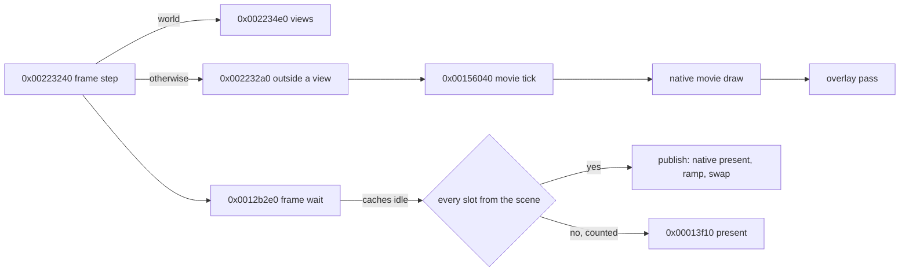

# Retiring D3D: movies, frames outside a game view and the display (R8)

Status: Partly built. The frame step, the movie's picture, the publish and the frame's finish are native, and the frame wait calls no D3D entry; the frame tail's setup, the frames outside a game view other than the movie's and a frame with a carried slot keep the guest's D3D calls.
Code: `crates/rewrites/render-bridge/src/render_frame.rs` (the frame step), `native_targets.rs` (the finish), `render_frame/publish.rs`, `d3d::Device::publish` and `game::d3d_glue::SinkDrain` (the publish), `crates/platform/bink-hle/src/display.rs` and `crates/rewrites/render-bridge/src/native_movie.rs` (the movie), `crates/extensions/game/src/movie_display_glue.rs` and `hud_overlay::place_movie` (the glue). Tests: in each, `the_frame_finish_makes_no_d3d_entry` (`native_targets.rs`), `the_frame_wait_is_outside_the_render` (`residual_census.rs`), `a_native_display_takes_the_picture_and_leaves_the_guest_texture_alone` (`crates/platform/bink-hle/tests/synthetic.rs`) and `a_published_frame_presents_with_the_frame_steps_ramp_and_the_next_vblank_reports_its_swap` (`crates/platform/d3d/tests/round7.rs`).
Switch: `impl.render.native` (on), listed in [switches.md](../runtime/switches.md). Off, the frame is the guest's and the movie fills and draws the guest's texture.

Slice R8 of [retire-d3d.md](retire-d3d.md). `render_frame_and_present` `0x00223240` is Rust: the frame step calls each part of the guest's frame in its order, so each part goes native in place. The exit: from boot to gameplay and back to the menu, `render.residual`'s `d3d_entries` grow only under `outside_render`. R7 owns the menus, R6 the HUD; R8 takes the frame itself, the movie, and what neither draws.



## The frame step

`render_bridge::render_frame::RenderFrame` implements `RENDER_FRAME` (**Code**, the guest's body at `0x00223240..0x0022329f`):

| Step | Guest call | When |
|---|---|---|
| 1 | `0x00068290`, the UI's world skip | engine globals active: `[0x004e6948]` set, its `+0x1120` byte set, its `+2` word not `0xffff` |
| 2 | `0x002234e0`, the views | the skip returned 0 |
| 2 | `0x002232a0`, the frame outside a view | otherwise |
| 3 | `0x0012b2e0`, the frame wait | always |
| 4 | `0x00013f10(0, 0)`, the present | both cache countdowns (`0x004e6470`, `0x004e64a0`), read after step 2, at or below 0, and the publish keeps the frame ([below](#the-final-display)) |

`render_frame::next` is the table as data, tested against the guest's order; `render_frame::after_wait` skips step 4 for a published frame. Each step is a `call_guest_named` from the frame's own stack; the frame returns to its caller after the last. Every other feature's hooks on `RENDER_FRAME` (render timing, the bots' pads, the map slots) still run around it. A light host's `sim-frame` owns the point, so the frame step is not added there (`crates/apps/boot/src/lib.rs`).

`render.residual` files the frame wait under `outside_render` (`residual_census::frame_wait`, called around step 3): the wait (`d3d::FrameWait`, a Rust override) calls no D3D entry, and the vblank callback `0x00014280` it delivers only counts. What other threads call while it yields is theirs, not the frame's.

Besides the present, the step replaces nothing by itself. What makes a frame native is the step's callees: the views' stages ([retire-d3d.md](retire-d3d.md), R1 to R5), the overlay's producers (R6, R7) and the movie (below).

## Movies

With the native renderer on, `movies_glue` sets `BinkHle::use_native_display`, and playback mode adds two overrides to the Bink API's ten ([bink-hle.md](../audio/bink-hle.md)):

| Guest | Guest body | Native body |
|---|---|---|
| `0x001568d0` decode and blit | `BinkDoFrame`, `BinkNextFrame`, lock the texture (`0x003fad50`, `0x003fdbc0`), `BinkCopyToBuffer` | `BinkDoFrame`'s and `BinkNextFrame`'s bodies on `[0x004e9194]`; EAX 0 |
| `0x00156960` draw | one screen quad (`0x00035b90` with the record at `0x004e91c4`, `0x000363a0`), then `0x0001e930(1)` when `0x004c1a18` is set | the quad and the decoded picture to the host (`bink_hle::MovieDisplay`) |

The guest's texture is never locked or written. The quad (`bink_hle::display::movie_quad`, **Code** `0x00156960..0x00156a79`) is the guest's integer arithmetic over the rectangle at `0x00485a8a` (top, left, bottom, right): with start flag bit 4 the rectangle's edges, otherwise the movie at its own size, centred, `(span - size) / 2` to `(span + size) / 2` from 0, halved toward zero. Every movie the game starts (intro `0x1c6`, attract `0xe`, credits `0x40c`) is centred. Corner 0 is the top left, then clockwise; coordinates run from 0 to the movie's size in texels; each corner is white.

`render_bridge::native_movie::overlay` reads the record as the begin reads it (`native_render::hud::Record`) and makes one `MovieFrame` item over the 640 x 480 canvas: corners through the begin's screen transform and the full-screen viewport (`native_render::hud::text_quad`), coordinates as the texels of the guest's texture over the picture's size, the record's blend, filter and address mode, `Combiner::Texture`, red, green and blue writes. `hud_overlay::place_movie` places it as an overlay pass at the guest's point in the frame, with the UI fit the guest's draws carry there; the pass uploads the picture first (`OverlayResidency::sync_movie`: a `Bgra8Unorm` texture of the picture's size, written when the frame number moves, kept across a map change).

A draw that is not placed shows nothing, since no guest texture is behind it. Each is counted in `render.stats`:

| Counter | Cause |
|---|---|
| `native_ui_movie_placed` | placed |
| `native_ui_movie_refused_record` | the record or its bitmap does not read, keeps the caller's state, binds another stage, has a second constant block or a pixel offset |
| `native_ui_movie_refused_frame` | the screen quads' viewport `0x00485648` is not the full screen |
| `native_ui_movie_refused_picture` | no frame decoded for showing (logged once) |
| `native_ui_movie_refused_host` | no display installed (logged once) |
| `native_ui_movie_refused_pass` | the device did not take the pass |
| `native_ui_overlay_movie_frames`, `native_ui_overlay_refused_movie` | items the overlay drew, and those with no upload |

`render.residual`'s registry has the tick `0x00156040` as `movie`, `partial`: the service's stop path (`0x001565a0`, `0x001565e0`) releases the guest's texture, and the start `0x00156090` creates it.

## Frames outside a game view

`0x002232a0` draws what is not a game view: the menus, the loading screen and the movie. The tick `0x00156040` has two callers, `0x0002bc31` and `0x0002c99d` (**Code**; **S**: which views they sit in). Its draws are the overlay producers' ([native-post-hud.md](native-post-hud.md#the-fade-the-bars-and-the-loading-screen), [native-menus-overlay.md](native-menus-overlay.md)) and the movie's. Its own setup (the target, the clear, the viewport) is the guest's, through `d3d`.

## The final display

At step 4 the frame step asks the publish (`render_frame::publish::present`) first. The present with first argument 0 asks no readback and runs from `0x000140e6` (**Code**):

| Guest | What | The publish |
|---|---|---|
| `0x00013d80` | with `[0x005093c8]` set, a border round the rectangle at `0x005093c0` on the back buffer | kept |
| `0x003f9df0(1, 1)`, `Swap(0)`, `0x003f9df0(1, 1)` | the back buffer scale and the swap | `d3d::Device::publish`: the back buffer to the backend with the frame step's ramp, the swap counted |
| `0x00014110..0x00014194` | `[0x00485acc]` against `[0x00467008]`, byte `[0x00485ad0]` against `[0x0046700c]`; when either differs, the TV encoder option, the flicker filter `0x003f8c70` and the latch | kept |
| `0x00014196..0x000141ae` | the present counter `0x00485aa0`, 64-bit, +1 | `engine::render_loop::tick_writes::present_counter` |

```text
present step
  host's open frame (SceneSink, after the push buffer drains)
    a slot with a guest op ........ kept: publish_kept_<slot>
    a write with no slot .......... kept: publish_kept_untracked
  border flag set ................. kept: publish_kept_border
  TV option or flicker changed .... kept: publish_kept_display
  no host ......................... kept: publish_kept_host
  host's present fails ............ kept: publish_failed
  otherwise ....................... publish_native, 0x00013f10 skipped
```

A kept frame runs the guest's `0x00013f10(0, 0)` as before. Every outcome is counted in `render.scene` by the names above; `<slot>` is the first slot in the frame's order with a guest op (`opaque` to `outside`, as `frame_types::Slot::name`).

- **The open frame.** `d3d::scene_sink` marks each slot it files a guest op in, and a write while no slot is declared, from one present to the next (`scene_sink::open_frame`). A native producer's draw files nothing, so a frame drawn only by the scene's stages and the overlay has no mark. The host (`game::d3d_glue::SinkDrain`) runs the device's push buffer before it reads the marks.
- **The present.** `Device::publish` presents the back buffer the scene drew into through the backend with flags 5, so the scene sink ends the frame and the frame owner takes it as at a `Swap`. The frame-buffer headers do not rotate and no fence is set: no guest op drew into the frame.
- **The vblank.** `Device::publish` counts the swap (`+0x2478`), so the next vertical blank's record carries the swap count and `D3DVBLANK_SWAPDONE`, which `0x00014280` records ([d3d-timing.md](d3d-timing.md#vertical-blank)).
- **The gamma ramp.** The frame step reads the ramp the brightness update (`0x00012c71..0x00012d08`) last loaded into the miniport: device `[0x00407488]`, miniport `+0x1c28`, ramp `+0x1dc + 0x300 * [+0x7e4]`. An all-zero ramp is none loaded. The device's own copy (`Device::gamma_ramp`) is not used for a published frame.
- **The frame wait** is step 3 and runs before the publish either way.
- **Readbacks.** None is asked: the present's four callers (`0x00223296`, `0x0012b784`, `0x00163a28`, `0x00163adb`, **Code**) all push `(0, 0)`, so its surface lock and copy (`0x00013f21..0x000140e4`) never run. The other three are frame loops outside `0x00223240` (`0x0012b760`, and the map load's at `0x00163a1a` and `0x00163acd`): each a view, the frame wait and the guest's present, under `outside_render` when no producer is open.

## Rules and limits

- No guest fallback for a movie frame: the native draw skips the copy, so a refusal is a counted blank frame.
- The combiner is `Combiner::Texture` with white corners. **S**: that the begin's combiner reduces to the texture for this record (the text path makes the same assumption).
- `0x004c1a18` is left as it is: the native draw sets no state, so it has none to restore.
- The frame step holds a named continuation across each guest call of the frame, as `sim-frame` does.
- A published frame skips `0x003f9df0(1, 1)`. **S**: that nothing sets another back buffer scale for the next frame to inherit.
- Without a kernel clock, the vertical blanks a published swap counts (`Device::set_vblanks_per_swap`) are delivered at the next `Swap`'s return, not at the publish.
- The frame tail `0x00013b90` runs inside `render_views` before the present, and does nothing unless `0x0001fd20` returns a record with `+0xa4` above `[0x0045dbd8]`. With one, its native copy and composite fans file nothing, a refused fan carries `overlay` and keeps the frame, and its setup (the target `0x0001dc40` with the cache drain `0x0012d400`, binds, render states, shaders) is the guest's.

## The frame's finish

`0x00013cd0` (`ret`, three callers: `render_views` `0x0002b6f7` after the tail, `0x0002c9e9`, `0x0002cb14`) is Rust with the native targets (`native_targets::cut_finish`, `points::RENDER_FRAME_FINISH`), with no guest D3D entry:

| Guest | The cut |
|---|---|
| `[0x0051f3d8..0x0051f3e8]` = 0, `[0x00467004]` = -1 | the same writes |
| `0x0001cf50`: `D3DDevice_SetTexture(stage, 0)` for each stage whose `[0x0051f3c8 + 4 * stage]` is not 0, then that word 0 | `Device::set_texture` through the host, then the word |
| `[0x00408338]` = 0; the index buffer `[device + 0x7a0]` loses `0x80000`, `D3D_DestroyResource` when no reference is left; `+0x7a0` and `+0x1c` 0 | the same writes; the last reference is the body's |
| tail jump to `D3DDevice_SetPixelShader(0)` | `Device::set_pixel_shader` through the host |

Each step is a no-op once made, so a cut stopped part way runs the guest body, which repeats the prefix to the same end. `render.scene` counts `frame_finish_calls`, `frame_finish_cut` and `scene_kept_frame_finish_<cause>`: `host`, `device` (a refused set), `release` (the last reference), `unread`, `unwritable`.

## Not verified

- A movie on screen with the native display: its placement against the guest's draw at 1x and at render scale.
- That `d3d_entries` grow only under `outside_render` from boot to gameplay and back (the R8 exit); it needs R1 to R7, and the frame tail's setup.
- The frame's finish in a game: `frame_finish_cut` against `frame_finish_calls`, and that a `release` is rare.
- How many frames publish in a game: the `publish_*` counters over the census corpus.
- A published frame on screen: its pixels and brightness against the guest's present.
- Snapshot quiescence with the frame step's continuations.

## Related

- [retire-d3d.md](retire-d3d.md): the plan, the census and the other slices.
- [bink-hle.md](../audio/bink-hle.md): the movie wrapper and the Bink overrides.
- [native-renderer.md](native-renderer.md): the overlay stage.
- [render-loop.md](render-loop.md): the frame's call tree.
