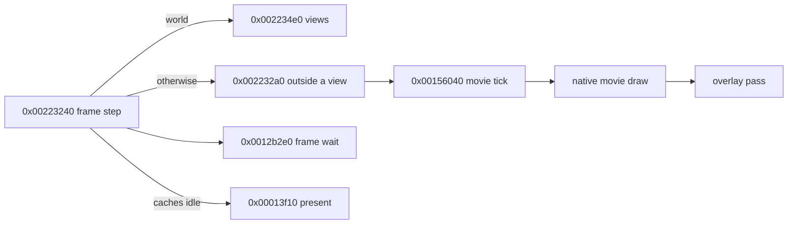

# Retiring D3D: movies, frames outside a game view and the display (R8)

Status: Partly built. The frame step and the movie's picture are native; the frames outside a game view other than the movie's, and the present, still run the guest's D3D calls.
Code: `crates/rewrites/render-bridge/src/render_frame.rs` (the frame step), `crates/platform/bink-hle/src/display.rs` and `crates/rewrites/render-bridge/src/native_movie.rs` (the movie), `crates/extensions/game/src/movie_display_glue.rs` and `hud_overlay::place_movie` (the glue). Tests: in each, and `a_native_display_takes_the_picture_and_leaves_the_guest_texture_alone` (`crates/platform/bink-hle/tests/synthetic.rs`).
Switch: `impl.render.native` (on), listed in [switches.md](../runtime/switches.md). Off, the frame is the guest's and the movie fills and draws the guest's texture.

Slice R8 of [retire-d3d.md](retire-d3d.md). `render_frame_and_present` `0x00223240` is Rust: the frame step calls each part of the guest's frame in its order, so each part goes native in place. The exit: from boot to gameplay and back to the menu, `render.residual`'s `d3d_entries` grow only under `outside_render`. R7 owns the menus, R6 the HUD; R8 takes the frame itself, the movie, and what neither draws.

## The frame step

`render_bridge::render_frame::RenderFrame` implements `RENDER_FRAME` (**Code**, the guest's body at `0x00223240..0x0022329f`):

| Step | Guest call | When |
|---|---|---|
| 1 | `0x00068290`, the UI's world skip | engine globals active: `[0x004e6948]` set, its `+0x1120` byte set, its `+2` word not `0xffff` |
| 2 | `0x002234e0`, the views | the skip returned 0 |
| 2 | `0x002232a0`, the frame outside a view | otherwise |
| 3 | `0x0012b2e0`, the frame wait | always |
| 4 | `0x00013f10(0, 0)`, the present | both cache countdowns (`0x004e6470`, `0x004e64a0`), read after step 2, at or below 0 |

`render_frame::next` is the table as data, tested against the guest's order. Each step is a `call_guest_named` from the frame's own stack; the frame returns to its caller after the last. Every other feature's hooks on `RENDER_FRAME` (render timing, the bots' pads, the map slots) still run around it. A light host's `sim-frame` owns the point, so the frame step is not added there (`crates/apps/boot/src/lib.rs`).

The step replaces nothing yet by itself. What makes a frame native is the step's callees: the views' stages ([retire-d3d.md](retire-d3d.md), R1 to R5), the overlay's producers (R6, R7) and the movie (below).

## Movies

With the native renderer on, `movies_glue` sets `BinkHle::use_native_display`, and playback mode adds two overrides to the Bink API's ten ([bink-hle.md](../audio/bink-hle.md)):

| Guest | Guest body | Native body |
|---|---|---|
| `0x001568d0` decode and blit | `BinkDoFrame`, `BinkNextFrame`, lock the texture (`0x003fad50`, `0x003fdbc0`), `BinkCopyToBuffer` | `BinkDoFrame`'s and `BinkNextFrame`'s bodies on `[0x004e9194]`; EAX 0 |
| `0x00156960` draw | one screen quad (`0x00035b90` with the record at `0x004e91c4`, `0x000363a0`), then `0x0001e930(1)` when `0x004c1a18` is set | the quad and the decoded picture to the host (`bink_hle::MovieDisplay`) |

The guest's texture is never locked or written. The quad (`bink_hle::display::movie_quad`, **Code** `0x00156960..0x00156a79`) is the guest's integer arithmetic over the rectangle at `0x00485a8a` (top, left, bottom, right): with start flag bit 4 the rectangle's edges, otherwise the movie at its own size, centred, `(span - size) / 2` to `(span + size) / 2` from 0, halved toward zero. Every movie the game starts (intro `0x1c6`, attract `0xe`, credits `0x40c`) is centred. Corner 0 is the top left, then clockwise; coordinates run from 0 to the movie's size in texels; each corner is white.

`render_bridge::native_movie::overlay` reads the record as the begin reads it (`native_render::hud::Record`) and makes one `MovieFrame` item over the 640 x 480 canvas: corners through the begin's screen transform and the full-screen viewport (`native_render::hud::text_quad`), coordinates as the texels of the guest's texture over the picture's size, the record's blend, filter and address mode, `Combiner::Texture`, red, green and blue writes. `hud_overlay::place_movie` places it as an overlay pass at the guest's point in the frame, with the UI fit the guest's draws carry there; the pass uploads the picture first (`OverlayResidency::sync_movie`: a `Bgra8Unorm` texture of the picture's size, written when the frame number moves, kept across a map change).

A draw that is not placed shows nothing, since no guest texture is behind it. Each is counted in `render.stats`:

| Counter | Cause |
|---|---|
| `native_ui_movie_placed` | placed |
| `native_ui_movie_refused_record` | the record or its bitmap does not read, keeps the caller's state, binds another stage, has a second constant block or a pixel offset |
| `native_ui_movie_refused_frame` | the screen quads' viewport `0x00485648` is not the full screen |
| `native_ui_movie_refused_picture` | no frame decoded for showing (logged once) |
| `native_ui_movie_refused_host` | no display installed (logged once) |
| `native_ui_movie_refused_pass` | the device did not take the pass |
| `native_ui_overlay_movie_frames`, `native_ui_overlay_refused_movie` | items the overlay drew, and those with no upload |

`render.residual`'s registry has the tick `0x00156040` as `movie`, `partial`: the service's stop path (`0x001565a0`, `0x001565e0`) releases the guest's texture, and the start `0x00156090` creates it.

## Frames outside a game view

`0x002232a0` draws what is not a game view: the menus, the loading screen and the movie. The tick `0x00156040` has two callers, `0x0002bc31` and `0x0002c99d` (**Code**; **S**: which views they sit in). Its draws are the overlay producers' ([native-post-hud.md](native-post-hud.md#the-fade-the-bars-and-the-loading-screen), [native-menus-overlay.md](native-menus-overlay.md)) and the movie's. Its own setup (the target, the clear, the viewport) is the guest's, through `d3d`.

## The final display

Not built. The present `0x00013f10(0, 0)` and the frame tail `0x00013b90`, `0x00013cd0` run as the guest's: the target copy and composite, the push words, the optional surface lock and `D3DDevice_Swap`, where `d3d` replays the carried slots to the window. The publish replaces them when the frame's every slot draws from the scene: the vblank, the frame wait and the gamma ramp move into the frame step, and the screenshot readback becomes a `RenderFeedback` message ([retire-d3d.md](retire-d3d.md#what-replaces-each-subsystem)).

## Rules and limits

- No guest fallback for a movie frame: the native draw skips the copy, so a refusal is a counted blank frame.
- The combiner is `Combiner::Texture` with white corners. **S**: that the begin's combiner reduces to the texture for this record (the text path makes the same assumption).
- `0x004c1a18` is left as it is: the native draw sets no state, so it has none to restore.
- The frame step holds a named continuation across each guest call of the frame, as `sim-frame` does.

## Not verified

- A movie on screen with the native display: its placement against the guest's draw at 1x and at render scale.
- That `d3d_entries` grow only under `outside_render` from boot to gameplay and back (the R8 exit); it needs R1 to R7 and the present.
- Snapshot quiescence with the frame step's continuations.

## Related

- [retire-d3d.md](retire-d3d.md): the plan, the census and the other slices.
- [bink-hle.md](../audio/bink-hle.md): the movie wrapper and the Bink overrides.
- [native-renderer.md](native-renderer.md): the overlay stage.
- [render-loop.md](render-loop.md): the frame's call tree.
