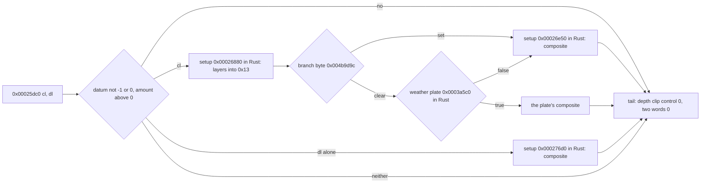

# Retiring D3D: the second fog's screen fans

Status: Built. The layers, their composite (the weather plate's branch and the set branch) and the composite are drawn natively. The native fans have not been seen in a run.
Code: `crates/rewrites/engine/src/fog_fans.rs` (`gate`, `fans`, `fan_call`, `layers`, `layers_composite`, `weather_plate_placement`, `plate_fan`, `composite`), `crates/rewrites/render-bridge/src/native_fog_fans.rs` (`before_fans`, `fan`, `stage_texture`, `turn`), `crates/rewrites/render-bridge/src/texture_cache.rs` (`header`, `lookup`, `request`), `crates/rewrites/native-render/src/fog_fans.rs` (`FanDraw`, `FogFansGpu`), `crates/rewrites/native-render/src/effect_material.rs` (`texture_cached`), `crates/extensions/game/src/native_fog_fans_glue.rs` (the host). Tests: in those files.
Switch: none. On with the native renderer (`impl.render.native`), listed in [switches.md](../runtime/switches.md).

`0x00025dc0` draws the second fog (**S**: the scenario's patchy fog, its `fpch` tag datum at `[0x004857b8]`) in a view's passes, view kind not 2 ([render-loop.md](render-loop.md), [native-post-frame.md](native-post-frame.md)). Its draws are fans of the screen-quad fan `0x00034420`, each with a setup and an attribute callback. With the native renderer on, no fan reaches D3D: each fan's setup is cut and the native renderer draws the fan.

## How it works

`render_bridge::native_fog_fans` observes the entry (`engine::points::FOG_FANS`): a gate the SSE model refuses or that does not read panics (`simd`, `unread`); the gate is the game's (the datum neither -1 nor 0, then `comiss [0x004857d8], [0x0045dbd8]; jbe`, so a NaN amount draws nothing and a denormal one draws: the Pentium III has no DAZ).

Each setup is an `implement` (`FOG_LAYERS_SETUP`, `FOG_LAYERS_COMPOSITE_SETUP`, `FOG_COMPOSITE_SETUP`), as the planar fog's quad is cut ([retire-d3d-fog-quad.md](retire-d3d-fog-quad.md)). A call counts only when its frame holds the fan's return `0x0003452e`, the fan's return to `0x00025dc0` and the fan's corners callback (`fog_fans::fan_call`):

| Setup | Fan's return | Corners | Rust |
|---|---|---|---|
| layers `0x00026880` | `0x00025e04` | `0x00026ca0` | `layers` |
| layers' composite `0x00026e50` | `0x00025e2d` | `0x00027520` | `weather_plate_placement` then `plate_fan` (branch byte clear, true), else `layers_composite` |
| composite `0x000276d0` | `0x00025e2d` | `0x00027960` | `composite` |

The rectangle is read from the fan's own frame. The cut hands the fan to the host, makes the writes a later read sees (the depth word `0x00509400`: the clip far `[0x00485ae0]` as the composites' setups write it, the weather plate's result, or the clip far as the callbacks write it when it is not above 0) and returns AL 0, so the fan draws nothing. The setups' render states, blocks, textures, vertex program and the fan's commits are not made; with the gate shut the game makes none of them either.

## The fans

| Fan | Into | Stages | Raster | Block |
|---|---|---|---|---|
| layers | target `0x13` | 0..3: the fog patch's bitmap, image the word at `0x004b9cac + 0x38 n`, wrap | blend off | `layers_combiner`: four or three stages on the branch byte, the colours `0x00131ed0` of `0x004b9cb4`, `0x004b9cec`, `0x004b9d24`, `0x004b9d5c` |
| layers' composite (plate) | as the set branch, by the block's byte | 0: target 3, point; 1: target `0x13`, linear (both clamp) | as the set branch | `weather_plate_placement`: kind 2's two stages (below) |
| layers' composite (set) | the view's target when `dl` is set, else target 3 | 0: target 3; 1: dot product; 2: the rasterizer bitmap, image 0 (`DOT_ST`); 3: target `0x13` | into the view as the composite; into target 3 blue alone, blend off (states `0x43` = 1, `0x3b` = 0) | `layers_composite_combiner`: six stages, the clamped layer amounts, `[0x004857d4]` and `[0x004857d8]` packed by `0x00131e50` |
| composite | the view's target | 0: target 3 | blend on, `GL_CONSTANT_COLOR` over `GL_ONE_MINUS_SRC_ALPHA`, add, constant `0x00ffffff` (`fog_quad::blend`) | `composite_combiner`: stage 0 times `0x00131ed0(0x004857bc)` |

Every fan has alpha test, cull, stencil and depth test off. The corners (attribute 0 the position, `screen_grid::position` at the depth word):

| Callback | Attributes |
|---|---|
| `0x00026ca0` | 1..4, layer `n`: `(u k - c) m0 - (v k - c) m1 a + o` per axis, `k` 2, `c` 1, `a` `[0x004b9d94]`, the layer's matrix and offsets at `+0x18`..`+0x34` |
| `0x00027520` | 1: the rectangle's lerp; 3, and 2 with the branch byte set: `([0x0048565c], 0, -[0x004857dc], 0)` over the span `[0x004857e0] - [0x004857dc]` (at least `[0x0045dbdc]`); 4, and 2 with the byte clear: the lerp times `[0x004b9d90]` |
| `0x00027960` | 1: the rectangle's lerp |

`native_render::fog_fans::FogFansGpu` draws a fan as one four-vertex strip (the fan's corners `(0, 0)`, `(0, 1)`, `(1, 1)`, `(1, 0)`, the last two swapped) through `QuadDrawer::grid_raster` with the block translated as the post's are. A target stage's coordinates are its guest pixels, a bitmap's normalised; `PostRaster::wrap` gives a stage the repeating sampler. A fan into target 3 that samples target 3 samples a copy made just before it.

The targets reach the device as slots by surface header: slot 0 the fan's target, written; each sampled target once, read. The setup's own target select (`0x00014bc0`) is cut, so the pass names the fan's target rather than the one bound: a fog scene stage at that target, its whole surface the rect, after the drained draws and with nothing rebound (`Device::external_stage_now`, `ExternalTargets`, `Device::surface_size`), which a replaying scene sink keeps typed. The select's targets by index:

| Index | Surface header | Role |
|---|---|---|
| 0 | the view's colour `[0x0050935c]` | `Display(n)` |
| 3 | `[0x00509370]` (`TARGET3`): the colour surface over the depth buffer's memory (`0x00014600`); `0x00014f60` binds its texture `[0x00509368]`, over the same memory. Table entry 3 is never made | `Slot(0x00509370)` |
| `0x13` | table entry `0x13`'s first surface, while `0x0001dcf0` returns it: `+0x88` set, `+0x95` clear, `+0x78` above 0 | `Game(0x13)` |

The device holds the frame graph's surface for each role. A bitmap stage is the texture header `0x000143c0` binds, resolved before the setup's first write (`stage_texture`, `effect_material::texture_cached`):

| Step | What |
|---|---|
| the bitmap | the layers: the fog patch's (`+0x18` of the `[0x004857b8]` tag's data), image the layer's word (signed); the set branch's stage 2: `[[0x00485a80] + 0x14]`, image 0 |
| fall-back | datum -1, or an image below 0 or past the tag's count `+0x44`: the rasterizer default `[[0x00485a80] + 0x64]`, image 0; none or no images: `texture_unbound` |
| the image | `+0x48 + 0x74 image` (`0x00137550`) |
| resident | `0x00012310`'s fast arm: the header `+0x50`, non-zero, with its stamp `+0x70` past `[0x004e6488]` or not streamed (`+0x0f` bit 1 clear) |
| streaming | `0x00012310` with LOD 0 in Rust (`texture_cache::header`), as `0x000143c0` asks for it: the lookup `0x0012ccf0` with flags 3, then the request `0x0012ce00` (the level loaded, else the held header `+0x5c`, else the type's default). A header of 0 makes the setup's writes and draws nothing that frame. A level that needs a read is `texture_request: <cause>`, below |

The host decodes the header from guest memory (`native_decals_glue::decode_bitmap`), as the fog quad's ramp is ([retire-d3d-fog-quad.md](retire-d3d-fog-quad.md)).

What a fan cannot draw panics: `host`, the placement's (`placed_lock`, `placed_header`, `placed_refused` (the device refused, or a guest push-buffer callback is pending), `placed_device`), `texture_unbound`, `texture_unread`, `texture_request: <cause>` (the cache would queue, raise or wait for a disc read through the async I/O pool's kernel mutex: `0x0012d5a0`, `0x00120ce0`, `0x0012ca6f`), the decode's (`texture_resource`, `texture_format`, ...), `bitmap_linear`, `weather plate <cause>` (a plate call other than the composite's: `kind <n>`, `flags [..]`, `no result`), `composite into target <n>` (a view target other than 0, whose surface `0x00014bc0` picks by its own table), `target 3 unmade` (`[0x00509370]` is 0), `target <n> unmade` (a table target `0x0001dcf0` would not return), `fan_unfinite`, `fan_slots`, `simd`, `x87`, `unread`, and the GPU's (`fan_size`, `fan_stage`, `fan_combiner`, `fan_snapshot`).

## Interfaces

The fans (**Code**, `h2 disasm`). Each fan is four vertices of the rectangle `0x00034420` makes (its first argument 0: the window `0x00485648`, or the whole target for targets `0x12`/`0x14`), attributes 15 down to 0 asked of the callback, 0 the position. All three setups bind the vertex program `0x0001c590` (`[[[0x00485a80] + 0x5c] + 0x64]`), which passes the position in pixels through (**S**, as for the fog quad).

The layers' composite with the branch byte clear calls the weather plate's placement `0x0003a5c0` (`stdcall`, nine arguments, `ret 24h`); when it returns true the setup binds target `0x13` at stage 1 (clamp, linear) and the fan draws with the plate's state, and when false the setup takes the set branch. Two calls are ported: the composite's (`0x00026e89`..`0x00026ef0`, `PlateArgs::fog`), below, and the other planar fog setup's (kind 1, `PlateArgs::planar`, [retire-d3d-fog-quad.md](retire-d3d-fog-quad.md)). The composite's:

| Argument | Value |
|---|---|
| 0, the block | `[0x004857d4]`, `[0x004857d8]`, the colour `[0x004857bc]`..`[0x004857c4]`, `+0x14` set when `dl` is clear |
| 1, 2: near, far | `[0x004857dc]`, `[0x004857e0]` |
| 3: kind (the jump table at `0x0003b88c`) | 2: rescale allowed, no fade, cap `[0x0045dd60]` |
| 4..7 | 0, 0, 1, 0 (argument 7 clear: the device setup runs; `0x0003a7c9` skips it) |
| 8: the result | the depth word `0x00509400` |

| Step | Code | What |
|---|---|---|
| place | `0x0003a5c0`..`0x0003a7c2` | near and far over `[0x0048565c]`; both times 256 when far so is not above 1; each `floor` (`0x00321099`) times 65536, `_ftol2` (`0x00322b0c`), over 65536. False when far is not above near; when `1 / (far - near)` is above the cap, false if rescaled, else the cap is the slope; false when near is below 0 |
| setup | `0x0003a7cf`..`0x0003a984` | the view's target (`0x00014bc0`, AL 1), target 3 at stage 0 (clamp, point), blend and alpha test off, states `0x39` = `0x207`, `0x52` = `0x10`, vertex slot `0xc`, program `0x0051f0f0` |
| block | `0x0003a989`..`0x0003aad2`, `0x0003b29f`..`0x0003b545` | zeroed, then the fixed-point near end's bytes, the slope's power of two `n` (`0x0003aad4`: least `n` with `2^n` not below it), `0x00131fc0` of the density and amount, the slope times 256 over `2^n` and the slope over 2 floored to bytes; into target 3 (`+0x14` set) blue alone, blend off and no final constant, else blend as the composite with `0x00131ed0` of the colour |
| result | `0x0003b821`..`0x0003b871` | `[0x0048565c]` times near (over 256 when rescaled), at least `[0x00485658]`, written through argument 8 |

The fan's vertex program is slot `0xc`, not `0x0001c590`'s; it is read, not run, as passing the position in pixels through (**S**).

## Rules and limits

- No guest fan is drawn and none is dropped: the device's `fog_fans` gap is gone, and a fan that reached D3D would be counted under `other` ([retire-d3d-remainders.md](retire-d3d-remainders.md), "The named gaps").
- A call with no fan runs its own body, so its tail (the depth clip control `0x00041d78`, the words `0x004b8344` and `0x004075e0`) stays the game's.
- Every stage filters linearly; target 3 at stage 0 is set to point, and its coordinates fall on texel centres.

Tests: engine `fog_fans.rs` (`cl_draws_the_layers_and_dl_alone_the_composite`, `no_datum_or_no_amount_draws_nothing`, `a_denormal_amount_draws`, `the_composites_fan_is_found_by_its_frame`, `the_composite_is_the_rectangle_with_the_colours_block`, `the_composites_writes_are_the_depth_word`, `the_layers_read_the_patchs_bitmap_and_map_each_corner`, `the_layers_composite_clamps_its_amounts_and_reads_the_dot_vector`, `the_composites_plate_call_is_kind_2_and_other_arguments_are_named`, `a_wide_plate_is_placed_into_the_view_with_its_block_and_depth`, `a_narrow_plate_takes_the_cap_and_its_power_of_two`, `a_small_range_is_rescaled_by_256`, `an_empty_negative_or_narrow_rescaled_plate_is_refused_and_writes_nothing`, `the_plates_fan_samples_the_scaled_lerp_for_stage_1`), `native_fog_fans.rs` (`every_gate_and_flag_runs_to_the_setups`, `an_unread_gate_panics`, `the_setups_are_named_by_their_entries`, `the_composite_is_cut_into_the_view_sampling_target_3`, `the_layers_are_cut_into_target_0x13_from_the_patchs_bitmap`, `the_layers_composite_samples_target_3_the_rasterizer_bitmap_and_0x13`, `an_unmade_table_target_is_named`, `an_unmade_target_3_is_named`, `a_layer_out_of_range_binds_the_rasterizer_default`, `a_streaming_image_asks_the_cache_and_draws_what_it_returns`, `the_weather_plate_draws_target_3_and_0x13_at_its_depth`, `a_refused_plate_takes_the_set_branch_with_the_scaled_lerp_at_stage_1`, `another_caller_runs_the_setup`, `a_fan_the_host_refuses_panics_with_its_cause`, `no_host_panics`, `another_view_target_panics`), native-render `effect_material.rs` (`the_cache_takes_a_fresh_or_unstreamed_header_and_asks_for_the_rest`), `fog_fans.rs` (`the_fan_is_a_strip_with_its_last_two_swapped`, `an_unfinite_fan_is_refused_only_where_it_is_used`), `native_targets.rs` (`a_game_target_is_named_by_its_table_entry`).

## Evidence

- **E**: the gate, the flags and the fans' setups and callbacks (`h2 disasm 0x25dc0 40`, `0x26880 240`, `0x26ca0 70`, `0x26e50 410`, `0x27179 250`, `0x27520 120`, `0x276d0 160`, `0x27960 35`, `0x34420 75`, `0x131e50 32`); the target select and stage bind and their case bytes (`0x14bc0 150`, `0x14ed0`, `0x14f30`, `0x14f60 120`, `0x15114`, `0x15154`), target 3's surfaces (`0x14600 140`, `0x147cb 50`), `0x1dd60 40`; the weather plate's path (`0x3a5c0 1200`, the table at `0x3b88c`, `0x131fc0 12`, `0x2b480 6`).
- **S**: the datum is the scenario's patchy fog, read as a tag datum through `0x004e3b44`.

## Not verified

- Which maps and views reach which fans.
- That the host surface of `[0x00509370]` holds what target 3's texture `[0x00509368]` samples (they share the depth buffer's memory) (**S**).
- That the combiner translator draws the dot product and `DOT_ST` stages as the NV2A does.
- That vertex slot `0xc` passes the position in pixels through, and what the plate's states `0x39`, `0x52`, `0x8f` and `0x40` change with the depth test off.

## Related

[retire-d3d-fog-quad.md](retire-d3d-fog-quad.md) (the planar fog's quad, the same fan), [retire-d3d-remainders.md](retire-d3d-remainders.md), [native-post-frame.md](native-post-frame.md).
