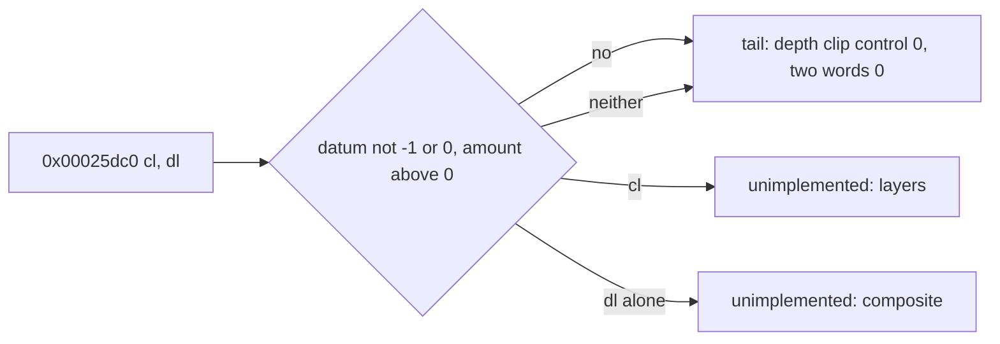

# Retiring D3D: the second fog's screen fans

Status: Partly built. The call is read and cut; a call that would draw a fan panics by name, as the native renderer has no stage for the fans.
Code: `crates/rewrites/engine/src/fog_fans.rs` (`gate`, `fans`), `crates/rewrites/render-bridge/src/native_fog_fans.rs` (`before_fans`). Tests: in those files.
Switch: none. On with the native renderer (`impl.render.native`), listed in [switches.md](../runtime/switches.md).

`0x00025dc0` draws the second fog (**S**: the scenario's patchy fog, its tag datum at `[0x004857b8]`) in a view's passes, view kind not 2 ([render-loop.md](render-loop.md), [native-post-frame.md](native-post-frame.md)). Its draws are fans of the screen-quad fan `0x00034420`, each with a setup and an attribute callback. With the native renderer on, no fan reaches D3D: a call that would draw one is `unimplemented!("fog fans: <cause>")`.

## How it works

`render_bridge::native_fog_fans` observes the entry (`engine::points::FOG_FANS`) and asks `engine::fog_fans::fans` with the call's MXCSR, `cl` and `dl`:

| Flags | `Fans` | Cause |
|---|---|---|
| gate shut, or neither set | `None` | runs as the game's: the tail makes no draw |
| `cl` set | `Layers` | `layers (0x00026880 into target 0x13, then 0x00026e50)` |
| `cl` clear, `dl` set | `Composite` | `composite (0x000276d0, target 3)` |
| a gate the SSE model refuses, or one that does not read | | `simd`, `unread` |

The gate is the game's: the datum neither -1 nor 0, then `comiss [0x004857d8], [0x0045dbd8]; jbe`, so a NaN amount draws nothing and a denormal one draws (the Pentium III has no DAZ).

## Interfaces

The fans, for the native stage that replaces the panics (**Code**, `h2 disasm`). Each fan is four vertices `(0, 0)`, `(0, 1)`, `(1, 1)`, `(1, 0)` of the rectangle `0x00034420` makes (its first argument 0: the window `0x00485648`, or the whole target for targets `0x12`/`0x14`), attributes 15 down to 0 asked of the callback, 0 the position.

| Fan | Setup | Target and textures | State | Callback |
|---|---|---|---|---|
| layers | `0x00026880` | target `0x13` (`0x00014bc0`, AL 0). Stages 0 to 3: the tag's bitmap `[tag + 0x18]`, image the word at `0x004b9cac + 0x38 n` (`0x000143c0`), wrap, linear | blend, alpha test, cull, stencil and depth test off; z bias 0. The block `0x00484f68` two ways on `[0x004b9d9c]`: the colour `0x004b9cb4` times `[0x0045dc38]` and three layer colours (`0x00131ed0` of `0x004b9cec`, `0x004b9d24`, `0x004b9d5c`) | `0x00026ca0`: attributes 1 to 4 a layer's coordinates, `(x k - c) m0 - (y k - c) m1 a + o` from the layer at `0x004b9c74 + 0x38 n`, `a` `[0x004b9d94]` |
| layers' composite | `0x00026e50` | `[0x004b9d9c]` clear: the weather plate's placement `0x0003a5c0`, then target `0x13` at stage 1. Set: the view's target (or 3 when `[0x005093fe]` is clear), target 3 at stage 0, the rasterizer bitmap `[[0x00485a80] + 0x14]` at stage 2, target `0x13` at stage 3 | blend on through `0x000222d0` (states `0x3f`, `0x4a`, `0x4b`, `0x3c`); the block from the clamped layer amounts and the fog's colours (`0x00131e50`); cull, stencil, depth test and z bias off | `0x00027520`: the position at the depth word `0x00509400` (`0x000350e0`), attribute 1 the rectangle's lerp |
| composite | `0x000276d0` | the view's target `[0x004858b8]`, target 3 at stage 0 | blend constant colour over one less source alpha, constant `0x00ffffff`; alpha test, cull, stencil and depth test off; the block: stage 0's texture times the colour `0x00131ed0(0x004857bc)` | `0x00027960`: as `0x00027520`, attributes 0 and 1 |

All three bind the vertex program `0x0001c590` (`[[[0x00485a80] + 0x5c] + 0x64]`), which passes the position in pixels through (**S**, as for the fog quad).

## Rules and limits

- No guest fan is drawn and none is dropped: the device's `fog_fans` gap is gone, and a fan that reached D3D would be counted under `other` ([retire-d3d-remainders.md](retire-d3d-remainders.md), "The named gaps").
- A call with no fan runs its own body, so its tail (the depth clip control `0x00041d78`, the words `0x004b8344` and `0x004075e0`) stays the game's.

Tests: `fog_fans.rs` (`cl_draws_the_layers_and_dl_alone_the_composite`, `no_datum_or_no_amount_draws_nothing`, `a_denormal_amount_draws`), `native_fog_fans.rs` (`a_call_with_no_fan_runs`, `the_layers_panic`, `the_composite_panics`, `an_unread_gate_panics`).

## Evidence

- **E**: the gate, the flags and the fans' setups and callbacks (`h2 disasm 0x25dc0 40`, `0x26880 240`, `0x26ca0 50`, `0x26e50 410`, `0x27520 40`, `0x276d0 160`, `0x27960 35`, `0x34420 215`).
- **S**: the datum is the scenario's patchy fog, read as a tag datum through `0x004e3b44`.

## Not verified

- Which maps and views reach the panics, and which of the two.
- What `0x0003a5c0` sets for the composite's first branch (the weather plate's state, [retire-d3d-r2.md](retire-d3d-r2.md)).

## Related

[retire-d3d-fog-quad.md](retire-d3d-fog-quad.md) (the planar fog's quad, the same fan), [retire-d3d-remainders.md](retire-d3d-remainders.md), [native-post-frame.md](native-post-frame.md).
