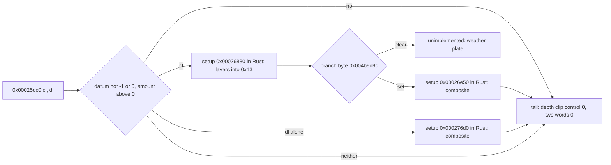

# Retiring D3D: the second fog's screen fans

Status: Built but for the weather plate. The layers, their composite's set branch and the composite are drawn natively; the layers' composite's weather-plate branch panics by name. The native fans have not been seen in a run.
Code: `crates/rewrites/engine/src/fog_fans.rs` (`gate`, `fans`, `fan_call`, `layers`, `layers_composite`, `composite`), `crates/rewrites/render-bridge/src/native_fog_fans.rs` (`before_fans`, `fan`, `turn`), `crates/rewrites/native-render/src/fog_fans.rs` (`FanDraw`, `FogFansGpu`), `crates/extensions/game/src/native_fog_fans_glue.rs` (`load`, the host). Tests: in those files.
Switch: none. On with the native renderer (`impl.render.native`), listed in [switches.md](../runtime/switches.md).

`0x00025dc0` draws the second fog (**S**: the scenario's patchy fog, its `fpch` tag datum at `[0x004857b8]`) in a view's passes, view kind not 2 ([render-loop.md](render-loop.md), [native-post-frame.md](native-post-frame.md)). Its draws are fans of the screen-quad fan `0x00034420`, each with a setup and an attribute callback. With the native renderer on, no fan reaches D3D: each fan's setup is cut and the native renderer draws the fan.

## How it works

`render_bridge::native_fog_fans` observes the entry (`engine::points::FOG_FANS`): a gate the SSE model refuses or that does not read panics (`simd`, `unread`); the gate is the game's (the datum neither -1 nor 0, then `comiss [0x004857d8], [0x0045dbd8]; jbe`, so a NaN amount draws nothing and a denormal one draws: the Pentium III has no DAZ).

Each setup is an `implement` (`FOG_LAYERS_SETUP`, `FOG_LAYERS_COMPOSITE_SETUP`, `FOG_COMPOSITE_SETUP`), as the planar fog's quad is cut ([retire-d3d-fog-quad.md](retire-d3d-fog-quad.md)). A call counts only when its frame holds the fan's return `0x0003452e`, the fan's return to `0x00025dc0` and the fan's corners callback (`fog_fans::fan_call`):

| Setup | Fan's return | Corners | Rust |
|---|---|---|---|
| layers `0x00026880` | `0x00025e04` | `0x00026ca0` | `layers` |
| layers' composite `0x00026e50` | `0x00025e2d` | `0x00027520` | `layers_composite` |
| composite `0x000276d0` | `0x00025e2d` | `0x00027960` | `composite` |

The rectangle is read from the fan's own frame. The cut hands the fan to the host, makes the writes a later read sees (the depth word `0x00509400`: the clip far `[0x00485ae0]` as the composites' setups write it, or as the layers' callback writes it when it is not above 0) and returns AL 0, so the fan draws nothing. The setups' render states, blocks, textures, vertex program and the fan's commits are not made; with the gate shut the game makes none of them either.

## The fans

| Fan | Into | Stages | Raster | Block |
|---|---|---|---|---|
| layers | target `0x13` | 0..3: the fog patch's bitmap, image the word at `0x004b9cac + 0x38 n`, wrap | blend off | `layers_combiner`: four or three stages on the branch byte, the colours `0x00131ed0` of `0x004b9cb4`, `0x004b9cec`, `0x004b9d24`, `0x004b9d5c` |
| layers' composite (set) | the view's target when `dl` is set, else target 3 | 0: target 3; 1: dot product; 2: the rasterizer bitmap, image 0 (`DOT_ST`); 3: target `0x13` | into the view as the composite; into target 3 blue alone, blend off (states `0x43` = 1, `0x3b` = 0) | `layers_composite_combiner`: six stages, the clamped layer amounts, `[0x004857d4]` and `[0x004857d8]` packed by `0x00131e50` |
| composite | the view's target | 0: target 3 | blend on, `GL_CONSTANT_COLOR` over `GL_ONE_MINUS_SRC_ALPHA`, add, constant `0x00ffffff` (`fog_quad::blend`) | `composite_combiner`: stage 0 times `0x00131ed0(0x004857bc)` |

Every fan has alpha test, cull, stencil and depth test off. The corners (attribute 0 the position, `screen_grid::position` at the depth word):

| Callback | Attributes |
|---|---|
| `0x00026ca0` | 1..4, layer `n`: `(u k - c) m0 - (v k - c) m1 a + o` per axis, `k` 2, `c` 1, `a` `[0x004b9d94]`, the layer's matrix and offsets at `+0x18`..`+0x34` |
| `0x00027520` | 1: the rectangle's lerp; 2 and 3: `([0x0048565c], 0, -[0x004857dc], 0)` over the span `[0x004857e0] - [0x004857dc]` (at least `[0x0045dbdc]`); 4: the lerp times `[0x004b9d90]` |
| `0x00027960` | 1: the rectangle's lerp |

`native_render::fog_fans::FogFansGpu` draws a fan as one four-vertex strip (the fan's corners `(0, 0)`, `(0, 1)`, `(1, 1)`, `(1, 0)`, the last two swapped) through `QuadDrawer::grid_raster` with the block translated as the post's are. A target stage's coordinates are its guest pixels, a bitmap's normalised; `PostRaster::wrap` gives a stage the repeating sampler. A fan into target 3 that samples target 3 samples a copy made just before it.

The targets reach the device as slots by surface header: slot 0 the fan's target, written; each sampled target once, read. A game target is `native_targets::surface(Game(n))`, the view's target 0 its colour `[0x0050935c]`; the device holds the frame graph's surface for each role. The bitmaps are decoded at map load (`native_fog_fans_glue::load`): every image of every `fpch` tag's bitmap (the datum at `+0x18`) and image 0 of the rasterizer bitmap (`matg` rasterizer data `+0x14`).

What a fan cannot draw panics: `host`, `placed`, `bitmap` (not loaded), `layers composite weather plate (0x0003a5c0)`, `composite into target <n>` (a view target other than 0, whose surface `0x00014bc0` picks by its own table), `fan_unfinite`, `fan_slots`, `simd`, `x87`, `unread`, and the GPU's (`fan_size`, `fan_stage`, `fan_combiner`, `fan_snapshot`).

## Interfaces

The fans (**Code**, `h2 disasm`). Each fan is four vertices of the rectangle `0x00034420` makes (its first argument 0: the window `0x00485648`, or the whole target for targets `0x12`/`0x14`), attributes 15 down to 0 asked of the callback, 0 the position. All three setups bind the vertex program `0x0001c590` (`[[[0x00485a80] + 0x5c] + 0x64]`), which passes the position in pixels through (**S**, as for the fog quad).

The layers' composite with the branch byte clear calls the weather plate's placement `0x0003a5c0` with the fog's colour and amounts; when it returns true the fan draws with its state and target `0x13` at stage 1, and when false the setup takes the set branch.

## Rules and limits

- No guest fan is drawn and none is dropped: the device's `fog_fans` gap is gone, and a fan that reached D3D would be counted under `other` ([retire-d3d-remainders.md](retire-d3d-remainders.md), "The named gaps").
- A call with no fan runs its own body, so its tail (the depth clip control `0x00041d78`, the words `0x004b8344` and `0x004075e0`) stays the game's.
- Every stage filters linearly; target 3 at stage 0 is set to point, and its coordinates fall on texel centres.

Tests: engine `fog_fans.rs` (`cl_draws_the_layers_and_dl_alone_the_composite`, `no_datum_or_no_amount_draws_nothing`, `a_denormal_amount_draws`, `the_composites_fan_is_found_by_its_frame`, `the_composite_is_the_rectangle_with_the_colours_block`, `the_composites_writes_are_the_depth_word`, `the_layers_read_the_patchs_bitmap_and_map_each_corner`, `the_layers_composite_clamps_its_amounts_and_reads_the_dot_vector`), `native_fog_fans.rs` (`every_gate_and_flag_runs_to_the_setups`, `an_unread_gate_panics`, `the_setups_are_named_by_their_entries`, `the_composite_is_cut_into_the_view_sampling_target_3`, `the_layers_are_cut_into_target_0x13_from_the_patchs_bitmap`, `the_layers_composite_samples_target_3_the_rasterizer_bitmap_and_0x13`, `the_weather_plate_panics`, `another_caller_runs_the_setup`, `a_fan_the_host_refuses_panics_with_its_cause`, `no_host_panics`, `another_view_target_panics`), native-render `fog_fans.rs` (`the_fan_is_a_strip_with_its_last_two_swapped`, `an_unfinite_fan_is_refused_only_where_it_is_used`), `native_targets.rs` (`a_game_target_is_named_by_its_table_entry`).

## Evidence

- **E**: the gate, the flags and the fans' setups and callbacks (`h2 disasm 0x25dc0 40`, `0x26880 240`, `0x26ca0 70`, `0x26e50 410`, `0x27179 250`, `0x27520 120`, `0x276d0 160`, `0x27960 35`, `0x34420 75`, `0x131e50 32`).
- **S**: the datum is the scenario's patchy fog, read as a tag datum through `0x004e3b44`.

## Not verified

- Which maps and views reach which fans.
- That target 3's and `0x13`'s stage textures (`0x00014f60`'s own table) are the table entries' surfaces the slots name (**S**).
- That the combiner translator draws the dot product and `DOT_ST` stages as the NV2A does.
- What `0x0003a5c0` sets for the weather plate (its state, [retire-d3d-r2.md](retire-d3d-r2.md)).

## Related

[retire-d3d-fog-quad.md](retire-d3d-fog-quad.md) (the planar fog's quad, the same fan), [retire-d3d-remainders.md](retire-d3d-remainders.md), [native-post-frame.md](native-post-frame.md).
