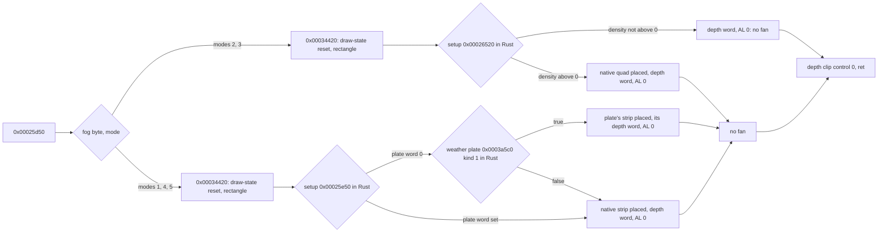

# Retiring D3D: the planar fog's screen quad

Status: Built. The cut and the GPU pass have not been seen in a run.
Code: `crates/rewrites/engine/src/planar_fog.rs` (`setup`, `draws`, `colour`, `quad`, `other`), `crates/rewrites/engine/src/fog_fans.rs` (`PlateArgs::planar`, `weather_plate_placement` kind 1), `crates/rewrites/render-bridge/src/native_fog_quad.rs` (`turn`, `turn_other`, `before_fog`), `crates/rewrites/native-render/src/fog_quad.rs` (`FogQuadDraw`, `FogOtherDraw`, `ramp_texture`, `FogQuadGpu`), `crates/extensions/game/src/native_fog_quad_glue.rs` (the host). Tests: in those files.
Switch: none. On with the native renderer (`impl.render.native`), listed in [switches.md](../runtime/switches.md).

A residual caller of [retire-d3d-remainders.md](retire-d3d-remainders.md) ("The residual callers"): `0x00025d50`, one inline fan a frame ([notes/residual-callers.md](notes/residual-callers.md)). In every view mode the native renderer draws the quad and the guest's setup returns as it does when there is no fog to draw, so the fan never reaches D3D. Neither setup's body runs.

## How it works

| Piece | Rust | Guest |
|---|---|---|
| The branch (`planar_fog::setup`) | the fog byte, the mode, the other-setup byte | `0x00025d50`..`0x00025d9d` |
| The gate (`planar_fog::draws`, `gate_writes`) | the clip far to the depth word; on only for a density above 0 | `0x00026520`..`0x0002653f` |
| The colour (`planar_fog::colour`) | density, red, green, blue scaled, `fistp` under the call's control word, ARGB, the colour lanes masked | `0x00131f40` |
| The combiner (`planar_fog::combiner`) | the block the setup fills: the final combiner's constant as colour and alpha | `0x00026690`..`0x000266da`, then `0x0001ccf0` |
| The state (`planar_fog::STATES`) | blend on, constant colour over one less source alpha, white blend constant with alpha 0, W-buffered, less or equal, no depth write, cull, stencil and alpha test off | `0x0002655a`..`0x0002668b` |
| The corners (`planar_fog::quad`) | `(0, 0)`, `(0, 1)`, `(1, 1)`, `(1, 0)` of the fan's rectangle, each `0x000350e0` at the depth word (`screen_grid::position`) | `0x00034552`..`0x00034706`, `0x00026710` attribute 0 |
| The draw (`fog_quad::FogQuadGpu`) | one quad through the post's `QuadDrawer`, the block translated as a combiner, its stored depth tested less or equal against the bound depth, placed with `Device::external_pass_now` | the fan's `Begin(7)` .. `End` |

### The other setup (view modes 1, 4 and 5)

`0x00025e50` is a fog read from the depth buffer by the texture shader.
Its fan has the same frame and corners callback, so it is cut the same
way, by an `implement` at `PLANAR_FOG_OTHER_SETUP`.

| Piece | Rust | Guest |
|---|---|---|
| The plate (`planar_fog::other`, `fog_fans::PlateArgs::planar`) | `[0x0048578c]` 0 asks the weather plate's placement first: the block `0x0048574c`, near `[0x00485778]`, far `[0x0048577c]`, kind 1, flags 0, the result into the depth word. True returns AL 1 at once (`0x00026515`), so the fan draws the plate's block ([below](#the-plate-kind-1)); false falls into the main path | `0x00025e50`..`0x00025e90`, `0x0003a5c0` |
| The constants (`planar_fog::other`) | c0 the clamped `(1 - mix) * plate` and `first * amount`, c1 `amount * mix` and `second * plate`, their alpha bytes the clamped amount and plate, the final constant the clamped density and colour, packed as `0x00131f40` | `0x00025e50` |
| The block (`planar_fog::other_combiner`) | two combiner stages and the texture shader: modes `0x2621` (2D, dot product, dot ST), dot mapping `0x44` (HILO 1) | `0x00025e50`, then `0x0001ccf0` |
| The attributes | per corner: the position at the clip far, attributes 1 and 4 the rectangle's lerp, 2 and 3 the near and far planes `[k / range, 0, -start / range, 0]` | `0x00026812` |
| Stage 0 (`FogQuadGpu::record_other`) | the bound depth's D24S8 words as LIN A8R8G8B8, made by a prepass from the depth view into an RGBA8 copy | target 3 of `0x00014bc0` |
| Stage 2 (`fog_quad::ramp_texture`) | image 0 of the rasterizer's ramp bitmap, or of its default, decoded as a decal bitmap | `0x000143c0` |
| The draw | one strip through `QuadDrawer::grid_program`, its depth the clip far tested greater unless `[0x0048575d]` is set, the planar fog's blend | the fan's `Begin(7)` .. `End` |

### The plate (kind 1)

`weather_plate_placement` runs the placement and device setup as for the
layers' composite ([retire-d3d-fog-fans.md](retire-d3d-fog-fans.md)), with
kind 1's differences:

| Step | Kind 1 | Guest |
|---|---|---|
| The kind | no rescale, `bl` set, cap `[0x0045dc90]` | the table at `0x0003b88c`, `0x0003a62d` |
| A slope above the cap | false (arguments 4, 5 and 6 are 0) | `0x0003a71c`..`0x0003a761` |
| A negative near end | the start `-slope * near` in [0, 1], the near end 0 | `0x0003a779`..`0x0003a7bc` |
| The states | the planar fog quad's: blend, W-buffered less or equal, no depth write | `0x0003afc6`..`0x0003b047` |
| The block | stage 0 alone (target 3); the amount and `first * amount`, the density and colour, each in [0, 1] and packed (`0x00131e50`); the start over the slope's scale as an alpha byte | `0x0003ae64`..`0x0003b291` |
| The result | the depth word; held to the limit, the depth test off (state `0x8f` 0) | `0x0003b821`..`0x0003b871` |

The fan's corners (`0x00026710`) take the plate's depth word. The strip
draws the block with the depth words at stage 0, no ramp, tested
`LessEqual` (`FogOtherDraw::plate`), and the cut does not write the
depth word again.

The cut is an `implement` at `PLANAR_FOG_SETUP` (`0x00026520`), the
setup the fan calls through EDI. A call counts only when the fan's frame
above it holds the return to `0x00025d50` and the corners callback; the
rectangle is read from the fan's own frame (`[entry + 4]`).

On a cut call the guest keeps the path it makes with no fog: the fan's
draw-state reset `0x00016b10` and rectangle, then the setup's depth-word
write and AL 0, then `0x00025d50`'s depth clip control. The setup's target
select, render states, combiner, vertex program and the fan's texture and
vertex-input commits are not made. No later draw depends on them, as the
game makes the same path whenever the density is not above 0 (**Design**).

## What panics

Every path the cut does not draw is `unimplemented!("fog quad: <cause>")`:

| Cause | When |
|---|---|
| `other_placed` | the device did not take the other setup's pass |
| `ramp_unread`, `ramp_unbound`, `ramp_image`, `ramp_streaming` | the ramp bitmap does not read, binds nothing, has no image 0, or is not resident |
| `other_depth_binding`, `other_combiner`, `depth_clip`, `ramp` | the depth view cannot be sampled, the block does not translate, a tested strip has no clip, or the fog strip has no ramp |
| `host` | no host is installed |
| `placed` | the device did not take the pass |
| `fan_shape`, `fan_unfinite` | the fan's corners are not one finite axis-aligned quad at one depth |
| `simd`, `x87`, `unread` | the gate, colour or corners refused by the SSE or x87 model, or an input that does not read |
| `depth_clip`, the quad drawer's | a quad placed but not recorded on the GPU |

## Tests and limits

Tests: `planar_fog.rs`
(`the_branches_follow_the_fog_byte_the_mode_and_the_other_byte`,
`the_gate_passes_only_a_density_above_zero`,
`the_colour_is_argb_rounded_under_the_control_word`,
`the_block_is_the_constant_through_the_final_combiner`,
`the_corners_are_the_rectangle_at_the_clip_far`), `native_fog_quad.rs`
(`the_first_call_is_cut_without_the_body`,
`no_density_makes_the_gates_write_and_draws_nothing`,
`another_caller_runs_the_setup`,
`a_pass_the_device_does_not_place_panics`, `no_host_panics`,
`the_other_setup_is_cut_and_draws_its_strip`,
`the_other_setups_plate_draws_its_block_at_its_depth`,
`an_other_pass_the_device_does_not_place_panics`,
`every_mode_passes_the_branch`,
`the_native_raster_is_the_setups_state`), `planar_fog.rs` again
(`the_other_setup_asks_the_plate_when_its_word_is_zero`,
`the_plates_kind_1_block_is_the_planar_fog_through_its_slope`,
`a_negative_near_end_starts_the_plate_and_its_held_depth_drops_the_test`,
`the_other_block_is_the_texture_shader_fog_with_clamped_constants`,
`the_other_fans_attributes_are_the_lerp_and_the_two_planes`),
`fog_quad.rs` (`a_fan_of_the_four_corners_is_one_quad`,
`a_fan_that_is_not_a_rectangle_at_one_depth_is_refused`,
`the_blend_constant_is_white_with_alpha_zero`,
`the_other_fan_is_a_strip_with_its_coordinates`,
`the_ramp_is_image_0_of_the_rasterizers_bitmap_or_its_default`).

## Evidence

- **E**: the branch, the gate, the setup's states and block, the colour
  and the fan's corners (`h2 disasm` of `0x25d50`, `0x26520`, `0x26710`,
  `0x34420`, `0x131f40`).
- **S**: the vertex program `0x0001c590` binds passes the position in
  pixels through, as the glow's screen quads' does. A frame whose fog
  quad sits off the guest's would show it.
- **E**: the other setup's plate test, constants, block, planes and
  ramp (`h2 disasm` of `0x25e50`, `0x26812`, `0x143c0`).
- **E**: the plate's call and kind 1 (`h2 disasm` of `0x25e50`,
  `0x3a5c0 1500`, the table at `0x3b88c`, `0x26515`).
- **S**: the plate's vertex program (slot `0xc`) passes the position in
  pixels and attribute 1 to texture coordinate 0 through.
- **S**: the other setup's vertex program passes attributes 1 to 4 to
  texture coordinates 0 to 3.
- **S**: a native depth `d` is the D24 word `round(d * 16777215)`, and
  the bound depth texture can be sampled (`TEXTURE_BINDING`).
- **S**: the target select `0x00014bc0` keeps the bound pair in a game
  view, so the cut's quad, drawn into the bound target, lands where the
  fan would.

## Not verified

- That the setup is reached through the hook when the fan calls it
  through EDI, and that a cut frame's fog matches the guest's.
- Whether the colour arithmetic of the original under the game's
  control word matches the x87 model's (no differential test).

## Related

[retire-d3d-remainders.md](retire-d3d-remainders.md), [native-water-fog.md](native-water-fog.md) (layer 16, drawn after the quad), [native-post.md](native-post.md) (`0x00034420`), [retire-d3d-fog-fans.md](retire-d3d-fog-fans.md) (the second fog's fans).
