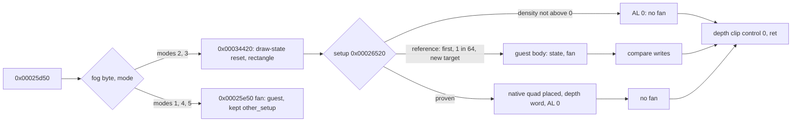

# Retiring D3D: the planar fog's screen quad

Status: Built. The arm, the cut and the GPU pass have not been seen in a run.
Code: `crates/rewrites/engine/src/planar_fog.rs` (`setup`, `draws`, `colour`, `quad`, `differences`), `crates/rewrites/render-bridge/src/native_fog_quad.rs` (`turn`, `referenced`), `crates/rewrites/native-render/src/fog_quad.rs` (`FogQuadDraw`, `FogQuadGpu`), `crates/extensions/game/src/native_fog_quad_glue.rs` (the host). Tests: in those files.
Switch: `impl.render.native-fog-quad` (on with the native renderer), listed in [switches.md](../runtime/switches.md).

A residual caller of [retire-d3d-remainders.md](retire-d3d-remainders.md) ("The residual callers"): `0x00025d50`, one inline fan a frame ([notes/residual-callers.md](notes/residual-callers.md)). In view modes 2 and 3 the native renderer draws the quad and the guest's setup returns as it does when there is no fog to draw, so the fan never reaches D3D. The rule: a call is cut only once a reference body has matched the cut's numbers, with the view target that reference left still bound.

## How it works

| Piece | Rust | Guest |
|---|---|---|
| The branch (`planar_fog::setup`) | the fog byte, the mode, the other-setup byte | `0x00025d50`..`0x00025d9d` |
| The gate (`planar_fog::draws`, `gate_writes`) | the clip far to the depth word; on only for a density above 0 | `0x00026520`..`0x0002653f` |
| The colour (`planar_fog::colour`) | density, red, green, blue scaled, `fistp` under the call's control word, ARGB, the colour lanes masked | `0x00131f40` |
| The combiner (`planar_fog::combiner`) | the block the setup fills: the final combiner's constant as colour and alpha | `0x00026690`..`0x000266da`, then `0x0001ccf0` |
| The state (`planar_fog::STATES`) | blend on, constant colour over one less source alpha, white blend constant with alpha 0, W-buffered, less or equal, no depth write, cull, stencil and alpha test off | `0x0002655a`..`0x0002668b` |
| The corners (`planar_fog::quad`) | `(0, 0)`, `(0, 1)`, `(1, 1)`, `(1, 0)` of the fan's rectangle, each `0x000350e0` at the depth word (`screen_grid::position`) | `0x00034552`..`0x00034706`, `0x00026710` attribute 0 |
| The draw (`fog_quad::FogQuadGpu`) | one quad through the post's `QuadDrawer`, the block translated as a combiner, its stored depth tested less or equal against the bound depth, placed with `Device::external_pass_now` | the fan's `Begin(7)` .. `End` |

The cut is an `implement` at `PLANAR_FOG_SETUP` (`0x00026520`), the
setup the fan calls through EDI. A call counts only when the fan's frame
above it holds the return to `0x00025d50` and the corners callback; the
rectangle is read from the fan's own frame (`[entry + 4]`).

On a cut call the guest keeps the path it makes with no fog: the fan's
draw-state reset `0x00016b10` and rectangle, then the setup's depth-word
write and AL 0, then `0x00025d50`'s depth clip control. The setup's target
select, render states, combiner, vertex program and the fan's texture and
vertex-input commits are not made. No later draw depends on them, as the
game makes the same path whenever the density is not above 0 (**Design**).

## The arm

| Reference | When | Kept as |
|---|---|---|
| `unproven` | no clean reference yet, or the last one differed | `scene_kept_fog_quad_unproven` |
| `target` | the view target (`0x004858b8`) or the bound pair (`0x0051f3f4`, `0x0051f3f8`) is not the one the last reference was called with | `scene_kept_fog_quad_target` |

A reference runs the guest body, then compares its writes with the cut's
(`planar_fog::differences`): the 60 block words, the depth word, and each
state's game word (`0x004b82e0`..) and D3D render-state word (`0x0040757c`..),
and AL 1. A difference is `fog_quad_mismatch_<field>` (`block_<n>`,
`depth`, `state_<name>`, `d3d_<name>`, `al`); every later call runs the
guest body for the session (`fog_quad_fallback` 1). A clean reference
whose select bound another pair proves nothing (`fog_quad_select_bound`):
the cut draws into the bound target, so it needs the select to keep it.

Once its target is proven a call never runs the guest body. A quad the
cut does not draw there returns as the gate does, with no fan, and is
`scene_dropped_fog_quad_<cause>`: `host`, `placed` (the device did not
take the pass), `fan_shape`, `fan_unfinite`, and a quad placed but not
recorded (`depth`, `outside`, `combiner`, `depth_clip`, the quad
drawer's).

A fan the guest draws is `scene_kept_fog_quad_<cause>`: a reference's,
`fallback`, `unread`, `simd`, `x87`, and `other_setup` (the fan of
`0x00025e50`, not read). All in
`render.scene` with `fog_quad_{calls,cut,referenced,matched,undrawn,proven}`.

## Tests and limits

Tests: `planar_fog.rs`
(`the_branches_follow_the_fog_byte_the_mode_and_the_other_byte`,
`the_gate_passes_only_a_density_above_zero`,
`the_colour_is_argb_rounded_under_the_control_word`,
`the_block_is_the_constant_through_the_final_combiner`,
`the_corners_are_the_rectangle_at_the_clip_far`,
`a_reference_body_is_compared_by_field`), `native_fog_quad.rs`
(`the_first_call_is_a_reference_and_the_next_is_cut_without_the_body`,
`a_new_target_is_a_reference_and_a_proven_one_never_runs_the_body`,
`a_reference_that_differs_sends_the_session_to_the_body`,
`a_reference_whose_select_binds_another_pair_proves_nothing`,
`a_proven_call_the_cut_does_not_draw_is_dropped_counted_by_cause`,
`the_other_setups_fan_is_counted_kept`,
`the_native_raster_is_the_setups_state`), `fog_quad.rs`
(`a_fan_of_the_four_corners_is_one_quad`,
`a_fan_that_is_not_a_rectangle_at_one_depth_is_refused`,
`the_blend_constant_is_white_with_alpha_zero`).

Not built: the fan of `0x00025e50` (view modes 1, 4 and 5), whose setup is
not read.

## Evidence

- **E**: the branch, the gate, the setup's states and block, the colour
  and the fan's corners (`h2 disasm` of `0x25d50`, `0x26520`, `0x26710`,
  `0x34420`, `0x131f40`).
- **S**: the vertex program `0x0001c590` binds passes the position in
  pixels through, as the glow's screen quads' does. A frame whose fog
  quad sits off the guest's would show it.
- **S**: the target select `0x00014bc0` keeps the bound pair in a game
  view. `fog_quad_select_bound` above 0 says it does not.

## Not verified

- That the setup is reached through the hook when the fan calls it
  through EDI, and that a cut frame's fog matches the guest's.
- How often the select keeps the pair, so how many calls are cut.
- Whether the colour arithmetic of the original under the game's
  control word matches the x87 model's (no differential test).

## Related

[retire-d3d-remainders.md](retire-d3d-remainders.md), [native-water-fog.md](native-water-fog.md) (layer 16, drawn after the quad), [native-post.md](native-post.md) (`0x00034420`).
