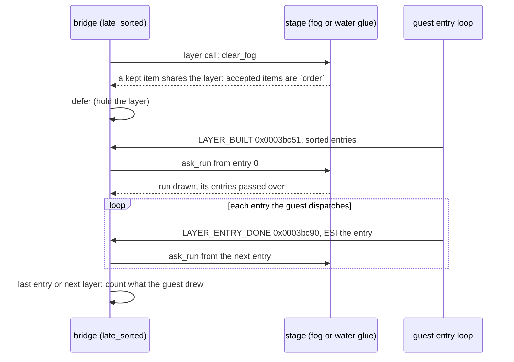
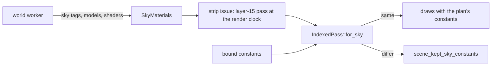

# Retiring D3D: R5, the rest of a game view

Status: Partly built. Fog, water and layers 2 and 17 draw per item; the sky's constants come from the plan; cutting the guest's sky setup is the section below that says "not built".
Code: `crates/rewrites/render-bridge/src/late_sorted.rs` (the sorted runs), `crates/rewrites/native-render/src/sorted_entries.rs`, `crates/rewrites/native-render/src/fog.rs` (`clear_fog`, `sorted_run`), `crates/rewrites/native-render/src/layer_pass.rs` (`sorted_layer_run`), `crates/rewrites/render-bridge/src/native_layers.rs` (`RUN_LAYERS`), `crates/rewrites/native-render/src/sky_material.rs`, `crates/extensions/game/src/native_sky_glue.rs`. Tests: in those files, `crates/rewrites/render-bridge/tests/native_fog.rs`.
Switch: `impl.render.native` (on), listed in [switches.md](../runtime/switches.md).

R5 of [retire-d3d.md](retire-d3d.md) moves the rest of a game view off the
guest's draws: the sky, layers 2 and 17, the late layers 6 and 16, and
the passes named in "By caller" there. The rule is the plan's: an item a
stage cannot draw keeps its guest draw in its place, counted
`scene_kept_*` by cause.

## What is kept

Each counter is in `render.scene` (**Code**; causes in
[native-world-walk.md](native-world-walk.md), "What the scene cannot draw
keeps its guest draw").

| Stage | Counter | Kept |
|---|---|---|
| Layer 2, scene and alternate view | `scene_kept_2_*`, `scene_kept_alt2_*` | what the plan refuses, as layers 1, 5, 7, 8 and 20, plus `object_sorted`, `set` and `entry` from the sorted runs |
| Layer 17 | `scene_kept_17_*` | the same, at the scene's call only |
| Layers 18, 19, 21 (sorted handlers) | `scene_kept_{18,19,21}_*` | as layer 17's (`native_layers::kept_counted`) |
| Layers 2, 17, 18, 19, 21, other callers | `scene_kept_<layer>_<kind>_caller` | every item (`native_layers::UNTAKEN_CALLER`) |
| Colour pass, screen effects | `scene_kept_post_colour_*`, `scene_kept_post_screen_effect_*` | a call the host does not arm (`host`, `args`, `plan`, `arm`, the screen effect's preflight causes); a glow that draws nothing is not counted. A HUD widget's call is R6's |
| Flare fans | `scene_kept_flare_<site>_<cause>` | a fan left to the device: `boundary`, `entry`, `preparation` or the check's refusal (`flares::Refusal::cause`) |
| Fog, layer 16 | `scene_kept_16_*` | the walk's per-slot causes, `state` and `entry` from the sorted runs, objects' items, other callers, view refusals. A record with no layer-16 entry draws nothing and is not counted (`fog::guest_items`) |
| Water, layer 6 | `scene_kept_6_*` | as the fog's, plus `target_view` and `no_parts` |
| Sky strip | `scene_kept_sky_*` | extraction, view and range refusals, then `IndexedPass::for_sky`'s |

## Fog and water per item

The layer draw sorts its entries and the fog and water passes blend, so
the order is the sort's. A layer the stage takes whole clears its items'
bits before the build, as before. When a kept item shares the layer, the
walk before the build clears nothing and names the accepted items
`order`; the bridge holds the layer (`late_sorted::defer`) and draws over
the sorted entries instead.

| Point | What runs |
|---|---|
| `LAYER_BUILT` (`0x0003bc51`) | the run from the first entry: each entry the stage draws, up to the first it keeps (`fog::sorted_run`) |
| `LAYER_ENTRY_DONE` (`0x0003bc90`) | after an entry the guest dispatched, the run that follows it; after the last entry, the layer is counted |
| next layer draw | a held layer whose entries never came is counted from what it held (`late_sorted::stale`) |

- **Passing over.** A committed run's entries are rewritten so the loop
  passes over them (`[[e+0x10]+0x100] == -1`, through the entry's own
  `+0x14`: `Sorted::pass_over`). No entry moves, so the guest's draws and
  the runs interleave in the sort's order.
- **The device.** Skipping a run's draws must leave the next kept entry
  the device drawing them would. The shader draw restores the cached
  implementation's list at a switch, so each run item's implementations
  are checked with `layer_pass::skip_holds` against the device as that
  restore leaves it (`sorted_entries::cached_restore` over the device's
  states). An item that fails is kept, `state`.
- **The scene.** Each run's parts go into the view's late layer after the
  earlier runs' (`scene_step::late_layer`), and its pass draws its own.

Counters (`render.scene`): `layer_plan_{16,6}_sorted_views` (layers
held), `_sorted_taken` (items the runs drew), `_refused_state`,
`_refused_entry`, `_sorted_pass_failed` (a committed run whose entry would
not take the rewrite: the guest draws it too, logged).

## Layer 2 from the plan

Layers 2 and 17 (`native_layers::RUN_LAYERS`) at the scene's and the
alternate view's calls use the same runs. The layer call's ask draws the
leading items the order rule allows and clears their bits; when it leaves
an item `order`, the bridge holds the layer (`late_sorted::hold`) and each
run asks the glue again (`Host::ask_run`), which differs from the call's
ask in four ways.

| Step | Layer call | Sorted run |
|---|---|---|
| Items | the list, by the order rule (`clear_layer_items`) | the sorted entries from `from`, up to the first kept (`layer_pass::sorted_layer_run`) |
| Skip check | `skip_holds` against the device | against the device after the cached restore |
| Objects | planned with the structure | kept, `object_sorted` (their checks read the device at the call) |
| Outcomes | `layer_plan_2_*` | none; the held layer's `scene_kept_*` when done |

No layer-2 draw is admitted at its resolved inputs: what no run takes
keeps its guest draw and its count.

Counters: `layer_plan_{2,17}_sorted_views`, `_sorted_taken`,
`_sorted_pass_failed`.

## The sky from the plan

| Step | Code | What it does |
|---|---|---|
| Load | `native_sky_glue::load` (world worker, `Ready::sky`) | every `sky ` tag's model (`+0x4`), its materials (`mode +0x60`, shader at `+0xc`), each shader's `Material` and animated properties |
| Evaluate | `native_sky_glue::evaluate`, `sky_material::evaluate` | at the strip's issue, the section part's shader, layer 15, the pass the guest pushed, implementation 0, sampled at the render clock |
| Compare | `SkyConstants::difference` | every instance vertex register and every written combiner constant, bit for bit, against the draw's constants and combiner state (and the retail constants) |
| Draw | `SkyRows::apply` | the view's node rows, the decompression and the plan's constants over the draw's uniforms |

Engine vertex registers (`Origin::Engine`) and the view's rows stay the
draw's. Causes, as `scene_kept_sky_<cause>`: `unloaded`, `shader`,
`layer`, `pass`, `animation`, `constants`.

## Not built

- **Cutting the guest's sky setup.** The strip is admitted at its
  resolved draw, so the guest's sky selection, its node palette upload and
  the strip's setup still run. A cut needs the view's node rows from the
  sky's transform natively (scale `+0x14`, rotation, camera translation
  scale; checked against `SkyItem::rows` while the guest still runs), the
  strip's program and textures from the material instead of the draw, and
  the section's geometry from the load rather than the first strip's
  capture.
- **The flare passes, the post and layers 18, 19 and 21 from the scene.**
  `0x0002dd30`, `0x0002df00` and `0x00013870` still run, and their native
  passes draw into the device's live targets at the guest's calls. Cutting
  them needs the graph to own the view's targets. Layers 18, 19 and 21
  draw at their sorted entry in slot 9 or 10, after the view snapshot
  (`native_render::snapshot_gpu`). The water's full-size colour copy is
  there too (`snapshot_gpu::ColourCopies`).

## Not verified

- That `0x0003bc90` is reached for an entry the loop passes over as well
  as after a handler; the bridge needs only the second, and counts a
  layer at the next layer draw when the last entry's step does not come.
- That the native world's list parity observer at `LAYER_BUILT` reads the
  entries before a run rewrites them; otherwise the parity counts the
  layer as different and does not reuse it.
- Frame parity on a fogged map with objects in the fog.

Tests: `the_stage_draws_around_the_entry_the_guest_keeps`,
`a_held_layer_whose_boundary_never_comes_keeps_every_draw`,
`a_refused_view_asks_no_later_run` (`late_sorted`);
`a_sorted_run_ends_at_the_entry_the_guest_keeps_and_the_next_starts_after_it`
(`native_render::fog`); `a_sorted_layer_run_ends_at_the_entry_the_guest_keeps`
(`layer_pass`), `the_evaluated_constants_match_what_the_guest_bound_and_each_difference_is_named`,
`an_animated_sky_pass_is_sampled_at_the_render_clock`,
`a_sky_without_the_pass_names_what_is_missing` (`sky_material`),
`each_skys_model_names_its_shaders_once` (`native_sky_glue`),
`an_order_item_of_layer_2_holds_the_layer_for_its_sorted_entries`
(`native_layers`); `a_passed_over_entry_reads_as_passed_and_keeps_its_slot_and_neighbours`,
`the_cached_restore_list_reads_from_the_descriptor_table` (`sorted_entries`);
`layer_17_and_an_untaken_callers_layer_2_count_what_they_keep`,
`a_camouflage_or_hologram_item_the_host_does_not_draw_counts_scene_kept`
(`native_layers`), `the_host_gets_the_calls_words` (`tests/native_post.rs`),
`a_kept_post_call_or_flare_fan_counts_its_cause_and_owes_the_hud_nothing`
(`native_hud::kept`), `what_the_guest_still_draws_is_counted_scene_kept_by_cause`
(`tests/native_fog.rs`), `a_sky_strip_keeps_its_cull_and_each_refusal_is_named`
(`tests/world_layers_gpu.rs`), `a_kept_strip_is_counted_scene_kept_by_its_cause`
(`native_sky`), `the_world_layers_are_cut_in_their_slots` (`tests/cut.rs`).

## Related

- [retire-d3d.md](retire-d3d.md): the plan and the other slices.
- [native-renderer.md](native-renderer.md): the sky and residual geometry stages.
- [layer-draw.md](layer-draw.md): the entry loop and its build.
- [native-water-fog.md](native-water-fog.md): the fog and water passes.
