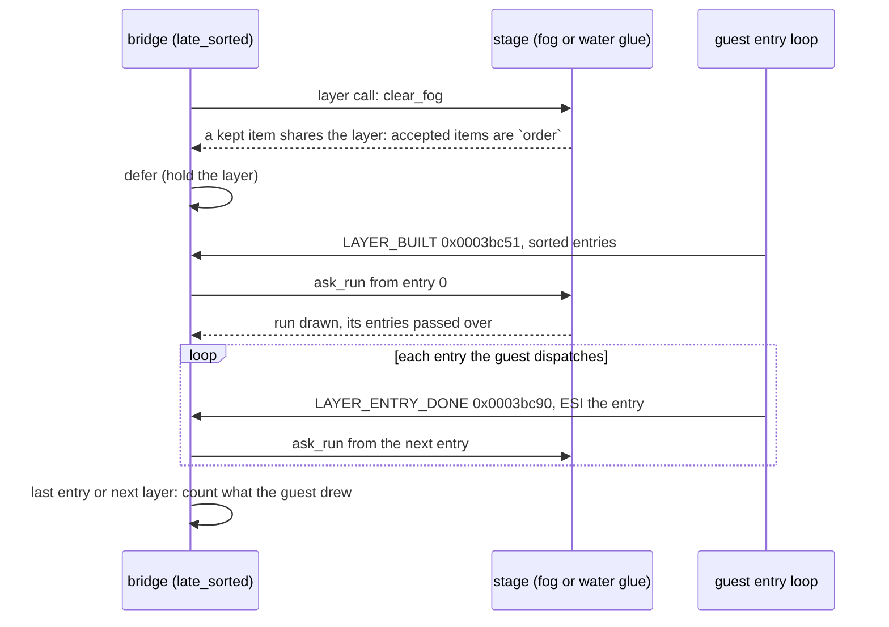
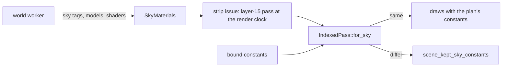
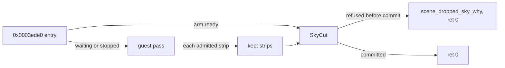

# Retiring D3D: R5, the rest of a game view

Status: Partly built. Fog, water and layers 2 and 17 draw per item; layers 2, 6, 16, 17, 18, 19 and 21 return without the guest body when the scene draws every item; the sky's constants, rows, look and geometry come from the plan, and its cut passes over the guest's sky.
Code: `crates/rewrites/render-bridge/src/late_sorted.rs` (the sorted runs), `crates/rewrites/native-render/src/sorted_entries.rs`, `crates/rewrites/native-render/src/fog.rs` (`clear_fog`, `sorted_run`), `crates/rewrites/native-render/src/layer_pass.rs` (`sorted_layer_run`), `crates/rewrites/render-bridge/src/native_layers.rs` (`RUN_LAYERS`), `crates/rewrites/native-render/src/sky_material.rs`, `crates/extensions/game/src/native_sky_glue.rs`. Tests: in those files, `crates/rewrites/render-bridge/tests/native_fog.rs`.
Switch: `impl.render.native` (on), listed in [switches.md](../runtime/switches.md).

R5 of [retire-d3d.md](retire-d3d.md) moves the rest of a game view off the
guest's draws: the sky, layers 2 and 17, the late layers 6 and 16, and
the passes named in "By caller" there. The rule is the plan's: an item a
stage cannot draw keeps its guest draw in its place, counted
`scene_kept_*` by cause.

## What is kept

Each counter is in `render.scene` (**Code**; causes in
[native-world-walk.md](native-world-walk.md), "What the scene cannot draw
keeps its guest draw").

| Stage | Counter | Kept |
|---|---|---|
| Layer 2, scene and alternate view | `scene_kept_2_*`, `scene_kept_alt2_*` | what the plan refuses, as layers 1, 5, 7, 8 and 20, plus `set` and `entry` from the sorted runs |
| Layer 17 | `scene_kept_17_*` | the same, at the scene's call only |
| Layers 18, 19, 21 (sorted handlers) | `scene_kept_{18,19,21}_*` | as layer 17's (`native_layers::kept_counted`) |
| Layers 2, 17, 18, 19, 21, other callers | `scene_kept_<layer>_<kind>_caller` | every item (`native_layers::UNTAKEN_CALLER`) |
| Colour pass, screen effects | `scene_kept_post_colour_*`, `scene_kept_post_screen_effect_*` | a call the host does not arm (`host`, `args`, `plan`, `arm`, the screen effect's preflight causes); a glow that draws nothing is not counted. A HUD widget's call is R6's |
| Flare fans | `scene_kept_flare_<site>_<cause>` | a fan left to the device: `boundary`, `entry`, `preparation` or the check's refusal (`flares::Refusal::cause`) |
| Fog, layer 16 | `scene_kept_16_*` | the walk's per-slot causes, `state` and `entry` from the sorted runs, objects' items, other callers, view refusals. A record with no layer-16 entry draws nothing and is not counted (`fog::guest_items`) |
| Water, layer 6 | `scene_kept_6_*` | as the fog's, plus `target_view` and `no_parts` |
| Sky strip | `scene_kept_sky_*` | extraction, view and range refusals, then `IndexedPass::for_sky`'s |

## The layer draws' return

The layer draw `0x00044550` returns without its body for layers 2, 6,
16, 17, 18, 19 and 21 as it does for the opaque block's
(`frame_step::layer::LATE_LAYERS`, `FOG_WATER_LAYERS`,
`native_layers::return_site`): once no item of the list holds the layer's
bit, the call makes the body's own writes and returns. The body is the
same for every layer in the draw mask `0x00bffdee`. Layer 16 has a gate of
its own (`0x00044582`: fog mode 3, or byte 1 or 2 of `0x00485a74`); with
it off the body builds no entry, so the call returns with its items held
(`frame_step::layer::builds`).

| Layer | Site | Return counted |
|---|---|---|
| 2 | the scene's `0x0002c060`, the alternate view's `0x0002bda8`, the first person's `0x00040289` | `layer_return_{,alt,fp}2_*` |
| 6, 16 | the late passes' `0x0002c120`, `0x0002c0e9` (not the first person's 16: its items draw at the indexed range hook inside the body) | `layer_return_{6,16}_*` |
| 17 | the scene's `0x0002c30b` | `layer_return_17_*` |
| 18, 19 | the camouflage handler's `0x00042015`, `0x0004205f` | `layer_return_{18,19}_*` |
| 21 | the hologram handler's `0x00042721` | `layer_return_21_*` |

A call with an item held runs the body, `layer_return_<site><layer>_guest_<cause>`;
each item the body draws is one `scene_kept_*` count, those a stage did not
count before the call under `unnamed` or the stage's cause. The fog and
the water count every item they leave themselves (`native_layers::counts_own`). These calls are `kept`; the
sorted handlers' are under the site `sorted`. Tests:
`r5s_layer_draws_return_when_every_item_is_native`,
`the_scenes_fog_and_water_return_and_their_kept_items_are_counted_once`
(`native_layers`), `a_returned_layer_draw_leaves_the_words_the_guest_body_leaves`,
`a_fog_layer_with_its_gate_off_returns_with_its_items_held`
(`tests/frame_step_layer.rs`).

## Fog and water per item

The layer draw sorts its entries and the fog and water passes blend, so
the order is the sort's. A layer the stage takes whole clears its items'
bits before the build, as before. When a kept item shares the layer, the
walk before the build clears nothing and names the accepted items
`order`; the bridge holds the layer (`late_sorted::defer`) and draws over
the sorted entries instead.

| Point | What runs |
|---|---|
| `LAYER_BUILT` (`0x0003bc51`) | the run from the first entry: each entry the stage draws, up to the first it keeps (`fog::sorted_run`) |
| `LAYER_ENTRY_DONE` (`0x0003bc90`) | after an entry the guest dispatched, the run that follows it; after the last entry, the layer is counted |
| next layer draw | a held layer whose entries never came is counted from what it held (`late_sorted::stale`) |

- **Passing over.** A committed run's entries are rewritten so the loop
  passes over them (`[[e+0x10]+0x100] == -1`, through the entry's own
  `+0x14`: `Sorted::pass_over`). No entry moves, so the guest's draws and
  the runs interleave in the sort's order.
- **The device.** Skipping a run's draws must leave the next kept entry
  the device drawing them would. The shader draw restores the cached
  implementation's list at a switch, so each run item's implementations
  are checked with `layer_pass::skip_holds` against the device as that
  restore leaves it (`sorted_entries::cached_restore` over the device's
  states). An item that fails is kept, `state`.
- **The scene.** Each run's parts go into the view's late layer after the
  earlier runs' (`scene_step::late_layer`), and its pass draws its own.

Counters (`render.scene`): `layer_plan_{16,6}_sorted_views` (layers
held), `_sorted_taken` (items the runs drew), `_refused_state`,
`_refused_entry`, `_sorted_pass_failed` (a committed run whose entry would
not take the rewrite: the guest draws it too, logged).

## Layer 2 from the plan

The layers cut to the scene (1, 5, 7, 8, 20, 2 and 17:
`native_layers::RUN_LAYERS`) at the scene's and the alternate view's
calls use the same runs. The layer call's ask draws the
leading items the order rule allows and clears their bits; when it leaves
an item `order`, the bridge holds the layer (`late_sorted::hold`) and each
run asks the glue again (`Host::ask_run`), which differs from the call's
ask in four ways.

| Step | Layer call | Sorted run |
|---|---|---|
| Items | the list, by the order rule (`clear_layer_items`) | the sorted entries from `from`, up to the first kept (`layer_pass::sorted_layer_run`) |
| Skip check | `skip_holds` against the device | against the device after the cached restore |
| Objects | planned with the structure | planned with the restore over the device (`sorted_entries::after_restore`): the stencil, entry states, fog, W buffer, stipple switch and skip; an item making the frame's first `0x0003bea0` call writes the cache's restore list before the pass, and the commit sets the copy flag and the draw byte and clears the cache (`FirstCopy`, as layer 15's object entry); the pass makes the colour copies the layer call's does |
| Outcomes | `layer_plan_<layer>_*` | none; the held layer's `scene_kept_*` once, when done (the layer draw's own turn leaves them) |

No layer-2 draw is admitted at its resolved inputs: what no run takes
keeps its guest draw and its count.

Counters: `layer_plan_{2,17}_sorted_views`, `_sorted_taken`,
`_sorted_pass_failed`.

## The sky from the plan

| Step | Code | What it does |
|---|---|---|
| Load | `native_sky_glue::load` (world worker, `Ready::sky`) | every `sky ` tag's model (`+0x4`), its materials (`mode +0x60`, shader at `+0xc`), each shader's `Material` and animated properties |
| Evaluate | `native_sky_glue::evaluate`, `sky_material::evaluate` | at the strip's issue, the section part's shader, layer 15, the pass the guest pushed, implementation 0, sampled at the render clock |
| Compare | `SkyConstants::difference` | every instance vertex register and every written combiner constant, bit for bit, against the draw's constants and combiner state (and the retail constants) |
| Draw | `SkyRows::apply` | the view's node rows, the decompression and the plan's constants over the draw's uniforms |

Engine vertex registers (`Origin::Engine`) and the view's rows stay the
draw's. Causes, as `scene_kept_sky_<cause>`: `unloaded`, `shader`,
`layer`, `pass`, `animation`, `constants`.

## The sky's node rows

The cut makes each strip's rows from the sky's transform
(`scene_extract::layout::sky_rows::rows_of`); nothing compares them with
the guest's.

| Step | Guest | Made from |
|---|---|---|
| Rest pose | `0x0003ea60` | the guest's rest matrices at `0x004c5040` (made once per sky model) |
| Sky matrix | `0x0003ebd0` | `sky +0x14` scale, `+0x80` angle, the elevation double at `0x0045dbe0`, the global up, `sky +0x18` times the camera |
| Node | `0x0003ebd0`'s loop, `0x00142a60` | the rest matrix plus `[0x004687a4]`, under the sky matrix |
| Rows | `0x001376c0` | under the node's inverse bind (`mode` node `+0x28`), three rows |

A section with no single node (`SECTION_NODE` -1) takes its node map's
palette as `0x00137800` builds it (from `0x0003e380`, detail level 4):
every node's rows, then the sky group's compound nodes (`mode +0x38`,
group `byte mode +0x3c + 4`), each the weighted sum of up to four of the
matrices so far (`m·w + sum`, the fourth weight `1 - sum`), then the loaded
section's (`+0x34`) node map (`+0x64`) over them. A model with flag bit 2
(one matrix) is declined, `palette`; a group or record that does not read,
`blend`; a node map that does not read or names a matrix not made, `map`.

## The sky's program and textures

The world worker makes each sky shader's layer-15 passes from the material
(`native_sky_glue::load`): `decorators_load::decorator_look` at layer 15,
the `vrtx`'s rigid classification (1), and every bitmap stage decoded into
`SkyMaterials::images`. A stage the load cannot supply (the lightmap, an
engine texture) leaves the pass without a look, named at the load.

At the strip, `SkyLook::check` compares it with the guest's draw: the
program's instruction words and the stages sampled. Counted
`sky_plan_<outcome>`: `matched`, `program`, `textures`, or why there is no
look (`unloaded`, `shader`, `look`, `extraction`). The strip draws with
the draw's program and textures until the cut binds the look's.

The load also reads each sky render model's sections from the map
(`tags::model::RenderModelGeometry`, the section raw blocks) into
`SkySection`: every vertex stream's stride and bytes and every part's
index run. At the strip, `SkySection::check` compares the draw's index
list (absolute, or rebased by the part's smallest index) and each stream
over the part's vertex window. Counted `sky_geometry_<outcome>`:
`matched`, `indices`, `window`, `streams`, `part`, or why there is no
section (`unloaded`, `model`, `section`, `extraction`), and `absolute` (a
draw that indexes the whole section, not the part's window).

A strip whose geometry matches is drawn from the load's bytes
(`SkySection::resident`): the load cuts each part's vertex window and
rebased index list once, each a snapshot of its own
(`CachedBytes::derived`, `CachedIndices::derived`), and
`IndexedPass::for_sky` makes the strip's `SectionKey::Sky` entry from
them, so the entry is uploaded once per part per BSP from the map, not
from the guest's buffers. The draw's layout, state and constants stay the
strip's.

The cut's arm counts each strip `sky_cut_<outcome>`: `waiting`, `ready`
(256 strips in a row with the made rows answering and the look and
geometry matching), `stopped` (one strip that did not, until the next
BSP).

## The sky's cut

Once the cut's arm is ready, `0x0003ede0` (`RENDER_SKY`, `[fn() ret 0]`)
is passed over at every pass for the BSP and the native pass draws the sky
in slot 8. The guest's pass runs only while the arm waits or after it
stops, to record the strips the cut replays.

| Step | Code | What it does |
|---|---|---|
| Hook | `native_world_layers` (`native_sky_cut`), `native_sky::before_sky` | at the entry, `cut_takes`: the arm ready for the BSP (`SkyTurn`) |
| Keep | `native_sky_cut_glue::record` | over a guest pass, every admitted strip's `IndexedPass::sky_template` with its section, shader, pass and decompression; the device's view block (registers 0 to 17) at the entry checked against each strip's; each strip's stencil checked against the last complete pass's strip in its place (`stencil_holds`) |
| Replay | `IndexedPass::sky_replay` | the template's draw, the rows from `sky_rows::rows_of` (no strip on the stack), the pass evaluated at the render clock; geometry, program, pipeline and stage views from the resident `SectionKey::Sky` entry |
| Issue | `SkyCut`, `prepare_external_bound` | the strips as one pass at the boundary, the device's view block over each (`view_constants`), committed before the hook returns |

A guest pass that keeps a strip on the guest leaves the kept strips empty
until a complete one. A view block that differs stops the arm for the BSP
(`sky_cut_view`), as does a strip whose stencil differs from the one its
place drew with in the last complete pass (`sky_cut_stencil`): a replay
draws with its template's stencil.

A ready arm never returns a pass to
the guest: a cut refused before its commit draws no sky that pass,
`scene_dropped_sky_<why>` (`unloaded`, `strips`, `rows`, `constants`,
`device`, `pass`). Counters: `sky_cut_drawn`, the drops, and the
arm's `sky_cut_{waiting,ready,stopped}`.

## Not built

- **The flare passes, the post and layers 18, 19 and 21 from the scene.**
  `0x0002dd30`, `0x0002df00` and `0x00013870` still run, and their native
  passes draw into the device's live targets at the guest's calls. Cutting
  them needs the graph to own the view's targets. Layers 18, 19 and 21
  draw at their sorted entry in slot 9 or 10, after the view snapshot
  (`native_render::snapshot_gpu`). The water's full-size colour copy is
  there too (`snapshot_gpu::ColourCopies`).

## Not verified

- That `0x0003bc90` is reached for an entry the loop passes over as well
  as after a handler; the bridge needs only the second, and counts a
  layer at the next layer draw when the last entry's step does not come.
- That the native world's list parity observer at `LAYER_BUILT` reads the
  entries before a run rewrites them; otherwise the parity counts the
  layer as different and does not reuse it.
- Frame parity on a fogged map with objects in the fog.

Tests: `the_stage_draws_around_the_entry_the_guest_keeps`,
`a_held_layer_whose_boundary_never_comes_keeps_every_draw`,
`a_refused_view_asks_no_later_run` (`late_sorted`);
`a_sorted_run_ends_at_the_entry_the_guest_keeps_and_the_next_starts_after_it`
(`native_render::fog`); `a_sorted_layer_run_ends_at_the_entry_the_guest_keeps`
(`layer_pass`), `the_evaluated_constants_match_what_the_guest_bound_and_each_difference_is_named`,
`an_animated_sky_pass_is_sampled_at_the_render_clock`,
`a_sky_without_the_pass_names_what_is_missing` (`sky_material`),
`each_skys_model_names_its_shaders_once` (`native_sky_glue`),
`the_strips_rows_are_made_from_the_skys_tag_and_the_rest_pose`,
`the_product_is_the_guests_composition` (`sky_rows`),
`the_sky_look_from_the_material_is_checked_against_the_strip`,
`the_sky_section_from_the_load_is_checked_against_the_strip` (`tests/world_layers_gpu.rs`),
`the_cut_arm_is_ready_after_its_run_and_stops_at_a_miss` (`native_sky`),
`a_strip_holds_the_view_block_bit_for_bit`, `a_strip_holds_the_stencil_its_place_drew_with` (`native_sky_cut_glue`),
`the_rows_arm_answers_after_its_matches_and_stops_at_a_difference` (`native_sky`),
`an_order_item_of_layer_2_holds_the_layer_for_its_sorted_entries`
(`native_layers`); `a_passed_over_entry_reads_as_passed_and_keeps_its_slot_and_neighbours`,
`the_cached_restore_list_reads_from_the_descriptor_table` (`sorted_entries`);
`layer_17_and_an_untaken_callers_layer_2_count_what_they_keep`,
`a_camouflage_or_hologram_item_the_host_does_not_draw_counts_scene_kept`
(`native_layers`), `the_host_gets_the_calls_words` (`tests/native_post.rs`),
`a_kept_post_call_or_flare_fan_counts_its_cause_and_owes_the_hud_nothing`
(`native_hud::kept`), `what_the_guest_still_draws_is_counted_scene_kept_by_cause`
(`tests/native_fog.rs`), `a_sky_strip_keeps_its_cull_and_each_refusal_is_named`
(`tests/world_layers_gpu.rs`), `a_kept_strip_is_counted_scene_kept_by_its_cause`
(`native_sky`), `the_world_layers_are_cut_in_their_slots` (`tests/cut.rs`).

## Related

- [retire-d3d.md](retire-d3d.md): the plan and the other slices.
- [native-renderer.md](native-renderer.md): the sky and residual geometry stages.
- [layer-draw.md](layer-draw.md): the entry loop and its build.
- [native-water-fog.md](native-water-fog.md): the fog and water passes.
