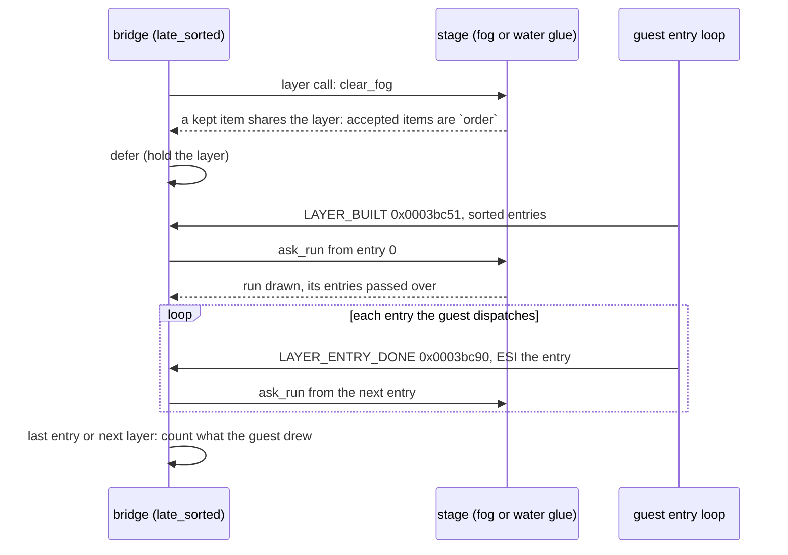

# Retiring D3D: R5, the rest of a game view

Status: Partly built. Fog and water draw per item; layer 2's remainder and the sky from the scene are the sections below that say "not built".
Code: `crates/rewrites/render-bridge/src/late_sorted.rs` (the sorted runs), `crates/rewrites/native-render/src/sorted_entries.rs`, `crates/rewrites/native-render/src/fog.rs` (`clear_fog`, `sorted_run`). Tests: in those files, `crates/rewrites/render-bridge/tests/native_fog.rs`.
Switch: `impl.render.native` (on), listed in [switches.md](../runtime/switches.md).

R5 of [retire-d3d.md](retire-d3d.md) moves the rest of a game view off the
guest's draws: the sky, layers 2 and 17, the late layers 6 and 16, and
the passes named in "By caller" there. The rule is the plan's: an item a
stage cannot draw keeps its guest draw in its place, counted
`scene_kept_*` by cause.

## What is kept

Each counter is in `render.scene` (**Code**; causes in
[native-world-walk.md](native-world-walk.md), "What the scene cannot draw
keeps its guest draw").

| Stage | Counter | Kept |
|---|---|---|
| Layer 2, scene and alternate view | `scene_kept_2_*`, `scene_kept_alt2_*` | what the plan refuses, as layers 1, 5, 7, 8 and 20 |
| Layer 17 | `scene_kept_17_*` | the same, at the scene's call only |
| Layers 2 and 17, other callers | `scene_kept_{2,17}_<kind>_caller` | every item (`native_layers::UNTAKEN_CALLER`) |
| Fog, layer 16 | `scene_kept_16_*` | the walk's per-slot causes, `state` and `entry` from the sorted runs, objects' items, other callers, view refusals. A record with no layer-16 entry draws nothing and is not counted (`fog::guest_items`) |
| Water, layer 6 | `scene_kept_6_*` | as the fog's, plus `target_view` and `no_parts` |
| Sky strip | `scene_kept_sky_*` | extraction, view and range refusals, then `IndexedPass::for_sky`'s |

## Fog and water per item

The layer draw sorts its entries and the fog and water passes blend, so
the order is the sort's. A layer the stage takes whole clears its items'
bits before the build, as before. When a kept item shares the layer, the
walk before the build clears nothing and names the accepted items
`order`; the bridge holds the layer (`late_sorted::defer`) and draws over
the sorted entries instead.

| Point | What runs |
|---|---|
| `LAYER_BUILT` (`0x0003bc51`) | the run from the first entry: each entry the stage draws, up to the first it keeps (`fog::sorted_run`) |
| `LAYER_ENTRY_DONE` (`0x0003bc90`) | after an entry the guest dispatched, the run that follows it; after the last entry, the layer is counted |
| next layer draw | a held layer whose entries never came is counted from what it held (`late_sorted::stale`) |

- **Passing over.** A committed run's entries are rewritten so the loop
  passes over them (`[[e+0x10]+0x100] == -1`, through the entry's own
  `+0x14`: `Sorted::pass_over`). No entry moves, so the guest's draws and
  the runs interleave in the sort's order.
- **The device.** Skipping a run's draws must leave the next kept entry
  the device drawing them would. The shader draw restores the cached
  implementation's list at a switch, so each run item's implementations
  are checked with `layer_pass::skip_holds` against the device as that
  restore leaves it (`sorted_entries::cached_restore` over the device's
  states). An item that fails is kept, `state`.
- **The scene.** Each run's parts go into the view's late layer after the
  earlier runs' (`scene_step::late_layer`), and its pass draws its own.

Counters (`render.scene`): `layer_plan_{16,6}_sorted_views` (layers
held), `_sorted_taken` (items the runs drew), `_refused_state`,
`_refused_entry`, `_sorted_pass_failed` (a committed run whose entry would
not take the rewrite: the guest draws it too, logged).

## Not built

- **The sky from the scene.** The strip is admitted at its resolved draw
  (`native_residual_glue`), so the guest's sky selection, its node palette
  upload and the strip's setup run.
- **Layer 2's packets.** The standard geometry the plan leaves at the main
  and alternate calls is admitted at its resolved draw, kind 2 setup
  included.

## Not verified

- That `0x0003bc90` is reached for an entry the loop passes over as well
  as after a handler; the bridge needs only the second, and counts a
  layer at the next layer draw when the last entry's step does not come.
- That the native world's list parity observer at `LAYER_BUILT` reads the
  entries before a run rewrites them; otherwise the parity counts the
  layer as different and does not reuse it.
- Frame parity on a fogged map with objects in the fog.

Tests: `the_stage_draws_around_the_entry_the_guest_keeps`,
`a_held_layer_whose_boundary_never_comes_keeps_every_draw`,
`a_refused_view_asks_no_later_run` (`late_sorted`);
`a_sorted_run_ends_at_the_entry_the_guest_keeps_and_the_next_starts_after_it`
(`native_render::fog`); `a_passed_over_entry_reads_as_passed_and_keeps_its_slot_and_neighbours`,
`the_cached_restore_list_reads_from_the_descriptor_table` (`sorted_entries`);
`layer_17_and_an_untaken_callers_layer_2_count_what_they_keep`
(`native_layers`), `what_the_guest_still_draws_is_counted_scene_kept_by_cause`
(`tests/native_fog.rs`), `a_sky_strip_keeps_its_cull_and_each_refusal_is_named`
(`tests/world_layers_gpu.rs`), `a_kept_strip_is_counted_scene_kept_by_its_cause`
(`native_sky`), `the_world_layers_are_cut_in_their_slots` (`tests/cut.rs`).

## Related

- [retire-d3d.md](retire-d3d.md): the plan and the other slices.
- [native-renderer.md](native-renderer.md): the sky and residual geometry stages.
- [layer-draw.md](layer-draw.md): the entry loop and its build.
- [native-water-fog.md](native-water-fog.md): the fog and water passes.
