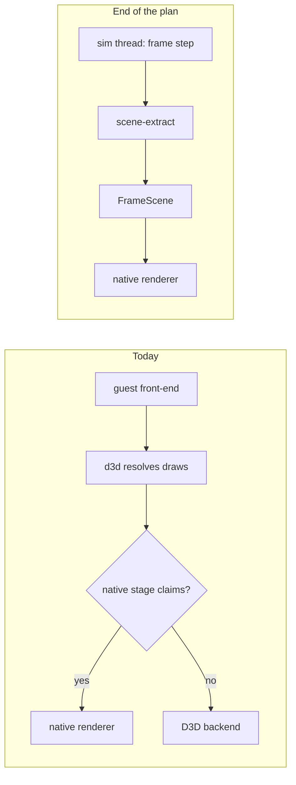
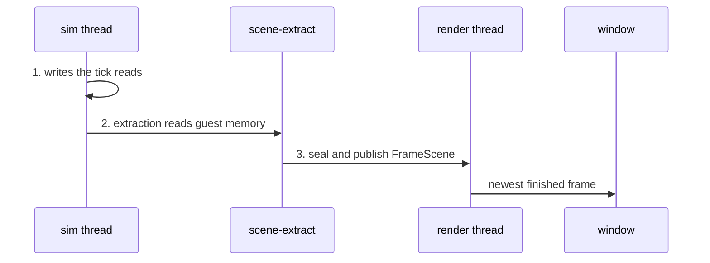

# Retiring the guest D3D path

Status: Design. R0 and R9 are built. R1, R4, R5, R6, R7, R8 and the parts of earlier stages listed below are partly built; R9's gate does not pass yet, and no other slice is built.
Code: `crates/platform/d3d/src` (what is deleted), `crates/rewrites/scene-extract/src` and `crates/rewrites/native-render/src` (what replaces it), `crates/rewrites/render-bridge/src` (the frame step and the census). Tests: named per slice below.
Switch: `impl.render.native` (on), removed with the crate; `impl.render.native-hud` and `impl.render.native-hud-walk` (on), R6's, removed with the guest HUD walk; R4's producers have `impl.render.native.visibility` (on), which only turns them off. All in [switches.md](../runtime/switches.md).

| Slice | Built | Where it is specified |
|---| R0 | `render.residual` and the three frame counters | [agent-api.md](../runtime/agent-api-render-checks.md#renderresidual-residual-d3d-work) |
| R1, structure | static items of layers 1, 5, 7, 8 and 20 draw from the scene's plan by default | framescene.md slice 4, "The stage" |
| R1, objects | items of the scene's layers 1, 5, 7, 8 and 20 (layer 5's with the model's PRT stream) and the first person's layers 1, 7, 8 and 20 | framescene.md slice 4, "The stage" |
| R1, object items with auxiliary state | draw with the rows and clip the toggle sets for their view where the device holds it off; those sampling the texture accumulation target bind its level outside layer 1; the first person's layer-3 items do both | [native-objects.md](native-objects.md) |
| R1, object items with a fade byte | draw masked by their byte's pattern under the device's polygon stipple, where the device holds what their epilogue leaves | [native-objects.md](native-objects.md), "Fade, the shader flag and the item's argument" |
| R1, object items whose shader has flag bit 0 | draw with the structure's parameter block upload (the bump matrices of stages 1 to 3 and `c[21..25]`) where the device and the engine already hold it, and, before the frame's structure target copy, where no pass's program has flag bit 20 (whose draw would make the copy). An item's projected size changes nothing they draw, in every layer named here and layer 3's walk | [native-objects.md](native-objects.md), "Fade, the shader flag and the item's argument" |
| R1, layer 3 object parts | draw every topology and subpart choice their records make, however many subparts a part has and a strip part's chosen subparts included | framescene.md slice 3, "Bit 9" |
| R1, layer 3 decorators | draw from the scene only where skipping them leaves the device's render states as drawing them would, a pass whose restore list writes back what it sets included | native-decorators.md, "The glue" |
| R1, the layer draw | a call of the opaque block's layers returns without the guest body when every item is native (status `kept`); a call that runs it counts each item it draws `scene_kept_<site><layer>_<kind>_<cause>` | "R1's remainder" |
| R1, the decal call | a call of the decal callback `0x00044040` whose records the native renderer draws returns without the guest body: each record drawn from its mode's template with its own vertices, tint and stage-0 texture, its marker written; a call that runs the body counts `scene_kept_decal_call_<cause>` | [retire-d3d-decals.md](retire-d3d-decals.md) |
| R1, the decal decorators' draw | each call of `0x0004ebd0` drawn natively at its sorted place; once a frame proves it, a call the last body's template stands for returns without its body; a call that runs it counts `scene_kept_decal_decorator_<cause>` | [retire-d3d-decal-decorators.md](retire-d3d-decal-decorators.md) |
| R1, layers 10, 11 and 14 | whole groups draw from the scene with no geometry handler; the object filter draws natively | native-shadow-layers.md |
| R4 | the main view's records, and its cluster set, window frusta and object set walked from them; the guest's view records (`0x002234e0`) and light frusta (`0x000c1d90`) as byte arms; audited by shadow arms (1 frame in 64, answer after 16 clean samples, guest for the map on a difference, for the frame on a refusal); the projection builder `0x0002fb70`; the gather's setup `0x00132b80` and reset `0x001348e0` as a byte arm; the portal, window, sphere and PVS producers after their comparisons. Still the guest's: the gather's own body and `0x00173130`'s frame (frustum loop and ordinal sort) | [native-visibility.md](native-visibility.md#the-shadow-arms) |
| R5, layers 2 and 17 | structure and object items draw from the scene's plan as layers 1, 5, 7, 8 and 20 do (layer 2 at the main, alternate and first-person calls); both are cut world layers (`cut::LAYER_CUTS`, layer 17 in slot 12) | [native-renderer.md](native-renderer.md) |
| R5, sky | the sky stage draws supported strips with the view's node palette, the material inputs at issue and the draw's own cull mode | [native-renderer.md](native-renderer.md) |
| R5, earlier stages | fog, water, layers 18, 19 and 21, the flares' colour fans and the post | "By caller" |
| R5, fog and water per item | layers 16 and 6 draw every item their stage takes in the guest's sorted order, interleaved with the items it keeps (`late_sorted`) | [retire-d3d-r5.md](retire-d3d-r5.md) |
| R5, layers 2 and 17 per item | the items the order rule holds back draw in the sorted order the same way; no layer-2 draw is admitted at its resolved inputs | [retire-d3d-r5.md](retire-d3d-r5.md) |
| R5, the layer draws' return | layers 2, 17, 18, 19 and 21 at the sites R5 takes, and the scene's water 6 and fog 16, return without the guest body when no item holds the bit; fog with its gate off returns with its items held (`kept` in the census) | [retire-d3d-r5.md](retire-d3d-r5.md) |
| R5, what is kept | every layer 2, 6, 16, 17, 18, 19 and 21 item, sky strip, post call and flare fan left to its guest draw is a `scene_kept_*` count by cause | [retire-d3d-r5.md](retire-d3d-r5.md) |
| R6, HUD bitmap widgets | a widget quad whose shader's Rust material is proven against the guest's draws is drawn at `0x0022a7b3` with no guest shader setup or draw | [native-hud-overlay.md](native-hud-overlay.md#the-material-in-rust) |
| R6, the walk | the walk's selection, inputs and bitmap, text and screen-effect widget layout in Rust; a bitmap or text widget proven against the guest's quads is drawn with no guest draw, and a proven screen-effect widget's body is left out | [native-hud-overlay.md](native-hud-overlay.md#the-walk-in-rust) |
| R6, the sensor's blips | a blip draw `0x00254490` after the first of its sensor call returns without its body when its setup would change nothing on the device: the host draws its quad from Rust's model of the body; a blip the body draws counts `scene_kept_overlay_sensor_blip_<cause>` | [native-hud-overlay.md](native-hud-overlay.md#the-blips) |
| R6, the other HUD quads | the training frame, the navpoints' arrows and outlines, the waypoint markers and the indicator are captured and proven as the widgets are | [native-hud-overlay.md](native-hud-overlay.md#bitmap-widgets) |
| R6, what is kept | every HUD item a producer offers and the overlay does not draw, and every HUD draw no producer offered, is a `scene_kept_overlay_*` count by kind and cause | "R6's remainder" |
| R7 | the menu frame's widgets, text, fade, bars (strips included), loading screen and blur from the overlay; every menu-frame draw that does not is a `scene_kept_ui_<kind>_<cause>` count in the HUD's register | [retire-d3d-menus.md](retire-d3d-menus.md) |
| R8 | `0x00223240` as the Rust frame step; the movie's picture decoded to a native texture and drawn from the overlay; a frame with no carried slot published without the guest's present, in the frame step and in the three frame loops outside it; the frame's finish `0x00013cd0` on the device with no guest entry; the frame wait under `outside_render` | [retire-d3d-display.md](retire-d3d-display.md) |
| R9 | `h2 render gate` over the census corpus; the frame's own calls (`views`, `outside_view`, `frame_loop`, `present`) as registry rows; `impl.render.native=off` built only with `hooks`' `d3d-reference` feature (`boot/d3d-reference`), off by default | "Rules and limits", "The zero gate" |

Each R1 item is taken only where skipping its guest draw leaves the device's render states as drawing it would (a pass whose restore list writes back what it sets included), and on its own wherever drawing it ahead of the items the guest keeps cannot change the frame. [retire-d3d-remainders.md](retire-d3d-remainders.md#r1s-remainder) lists what still reaches the guest's draws. The stages this builds on are in [native-renderer.md](native-renderer.md) and [framescene.md](framescene.md).



The recompiled game runs its own render front-end every frame: it makes
D3D8 calls and writes render-state and push-buffer words, `d3d` resolves
them into draws, offers each draw to a native stage, and draws what no
stage claims. At the end of this plan the front-end does not run. A Rust
frame step reads the game's world, object, effect, HUD and UI data into a
`FrameScene`, the native renderer draws it, the guest makes no D3D draw
call, and `crates/platform/d3d` is deleted. The one rule: a slice removes
D3D work only for content whose residual count is zero, and anything not
yet native stays on D3D under a name.

[framescene.md](framescene.md) is the design this page continues. It
ends with the renderer owning the frame while the UI, the HUD and the
long tail stay *carried* (guest draws that `d3d` resolves and the native
renderer plays), and with `d3d`'s entries, state model and push-buffer
decoder kept for them. This page removes the carried grade and then the
crate. Where framescene.md already specifies a step, this page names its
slice and does not restate it.

Evidence labels as in [docs-style.md](../meta/docs-style.md): **Code**,
**Test**, **Run**, **S**, **Design**, and **Estimate** for a number
nobody has measured. Addresses are research points. No game data.

## Inventory: what the native stages do not claim

| Kind | What | Where it shows |
|---| 1. Draws | A resolved draw reaches the backend unless an admission or a native producer committed a replacement | `d3d::device::backend_draws` counts the ones that do |
| 2. Draw setup the guest still runs for a claimed draw | The stages on the resolved-draw path replace the packet only: the guest's shader setup, state writes and stencil tail still run and go through `d3d` ([native-renderer.md](native-renderer.md), "Admission"). This is most of the front-end's CPU time | no draw count shows it |
| 3. Everything that is not a draw | Clears, target binds, viewport and scissor fragments, visibility tests, texture and palette binds, resource reference counting and busy checks, fences, `KickOff`, the gamma ramp, vblank and `Swap` | entry counts |

A stage that "draws natively" today removes only part of kind 1.

### By caller

"Claimed" is what a native stage takes in the default configuration.
"Left on D3D" is what the stage pages and `native-renderer.md`,
"Residual render callers", say stays. All of it is **Code** (read from the
stage pages and the hooks they cite) unless marked. No run has counted
these per caller with every stage on: the column "Count" says what exists.

| Caller (guest function) | Draw kind | Claimed | Left on D3D, and why | Count |
|---|---|---|---|---|
| Layer draw `0x00044550`, layer 3, from `0x0002bed0` | indexed lists and strips, world and objects | world and object parts including passes with all colour writes masked and opaque One/Zero/Add blends, object templates with inherited blend and depth-write fields or instance-driven states, model decorators | parts whose material pass does not translate; objects the walk returns (`walk_unsupported`: a bit-11 part whose auxiliary state toggle does not read, a bit-6 part whose visible subparts do not read or number more than 64); decorators with an engine-driven state from a per-draw source or a lightmap stage whose globals bitmap is not uniform, whose skip would leave a render state other than the device holds (one the pass sets and its restore list does not write back, or one the restore list writes another value to: `scene_decorator_draws_state`), or whose layer-3 view's stage palettes, stencil or inherited cull do not read or hold; any view where one copy refuses. Setup (kind 2) for the resolved-draw remainder | 8.26 ms, 1,882 D3D entries a frame on the D3D path [a]; about 14 objects a frame returned [b] |
| Layer draw, layers 1, 5, 7, 8, 20 | indexed | the structure's static items and the objects' items of layers 1, 5, 7, 8 and 20, layer 5's with the PRT stream the draw adds (the first person's 1, 7, 8 and 20) from the scene's plan (`frame-scene.layers`), under the stencil the geometry draw's prologue sets (`layer_pass::item_stencil`) | layer 5's object items whose PRT stream does not read or supplies incompatible registers or components, items whose pass leaves a render state other than the device holds (one it sets and its restore list does not write back, or one the restore list writes another value to: `layer_pass::skip_holds`), object items extraction names a cause for or whose passes do not plan, animated and per-draw items, every item after the first the plan cannot take, and every item with `frame-scene.layers=off` (kind 2 setup for all of it) | layer 1: 0.32 ms, 56 entries [a]; others under 0.3 ms |
| Layer 2 (`0x0002c05b`; the alternate view's `0x0002bda3`; the first person's `0x00040284`) and the sky `0x0003ede0` (strip at `0x0004c976`) | indexed | layer 2's structure and object items at the main, alternate and first-person calls from the scene's plan (`frame-scene.layers`, `layer_pass::OVERLAY_LAYER`), under the device's stencil; the sky strip, culled or not, with per-view node rows, material bindings and the mode-2 stencil state; the items the order rule holds back, per item in the sorted order ([retire-d3d-r5.md](retire-d3d-r5.md)) | what layers 1, 5, 7, 8 and 20 refuse (`scene_kept_2_*`); other callers (`scene_kept_2_*_caller`); unresolved sky geometry, transforms or materials (`scene_kept_sky_*`); the strip draws with its own stencil state; the guest's sky pass until the cut's arm is ready, then one pass in 64 (`sky_cut_*`) | 0.29 ms, 120 entries [a] |
| Object shadows `0x000335e0`, `0x00032350` (both partial, as are their caster and receiver layers 10 and 11) | indexed into shadow targets, then receivers | object lists, histories and admitted mask caster bodies ([native-light-gather.md](native-light-gather.md), L7), whole groups of layers 10, 11 and 14 from the scene with no geometry handler, the filter's native quads; sorted BSP and model draws of layers 10, 11 and 14, at 1x on one backend | scaled and E3 display copies, interpolated replay, a missing freeze or resource, a pending callback, an animated gel, guest creature shadows, and the mask chain's target and device setup | 1.24 ms, 182 entries [a] |
| Dynamic lights `0x00031c80`, per light `0x00031170` | indexed, layers 10 to 14; gel quads into target 13 | `dynamic_lights` and `light_passes` are partial. The Rust gather supplies ordered lights. Eligible diffuse and specular groups draw together over structure and models. | A refused gather runs the guest loop. A light whose groups do not read whole keeps its guest passes (`scene_kept_light_<cause>`). Shadow and opacity targets, shader gels, incomplete groups and unavailable device copies keep their layer handlers | 1.88 ms without the per-light passes [a]; per-light time not broken out |
| First person `0x0003fdf0(0)`, `(1)` and its lights `0x000404b0` | cut | `0x0003fdf0(0)` and `(1)`: the scene's first-person parts in slot 10, a part that does not draw a named drop ([native-objects.md](native-objects.md), "First person"); its lights' layers 12 and 13 whose groups the scene holds whole, from the scene ([native-lights.md](native-lights.md)) | the lights' list rebuilds, constants and layers 11 and 14, a group the scene does not hold whole, a light with a shader gel | 0.84 ms, 404 entries; lights 0.39 ms, 173 entries [a] |
| Fog (layer 16), water (layer 6) | indexed, full-screen | planar fog, passes with all colour writes masked, the water edge blend including rigid placements and rasterizer bitmap stages 14 and 15, eligible indexed ranges in mixed lists, and the indexed composite in `0x0003c3c0` | the whole list when one item refuses (`scene_kept_{6,16}_*_order`), objects' items, other callers, view refusals (`scene_kept_{6,16}_*`); mixed-list sorting and state setup, refused ranges and composite inputs, the conditional alpha clear and resource updates | under 0.3 ms [a] |
| Camouflage (layers 18, 19, sorted handler `0x00041cc0`), hologram (21, `0x000423c0`) | indexed with a framebuffer snapshot | layers 18, 19 and 21's object items from the scene's plan (`frame-scene.layers`), with the shader the record names over the part's and a copy of the bound colour for the view stages ([native-water-fog.md](native-water-fog.md)) | layers 18, 19 and 21's items extraction names a cause for (the stipple fade among them), whose shader's passes do not compile or plan, and every item after the first refused (`scene_kept_{18,19,21}_*`); the handlers' replays of the scene's layers | not measured |
| Sorted transparents `0x0001e370` (also `0x00040870`), layer 15 | indexed; per-handler immediate | Rust sort and native indexed draws for the standard layer-15 handler, including individual subranges and resolved object draws without a lighting owner | handler setup and restore, nonstandard emitters, ranges that fail state or attachment validation | 2.58 ms, 1,010 entries [a] |
| Particles `0x0023ed5c`, effect quads and contrails `0x0004b252`, `0x0004b28c` | inline quads and strips | the draw packet | iteration, property evaluation, ribbon construction, the per-view update `0x00174420`; unknown builders | not broken out |
| Decals `0x00044040` | array quad lists | ordered packets using each copy's constants and scissors, with live depth, offset and texture border state; the callback's body, where every record it draws is drawn from its mode's template ([retire-d3d-decals.md](retire-d3d-decals.md)) | guest allocation, retirement and the mode's state setup `0x00043a40`; the body of each mode's first call with records, and of a call whose record Rust cannot draw (`scene_kept_decal_call_<cause>`). Packets can fall back when their resources or shader cannot be recorded. | resolved draws per present interval and guest pool occupancy; `decal_call_*`, `decal_cut_records` |
| Lens flares: writer `0x00020bb0`, reader `0x00020770` | a counted draw between an inline begin and `EndVisibilityTest` | the pixel counter, on the GPU | the counted draw, the report slots, `GetVisibilityTestResult` | none |
| Post: `0x00013870`, colour pass `0x000214f0`, screen effect `0x0002d140` | strips into side targets | glow, screen strips, blur and convolutions, as one transaction per call, including glow quads with live blend and channel masks, mixed A8/X8 framebuffer reads, and a final strip or convolution into a side target | a call with an unsupported input or a missing live target (`scene_kept_post_*`); a reference-only intermediate under scaling | 0.76 ms, 164 entries [a] |
| `0x0002dd30`, `0x0002df00` (the flares' tests and draws) | a counted visibility fan, reflection billboards and a filtered composite | six colour fan sites ([retail trace](notes/2026-11-24-lens-flares.md)) | visibility test and feedback, guest queue and target changes, refused colour fans (`scene_kept_flare_*`) | committed fan ranges per copy in `render.scene` |
| Layer 17 `0x0002c30b` (S: bloom) | indexed | its structure and object items from the scene's plan (`frame-scene.layers`) | what layers 1, 5, 7, 8 and 20 refuse (`scene_kept_17_*`); other callers (`scene_kept_17_*_caller`) | none |
| HUD `0x001917eb` (tail `0x0013954b`), shader quad `0x0022a664` | immediate quads through a shader | every HUD caller's tag-shader quad through the overlay (widgets, crosshair, training frame, navpoints, waypoints, indicator), HUD glyphs, motion sensor compositing fans; a proven shader's quads with no shader draw; a proven bitmap or text widget with no guest draw; a proven definition's walk with no guest loop | the shader draw `0x0001bbf0` per quad of an unproven or refused shader and one proven quad in 32; what "R6's remainder" counts; the built-in diffuse shader; an unproven definition's loop, an unproven widget's draw, a screen effect's call | none: the HUD is outside the timed scene-pass sites |
| UI `0x00147af1` (widget dispatch `0x00235445`), screen quads `0x00035b90`/`0x000363a0`/`0x00036560` | one inline quad per glyph or bitmap | supported inline bitmap and glyph quads through the overlay, model-widget material groups | layout, shaping, state and target changes; a wrap or pending fence; model-widget groups that refuse | none for the UI alone; the menu frame is 755 to 1,704 draws [c], most of them its 3D view |
| Fade `0x00040890` | full-screen overlay | all six fade modes made in Rust: the PSDEF words, one `Fill` in slot `Fade`, the body not run once its mode is proven ([native-menus-overlay.md](native-menus-overlay.md#the-fade-in-rust)) | the body of an unproven mode and one proven call in 64; the session after a mismatch | not measured |
| Menu rectangles and bars (`0x0004b252` from `0x00052ce7`), outlines `0x0001ed98` | immediate fans, a line strip | the geometry | state setup, the line state | none |
| Untraced `D3DDevice_Begin` callers `0x00029b00`, `0x0003bf20` | immediate | none | not read (**S**: what they draw) | none |
| Loading `0x000289e0`, spinner `0x0002a1f4`, bitmaps `0x0002ae60` | immediate fans | the overlay draws supported background, sweep and spinner fans with their bound textures. Progress bars and fades use their respective overlay producers | refused fans, animation clears, binds and presents | none |
| Movies: tick `0x00156040`, blit `0x001568d0`, quad `0x00156960` | a texture lock and upload, one quad | the decode without the lock or copy, and the quad as an overlay `MovieFrame` ([retire-d3d-display.md](retire-d3d-display.md#movies)) | the texture's creation at the start and its release at the stop | `native_ui_movie_*` |
| Alternate view `0x0002c790` (`0x0002c863`, `0x0002c884`, `0x0002c889`), fallback view `0x002232a0` | whatever its scene and UI draw | alternate scene layers 1, 5 and 2 from the layer plan, layer 3 from the world and sorted object stages, first-person layers at their own calls | view setup and finish, refused items | none |
| Target selection `0x0001cd30` (five base sites `0x0002bde2` to `0x0002bfe3`), clears `0x00014b60` | binds, clears | attachment loads and clipped rectangle plans up to eight rectangles, device binds and title-surface reference transactions | longer rectangle lists, final resource destruction, the viewport reset | none |
| Frame end `0x00013b90`, `0x00013cd0`; present `0x00013f10` | a target copy and composite (with a screen effect only), the stage, index and shader resets, `Swap` | the tail in Rust: its copy an overlay hold kept across frames, its composite an overlay quad ([retire-d3d-display.md](retire-d3d-display.md#the-frame-tail)); the resets (`0x00013cd0`) on the device; a frame with no carried slot's present, in the frame step and the three frame loops ([retire-d3d-display.md](retire-d3d-display.md#the-final-display)) | a tail it does not cover (`scene_kept_frame_tail_*`); a kept frame's present. No caller asks the present's readback | `publish_*`, `frame_tail_*` |
| Outside the render call: boot, the resource caches, the sim | `CreateDevice`, `AddRef`, `Release`, `IsBusy`, `BlockOnResource`, fences | none | all of it; about 0.1 call a frame from the sim [d] | 0.1 a frame [d] |

The residual census marks `screen_effects`, `colour_pass`, `screen_effect` and `fade` partial. Each guest producer still runs. Entries inside a colour pass or an individual screen effect count toward that child, so the outer `screen_effects` row excludes those entries. The display gamma ramp belongs to the frame tail.

[a] [notes/scene-pass-timing.md](notes/scene-pass-timing.md), dated
2026-11-17, Old Mombasa, headless, commit not recorded, on the D3D path
before any native stage. "D3D entries" are calls of D3D entry points, not
draws. The whole `render` phase was 24.9 ms with the observers on; the ten
listed sites sum to 17.5 ms, and the rest (the per-light passes, the HUD
and UI, the frame end) has no row.
[b] [notes/native-ab.md](notes/native-ab.md), dated 2026-11-20.
[c] [menu-budget.md](../perf/notes/menu-budget.md), commit `064a955`.
[d] [notes/pipelined-render.md](notes/pipelined-render.md), dated
2026-11-18 (`sim_d3d_hits`).

The callers `render.residual` still names with residual draws, what each is and what claiming it needs: [retire-d3d-remainders.md](retire-d3d-remainders.md#the-residual-callers).

### What the guest does without calling D3D

The static census of the retail image in [d3d.md](d3d.md) bounds kind 2
and kind 3 (**E**, static analysis; it predates every native stage and
does not change):

- 91 D3D functions are reached from game code. The draw entries are
  `DrawVertices` (3 call sites), `DrawIndexedVertices` (8), and
  `Begin`/`End` (11 and 21) with the `SetVertexData*` setters (113).
- 36 inline `BEGIN_END` stores in 22 functions draw without any entry.
  `d3d` sees those words only when its next entry drains the push buffer.
- 386 and 432 direct accesses to the render-state and texture-state
  arrays, 167 references to the dirty flags, and 199 calls of
  `MakeRequestedSpace` from 53 functions.

## Measurement plan

Numbers come from the quiet laptop through `h2 lab`
([lab.md](../runtime/lab.md)), on a window with the GPU renderer, at
render scale 4. Four runs: the main menu, `ascension`, `lockout` and
`03a_oldmombasa`. A multiplayer map started alone has no fight in it; use
`--replay NAME` when a recording of that map exists, and say in the note
which was used.

Counts come from `render.residual` (below) and `capture`; time from a second run with `render-timing` and without the census options, whose observers move guest calls off the direct path.

### New method: `render.residual`

The census every slice here gates on, and the count the deletion is gated
on, so it is an agent method and not a one-off
([AGENTS.md](../../AGENTS.md), "Use the agent API"). It reports, by
caller, what the guest front-end still asks `d3d` to do.

| | |
|---|---|
| Access | read |
| Params | `{arm?: {frames}, top?}`. `frames` 1 to 3600. `top` 1 to 500, default 50 |
| Result | `{state, window?, totals?, producers?, callers?, unattributed?}` |

- **Arming.** `{"arm": {"frames": 600}}` starts a window at the next
  present and ends it after that many presents. `{}` reads `state`
  (`idle`, `armed`, `done`) and the last finished window. A new arming
  replaces one in progress. `h2 agent residual 600` arms, waits and
  prints per-frame numbers.
- **`window`.** `{frames, game_frames, presents: [first, last], ticks:
  [first, last], map, timing}`. `timing` is true when the run has
  `render-timing`.
- **`totals`** over the window: `draws` (resolved), `claimed` (a native
  replacement committed), `residual` (reached the backend), `entries`
  (D3D entry calls), `push_words` (decoded), `state_words` (render-state
  and texture-state words the deferred commit applied from the guest's
  arrays), `clears`, `binds`, `copies`, `uploads`, `locks`, `queries`,
  `presents`, and `d3d_ms`.
- **`producers`**, at most `top`, by `residual` then `entries`:
  `{producer, status, slot, calls, draws, claimed, residual, entries,
  push_words, state_words, clears, binds, native_rect_clears, clear_refused_rect_count,
  native_guest_binds, guest_bind_refused_destroy, copies, uploads, d3d_ms,
  guest_ms}`. `status` is `native`, `d3d` or `unknown` from the registry
  below, or `kept` for the opaque block's layer draws ("R1's remainder").
  Sky, water teardown, clear, target selection and screen effects
  are `partial`, as are the other layer draws where a native stage draws
  some items from the scene and skips their guest draws. `guest_ms` is the producer's
  exclusive guest time and is `null` without `render-timing`. A stage's refusals are not filed by producer;
  the capture's `native_<stage>_refused_*` counters give them by stage.
  The totals and producer rows count committed native rectangle plans
  (`native_rect_clears`) and lists above the eight-rectangle bound
  (`clear_refused_rect_count`). Title binds that complete without a
  destruction increment `native_guest_binds`; final releases increment
  `guest_bind_refused_destroy`. The helper rows are `scene_clear` and
  `target_select`.
- **`callers`**, at most `top`: `{function, sites, entries, draws,
  inline_draws, residual, d3d_ms}`. `function` is the analysed guest
  function that holds the return address of the entry call, named as
  `profile.fallbacks` names a function. `entries` maps an entry's name to
  its count.
- **`unattributed`**: `{draws, entries}` with no producer open.

**Attribution.** A D3D entry has a caller: the adapter in
`crates/platform/d3d/src/runtime_glue.rs` reads the return address at
`[esp]` (it already does while a post call is being swallowed) and the
census files the call, its time in the `d3d` phase and any draw the entry
itself resolves under that address. An inline draw has no entry. It is
charged to the producer that was open when its words were written, which
is exact because the device decodes the push buffer before a producer
boundary moves, as it does before the sink's slot moves
(`render_bridge::carried_slots::Drain`).

**Producers** are a fixed registry in
`crates/rewrites/render-bridge/src/residual_census.rs` (`REGISTRY`), one
row per caller in the inventory table that has a named point, each with
its entry point, its name, its status and its slot, and the layer draw by
site and layer as `render_bridge::entry_census` names it. Work goes to the
innermost open producer, so the rows sum to `totals`. Callers with no
point yet (the flares, the untraced `Begin`
callers, the first person's own entry) fall to the producer around them
or to `unknown`, and `callers` names their functions.

The frame's own
calls have rows too: `views` (`render_views` `0x0002b5d0`),
`outside_view` (`0x002232a0`), `frame_loop` (`0x0012b6f0`) and `present`
(`0x00013f10`, `kept`), so the frame loops outside `0x00223240` file
their work under a name. `outside_render` is
every entry call made with no render frame or producer open (boot, the
caches, the sim). A draw or entry under no registered producer is `unknown`, and
`unknown` is never folded into a neighbour.

**Cost and switch.** `totals` and `callers` are always available: unarmed,
the adapter does one relaxed load per entry. `producers` needs the
registry's observers, which are installed with the existing
`frame-scene.census` option; without it `producers` is absent and
`unattributed` holds the inline draws. No new option. Three frame
counters are added for the gates and are always on: `d3d_entries`,
`d3d_residual_draws` and `d3d_push_words`.

**Code.** Types in `crates/extensions/agent-proto/src/render.rs`, logic in
`crates/extensions/agent/src/render/residual.rs`, the registry and window
in `render_bridge::residual_census`, the adapter's hook in
`crates/platform/d3d/src/residual.rs` and `runtime_glue.rs`, glue in
`crates/extensions/game/src/scene_glue.rs` and `d3d_glue.rs`, the CLI
short form (`h2 agent residual N`), and a section in
[agent-api.md](../runtime/agent-api-render-checks.md#renderresidual-residual-d3d-work).

**Tests** (synthetic, the device's draw rig): entry calls from two return
addresses land in two caller rows; an inline draw written under one
producer and drained under the next is charged to the first; a claimed
draw counts once in `claimed` and not in `residual`; `totals.residual`
equals the growth of `d3d::device::backend_draws`; an entry outside every
producer is `unknown`.

With it, each of the four runs is one run and three calls:

```sh
start "Residual: lockout" frame-scene.census,render-timing --level lockout
ready $ID lockout
h2 lab agent --host laptop $ID render.residual '{"arm":{"frames":900}}'
h2 lab agent --host laptop $ID capture 900 --timeout 200 > $R/lockout-capture.json
h2 lab agent --host laptop $ID render.residual '{"top":500}' > $R/lockout-residual.json
```

`guest_ms` from a run with observers ranks producers; it is not a frame
time. Frame time for a slice's payoff is the A/B of framescene.md
section 12, without either option. Results go in a new
`notes/retire-d3d.md`, dated, with the commit.

## How it works

### The frame



`render_frame_and_present` `0x00223240` is the frame step, and it is
replaced whole (**Design**). The replacement runs on the sim thread after
the frame's ticks:

1. **Writes the tick reads.** It makes the writes of framescene.md
   section 5.2 that the guest front-end made, in the guest's order: the
   render frame counter, the game-time bracket, the present counter and
   frame timing, the two random seeds, the particle systems' view stamps,
   the animation cache's use stamps, and the residency requests.
2. **Extraction.** `scene-extract` reads guest memory into a
   `FrameScene`. It is the only render code that reads the guest, and it
   reads only what the sim owns.
3. **Seal and publish.** The render thread draws the scene. It never
   reads guest memory. The window composites the newest finished frame.

Every fact the renderer needs is in one of three places:

| Source | Examples | How it is read |
|---|---|---|
| Tags | world geometry, models, materials, lights, effects, HUD and UI definitions, fonts, bitmaps | from the map file at load, with no guest read (`tags`, `map`; the material path already works this way) |
| Sim state in the arena | object, effect, particle, light and player datums; the scripted camera; the UI's screens and widgets; the HUD's unit and weapon state | `scene-extract`, each frame, on the sim thread |
| Products of the guest front-end | view records, visibility lists, render records, the render-state cache, device vertex constants, the device's fog words, the glyph cache texture | not read. Each is computed in Rust from the two rows above |

The third row is the work. A typed stage that still reads a front-end
product (`program::ViewInputs` built from the device's vertex constants,
the fog stage's device words, the post stage's strip rows, the UI's
completed corners) cannot have its guest producer removed until that
input is computed in Rust. The count of such readers is in
[notes/editor-guest-reads.md](notes/editor-guest-reads.md): of 113
classified readers, 73 read run state and 30 start from it.

### What replaces each subsystem

| Subsystem | Guest code that stops running | Replacement | State today |
|---|---|---|---|
| Views and cameras | `0x002234e0`, `0x00223080` | `scene-extract` builds the view records from the observer cameras and writes them, since other code reads them | the projection builder `0x0002fb70` runs in Rust at the guest's call ([native-visibility.md](native-visibility.md#the-projection-builder)); the main view's viewport layout, render camera, projection terms, start cluster and mode built in Rust, the visibility walked from them, and compared field by field with the guest's ([native-visibility.md](native-visibility.md#the-view-records)). The render camera write, cinematic and override cameras remain guest-owned |
| Visibility | `0x00040e90`, the portal traversal, the light frustum setup `0x000c1d90` | a Rust traversal over the BSP's clusters and portals; the Rust scene lists consume it | lists built; every game view's traversal (portal flood, sphere mode, the visible set and its run-time rows) and object set, tested against the guest's window frusta, built beside the guest's, compared as sets, and carried by the view, the default and the guest's lists the fallback a decline takes; the sphere and frustum light views compared ([native-visibility.md](native-visibility.md)); verified portal, sphere and PVS calls publish from Rust; the gather's setup and reset answered by Rust once their byte arm is proven; the guest owns source-window overlap records, the gather's body and `0x00173130`'s frame |
| World | the layer draws of 1, 3, 5, 7, 8, 20 over structure | `native_render::world` and `layer_pass` from tags, whole-call (framescene.md slice 4) | built for layer 3; for 1, 5, 7, 8 and 20 the structure's static items, and objects' items of 1, 5, 7, 8 and 20 |
| Objects | `OBJECT_RENDER_SETUP` `0x00133790`, the layer-3 handlers, the first person | the Rust object setup and typed instances; an object the walk cannot take keeps its guest handler's draw (`scene_kept_3_object_*`) | built, with a remainder |
| Decorators | builds `0x0004de20`, draw `0x0004e260` | `native_render::decorators` ([native-decorators.md](native-decorators.md)) | built, not verified |
| Sky, layer 2 | `0x0003ede0`, the layer-2 handlers | a sky stage from the scenario's sky and its model; layer 2 from the scene's plan | layer 2 from the plan at the main, alternate and first-person calls; per-view sky model strips with resolved materials and stencil |
| Lights and shadows | `0x00031c80`, `0x00031170`, `0x000335e0`, `0x00032350`, `0x000404b0`, gels | typed light groups and shadow layers ([native-lights.md](native-lights.md), [native-shadow-layers.md](native-shadow-layers.md)), the entries as Rust bodies ([native-light-gather.md](native-light-gather.md)); the renderer's own selection in E3 mode ([e3-lighting.md](e3-lighting.md)) | partly built |
| Effects and particles | the producers, their property evaluation, ribbon construction, `0x00174420`, the sorted dispatch `0x0001e370` | a Rust effect pass that walks the effect and particle datums, makes the same draws from the effects seed, writes the same stamps and emits instanced quads and ribbons | packet; the stamps and the dispatch's state made in Rust beside the guest and compared ("R2's shadow arm") |
| Decals | the D3D backend draw when admission succeeds | a native quad packet from the callback's resolved array draw ([native-decals-research.md](native-decals-research.md)) | packet only. The guest walks and maintains the decal pool. |
| Fog, water, camouflage, hologram | layers 16, 6, 18, 19, 21 | typed late passes sampling the scene's depth and colour on the GPU | fog, water, 18, 19 and 21 partly built |
| Lens flares | `0x00020bb0`, `0x00020770`, the visibility entries | a native query pass; the flare's own fade state is advanced in Rust from its result | Native counted and colour fans, fade state guest-owned |
| Post | `0x00013870`, `0x000214f0`, `0x0002d140`, `0x0002dd30`, `0x0002df00`, layer 17 | typed post from the scenario's screen effects and the camera's parameters | glow and screen effects built |
| HUD | `0x001917eb`, `0x0013954b`, the widgets `0x0022b397` to `0x0022bca4` | a Rust HUD that walks the HUD definitions against the unit's and weapon's state and emits a draw list. It is the same HUD kit the added HUD pieces use | the live shader quad and glyph callbacks emit overlay items with the evaluated widget shader and layer inputs; a bitmap widget's material is read from the map with the HUD's function inputs, and a proven shader's quads skip the guest's setup ([native-hud-overlay.md](native-hud-overlay.md#the-material-in-rust)) |
| Menus and UI | `0x00147af1`, the widget sort `0x002353a5`, each widget's draw | a Rust walk of the guest's screens and widgets (the UI's logic, input and state stay the guest's) that emits a draw list: bitmaps, text runs, model widgets, the backdrop's blur chain | the walk emits the overlay's items (`scene_extract::ui::draw_list`, from a `UiFrame`); at each sorted list the guest's widgets are read and runs of exact ones drawn from the overlay with their draws skipped ([native-post-hud.md](native-post-hud.md#the-menus-on-the-overlay)). Containers and plain bitmap widgets read exactly; a shader bitmap's quad is drawn from the overlay at the shader quad with its template's combiner; the blur under a dialog is the overlay's `Blur` item, drawn in place of its quads ([native-post-hud.md](native-post-hud.md#the-blur-under-a-dialog)); supported text, lists and buttons draw from the sorted claim. Active model scenes use the model material hooks |
| Text | glyph decode `0x0001f5c0`, the glyph cache, one quad per glyph | Rust shaping from the font data ([fonts.md](../formats/fonts.md)) into the renderer's own atlas, one draw per run | not built |
| Movies | `0x00156040`'s blit and quad, `BinkCopyToBuffer` | the decoder's host frame goes to the renderer as an overlay item; no guest texture is locked | built with the native renderer ([retire-d3d-display.md](retire-d3d-display.md#movies)); the guest creates and releases its texture |
| Loading, fade, bars | `0x000289e0`, `0x00040890`, `0x00052ce7` | draw-list items from the same state words the guest reads | the fade made in Rust ([native-menus-overlay.md](native-menus-overlay.md#the-fade-in-rust)); the other draws taken at their producers onto the overlay with the guest's combiner, blend and blend constant at the draw: the bars with the combiner they inherit, the loading screen's bitmaps and spinner ([native-post-hud.md](native-post-hud.md#the-fade-the-bars-and-the-loading-screen)); `scene_extract::ui`'s typed `UiFrame` draws are not filled from them |
| Final display | `0x00013b90`, `0x00013cd0`, `0x00013f10`, `Swap` | the publish. Vblank, the logical frame wait and the gamma ramp move out of `d3d` into the frame step; the screenshot readback becomes a `RenderFeedback` message | the frame step `0x00223240` is Rust; a frame with no carried slot is published from the scene with the frame step's ramp and a counted swap, and one with a carried slot keeps the guest's present, counted by slot ([retire-d3d-display.md](retire-d3d-display.md#the-final-display)); the frame tail is Rust over the overlay ([retire-d3d-display.md](retire-d3d-display.md#the-frame-tail)) |

The HUD, the UI, text, movies, loading and the fade share one typed
stage, `frame_scene::Overlay` (`FrameScene::overlay`): an ordered list of
items, each with a material key and a clip rectangle, drawn by
`native_render::ui_gpu::OverlayGpu`. The stage has `Quad`, `TextRun`,
`Fill`, `Blur`, `ModelView` and `MovieFrame` items (`frame_scene::overlay`). Positions
are the guest target's pixels, so a producer writes what the guest's
screen transform would have made, and the renderer scales them and the
clips to its own target. A text run is one font's glyphs, each a glyph
index and a rectangle laid out by `font::layout`; the renderer's glyph
atlas (`native_render::overlay::GlyphAtlas`) supplies their coordinates.

`native_render::overlay::OverlayPlan` turns the list into one vertex and
index list and its batches: consecutive items with the same material
and clip draw as one, and nothing is reordered. Its materials are named
Rust programs for the fixed combiners the screen-quad path builds
(`Combiner`: flat, texture, texture alpha for glyphs, texture luma), and
translated tag shaders for the rest (`Program::Shader`). A blend is the
guest's D3D factors and equation by value, read from the running image
by the producer, never committed. An item the renderer cannot draw (a tag
shader without a supported combiner; a clip off the target; a glyph the
atlas lacks; a texture that is not resident or a blend that is not a D3D
blend) is dropped and counted: the overlay has no guest draw behind it.
`render.stats` reports the counts as `native_ui_overlay_*`
([agent-api.md](../runtime/agent-api-render.md#renderstats)).

A `Blur` item blurs what the items before it drew, inside its clip: the menus' backdrop under a dialog. It carries the guest's steps by value (each step's spread, the tap's offset over it, and the constant of the combiner that blends the taps, `pick`), and the plan turns the spreads into offsets that are fractions of the target, so a blur looks the same at any scale. The plan ends the batch before a blur (`native_render::overlay::PlanBlur`); `OverlayGpu` ends its pass there, copies the target, runs each step as four bilinear taps blended in pairs by the guest's combiner between two scratch targets, and writes the result back through the texture combiner into every channel inside the clip.

Over a target it cannot copy or sample, every blur is dropped and counted (`refused_blur`). In the game the blur under a dialog is drawn this way in place of the Kawase blur's quads ([native-post-hud.md](native-post-hud.md#the-blur-under-a-dialog)). A `ModelView` item is a model widget's camera and objects with its viewport as the clip.

The plan keeps it between the batches with its render camera and scissor, and `OverlayGpu` draws its objects in a pass of its own over the overlay's depth target ([native-menus-overlay.md](native-menus-overlay.md#model-views)).

The HUD editor and HUD kit preview use `hud_edit::overlay::draw_list`. In the game, each bitmap or glyph is captured at its draw callback with the actual corners, inputs, bound image and evaluated shader constants. The guest still selects the visible widgets and places each shield layer and each glyph.

The overlay executes supported widget combiners at their place in the frame. See [the HUD on the overlay](native-post-hud.md#the-hud-on-the-overlay). The renderer's glyph atlas is `native_render::overlay::GlyphPages` (one page per font, filled by the host from the fonts as the game serves them: `game::hud_overlay::fill_glyphs`, each glyph decoded once, resampled to the display's density ([high-resolution.md](high-resolution.md#text), `font::coverage::upsample`) and uploaded once by `ui_gpu::OverlayResidency`).

A run of menu widgets is placed with the UI fit its draw carries (`render_bridge::ui_layout`'s rule), so its widgets land in the same safe area the game's own draws keep; its glyph pages draw near 1:1 and are sampled point-wise.

The UI's producer is `scene_extract::ui::draw_list`. Its input, a `UiFrame`, is the guest's UI draws in call order: the fade, the solid rectangles of `0x00052ce7`, the loading draw's bitmaps and the screens of `0x00147af1`, each screen with its widgets' headers (type, depth, bias, rectangle, animated offset, alpha) and what each draws (a bitmap, a shader bitmap, text, a model view, or nothing for a container). Each screen's widgets are drawn in the order of the guest's comparator `0x002356d8` as the C runtime's `qsort` applies it (`sort_widgets`: the deeper first, ties within 0.001 by bias, smaller first, then by type, larger first; not stable), and a dialog's screen first draws its backdrop as a fill and a blur.

Text is laid out by the caller's fonts (`UiText`), clipped to the widget's rectangle. A shader bitmap names its shader, so it is refused until tag shaders translate.

The game reads the guest's widgets on the sim thread at each sorted list (`render_bridge::native_hud::ui_overlay`), in the guest's own sorted order: each drawn widget is read (`scene_extract::ui::read_widget`) and listed, consecutive exact ones are drawn by one overlay pass placed at the first one's draw, their draws are skipped, and the list's skipped draws are checked against its claim ([native-post-hud.md](native-post-hud.md#the-menus-on-the-overlay)). `read_widget` reads containers, and `ui_overlay::bitmaps` a bitmap widget's quad, a scrolling bitmap's quads or a meter's rectangle. The class readers also claim supported text, lists and buttons. Unsupported widget states keep their guest builders.

Eligible screen quads from those builders reach the overlay at submission. Sorted-list refusals are counted by reason (`native_ui_overlay_menu_refused_*`). The fade, bars and loading screen are not read into a `UiFrame` yet; their quads are the producers of [native-post-hud.md](native-post-hud.md#native-ui).

### What stays the same, and the proof

| What | Bar | Proof while both paths exist |
|---|---|---|
| The sim | identical: the gameplay digest of every tick, and the arena hash under `impl.sim.arena-hash` | `sim.hashes` on two launches, `impl.render.native=off` against the default, row by row (framescene.md 9.3). Every slice, before anything else |
| Films and saves | a film recorded before a slice replays to the same hashes after it | replay of a recorded film with `sim.hashes` |
| Pixels | framescene.md 9.2's bar: no channel off by more than 8, at most 0.01% of pixels off by more than 2 | `render.parity` in the same process (the guest front-end drawn into the D3D targets, the same tick drawn natively into private targets), and two launches compared with `h2 agent frame compare` on the gate corpus |
| Text | identical at 1x: same glyph, same texel, same pen position | `render.parity` on menu and HUD frames with `max_channel == 0` over the text's rectangles |
| Draw order of blended content | identical order for transparents, the overlay and the UI's sorted widgets | a test per stage that the typed list's order equals the guest list's, on synthetic lists and on dumped scenes |
| In-between frames | at `alpha = 1` identical to the tick's frame | framescene.md 9.2 |

`render.parity` needs the guest front-end to be runnable on demand after
its entry is replaced. It is, because a replacement makes a superset of
the entry's tick-visible writes and the hash gate has shown that. When
the draw path is deleted the reference is the tag `d3d-reference`
(framescene.md section 11), and pixel tests compare against captures made
from it on the same film. Those captures are game images and stay in
local scratch.

## Slices

Sizes are lanes of one Opus session: S under a day, M one to three, L
more, to be split. Payoff is the ceiling from the D3D-path census [a]:
what the caller cost before any stage, so what is left of it is at most
that. Slice R0 replaces every payoff figure with a measured one, and the
order after R0 follows the measured table, not this one. "ms" is guest
front-end time on the game thread a frame on Old Mombasa; "entries" are
D3D entry calls.

| Slice | What | Size | Needs | Payoff (**Estimate**, ceiling) | Proof |
|---|---|---|---|---|---|
| R0 | `render.residual`, the three counters, the baseline on the four maps | S | nothing | none; it orders the rest | the method's tests; `totals.residual` equals `draws` in the same capture |
| R1 | The opaque block whole: layers 1, 3, 5, 7, 8, 20, objects, decorators, first person. framescene.md slices 3 and 4. Built: the per-item skips of every layer and the layer draw's return when every item is native (`frame_step::layer`), each layer `kept`, every item a guest body draws a `scene_kept_*` count, layer 3's objects before the call behind a 1-in-64 comparison; not built: the drop ([R1's remainder](retire-d3d-remainders.md#r1s-remainder)) | L | R0; zero `walk_unsupported` and `layer_remainder` | 9.4 ms, 2,340 entries | 8.2's four rules; `producers` rows for these layers at zero |
| R2 | Transparents and effects: the sorted dispatch, particles, contrails, decals, effect quads, in Rust. Built: the display queue's runs, the stamps, emission, ribbon and dispatch arms, and the answer: particle callbacks and contrail builds made in Rust while the arms answer ([retire-d3d-r2.md](retire-d3d-r2.md)); not built: the handlers' materials, the decal replays | L | R0; the shadow arm answering on the census corpus | 2.6 ms, 1,010 entries | hash gate; order test; parity on explosion frames |
| R3 | Lights and shadows whole: the gather, per-light passes, object shadows, first-person lights, gels. Built: the cut light frame, each light drawn at its passes and a light the scene or the host refuses on its guest passes, the entry state (the fade byte, the auxiliary toggle, the shader's flag bit 0) and visible subparts, odd strip starts included, in layers 12 and 13, a lit pass's material animation sampled per draw, and the light layers' draw returning ([native-lights.md](native-lights.md), "Entry state", "Visible subparts", "What a native light draws", "The layer draw's return"); kept: a flagged shader's entry whose structure upload the device does not hold (`scene_kept_light_group_entry_state`) or whose layer has a flag bit 20 pass before the frame's copy, a sampler refusal, a shadow layer's animated or flagged pass (`scene_kept_light_host`), and a light layer with items (`layer_return_<site><layer>_guest_<cause>`) | L | R1 | 3.5 ms plus the per-light passes, 355 entries | hash gate; parity on lit interiors at 1x and 4x |
| R4 | Visibility and view records in Rust | M | R1 | 0.9 ms, no draws | cluster and object sets equal the guest's on dumped scenes (`scene_visibility_{clusters,frusta,objects}_proven` 1, `_differ` 0); hash gate |
| R5 | The rest of a game view: sky and layer 2, fog and water remainders, layers 17, 18, 19, 21, `0x0002dd30`, `0x0002df00`, the post remainder, flares, clears and binds | M | R1; the unread callers read | 1.1 ms, 284 entries | parity per effect; `scene_readback` zero |
| R6 | `Overlay` stage and the HUD | M | R0 | not measured | text and HUD parity at 1x exact; HUD frames on every weapon and vehicle |
| R7 | Menus, text, loading, fade, bars, model widgets, the backdrop ([retire-d3d-menus.md](retire-d3d-menus.md)) | L | R6 | not measured; the menu's draws less its 3D view | menu, settings, pregame lobby and loading captures; `scene_kept_ui_*` at zero on them; UI order test |
| R8 | Movies, frames outside a game view, the final display. `0x00223240` is replaced. Built: the frame step, the movie, the publish, the frame tail, the frame's finish, the frame wait outside the render ([retire-d3d-display.md](retire-d3d-display.md)); not built: the frames outside a game view's own setup, a kept frame's present (it follows R1 to R7's kept counts) | M | R1 to R7 | the rest of `render` and all of `d3d`, `decode` | from boot to gameplay and back to the menu, `d3d_entries` grows only under `outside_render` |
| R9 | Zero gate: `h2 render gate` (`crates/apps/cli/src/render_gate.rs`) runs the census corpus through `render.residual`; `impl.render.native=off` is behind the `d3d-reference` cargo feature of `hooks`, off by default (the off arm's tests and `boot/d3d-reference` turn it on). Built; the gate does not pass while R1 to R8 keep work | S | R8 | none | the gate in "Rules and limits"; the command exits 0 |
| R10 | Delete `d3d`'s draw path and the backends that replay it | M | R9, a soak the owner sets | build time and about 30,000 lines | the tree builds; the gate corpus against `d3d-reference` |
| R11 | Delete the crate | M | R10; the decision on non-draw entries below | the last guest D3D call | no `d3d` in `cargo metadata`; boot to menu on the laptop |

### R2's first slice

The display queue's runs: [retire-d3d-r2.md](retire-d3d-r2.md), "R2's first slice".

### R2's shadow arm

The stamps, emission, ribbon and dispatch arms, and the answer they gate:
[retire-d3d-r2.md](retire-d3d-r2.md), "R2's shadow arm" and "R2's answer".

What R10 and R11 delete is listed in [retire-d3d-remainders.md](retire-d3d-remainders.md#what-r10-and-r11-delete).

### R6's remainder

What keeps a guest draw in the game view's overlay, by counter (**Code**,
`render_bridge::native_hud::kept`). Each is
`scene_kept_overlay_<kind>_<cause>` in `render.scene`, under its `kept`
map as `overlay_<kind>_<cause>`.

| Kind | Producer (Code, the call's return) |
|---|---|
| `widget`, `crosshair` | bitmap widget quads (`0x0022aff1`, `0x0022bbca`); `crosshair` while the widget's anchor id is 4, the centre |
| `text` | HUD glyph quads at the screen quad `0x000363c4` |
| `motion_sensor` | the wash, tint and composite fans of `0x002548f0` in the HUD |
| `sensor_blip` | a blip's quad `0x00254490` the body draws: `first` (the call's first blip), `bitmap`, `unread`, `texture`, `shader`, `state` ([the blips](native-hud-overlay.md#the-blips)); one the host draws is `packet` |
| `navpoint`, `waypoint` | the arrow `0x0024e9c7` and outline `0x0024f0fc`; the marker `0x0024ef29` |
| `training`, `indicator` | the training frame `0x001e9140`; the indicator group `0x00200462` |
| `screen_effect` | a screen-effect widget's call of `0x0002d140` (`0x0022bbc0`) |
| `other` | a shader quad of another caller in the HUD |
| `untraced` | a HUD draw that reached the device with no producer before it |

| Cause | Kept because |
|---|---|
| `inputs` | the producer did not read the item (vertices, fan) |
| `host` | no native host is installed |
| `target`, `clip_rects`, `depth`, `fill`, `query`, `colour_write` | the draw's state is outside the overlay (`hud_overlay::Widget::plan`) |
| `shader`, `combiner`, `sampler`, `texture`, `glyph_cache`, `vertices`, `culled`, `clip`, `overlay` | its combiner, stages or corners are outside the overlay |
| `device` | the device did not take the draw (push room, a pending fence) |
| `packet`, `reservation` | the guest's resolved packet drew it (the carried grade), or that failed too |
| `template_pass` .. `template_skipped`, `plan`, `unplanned`, `loading`, `effect_depth`, `swallow`, `arm`, `scope_zoom` | a screen effect's preflight refusal, its plan, the map's effects still loading, or a converted scope-zoom profile |
| `packet`, `scope` (`untraced` only) | drawn by its packet, or outside an eligible scope |

A kept item's own guest draw is not counted again as `untraced`, nor are a kept screen effect's strips (`kept::hold` until the call returns).

Not built:

- **The rest of the walk.** The loop is the guest's until the
  definition's selection and every widget it shows are proven, and
  whenever a screen effect is shown; a string with a session, variant or clock token is the
  guest's ([the walk in Rust](native-hud-overlay.md#the-walk-in-rust)).
- **Screen effects from the scene.** A HUD screen effect is drawn by the
  post's transaction at its call, as `render_screen_effects`' are; a
  proven widget's call is Rust's, on a frame Rust fills.
  The transaction is what gives the pass its raster: each strip's blend,
  masks, viewport and bound sources come from the guest's resolved
  packets (`ScreenPass::validate`), slot 0 is the target the guest binds
  inside the call, and the guest's setters and tail run either way. A
  draw from the scene has to predict those per pass and prove them.
- **The carried grade.** An item the overlay refuses is drawn from its
  resolved packet (`packet`), which `d3d` still resolves.

Tests: `every_hud_quad_caller_names_its_kind_and_the_centre_widget_is_the_crosshair`,
`a_kept_item_counts_its_first_cause_and_a_drawn_one_nothing`,
`a_packet_drawn_item_is_counted_packet_once`,
`a_kept_items_own_guest_draw_is_not_untraced_but_the_next_draw_is` (`native_hud::kept`),
`every_hud_caller_of_the_shader_quad_is_a_tag_quad` (`native_hud::hud_overlay`).

Exit (**Run**, not done): `render.frame` at 1x with `impl.render.native`
off and on matches exactly for text and HUD, on a HUD frame of every
weapon and vehicle, with `scene_kept_overlay_*` read beside each.

## Rules and limits

- **No quiet fallback.** While both paths exist, content that is not
  native is drawn by D3D and appears as a `producers` row with status
  `d3d` and its counts. Nothing is drawn by a second native
  approximation, and nothing is skipped.
- **One registry.** A producer's status changes from `d3d` to `native`
  in the slice that replaces it, in the same commit as its test. A layer
  draw some of whose items a stage draws from the scene, skipping their
  guest draws, is `partial` (`residual_census::PARTIAL_LAYERS`) until
  the slice leaves it nothing; one whose call returns when every item is
  native and counts each item its guest body draws is `kept`
  (`KEPT_LAYERS`).
  `the_residual_registry_names_every_producer` (new, in `render-bridge`)
  fails when a hook draws for a producer the registry does not list.
- **A replaced producer cannot fall back.** After its slice, content the
  stage cannot draw is a named drop: `scene_dropped_<stage>`, one log
  line per cause, a row in `render.scene` (framescene.md 8.2). A drop is
  a bug with a name, and the gate corpus requires zero.
- **Unknown is a failure.** A slice's gate requires `unknown` and
  `unattributed` at zero on the gate corpus.
- **The zero gate (R9).** Over the census corpus of framescene.md 9.1
  (every campaign level and every multiplayer map, 3,000 presents each
  from boot) plus the menu, a movie, a loading screen, split screen and a
  film playback: `d3d_residual_draws` zero, `d3d_push_words` zero,
  `d3d_entries` zero inside the render frame, every `scene_dropped_*`
  zero, `scene_readback` zero, and hashes equal to `native=off`. R10 does
  not start on a waiver.
  `h2 render gate` runs it on a serve started with
  `H2_FEATURES=frame-scene.census`: boot, menu, movie, lobby, loading, a
  cutscene, then each level over 3,000 presents. It prints one table of the
  producers and callers with entries, residual draws or push words left,
  and exits 1 while any producer but `outside_render` has work (or a state
  cannot be judged). `d3d-reference` is not in `hooks`' default
  features, so a game build does not read the switch; the hash
  comparison runs against a build with `boot/d3d-reference`.
- **Not for the removed path:** no stage is patched to claim more on the
  resolved-draw path unless that work survives into its typed form. The
  per-draw admissions are deleted in R10.
- **Refused.** Reading a guest front-end product from the render thread;
  defining a new random stream to avoid reproducing the seed draws (that
  breaks films and co-op, and is the owner's call); committing any table,
  shader word or constant read from the image.

## Risks

- **Tick-visible writes under the front-end.** The shared seed, the
  effects seed and the particle stamps decide how much guest code R1 and
  R2 can drop. If they cannot be reproduced in order, the guest functions
  that make them keep running and those slices save less.
- **Code nobody has read.** The remaining untraced `Begin` callers and `0x0002c370`'s seven calls. R5's size is a guess until they are read.
- **The UI is large.** The widget system is the guest's and stays. R7
  ports only its drawing, but every widget kind and every screen has to
  be covered before `0x00147af1` can go.
- **Memory.** While both paths exist, textures and geometry are resident
  twice: once through the guest's caches and `d3d`, once from tags.
- **Other content.** Converted Halo 1 maps, community map packs and the
  UI-kit menus draw through the same producers and must be in the census
  corpus before R9.
- **Readers of the frame.** Film thumbnails, screenshots and Theater read
  the presented frame; each needs its `RenderFeedback` answer before R8.
- **Hosts.** `h2host`, `uwp-host` and sim mode install `d3d` over a
  recording backend to answer the game's non-render calls. R11 changes
  what they link.

## Not verified

- Every count in the inventory with the native stages on.
- Whether `impl.render.native` on and off give equal hash series today.
- Whether any guest code outside the front-end reads a front-end product
  (a render record, a visibility bit) between frames.
- What the four untraced `Begin` callers and layers 17 to 21 draw.
- Whether the guest's resource caches make any D3D call that changes what
  the sim sees, beyond the residency rows of framescene.md 5.2.
- Whether text shaped in Rust lands on the guest's texels at every font
  and scale.

## Related

- [framescene.md](framescene.md): the scene type, the frame step, the gates and the slices this page continues.
- [native-renderer.md](native-renderer.md): the stages, admission and the residual callers.
- [d3d.md](d3d.md): the crate being retired and the retail entry inventory.
- [render-loop.md](render-loop.md) and [native-post-hud.md](native-post-hud.md): the front-end's call tree, the HUD and the UI.
- [sim-rewrite.md](../engine/sim-rewrite.md): who owns state; the effects phase R2 shares.
- [e3-lighting.md](e3-lighting.md): the lighting that draws from the same scene.
- [native-visibility.md](native-visibility.md): R4's view records, traversals, frusta and object sets, and their differentials.
- [notes/scene-pass-timing.md](notes/scene-pass-timing.md), [notes/native-ab.md](notes/native-ab.md): the measurements cited above.
- [agent-api.md](../runtime/agent-api.md), [lab.md](../runtime/lab.md): the methods and the laptop runs.
