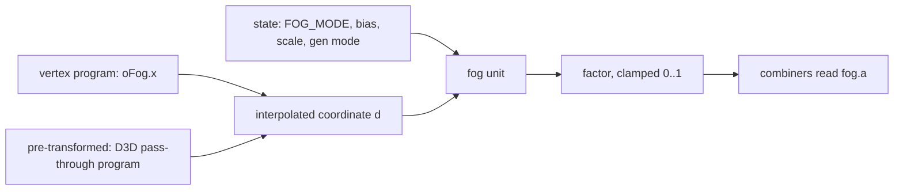

# Shaders: fog

Status: Built. Reference for `psh::fog` and `d3d::nv2a::d3d_fog`; part of [shaders.md](shaders.md).
Code: `crates/formats/shaders/src/psh/fog.rs` (`psh::fog`), `crates/platform/d3d/src/nv2a.rs` (`d3d_fog`, `PassthroughFog`). Tests: `crates/formats/shaders/tests/psh.rs`, `gpu.rs` (`fog_unit_modes_on_gpu`), `corpus.rs` (`corpus_fog_census`), `crates/platform/d3d/tests/fog_xbe.rs` (ignored, `$H2_XBE`).
Switch: none.



The vertex stage writes a fog coordinate, `oFog.x`, and the fog unit turns it into the factor the combiners read as `fog.a`. The NV2A state is `SET_FOG_ENABLE`, `SET_FOG_MODE`, the bias and scale of `SET_FOG_PARAMS`, and `SET_FOG_GEN_MODE`. Halo 2's D3D pushes them in its fog commit (`0x00400000`, from the deferred render states at `0x407608`), and `d3d::nv2a::d3d_fog` derives the same values from the render state:

| `FOGTABLEMODE` | mode | bias | scale | gen mode |
|---|---|---|---|---|
| `NONE` (0) | `LINEAR` (`0x2601`) | 1 | 1 | `SPEC_ALPHA` |
| `LINEAR` (3) | `LINEAR` | `1 + end/(end − start)` | `−1/(end − start)`, or −8192 when start == end | `PLANAR`, or `RADIAL` with `RANGEFOGENABLE` |
| `EXP` (1) | `EXP` (`0x800`) | 1.5 | `density · −1/(16 ln 2)` | as for `LINEAR` |
| anything else, `EXP2` (2) included | `EXP2` (`0x801`) | 1.5 | `density · −1/√(32 ln 2)` | as for `LINEAR` |

With `FOGENABLE` off only `SET_FOG_ENABLE` 0 is pushed. The fog unit computes, per fragment from the interpolated coordinate `d`:

```text
LINEAR   bias + scale·d − 1
EXP      bias + 2^(16·scale·d) − 1.5
EXP2     bias + 2^(−32·(scale·d)²) − 1.5
*_ABS    the same with |d|     (0x802 EXP_ABS, 0x803 EXP2_ABS, 0x804 LINEAR_ABS)
off      1
```

and clamps to [0, 1]. These are the formulas xemu's `glsl/vsh.c` evaluates. With D3D's parameters they give `(end − d)/(end − start)`, `e^(−density·d)` and `e^(−(density·d)²)`, and with no table the factor is `oFog.x` itself.

- **Constants.** The model computes the exp scales in closed form. D3D multiplies by its own constants (`0x45E378`, `0x45E374`), which differ by about 4e-6 relative; `fog_xbe.rs` reads them from `$H2_XBE` and checks that tolerance.
- **Uniform.** It carries `[mode, bias, scale]`, computed with f64 intermediates and f32 stores, as the x87 code rounds.
- **Colour.** The fog register's rgb is `D3DRS_FOGCOLOR`. It stays a `D3DCOLOR` (ARGB) in the render-state array, and `SetRenderState_FogColor` (`0x3f5370`) swaps red and blue only in the `SET_FOG_COLOR` method it pushes. The register's alpha is always the factor.

## Where the coordinate comes from

- **A vertex program is bound.** The coordinate is whatever the program leaves in `oFog.x` (64 of Halo's 353 programs write it). The generation mode only picks the coordinate of the fixed-function transform (specular alpha, radial eye distance, planar eye depth, absolute planar, fog X), and xemu likewise takes `oFog.x` as the distance whenever a program is bound. So `RANGEFOGENABLE` changes nothing for any draw this project renders: Halo never draws untransformed fixed-function vertices (`d3d::nv2a` skips them), and no fog write in its vertex programs depends on an `rsq`, which a radial distance needs ([notes/shaders-corpus.md](notes/shaders-corpus.md)).
- **Pre-transformed (`XYZRHW`) vertices** run one of D3D's three pass-through programs (`0x3f6f40`, `GuestLayout::passthrough_programs`), which are vertex programs too. Without a fog table, `mov oFog, v4.w` writes the specular alpha (D3D's vertex fog). With a table, `mov oFog, v0.z` writes the window z when the projection is affine (device flag 2) and `rcp oFog, v0.w` writes w otherwise.
- **Reproducing it.** `d3d::nv2a::PassthroughFog` reproduces the choice (the device records the flag in `ShaderInputs::affine_projection`). The synthesised pre-transformed program writes the same coordinate: `rcp` of the vertex's own rhw, so `rhw = 0` gives infinity as in the guest, while the position still treats `rhw = 0` as 1.

### Infinite and NaN coordinates

An infinite coordinate, of either sign, gives a fixed factor per mode whatever the bias and scale, as xemu's `glsl/vsh.c` assigns: 1 for `LINEAR`, `LINEAR_ABS` and `EXP`, 0 for `EXP_ABS`, `EXP2` and `EXP2_ABS` (`psh::fog::special_factor`). A NaN coordinate or formula result gives the same.

These are not the limits of the formulas. With D3D's negative scale, linear fog tends to 0, not 1, so with start −10 and end 10 an infinite coordinate reads 1 where the coordinate 0 reads 0.5. The WGSL recognises infinity and NaN by their bits, because the GPU's fast math does not keep IEEE semantics.

`fog_xbe.rs` runs the image's three programs through the interpreter, `rhw = 0` included, and checks that their `oFog` matches, along with the commit's constants (against the closed forms) and method headers.

## Not verified

- Per-fragment evaluation. xemu evaluates the factor per vertex and clamps it to the finite float range before interpolating, and marks that a guess. The two agree for linear fog and differ inside a triangle for the exp modes. Here the coordinate itself is interpolated.
- The `ABS` modes fold the coordinate (the eye-plane-absolute meaning); xemu folds the factor. Xbox D3D never selects them.
- Whether the rasteriser interpolates an infinite varying as infinity across a triangle, rather than NaN where a vertex's weight is 0.

## Related

- [shaders-pixel.md](shaders-pixel.md): the combiners that read `fog.a`.
- [graphics.md](graphics.md): how `GfxBackend` carries the fog uniform.
- [notes/shaders-corpus.md](notes/shaders-corpus.md): which retail programs write `oFog`.
