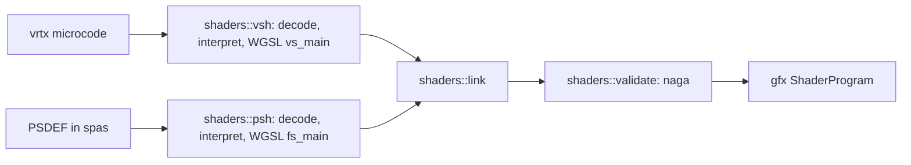

# Shaders

Status: Built. Reference for `crates/formats/shaders`.
Code: `crates/formats/shaders/src/` (`vsh`, `psh`, `link`, `validate`). Tests: `crates/formats/shaders/tests/`, see [shaders-testing.md](shaders-testing.md).
Switch: none.

`crates/formats/shaders` turns Halo 2's Xbox shader programs into WGSL. It does not emulate the NV2A. D3D8 is replaced at the API level, but Halo 2's shaders use NV2A features (vertex microcode, register combiners, texture-stage "shader modes"), so they still have to be translated.

| Page | Covers |
|---|---|
| this page | what the disc stores, vertex microcode, position fixup, W-buffering, the generated code's resource contract, gaps |
| [shaders-pixel.md](shaders-pixel.md) | `D3DPIXELSHADERDEF`: combiners, final combiner, texture modes, HILO, `COLORSIGN` |
| [shaders-fog.md](shaders-fog.md) | the NV2A fog unit and where the coordinate comes from |
| [shaders-shadow-maps.md](shaders-shadow-maps.md) | depth-format textures as shadow maps |
| [shaders-testing.md](shaders-testing.md) | tests and sources |
| [notes/shaders-corpus.md](notes/shaders-corpus.md) | retail corpus counts and tallies |



- `shaders::vsh`: NV2A vertex program microcode, giving a decoder, disassembler, reference interpreter and WGSL `@vertex` translator.
- `shaders::psh`: `D3DPIXELSHADERDEF` (texture modes plus register combiners), giving a decoder, listing, reference interpreter and WGSL `@fragment` translator.
- `shaders::link` joins the two into one module with `vs_main` and `fs_main`. `shaders::validate` runs naga over any WGSL.

## What Halo 2 stores

`h2 extract-shaders` (`crates/apps/h2-tools/src/extract_shaders.rs`) reads the owner's disc image through `crates/formats/map` and writes the corpus, a manifest and a provenance record to a directory you choose (keep it in `$TMPDIR`; no game data belongs in the repo). Across the 30 maps there are 353 distinct vertex programs and 149 distinct pixel shader definitions. All of them decode, translate and pass naga validation with no translation warning. Counts, the reproduction commands and the provenance are in [notes/shaders-corpus.md](notes/shaders-corpus.md).

### `vrtx` (vertex_shader)

```text
root (0xC):  u16 (1 in all 2,261 tags) | int16 | block program entries
entry (0x1C): u32 | block<u16> | dataref compiled shader | dataref code
```

- **compiled shader** is the `XGAssembleShader` output: the bytes `'x' 0x20`, a u16 instruction count, then 16 bytes per instruction. Every retail program has kind `0x20` (a normal shader). None are read/write (`'xw'`) or state (`'xs'`) programs.
- **code** is empty in every entry (all 11,837). Retail maps carry no D3D `vs.1.1` token streams or source, so the crate only takes microcode and needs no token parser.
- **The `u16` block** is a short list of small integers (such as `0,1,2,3,4,5,6`). It is not the set of `v` registers the program reads (it matches in 1,985 of 10,712 non-empty entries). It is probably vertex-declaration related; its meaning is unconfirmed.
- **Entries.** 765 are empty and 11,072 hold `'x' 0x20` programs. Some data pointers land in neighbouring tags because the cache deduplicates identical blocks, so the extractor resolves pointers against the whole metadata region, not one tag.

### `spas` (shader_pass): the pixel shader lives here

There are no `pixl` tags in the Xbox maps. The combiner program sits inside each shader pass:

```text
spas root + 0x1C: block postprocess definitions (0x58 each)
  + 0x00: block implementations (0x132 each)
            +0x00..0x06  three int16 block-index fields
            +0x06..0xF6  D3DPIXELSHADERDEF, verbatim, 2-byte aligned
            +0xF6..      index fields (meaning unverified), vertex shader tag ref (+0xFC), ...
```

The struct start is `+6`. `PSCombinerCount` there reads as the classic `0x00011101` (and `0x000111nn` across the corpus), `PSTextureModes` gives meaningful stage chains (lightmap passes decode as 2D, 2D, 2D, cube), and RGB input/output pairs form real programs (`desaturate` is `dot(t0, c0)`). At any 4-byte-aligned offset the same bytes look halfword-swapped.

The extractor checks every even offset 0 to 0x42 of all 4,593 implementations against the encoding's invariants and refuses to write a corpus unless `+6`, and only `+6`, passes for all of them. The table is in [notes/shaders-corpus.md](notes/shaders-corpus.md); the discriminating evidence is that only at `+6` do the 3,358 implementations with general combiners decode as combiner programs. The other 1,235 have a combiner count of 0 (texture stages only).

- 140 of 149 definitions use `MUX_MSB | UNIQUE_C0 | UNIQUE_C1`. The other 9 have no general combiners.
- `PSC0Mapping`, `PSC1Mapping` and `PSFinalCombinerConstants` are always 0: Halo 2 does not route constants through D3D's mapping and never sets `PS_GLOBALFLAGS_TEXMODE_ADJUST`. 38 definitions carry embedded `c0` values.
- Texture modes in use: none, project2d, project3d, cubemap, passthru, bumpenvmap, dotproduct, dot_st, dot_rflct_diff and dot_rflct_spec. Every dot-product stage uses `MINUS1_TO_1_D3D`.

Each corpus blob is the bytes of a `vrtx` entry's compiled shader (`*.xvu`) or the 0xF0 bytes at `+6` of a `spas` implementation (`*.psdef`), named by the first 16 hex digits of its SHA-256. `manifest.tsv` lists every file with its full hash, occurrence count and first location. `provenance.txt` records the image size, `default.xbe`'s SHA-256, each map's path, size, build and read-hash, every count, the offset table and the manifest's hash. The corpus test fails if the directory is empty, missing files or holds extras.

## Vertex microcode

Each instruction drives two units at once. The **MAC** is a 4-wide multiply/accumulate unit, and the **ILU** is the inverse/log unit, scalar except for `mov` and `lit`. Both read the same three operands A, B and C; the ILU only reads C. Word 0 is unused.

| field | word | low bit | width |
|---|---|---|---|
| ILU op | 1 | 25 | 3 |
| MAC op | 1 | 21 | 4 |
| constant index | 1 | 13 | 8 |
| input (`v`) index | 1 | 9 | 4 |
| A: neg, swizzle x/y/z/w | 1 | 8; 6/4/2/0 | 1; 2 each |
| A: temp, mux | 2 | 28, 26 | 4, 2 |
| B: neg, swizzle | 2 | 25; 23/21/19/17 | |
| B: temp, mux | 2 | 13, 11 | 4, 2 |
| C: neg, swizzle | 2 | 10; 8/6/4/2 | |
| C: temp | w2 bits 0-1 high, w3 bits 30-31 low | | 4 |
| C: mux | 3 | 28 | 2 |
| MAC mask, temp, ILU mask, output mask | 3 | 24, 20, 16, 12 | 4 each |
| output is register (1) or constant (0) | 3 | 11 | 1 |
| output address | 3 | 3 | 8 |
| output from ILU (1) or MAC (0) | 3 | 2 | 1 |
| constant is `c[a0.x + i]` | 3 | 1 | 1 |
| final | 3 | 0 | 1 |

- Mux 1 is `r`, 2 is `v` and 3 is `c`. Masks put x in the top bit. Swizzle values 0 to 3 mean x, y, z, w.
- MAC ops are `nop mov mul add mad dp3 dph dp4 dst min max slt sge arl` (0 to 13). ILU ops are `nop mov rcp rcc rsq exp log lit` (0 to 7).
- Output addresses: 0 `oPos`, 3 and 4 `oD0` and `oD1`, 5 `oFog`, 6 `oPts`, 7 and 8 `oB0` and `oB1`, 9 to 12 `oT0` to `oT3`.
- Constants use hardware numbering 0 to 191. D3D's `c-96` to `c95` map to `c[i + 96]`, so D3D's `c-38` is `c[58]`. The disassembler prints hardware numbers.

`vsh::interp` defines the semantics, and the generated WGSL uses the same formulas:

| Rule | Behaviour |
|---|---|
| Reads before writes | each instruction evaluates its operands, then writes, so a paired MAC and ILU, or an op writing a register it reads, see the old state |
| Pairing | with both units active the ILU's temporary write goes to `r1`, and a MAC temporary write to `r1` is dropped |
| `add`, `mad` | `add` is A + C. `mad` is A·B + C. Scalar ILU ops (`rcp rcc rsq exp log`) read the first selected component of C |
| Multiply by zero | gives zero, even for inf or NaN, in `mul`, `mad`, dots and `dst` |
| `rcc` | clamps 1/x to ±[2^-64, 2^64], keeping the sign (+0 gives +2^64, −0 gives −2^64). The saturation is decided on \|x\| before dividing, because on Metal (fast math) clamping `1/0 = inf` afterwards returned −5.42e-20 for RCC(+0). `rsq` is 1/√\|x\| |
| `exp` | (2^⌊x⌋, x−⌊x⌋, 2^x, 1), with y = 0 for ±inf (NV_vertex_program): EXP(+inf) = (inf, 0, inf, 1), EXP(−inf) = (0, 0, 0, 1) |
| `log` | of \|x\|: (exponent, mantissa, log2\|x\|, 1). Exponent and mantissa come from the IEEE fields, not ⌊log2⌋, which rounds up just below a power of two (bits `0x037fffff` give −121 and 1.99999988, log2 rounds to −120). Zero and denormals (flushed, as on the NV2A) give (−inf, 1, −inf, 1); ±inf gives (inf, 1, inf, 1) |
| `lit` | clamps the power to ±(128 − 1/256) |
| `arl` | `a0.x = floor(x + 0.001)` (the bias absorbs host attribute conversion landing just under an integer; xemu uses the same). `a0.x` is held to ±1024 and NaN gives 0, so `a0 + i` cannot overflow. Relative constant reads clamp the index to 0..191 |
| Infinities | the generated WGSL recognises infinities and signs by their bits, because fast math does not keep IEEE semantics |
| Decoding | rejects an absolute constant above `c[191]` (`Error::BadConst`), a temporary above `r12` and an operand with no register file. Only operands the active units use are checked: an unused B field naming `r15` is ignored |
| `r12` | is `oPos`, read back mid-program. The standard epilogue is `mul oPos.xyz, r12, c-38 : rcc r1.x, r12.w` then `mad oPos.xyz, r12, r1.x, c-37`; Halo 2 uses its own constants for it (`c[10]` and `c[11]`, for example) |
| `oFog` | takes the result's x whenever any component is masked. Halo 2 writes `oFog.xw` and `oFog.w` from replicated scalars |
| Outputs | start at (0, 0, 0, 1). Colours clamp to [0, 1] when they leave the vertex stage |
| Constant writes | from `'xw'` programs go to a per-vertex copy and do not persist across vertices as on the hardware. Halo 2 does not use them |

### Position fixup

NV2A vertex programs output window coordinates: x and y in pixels of the render target, z in [0, depth full scale], w for perspective. The Xbox D3D runtime puts the viewport scale and offset into constants and the program applies them itself (the epilogue above). Before writing `@builtin(position)`, the generated code maps window coordinates back to wgpu clip space (`crates/platform/d3d/src/clip_space/epilogue.rs`, `vsh::interp::fixup`):

```text
x, y  ← trunc(x·16)/16, trunc(y·16)/16      (rasterizer keeps 4 fractional bits, truncates;
                                             not at a render scale: high-resolution.md)
w     ← clamp_away(w)                       (as rcc: never 0 or inf)
ndc   = (2x/W − 1,  1 − 2y/H,  z/Zmax)      (wgpu y is up; NV2A window y is down)
        z/Zmax held to 1 when z <= Zmax,    (the depth clip range is inclusive)
        and to at least 1 + 2^-23 when z > Zmax
clip  = (ndc·w, w)                          (the GPU's divide by w restores the window position)
```

`W` and `H` are the guest render-target size in the units the game's viewport constants use, so they include any supersampling scale the game folded in. `Zmax` is 65535 for D16, 16777215 for D24, or 1 for float depth. They come from `VertexUniforms::{surface, z_max}`.

- **Window mapping.** Window coordinates map one-to-one onto wgpu framebuffer coordinates, pixel centres included, so half-pixel offsets in the game's offset constant are preserved. A higher host resolution only changes the wgpu viewport. Window-space y is preserved, so winding in the framebuffer matches the guest, and front-face and cull state come from the guest unchanged. The `render` test checks that guest screen row 0 is the top row.
- **Inclusive depth clip.** The NV2A clips depth against `[CLIP_MIN, CLIP_MAX]` inclusively (xemu discards only when `z < clipRange.z || clipRange.w < z`, in `glsl/psh.c`), and D3D sets the clip max to the depth full scale. So z exactly at `Zmax` is inside. The main menu's blue tint draws its quad at z = w = 0xFFFFFF, the D24 maximum.
- **Why z is clamped to 1.** On Metal `z / Zmax` divides through a reciprocal, and 0xFFFFFF / 0xFFFFFF comes out just above 1, which clipped the tint quad. The fixup clamps to 1 whenever `z <= Zmax`; since `1·w` is exact, clip z equals w.
- **Why z past `Zmax` is raised.** The division can round the next float above `Zmax` down to exactly 1 (D16: 65535.0039 / 65535), so z past `Zmax` is raised to at least the float after 1, and `(1 + 2^-23)·w` is always above w. The test compares bit patterns (`Zmax` is positive, so integer order is float order), because Metal's fast math folded a float comparison into a plain `min(z/Zmax, 1)`.
- **Still clipped.** Anything past `Zmax`, and anything below 0.
- **Test.** `quad_at_exactly_z_max_is_not_clipped` (`tests/render.rs`) draws quads at z = 0, exactly `Zmax`, the next float above it, a few ulps past it, 1.5·`Zmax` and −1, for D24, D16 and float depth, with w = 1 and w = z.
- **Clip range without W-buffering.** It is taken as `[0, Zmax]`. The `CLIP_MIN`/`CLIP_MAX` the game pushes (`d3d::hw::HwState`) apply only to w when W-buffered, and the NV2A's clamp mode (`ZCLAMP_EN`) is not applied to Z-buffered draws, where out-of-range z is clamped instead of culled.

### W-buffering

With `SET_CONTROL0` bit 16 (z-perspective; D3D sets it for `D3DRS_ZENABLE = D3DZB_USEW`, and Halo enables that at boot with `ZEnable(2)` at `0x1267a`) the NV2A ignores the program's z. It depth-tests and stores the perspective-correct interpolated w plus the polygon offset, and clips w to `[CLIP_MIN, CLIP_MAX]` (xemu's z-perspective path in `glsl/psh.c`). `d3d::nv2a` turns this on for vertex programs (`nv2a::w_buffered`) with `VertexUniforms::w_clip` and `PixelOptions::w_buffer`.

| Stage | What it does |
|---|---|
| Vertex | clip z = a·(w − lo), a = hi / (hi − lo): 0 at w = lo, w at w = hi, linear in clip coordinates, so the rasteriser's `0 <= z <= w` clip keeps exactly `lo <= w <= hi` (`interp::fixup_w_buffer`). With `CLIP_MIN` at 0 (a = 1) the far end cannot be culled, so such draws are clamped there |
| Fragment | `frag_depth = q(clamp(1 / position.w + units + factor · max(\|dpdx\|, \|dpdy\|), lo, hi)) / Zmax`. Polygon offset is in `XpsUniforms.depth`, the range in `XpsUniforms.depth_range`; the pipeline's own depth bias is off for such draws (`PreparedShader::writes_depth`) |
| `q` | `floor` for D16 and D24: the NV2A stores the whole part of w, as xemu's D24 and D16 paths do |
| Position | `@invariant`, so identical position code gives identical bits in every program |

Halo draws a surface in several passes with different programs, the later ones testing EQUAL. Passes whose w differs in the last bit or two stored different floats (dense stripes on one level's tower and the Banshee); the whole part almost always agrees. `w_buffered_passes_with_ulp_different_w_store_equal_depth` guards it ([notes/shaders-corpus.md](notes/shaders-corpus.md)).

- **Depth clamp.** `D3DRS_DEPTHCLIPCONTROL` (`NV097_SET_ZMIN_MAX_CONTROL`) with `D3DDCC_DEPTHCLAMP` (bits 7:4 = 1) clamps out-of-range depth instead of culling it (`ZCLAMP_EN` in xemu's `pgraph.c` and `glsl/psh.c`). Such a draw (`VertexUniforms::w_clamp`) outputs clip z = w / 2, so nothing is culled by the range, and the fragment clamp keeps the stored w inside it. Sky geometry past the far clip on one level is the likely case (`w_buffered_depth_clamp_keeps_what_lies_past_the_clip_range`).
- **Unclipped depth.** Such a draw's pipeline also leaves depth unclipped (`PrimitiveState::unclipped_depth` from `RenderState::depth_clamp`, where the device has `DEPTH_CLIP_CONTROL`; Metal's depth clip mode `clamp`). On the NV2A a clamped draw keeps what lies outside the depth range, so the host must not cull it at the near or far plane. The other planes still clip (`-w <= x, y <= w`, WebGPU spec 23.2.4). It does not remove a10's grey slab, which stays open ([sky.md](../halo1/sky.md), "Edge-on triangles").
- **Z-buffered clamp.** A Z-buffered draw that clamps gets the NV2A's meaning from the same switch: its depth is clamped to the viewport's depth range (the WebGPU spec clamps every fragment's depth to it) instead of culled. Without the feature, draws are clipped and the renderer says so once.
- **No depth, no write.** A draw that neither tests nor writes depth gets no depth write, since writing depth from the fragment stage turns off the GPU's early depth test. Rasterising the depth instead needs a w mapping affine in screen space, and none keeps the ordering across the range at float precision as stored w does, so the cost stays.
- **First-person weapon.** It uses another projection than the level, so its z does not order against the level's while its w does. `w_buffered_programs_depth_test_w_not_z` (`crates/platform/d3d/tests/shaders_render.rs`) checks the order and that z past `Zmax` does not clip.
- **Not covered.** Pre-transformed (`XYZRHW`) draws keep z, and an occlusion-count pass (which does not run the fragment program) still tests the rasterised z.

## Pixel side: `D3DPIXELSHADERDEF`

The combiners, the final combiner, texture modes and `COLORSIGN` are in [shaders-pixel.md](shaders-pixel.md).

### Fog

The NV2A fog unit, D3D's state mapping and where the coordinate comes from are in [shaders-fog.md](shaders-fog.md).

### Signed texture channels (`COLORSIGN`)

In [shaders-pixel.md](shaders-pixel.md), "Signed texture channels (`COLORSIGN`)": the transfer, the biased upload and borders. Signed formats ("Signed texture formats") are on the same page.

### Shadow maps

Depth-format textures compare instead of sampling: [shaders-shadow-maps.md](shaders-shadow-maps.md).

## Generated code and the resource contract

| group | binding | contents |
|---|---|---|
| 0 | 0 | `XvsUniforms`: `c[192]`, `defaults[16]`, `viewport` (vertex) |
| 0 | 1 | `XpsUniforms`: `c0[9]`, `c1[9]`, fog, bump-env, `tex_scale`, eye, alpha ref (fragment) |
| 1 | 2n | stage n texture (`texture_2d`, `texture_3d` or `texture_cube`, per `PixelShader::textures`) |
| 1 | 2n+1 | stage n sampler |

`vsh::VertexUniforms::to_bytes` and `psh::PixelUniforms::to_bytes` produce the buffer contents. The final 16 bytes of `XpsUniforms` hold the W clamp in `depth_range` and the polygon-stipple grid in `stipple_scale` (each lane: one axis's guest extent in the low 16 bits, its host extent in the high 16).

| Item | Rule |
|---|---|
| Vertex input | register `vN` is `@location(N)`. `VertexOptions::provided_inputs` names the registers the layout supplies; any other register the program reads comes from `XvsUniforms.defaults[N]` (the `SetVertexData4f` value) |
| Varyings | locations 0 to 3 for oD0, oD1, oB0, oB1; 4 to 7 for oT0 to oT3; 8 for the fog coordinate (`oFog.x`, which the fragment stage turns into the factor) |
| Code shape | each instruction is a commented block with its disassembly and raw words, in plain functions `xvs_program(v…) -> XvsRegs` and `xps_program(XpsInputs) -> XpsResult` that the entry points wrap. The tests call those functions from compute shaders |
| Sampling | texture sampling happens before any `discard`, so it stays in uniform control flow |

### Plugging into `gfx`

An adapter implementing gfx's `ShaderProgram` does four things:

1. Translate once per (vertex program, pixel definition, `VertexOptions`, `PixelOptions`) and use a hash of all four as the `ShaderId`, since the options change the code. `shaders::link` gives the module source, with entries `vs_main` and `fs_main`.
2. Build the pipeline layout from the table above: a vertex uniform at group 0 binding 0 (`VertexUniforms::SIZE`), a fragment uniform at binding 1, and in group 1 a texture and sampler for each stage where `PixelShader::textures[n]` is `Some`, with the view dimension taken from it.
3. For each draw, fill `VertexUniforms` from the guest's vertex constants (hardware order), render-target size and depth format, and `PixelUniforms` from the combiner constants, fog, bump-env state and alpha ref. Pass both groups in `Draw::bind_groups`.
4. Declare a `Float32xN` (or normalised) attribute at location `N` for each supplied register `vN` and set `provided_inputs` to match. wgpu fills missing components with (0, 0, 0, 1), the Xbox default. D3DCOLOR attributes need BGRA unpacking.

## Gaps

| Gap | State |
|---|---|
| Point sprites | `oPts` is computed, but WGSL has no point size. Halo 2 writes it in 2 programs, which need quad expansion in the renderer. [xemu](https://github.com/xemu-project/xemu/blob/master/hw/xbox/nv2a/pgraph/glsl/vsh.c) forwards `oPts.x` to the host point-size output |
| `dot_zw` depth replacement, `brdf` | not translated; not in Halo 2's tags |
| Persistent constant writes, state programs | not translated; not used by Halo 2 |
| Edge-case float behaviour | wgpu's Metal backend compiles with fast math, so arithmetic on an infinity is not IEEE on the GPU: an `add` fed by LOG(0) returned 0 where the interpreter gives −inf (352 of 2,472 non-finite expected values in the random vertex test, all in two programs). The ILU helpers build their infinities from bit patterns and match exactly. Inf and NaN in `rcp`/`rsq`, and NaN through `min`/`max`, follow the host GPU. The NV2A's exact rounding is not modelled. No Halo 2 program produces a non-finite value on the corpus test's inputs |
| Colour key, convolution filters, texture border adjustment | sampler and texture state outside the PSDEF, left to the renderer. No retail material sets `COLORKEYOP` |
| Signed blend equations | `BLENDOP = ADDSIGNED/REVSUBTRACTSIGNED` have no wgpu equivalent and fall back to the unsigned ones. Retail materials only use `ADD` |
| Shadow-map limits | [shaders-shadow-maps.md](shaders-shadow-maps.md), "Limits" |
| Unverified pixel-side behaviour | [shaders-pixel.md](shaders-pixel.md), "Not verified" |
| What the `vrtx` u16 block and the `spas` index fields mean, and how `spas` constant blocks feed `c0`/`c1` | belongs to the tag and renderer work; the translator only takes ready constant values |

## Related

- [shaders-testing.md](shaders-testing.md): tests and sources; [notes/shaders-corpus.md](notes/shaders-corpus.md): corpus counts.
- [graphics.md](graphics.md), [d3d.md](d3d.md): the `gfx` backend and the device that drive these programs.
- [shader-instances.md](../formats/shader-instances.md): the variant shells the engine builds at run time.
