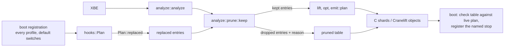
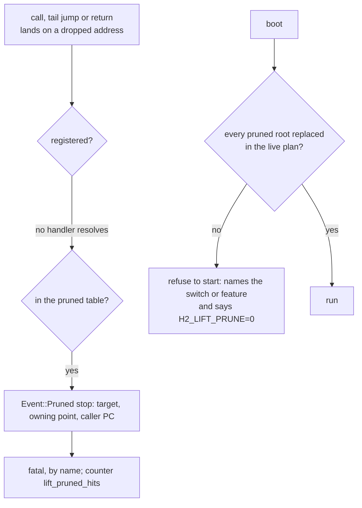

# Leave replaced guest code out of the lift

Status: Design. Nothing here is built.
Code: `crates/recompiler/analyze/src/prune.rs` (keep set), `crates/hooking/hooks/src/plan.rs` (`Plan::replaced`), `crates/recompiler/emit/src/lib.rs` (`plan_image`), `crates/runtime/recomp/src/pruned.rs` (the stop). Tests: `crates/recompiler/analyze/src/prune.rs`, `crates/recompiler/emit/tests/prune.rs`, `crates/apps/boot/src/registration/tests.rs`.
Switch: `H2_LIFT_PRUNE` (on; `0` lifts the whole image), to be listed in [switches.md](../runtime/switches.md).

A guest function that Rust replaces outright is not lifted, and neither is
any function that only replaced functions reach. Each render or sim piece
that finishes then removes its guest subtree from both tiers' builds. The
one rule: **a dropped function can never run quietly**. Either the build
proves nothing kept reaches it, or the run stops and names it.

## How it works

| Step | Where | What it does |
|---|---|---|
| 1 | `boot::registration::replaced_entries` | builds the registry for every boot profile with `Switches::defaults()`, no game running, and intersects `Plan::replaced()` across them |
| 2 | `analyze::prune::keep` | walks the call graph from the roots, stopping at replaced entries; returns kept entries and, for each dropped one, the replaced point that owns it |
| 3 | `emit::plan_image` | lifts and plans only kept entries; both tiers take the same owners |
| 4 | `emit::write_module`, `clif` | write the pruned table (entry, end, owning point name) beside the entry table |
| 5 | `boot` | refuses to start if a pruned entry is not replaced in the live plan; registers the named stop for every dropped entry |

### The replaced list

A chain replaces its entry when all of these hold. `Plan::replaced()`
(`crates/hooking/hooks/src/plan.rs`) is the only source; no hand-kept list
exists.

| Condition | Why |
|---|---|
| `chain.implement` is set and its hook carries `HookRef::replaces_guest()` | `Kind::Implement` runs instead of the body; the mark is the author's statement that the closure never transfers to its own guest body |
| the point is a function entry (`analysis.functions` key), not an instruction entry | a mid-function point leaves the rest of the function live |
| no hook in the chain names `resume_sites` or `generated_sites` | those resume generated code in the body; the plan has no function bounds, so any site keeps the entry |
| the feature has no switch that restores the guest in a shipped profile, or the build accepts that the switch then refuses to boot ("Boot safety") | the plan is built with defaults |
| the entry is replaced in every profile `registration` can build (window, Theater playback, headless host) | one image serves all of them; `hooks::replaced_in_every` intersects by address and point name |

What keeps its guest body:

| Hook shape | Kept because |
|---|---|
| `before` returning `Flow::Continue` on some path (a refusing arm) | the body runs when the model refuses |
| a compare arm (the sampled guest setups in `render-bridge`, `effects_shadow`'s gate) | the body is the reference it compares against |
| `after`, `observe_before`, `observe_after` alone | they wrap the body |
| `implement` without `replaces_guest()` | unmarked is kept; the default is safe |

`replaces_guest()` is added to a hook in the same commit that deletes its
refusing and comparing arms. Marked so far:

| Point | Feature | Why it qualifies |
|---|---|---|
| `CONTROLS_ROW_TEXT` (`0x2c8548`) | `controls-text` (`crates/extensions/game/src/controls_text.rs`) | the port reads the body's immediates and jump table as data and calls only `ITEM_TEXT` and `TEXT_SET` (declared with `calls_guest`); no arm runs the body |
| `RASTERIZER_INITIALIZE`, `BOOT_DISPLAY_ONCE`, `RASTERIZER_DISPOSE` and the eleven under them (`0x12560`, `0x12420`, `0x141c0`; [d3d-entries.md](../graphics/d3d-entries.md#start-up-and-shutdown)) | `rasterizer` (`crates/rewrites/render-bridge/src/rasterizer.rs`) | no device to make or free: the bodies write what the game reads and call only the game functions they declare with `calls_guest`; no arm runs a body |
| `OBJECTS_PRE_PHYSICS`, `OBJECTS_POST_PHYSICS`, `OBJECT_PRE_UPDATE`, `OBJECT_POST_UPDATE` (`0xb6f10`, `0xb7060`, `0xbc470`, `0xbc820`) | `sim-native`, the walk table (`crates/rewrites/sim-bridge/src/sim_objects.rs`, `install_walk`) | float-free bodies with no refusal ([object-update.md](../engine/object-update.md#the-walks-in-rust)); each resumes at its sites, so the plan keeps it lifted |
 A feature that refuses to build
(`BuildError`) contributes nothing, so its entries stay lifted.

### Reachability

Nodes are owners. A replaced function has two nodes: its entry (cut) and
its body. An edge to the entry address stops there. An edge to one of its
interior entries (`dispatch::entries`) reaches the body and keeps the whole
owner, since interior entries register against the canonical owner.

| Root | Source | Kept even if only dropped code refers to it |
|---|---|---|
| XBE entry point, TLS and kernel thunks | `Source::Entry` | yes |
| every address-taken function: code immediates and `Analysis::labels` | `Source::CodeRef` | yes in slice 2; slice 5 keeps it only when a kept function holds the immediate |
| every function a data section points to: vtables, callback tables, handler tables | `Source::DataPointer`, `pointer_seeds`, `dispatch::tables`, `dispatch::catalog` | yes, always |
| gap-scan candidates | `Source::GapScan` | yes: no known referrer means an unknown one |
| every chain point in the plan that is not replaced | `Plan::chains` | yes |
| every guest function Rust calls | `Builder::calls_guest(&POINT)`, a declaration beside the hook | yes |
| `resume_sites` and `generated_sites` owners | `Hook` | yes |

| Edge | From |
|---|---|
| direct call | `CfgBuilder` (`crates/recompiler/analyze/src/cfg.rs`) |
| tail transfer to another entry: jump, branch, fall-through | the same CFG; `ir::Dest::tail` in the lift |
| switch case landing on another entry | `Analysis::jump_tables` |

An unresolved indirect call or jump adds no edge. It can reach only an
address something stored, and every stored code address is already a root.
That is why a function is droppable only when it was found by `Source::Call`
or `Source::TailCall` and its address is taken nowhere.

`prune::Graph::build` (`crates/recompiler/analyze/src/prune.rs`) reads each
CFG once: the exiting edges and direct calls of every function, and every
stored code address. Stored means an imm32 or displacement in any decoded
instruction, or any aligned word in a data section, that lands on an entry
or an instruction start. That set covers `Source::CodeRef`, `labels`,
`pointer_seeds` and the `dispatch` tables, and also a `Call` function whose
address is taken too, which discovery records only as a call. `prune::keep_in`
walks the graph, so tests hand it an invented one. The XBE entry is never
cut, even if listed as replaced.

The walk runs on the analyzer's CFG, before lifting, so a dropped function
costs no lift, optimisation or emission time. It is deterministic: sorted
inputs, no hash-map order.

### Boot safety

| Path into dropped code | What happens |
|---|---|
| direct call from kept generated code to a dropped entry | a dropped entry has no entry index, so the call is emitted as a dispatched call; a replaced entry's hook chain answers it; no `h2fn_<entry>` symbol exists |
| any call, jump, return or resume nothing resolves | the runner looks the target up in the pruned table (`Dispatch::set_pruned`, `crates/runtime/runtime/src/runner.rs`) and stops with `Event::Pruned`, naming the range's replaced entry |
| the entry fallback (unread jump-table targets) | never asked about a pruned address (`Runtime::resolve_with_generation`) |
| the fallback interpreter (`crates/runtime/recomp/src/fallback.rs`) | `recover` does not handle the stop, and the interpreter stops with `Event::Pruned` at a pruned range instead of decoding it from guest memory |
| a hook marked `replaces_guest()` that transfers to its body anyway | the same stop, naming the point |
| a switch or profile that turns the replacing feature off | boot refuses before the first guest instruction (`boot::registration::check_pruned`) |

Ranges are the dropped functions' CFG blocks less every byte a kept
owner's instructions cover, so a tail shared with kept code stays
runnable. Each is owned by the lowest replaced entry whose cut body
reaches it. **Code**: `crates/recompiler/emit/src/pruned.rs`,
`crates/runtime/runtime/src/pruned.rs`.

There is no fallback arm. The message names the dropped address, the
replaced point it hangs from, and the caller: a call's return address,
else the EIP the transfer left.

### Differential tests

The differential tests in `crates/rewrites/engine/tests/` (for example
`particle_walk_differential.rs`) open the XBE named by `H2_XBE`, check its
hash, lift the original function with `lift::Lifter` and run it on
`ir::interp` in a `FlatMemory` of their own. They load no image and read no
entry table. They call `Lifter::lift(entry)` directly, which takes no keep
set, so a pruned function still lifts on demand. **Code**:
`crates/rewrites/engine/tests/common/`, `lift::Lifter::lift`.

`plan_image` is the only caller that filters. `h2 lift`, `h2 disasm` and
`h2 analyze` show the whole image.

## Interfaces

| Interface | Shape |
|---|---|
| `HookRef::replaces_guest(self) -> Self` | marks an `implement` hook; any other kind carrying it fails the feature's build (`BuildError`) |
| `Builder::calls_guest(&mut self, point: &'static Point)` | declares a guest function the feature's Rust calls; a point missing from the image turns the feature off, as a hook's does |
| `Plan::calls_guest: BTreeMap<u32, &'static Point>` | the on features' declared calls, by address: roots for `prune::keep` |
| `Plan::replaced(&self, entries: &BTreeSet<u32>) -> BTreeMap<u32, &'static Point>` | the conditions above |
| `hooks::replaced_in_every(plans, entries) -> BTreeMap<u32, &'static Point>` | `Plan::replaced` in every plan; none given, none replaced |
| `boot::registration::replaced_entries(entries: &BTreeSet<u32>) -> BTreeMap<u32, &'static Point>` | the window, playback and light-host cases of `registration/profiles.rs`, default switches; panics if a profile's registration or plan fails |
| `analyze::prune::keep(xbe, analysis, replaced: &BTreeSet<u32>, extra_roots: &BTreeSet<u32>) -> Keep` | `Keep { kept: BTreeSet<u32>, dropped: BTreeMap<u32, Dropped>, digest: u64 }`; `Dropped { by, bytes }`, `by` the replaced entries whose cut bodies reach it through dropped code; digest FNV-1a over replaced then dropped |
| `emit::plan_image(analysis, xbe, passes, keep: Option<&Keep>)` | `None` lifts everything; `emit::lifted_entries` is its entry list, which both tiers' builds lift |
| `emit::pruned::Table` | `root` rows (entry, point, feature) and `range` rows (start, end, root), tab-separated text, exported NUL-terminated as `h2gen_pruned_v1`: `h2gen_pruned.c` on clang (`emit::pruned::write_c`), a data object on the fast tier (`clif::build_dylib_pruned`). No symbol, nothing left out. `recomp::load_module` reads it into `Module::pruned`, the dispatch tables and the interpreter |
| `boot::registration::lift_replaced(entries) -> emit::pruned::Replaced` | `replaced_entries` with each entry's feature, plus every profile's `Plan::calls_guest` as roots. `boot::register_image_entries` registers it (`recomp::register_lift_replaced`); `recomp::prune::plan` calls it when `H2_LIFT_PRUNE` is on, and nothing replaced lifts everything |
| `boot::registration::check_pruned(roots, plan)` | boot's refusal: a cut root `plan.replaced` no longer holds, named with its feature and `H2_LIFT_PRUNE=0` |
| `Event::Pruned { caller, target, root, point }` | the stop; `runtime::pruned::hits()` is `lift_pruned_hits` |
| `h2 analyze --prune-report [--replaced FILE]` | TSV, three row kinds, each after a `#` header. `point`: entry, name, body (`dropped`, `kept`, `unknown`), functions dropped alone and shared, bytes alone, shards, shards it alone empties. `function`: entry, source, bytes, shard, the points that drop it. `total`: functions, kept, dropped, bytes, shards touched, emptied, digest. `FILE` is one hex entry per line and an optional name; slice 2's list replaces it |

### Build caches

| Cache | Effect of a newly replaced piece | Change needed |
|---|---|---|
| emit receipt (`crates/apps/cli/src/emit_cache.rs`) | the `h2` executable changed, so the receipt misses and the image is analysed and lifted again, as for any generator change | `settings` gains `H2_LIFT_PRUNE` and `Keep::digest` |
| shard files | names depend on the entry address only, so no function moves; a shard that loses a function changes text, a shard that loses all of them is not written and the stale file is removed | none |
| object cache (`H2_OBJ_CACHE`) | untouched shards hit; changed shards compile smaller; emptied shards compile nothing | none |
| entry table and pruned table | change with every prune set | they stay in their own file so one small object rebuilds |
| fast tier stamp (`tier::fast_stamp`) | the stamp names the generator's sources, which do not include the feature crates | the stamp gains `Keep::digest` |
| slim module (`emit::write_slim_module`) | dropped wins over cold: no cold route for a dropped entry | filter before the native/cold split |

The fast tier lowers the same filtered owners ([cranelift-tier.md](cranelift-tier.md),
"What the fast tier is"), so both tiers register the same addresses and the
same pruned table.

## Rules and limits

- A dropped function never runs quietly. Every path is a refused boot or
  an `Event::Pruned` stop.
- The prune set is a function of the XBE and the `h2` executable alone. A
  user's switch file never changes what is lifted.
- Unmarked means kept. Any doubt in a table above resolves to keeping.
- Data-pointer roots are never cut, even for a table only dropped code
  reads. That needs proof no other code reaches the table, which the
  analyzer does not have.
- `H2_LIFT_PRUNE=0` is the diagnostic arm: a whole image for bisecting a
  `Event::Pruned` or running with a replacing feature switched off.
- A snapshot taken on a whole image can hold a return address inside a
  function a pruned image drops. Restoring it stops by name.

### Slices

| # | Slice | Tests |
|---|---|---|
| 1 | `h2 analyze --prune-report` over a hand-given entry list: `analyze::prune::keep`, report only, nothing dropped. Gives the win before anything is built on it | invented graphs in `prune.rs`: a chain cut at a replaced entry; an address-taken callee, a gap-scan root and a callee reached from two sides stay; an interior entry keeps its owner; the entry point stays; nested cuts; determinism and digest; report rows. One synthetic image checks `Graph::build` |
| 2 | `HookRef::replaces_guest`, `Builder::calls_guest`, `Plan::replaced`, `registration::replaced_entries`. Marks `controls-text` | `crates/hooking/hooks/tests/plan.rs` (`mod replaced`): marked implement is replaced; a refusing `before`, a compare arm, observers and an unmarked implement are not; a resuming port is not; the mark on a `before` refuses the feature; switch off is not; profile intersection; `calls_guest` roots. `controls_text.rs` and `registration/tests.rs`: `CONTROLS_ROW_TEXT` is replaced in every profile |
| 3 | `plan_image` takes the keep set; pruned table; `Event::Pruned`; fallback refuses; boot check; `H2_LIFT_PRUNE` | `emit/tests/prune.rs`: A calls replaced B, only B reaches C; module builds on both tiers; a call of C stops naming B; a return into B's body stops by name; the fast tier's module carries the same table. Boot test (`registration/tests.rs`): a pruned root with the feature off refuses and names it |
| 4 | Cache keys: receipt settings, fast stamp, slim split | receipt misses on a changed digest; an untouched shard's object key is unchanged; an emptied shard's file and object go |
| 5 | Narrow `CodeRef` roots to immediates held by kept functions, to a fixed point | synthetic: a callback referenced only from a dropped function is dropped; referenced from data, kept |
| 6 | Retail measurement and a note | `#[ignore]` disc test: keep set closed, digest stable across two runs; boot check on the fast tier with `lift_pruned_hits` at 0 |

Slices 1 and 2 are independent. Slice 3 needs both.

### Measuring the win

| Number | From |
|---|---|
| functions dropped, per replaced point and total | `h2 analyze --prune-report` |
| shards changed and shards emptied | the same report (`entry >> emit::SHARD_SHIFT`) |
| generated C bytes | `WriteReport` |
| cold clang build time, `H2_OPT=2`, empty object cache | `h2 lab` on the quiet machine, `H2_LIFT_PRUNE=0` against the default |
| fast tier build time | the same pair with `--tier fast` |
| module size | the dylib |

Results go in `notes/lift-pruning.md`, dated, with the commit.

## Evidence

- **Code**: every discovered function is lifted today (`emit::plan_image`
  iterates `analysis.functions`).
- **Code**: generated code makes static direct calls by name
  (`crates/recompiler/emit/src/lib.rs`, the entry table), so a dropped
  callee is a link-time fact.
- **Code**: the differential tests run from the XBE on `ir::interp`
  (`crates/rewrites/engine/tests/particle_walk_differential.rs`).
- **S**: the size of the win. No count of functions reached only through
  replaced entries exists; slice 1 produces it.

## Not verified

- How many functions the pieces finished so far drop. Shared leaf helpers
  (maths, memory, containers) have many kept callers, so the win may start
  small and grow as whole subsystems go.
- That every Rust call into guest code goes through a named point that
  `calls_guest` can declare. An undeclared one shows as `Event::Pruned`.
- That a hooked hot callee is already reached through dispatch, not a
  static direct call, in both tiers.
- Whether the headless host and Theater playback register the same
  replacing features as the window profile.

## Related

- [LIFTER.md](LIFTER.md): the pipeline and transfer contract.
- [dispatch-coverage.md](dispatch-coverage.md): the table census and root closure the walk reuses.
- [BUILD-CACHE.md](BUILD-CACHE.md): receipt and object keys.
- [cranelift-tier.md](cranelift-tier.md): the fast tier's stamp and shared plan.
- [feature-engine.md](../engine/feature-engine.md): hook kinds and chains.
