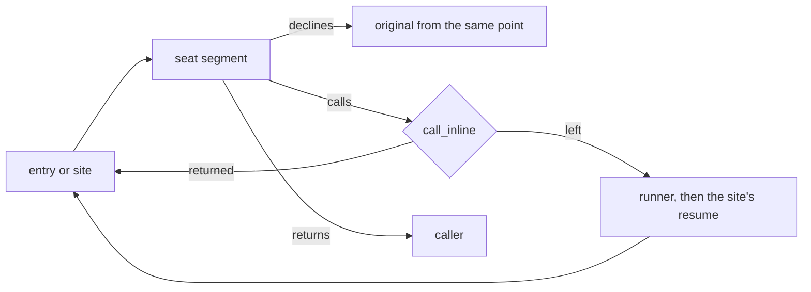

# The phantoms' action build: what it costs and how it gets cheap

Status: Option 1, the alias and its journal (lane P1), is built and on by default. On the laptop it is 22% faster per match than the view with identical state hashes ([notes](notes/sim-10x.md#2026-11-22-the-phantom-alias-against-the-view-on-the-laptop)); its film runs are pending. The input stage in Rust (lane P2) is built and on by default; its check-mode and differential runs are pending. The builder's body in Rust (lanes P3 and P4) is built and on by default; its disc differentials and check-mode runs are pending. Lane P0 is design.
Code: `crates/extensions/game/src/bot_glue/retail_input.rs` (`gather`, `Builder::sample_checked`, `Builder::alias`, `Builder::view`, `Builder::rust`, `Builder::action`), `crates/rewrites/engine/src/sim_seats/input.rs`, `crates/rewrites/engine/src/sim_seats/builder.rs`, `crates/rewrites/engine/src/sim_seats/interaction.rs`, `crates/extensions/game/src/bot_glue/retail_input/body.rs`, `crates/runtime/runtime/src/executor.rs` (`SecondExecutor::alias`, `Alias`), `crates/runtime/runtime/src/guest/journal.rs`, `crates/runtime/runtime/src/guest/view.rs`. Tests: named per lane.
Switch: `impl.sim.phantom-alias` (on; `-impl.sim.phantom-alias` builds in the view) and `H2_PHANTOM_BUILD_CHECK=1`, both in [switches.md](../runtime/switches.md). The input stage and the builder body always run in Rust, with no switch; a piece or segment that declines is counted and runs its guest entry.

Each tick a sim host turns every phantom's pad into a retail action by
running the title's own local action builder in a private view of guest
RAM. On Lockout with four phantoms that is 1.15 ms of a 5.19 ms tick,
the largest single cost found
([note](notes/sim-10x.md#2026-11-22-eight-at-once-with-the-warm-z-and-the-phantom-builds-cost)).
This page reads the build call by call and designs the cheaper one. The
rule: **the action bytes of every phantom on every tick stay the same**,
so `state_hashes_v1` and films stay the same. It is row 1 of
[sim-headless-skips.md](sim-headless-skips.md).

The answer in one paragraph: the six guest calls are small, and only one
of them (the builder, with its aim-assist and interaction searches) is
real work. What the build pays for is the isolation: a fresh
copy-on-write mapping of all RAM every tick, whose pages the kernel maps
one fault at a time, and a compare-and-copy revert between seats. The
design keeps the isolation and drops the mapping: the executor runs on
the live RAM itself with a software undo journal, and puts back every
byte before the gather returns.

Evidence labels are those of [docs-style.md](../meta/docs-style.md).
Addresses are research points in the retail XBE.

## How it works

### The build, call by call

`gather` runs at the remote gather hook (`SIMULATION_SLOT_ACTION`,
`crates/extensions/game/src/bot_glue.rs`), once per phantom slot per
tick, on the game thread. `Builder::action` does this
(**Code**):

1. **View.** The tick's first seat calls `SecondExecutor::snapshot`: two
   copy-on-write copies of RAM, the view and the base. Each later seat
   calls `written` (the view's dirty pages, each compared with the base
   line by line) and `revert` for each page.
2. **Setup writes**, about 25 stores: the phantom becomes local user zero
   on controller zero (`[0x4e8c20]`, the player record, the controller
   handles `0x4e61cc`, the profile slot and its sensitivity), the pad
   goes to the workspace page, user zero's director and the six dialog
   lists are cleared, and the seat's own history from its last build is
   written back: raw input `0x4e61dc` (0x48 bytes), the control block
   (0x94), the abstract input `0x51ea88` (0x50) and a latch.
3. **Six guest calls**, the table below.
4. **Read back** the 0x5c-byte action and the four history blocks.

| # | Entry | What it does | Reads | Writes | Shape |
|---|---|---|---|---|---|
| 1 | `0x1872d0` bind | Returns at once when the control block already holds this unit. Otherwise clears the block, seeds the facing angles from the unit's forward vector and copies three unit fields | control globals `[0x4ed284]`, the unit object | control block of user 0 | leaf, two `fpatan` |
| 2 | `0x190c34` look rates | Profile bytes to the look-rate record: the Default layout (`0x218420`, onto the stack) and two table lookups | profile `0x54e9f4`, constant tables | `0x51ea18`, 0x1c bytes | no floats computed; a pure function of the profile bytes the setup writes |
| 3 | `0x1557c0` camera origin | `0x155810` classes the unit's camera (on foot, seated, and so on) from the unit, its parent and its tag; `0x23bc90` or `0x23ca20` then fills the observer record from the unit. Rust writes the matching camera entry into the director, which `0x155760` reads back as the camera mode | unit, parent, tags | observer `0x4e9c8c`, workspace | small tree, floats |
| 4 | `0x124c00` input read | For each port with a handle: `XInputGetState` (our override answers the seat's pad from the workspace), then down counts, held milliseconds and hysteresis for 16 buttons and four scaled stick axes | pad, raw history | raw input `0x4e61dc` | integer only; one port has a handle |
| 5 | `0x217c40` remap | Raw input to abstract input: stick shaping by the look rates, the layout's button slots | raw input, look rates, `0x4e61b9` | abstract input `0x51ea88`, latch `0x51ebcc` | one helper call (`0x218510`), SSE and x87 floats |
| 6 | `0x186ab0` builder | The control update `0x185be0` (it calls the aim-assist `0x1a4900`: weapon cone `0x1a50a0`, target search `0x1a5370` and its candidate walk `0x1a54a0`), the dialog test `0x148fff`, unit queries, the weapon and seat interaction search `0x151110`, angle wrap, then the action record | players, objects, tags, the visibility set `[0x4e6948]`, the director, user tables, game globals `[0x510c50]` | control block, the action at `out`, and scratch the searches keep | a deep tree: over thirty callees listed, not all read |

All six are **E** (read at the address; callees listed by
`h2 disasm`, not each read through).

**Why a view and not the live world.** A phantom is a remote player. The
builder is written for a local user: it finds its unit, camera, pad and
history through the local-user tables, and those hold −1 on a phantom
host ([sim-headless-skips.md](sim-headless-skips.md#what-a-phantom-host-does-not-run)).
Binding the phantom as user zero changes the player record and a dozen
globals that are in the arena hash, and the calls write more (the
control block, input history, observer, search scratch). The view takes
all of it and is thrown away; only the action and the seat's history
come out (**Code**: the test
`retail_input_binds_the_requested_seat_and_keeps_its_history_private`).
The view's memory accesses are not charged to the game thread's logical
clock (`last_accesses` is never read back), so the build does not move
the schedule either.

### Where the 1.15 ms goes

Measured (**Run**, the note above): 1.15 ms a tick in `Builder::sample`,
0.12 ms of it in `snapshot` (one per tick, remapped). The other 1.03 ms
has no finer measurement. What the code says it contains:

- **The guest work.** Twenty-four calls a tick; calls 1 to 5 are a few
  hundred instructions each, and call 1 is a no-op on every tick but a
  seat's first. For four *local* seats the whole "players" family
  (player update, control, aim assist) is 4.55% of the thread
  ([sim-attribution.md](sim-attribution.md#attribution)), 0.14 ms of a
  3.1 ms tick, and the builder is a part of it. So the guest work is
  supposed at 0.1 to 0.3 ms (**S**). One thing makes it dearer in the
  view than live: `Dispatch::prefer_generated` turns off every
  non-context override, so the collision and object reads under the
  searches run as lifted code, not as the native ports.

  Which of the live game's seat ports the builder's executor keeps
  (**Code**, test
  `a_phantom_executor_keeps_the_target_seats_and_not_the_control_update`
  in `crates/rewrites/sim-bridge/src/sim_seats.rs`). An override survives
  `prefer_generated` only where its whole chain is context-only
  (`Chain::render_thread`, marked in `hooks::install::place`). All three
  are always installed. The executor installs
  seats of its own over them ([below](#the-builder-body-in-rust)), so the
  column is what runs in the tests' builder without the body.

  | Entry | Port | In the phantom executor | Why |
  |---|---|---|---|
  | `0x1a4900` target update | `sim_seats::targeting::update` | Rust | the seat alone at the point; the body reads only the CPU and the guest |
  | `0x1a5370` target search | `sim_seats::targeting::search` | Rust | the same |
  | `0x185be0` control update | `sim_seats::look::update` | lifted | the `aim-assist` feature's open and close sit at the point: per-player host state, and an `after` the fallback cannot resume |
  | `0x1a50a0` cone | `sim_seats::aim::arm` | lifted | the `aim-assist` feature's `after` at the point |

  The look and aim arms also move host proof counters
  (`device::arm` and `leaf` statics, and `aim::arm`'s answered count), so a
  phantom call counts towards the live arm's proof. That changes who answers, not the answer.
- **Kernel faults on a mapping made this tick** (**S**, the suspect).
  `Guest::cow_refresh` replaces the view's RAM with a new
  `mach_vm_remap` each tick, and `freeze_ram` does the same for the
  base. A new mapping has no pages mapped in: the first read of each
  16 KB host page from the view is a kernel fault, and the first write
  a fault and a copy (2.8 µs, [second-executor.md](../runtime/second-executor.md#2-guest-memory-view)).
  The searches read objects, tags, the BSP and node data across RAM.
  The base faults too, under `changed_lines` and `revert`.
- **Reverts**: three a tick, each a 4 KB compare and a 4 KB copy per
  written page under a memory guard taken per page.
- **Outside the timer** (**S**): the view and the base stay mapped until
  the next tick's snapshot, so the live side takes a copy-on-write fault
  on its first write to every host page for the whole tick. That cost
  lands in the guest's tick, not in `wall.phantom_build_ms_per_tick`.
- **A host that cannot remap** copies all 64 MiB per snapshot
  (`cow.rs`: every host but macOS).

Lane P0 measures the split. The design below removes every item but the
first.

### The design: run on live RAM, journal the writes, undo

`SecondExecutor::alias` gives the executor a second kind of view, an
**alias**: its `Guest` takes the live RAM block in place (the two Guests
exchange blocks; no mapping call) and keeps its own mappings, page table,
dispatch and context as a view does. It never remaps and never copies
([second-executor.md](../runtime/second-executor.md#the-alias-and-its-journal)).

- **Journal.** Every writable page starts with its write bit clear in the
  alias's fast page table, the way `crate::trap` arms a page
  (`guest/journal.rs`): the first store to a page, from generated C or
  from Rust, takes the checked slow path. There the journal saves the
  page's 4 KB, keyed by physical page, and sets the write bit, so later
  stores to it are inline.
- **Undo.** The `Alias` copies each saved page back and clears its write
  bit as it drops: in `Builder::action` after the action and history are
  read, on the early return of a faulted or refused call, and on a
  panic's unwinding. After it, live RAM equals its bytes at the start of
  the build.
- **Isolation.** The build holds the live runtime's memory guard from
  the first setup write to the end of the undo, so no other host thread
  reads the bound state. The game thread is inside the gather hook, so
  no guest code runs.
- **Per seat**: setup writes, six calls, read back, undo. There is no
  snapshot, no `written`, no `revert` and no base.

What the alias changes for the guest calls is the tick's later seats.
A view shows every seat the RAM of the tick's first gather. An alias
runs on live RAM at each seat's own gather, so `Builder::alias` makes up
what it can of the difference:

- **An earlier seat's writes** (its setup, its scratch, its history) are
  undone before its gather returns, so a later seat never sees them, as
  the view's revert hides them (**Code**).
- **The stack.** Between two gathers the game thread runs guest code
  below the gather frame (the `0x14d0a0` check of `out`, the retail
  loop), and a builder that reads an uninitialised local would read those
  bytes. The tick's first seat keeps the stack pages from 64 KiB below
  the gather's ESP to the page above it; a later seat writes back, through
  the journal, each page live RAM has changed since, so the window holds
  the first gather's bytes, as the view's does (**Code**; the depth is a
  window, not a measured one, **S**).
- **The clock.** The tick's first seat opens with `alias`, which starts
  the executor's time-stamp counter and guest clock as `snapshot` does; a
  later seat opens with `alias_continued`, which runs them on, as the
  view's later seats do (**Code**).
- **What is left**: the earlier slot's action record and stamp, whatever
  the `0x14d0a0` check writes outside the stack, and possibly an
  animation-cache fill ([bots.md §5.5](../game/bots.md)). The builder is
  not known to read any of them (**S**); the differential below is the
  proof. The view path already builds from later RAM after a failed seat
  or a cold-animation retry (`Builder::sample` sets `tick = None`), and
  the alias path then starts afresh the same way.

The cost per tick is then the guest work, about 100 setup stores, and a
save and a restore of each written page: 0.2 to 0.35 ms supposed, against
the 0.3 ms target. The live side's faults for the rest of the tick go
too.

The alias is for the paged memory model, which a sim image is built
with. A flat-RAM image (`H2_FLAT_RAM`) keeps the view: its stores are
host instructions in a window and would need host page protection.
`Builder::new` sees `Runtime::flat_ram` and builds in the view, with one
log line. A runtime with no fast page table journals too: every store
takes the slow path.

**Check mode.** `H2_PHANTOM_BUILD_CHECK=1` gives the builder a second
builder on the other path, with its own executor and history. Every seat
is built by both, the other path first; the switch's path gives the
answer, and a seat whose outcome, action bytes or history differ counts
in `wall.phantom_build_mismatches` (the first eight are logged). Each path
keeps its own history, so each runs as it would alone.

### The input stage in Rust

Four of the six calls are the input stage: they turn the seat's pad and
history into the records the builder reads. `Builder::action` runs each
in Rust (`engine::sim_seats::input`), always, in
the guest's order and on the same alias or view, with the camera origin
`0x1557c0` still a guest call between them (**Code**).

| Piece | Entry | What the Rust writes | Floats |
|---|---|---|---|
| `bind` | `0x1872d0` | nothing when the control globals are active and the block holds the unit (every build but a seat's first); else the reset block, the facing from the unit's forward vector, three unit fields | two `fpatan`, one `fsqrt`, one `addss` |
| `look_rates` | `0x190c34`, `0x218420` | the 0x1c-byte record at `0x51ea18` from profile bytes 0 to 6 | none: table entries |
| `read_pads` | `0x124c00` | each handled port's raw record: counts, milliseconds and thresholds for 16 buttons, four axes past the 9000 dead zone | none |
| `remap` | `0x217c40` | each handled port's abstract record at `0x51ea88` (16 buttons by layout slot, triggers, four axes, the look mode's swaps and inversion) and the latches at `0x51ebcc` | `fpatan`, `fsin`, `fcos`, `fsqrt` per stick; mode 2 and 3's diagonal shaping |

How it stays exact:

- **One piece, one commit.** A piece reads RAM, computes every byte the
  entry stores into locals, and writes them at its end. A refusal has
  written nothing, and the builder makes that piece's guest call instead
  (`Builder::rust`). The other pieces still run in Rust.
- **The call's float environment.** The x87 steps run on the x87 crate
  from the x87 state of the registers the guest call starts with
  (`load_fpu`), instruction for instruction, so precision control, the
  stack's depth and rounding of each `fst` match. The SSE steps are
  native `f32` in the original's operand order; they equal `mulss`,
  `divss` and `comiss` only under round to nearest with no flush to zero,
  so any other MXCSR refuses.
- **What the phantom executor answers.** `read_pads` takes the pad
  report from the workspace as the executor's `XInputGetState` override
  does, for every port with a handle, with success.
- **Refusals, by name** (`Refusal::name`, said once a builder):

  | Name | When | Seen on a phantom |
  |---|---|---|
  | `input.mxcsr` | MXCSR not 0x1f80 in its controls | no: the gather's MXCSR |
  | `input.x87` | an x87 step the crate stops on (a transcendental under a directed rounding mode) or an unmasked exception | no |
  | `input.replay-record` | `0x4e61b9` set: the remap reads `0x4e630c` | no: the setup clears it |
  | `input.look-helper` | look rates whose remap calls `0x218510` (profile bit 2 set, bit 0 clear) | no: the setup writes a zero profile |
  | `input.slot` | a button order or layout slot past 16 | no: the Default layout's slots |
  | `input.memory` | a read or write faults | only on a broken image |

- **What it does not write**: the entries' stack locals. A later guest
  call that read one uninitialised would see other bytes (**S**: none
  known; the check mode is the proof).

The stage stays clear of the aim-assist feature's hooks: `0x185be0` and
`0x1a50a0` run under `0x186ab0`, and no input piece calls or writes their
per-player host state.

**Check mode** builds the reference arm on the other path with the guest
input stage, so a mismatch counts either the path or the stage. With the
alias off (or a flat-RAM image) the reference arm is a second view with
the guest stage.

### The builder body in Rust

The sixth call, the builder `0x186ab0`, runs in Rust in the phantom
executor, always (lanes P3 and P4). `Builder::with_body`
puts every seat of `sim_seats::phantom_body` into the executor's own
dispatch, at its entry and its return sites (`body::install`); the live
game's dispatch is not touched (**Code**).

| Seat | Entry | Body | Its callees |
|---|---|---|---|
| `sim.seats.phantom_action_build` | `0x186ab0` | `sim_seats::builder` | the control update, dialog test `0x148fff`, input block `0x12be90`, the unit's weapon and grenade queries (`0xcdeb0`, `0xcfe40`, `0xcdff0`), camera mode `0x155760`, zoom `0xc85c0` and `0xc8960`, script look `0x187510`, the interaction search, `fmod` `0x373b6a`, the action copy `0x14d040` |
| `sim.seats.phantom_interaction_search` | `0x151110` | `sim_seats::interaction` | the spatial query `0xbb050`; the weapon, control, vehicle and biped tests `0x151780`, `0x1516c0`, `0x151430`, `0x1515e0` |
| `sim.seats.player_control_update` | `0x185be0` | `sim_seats::look::update` | the look curve, the target update and the leaves `look` already names |
| `sim.seats.player_look_curve` | `0x185b30` | `sim_seats::look::curve` | none |
| `sim.seats.aim_target_update`, `_search`, `_compare` | `0x1a4900`, `0x1a5370`, `0x1a66f0` | `sim_seats::targeting` | the cone `0x1a50a0`, the stack probe `0x320560`, the candidate walk `0x1a54a0`, `qsort` `0x321460`, the line of sight `0x1a67f0` |

How a build runs (`body::drive`):

- **One segment, one commit.** A seat is register-level in the style of
  `sim_seats::look`: each segment runs from the entry or a site to the
  next call or the return, buffers its stores in a plan, and leaves every
  register, flag, x87 and SSE state the original leaves there. A segment
  that declines has written nothing, and the original runs from the same
  point: its entry, or the site's generated resume.
- **Callees in place.** A call a segment ends with is made through
  `ExecCtx::call_inline`, and the seat carries on at the site in Rust. A
  callee that is a seat too enters its own Rust through the entry table.
  Where the runtime leaves a call to the runner (`Fallback`), the runner
  makes it and enters the seat again at the site through its resume
  registration, so the answer is the same either way. The stack probe
  `0x320560` under the target search returns below its call slot, so it
  is always left to the runner (**Code**: the plain-return test in
  `try_inline`).
- **Floats.** The facing's `fpatan`, `fsqrt` and the zoom hold's
  `fabs`/`fcomip` run on the x87 crate from the call's x87 state, with
  the last instruction and operand pointers retail leaves; `fmod` is the
  guest's. The interaction search's `addss`, `subss`, `mulss` and
  `comiss` go through `sim_objects::sse`, which follows MXCSR.
- **Declines, by seat and point** (`body::declined`, said once each):

  | When | Seat | Seen on a phantom |
  |---|---|---|
  | MXCSR or x87 exceptions unmasked, or a reserved precision (`sim_native::supported`) | every seat | no: the gather's float state |
  | an x87 step the crate stops on (a transcendental under a directed rounding mode) | builder | no |
  | the direction flag set at a `rep stos` or `rep movs` | builder | no |
  | the grenade walk past `builder::SLOT_WALK` steps (a slot outside 0 and 1 with neither holding a grenade, where retail spins) | builder | no: units have two slots |
  | a query count past 64, or a jump table entry the image does not have | interaction search | no |
  | a read or write that faults, or a store log past its size | every seat | only on a broken image |

- **The aim-assist feature.** Its hooks at `0x185be0` and `0x1a50a0` keep
  per-player host state. `prefer_generated` already turns them off in the
  executor; the body's seat at `0x185be0` replaces that chain there, and
  `0x1a50a0` is not a phantom seat, so a phantom never runs them.
- **Proof counters.** The control update's device and leaf arms keep
  host statics (above), so a phantom's control updates count towards the
  live arms' proof. Until an arm is proven its bound read declines, and
  the guest's control update answers the phantom.

The proof, in the order it is run: the disc differentials
`phantom_action_build` and `phantom_interaction_search` in
`crates/rewrites/engine/tests/sim_seats_differential.rs` (each segment
against the lifted original at every call and return, every register and
every byte of RAM; callees stubbed) and
`the_phantom_body_reaches_its_children`; the synthetic build
`retail_input_binds_the_requested_seat_and_keeps_its_history_private`
with the body on (it declines and the stand-in answers); then the check
mode over the eight Lockout seeds, whose reference arm is the guest
builder.

### The other options

| # | Option | Saving, ms a tick | Exact? | Verdict |
|---|---|---:|---|---|
| 1 | Alias and journal (above) | 0.8 to 0.95 of the build, and the live side's faults (**S**) | by the differential | lane P1 |
| 2 | The input stage in Rust (above): calls 1, 2, 4 and 5 | at most 0.04 (**S**): four of six calls | by the disc differentials and the check mode | lane P2, built |
| 3 | Native ports allowed in the view (collision and object reads under the searches) | unknown until P0's access counts | each port already has its parity test | after P0 |
| 4 | The four seats as local users 0 to 3 in one view: one input read, one remap, no undo between seats | under 0.05 after option 1 | **not known**: the user count is 4, not 1, and a later seat sees an earlier seat's search scratch | no lane |
| 5 | A result kept across ticks | 0 | the aim search and the interaction search read moving objects every tick. Only call 2's record is constant, and option 2 takes it | no lane |
| 6 | Seats built on several threads | wall only: no CPU saved, and a batch already fills the cores | yes (seats are independent, below) | no lane |
| 7 | The build overlapped with the guest's tick | 0 | **no**: tick N's action is read by tick N's update straight after the gather. A build a tick late is a different match, as `H2_BOT_PIPELINE` is | no lane |
| 8 | The builder tree in Rust over live state | all but about 0.05 | x87 and SSE floats across the whole tree, collision under it | lanes P3 and P4, built for the builder, the interaction search and the seats under them; their other callees stay guest calls made in place |
| 9 | A copy-on-write view kept across ticks and patched from the live side's written pages | the faults, at the cost of a write watch on the live side and a copy of every page the tick wrote | yes | superseded by option 1, which copies only what the build wrote |

**Order of the calls.** Seats are independent: each starts from the same
RAM plus its own history, and nothing a seat writes survives its undo
(or revert). Their order is not observable, with one exception to keep
in mind: the executor's time-stamp counter runs on across seats
(`restore_tsc_last` at the snapshot only, and at `alias` only, not at
`alias_continued`). No `rdtsc` is in the entries read (**E**, the six
entries and `0x1a4900`; the callees are not searched). The alias path
keeps the view's counter behaviour seat for seat, so whether a callee
reads it does not separate the two paths.

**What `H2_BOT_PIPELINE` covers.** The brain only. `bots::think` stages
the thinks of tick N to run during the guest's tick and delivers their
pads at tick N+1 (`crates/live/bots/src/think.rs`; `think_env` in
`crates/apps/cli/src/sim_cmd.rs` passes the match file's `bot_pipeline`
through). The build still runs on the game thread at the gather, in
every think mode, and `GameThreadTimer` does not cover it.

## Interfaces

The lanes. Each is code only; the coordinator builds and runs.

| Lane | Scope | Files | Switch | Proof |
|---|---|---|---|---|
| **P0** split | `PhantomCosts` gains: nanoseconds in the setup writes, in each of the six calls, in `written` plus `revert`, and in the read back; the guest accesses of each call (`CallOutcome::accesses`); the pages written per seat; and the process's minor faults inside `Builder::sample` (`getrusage`). The sim report prints them under `wall` as per-tick figures | `crates/extensions/game/src/bot_glue/retail_input.rs`, `crates/live/sim-bench/src/metrics.rs`, [sim.md](../runtime/sim.md) | none | metrics unit tests on the JSON, beside `phantom_costs_are_per_tick_beside_the_brains` |
| **P1** alias and journal (built) | `Guest` has a write journal on the fast page table's write bit; `SecondExecutor::alias(main)`, `alias_continued` and `undo`; `Builder::action` takes the alias path under the switch and the view path without it. A check mode, `H2_PHANTOM_BUILD_CHECK=1`, runs both for every seat and counts seats whose outcome, action or history bytes differ (`wall.phantom_build_mismatches`) | `crates/runtime/runtime/src/guest.rs`, `guest/journal.rs`, `guest/view.rs`, `executor.rs`, `crates/extensions/game/src/bot_glue/retail_input.rs`, `crates/live/sim-bench/src/metrics.rs`, [second-executor.md](../runtime/second-executor.md), [switches.md](../runtime/switches.md) | `impl.sim.phantom-alias` | below |
| **P2** input stage (built) | Option 2: `bind`, `look_rates`, `read_pads`, `remap` in Rust, each falling back to its guest entry on a named refusal | `crates/rewrites/engine/src/sim_seats/input.rs`, `crates/extensions/game/src/bot_glue/retail_input.rs` | none (always on) | the disc differentials `input_stage::*` in `crates/rewrites/engine/tests/sim_seats_differential.rs` (each piece against its lifted entry to the return, every byte outside the stack); `stage_tests` in `retail_input.rs`; the image test `retail_pad_sequence_matches_local_angles_target_and_fire` on the Rust stage; the check mode over the eight Lockout seeds |
| **P3** builder body (built) | `0x186ab0` in Rust over `sim_seats::look` (the control update's body); the dialog test, the unit queries and `fmod` stay guest calls, made in place | `crates/rewrites/engine/src/sim_seats/builder.rs`, `crates/extensions/game/src/bot_glue/retail_input/body.rs` | none (always on) | the disc differential `phantom_action_build`; `the_phantom_body_reaches_its_children`; the synthetic build with the body on; the check mode over the eight Lockout seeds |
| **P4** searches (built) | the interaction search `0x151110` in Rust, and the target update and search seats in the phantom executor, their callees made in place; the candidate walk `0x1a54a0` and the type tests stay guest calls | `crates/rewrites/engine/src/sim_seats/interaction.rs`, as P3 | as P3 | the disc differential `phantom_interaction_search`, the shadow gate's `sim.seats` group for the target seats, and the check mode |

P1's proof, in the order it is run:

1. **Runtime tests** (`crates/runtime/runtime`, and
   `crates/recompiler/emit/tests/second_executor.rs` for generated
   stores): after random stores through an alias, from Rust and from
   generated code, a store crossing a page, and a call that faults or is
   refused part way, `undo` leaves every byte of RAM as it was; the live
   `Guest`'s write watch reports nothing; a second round journals the
   same pages again.
2. **The builder's tests** run on both paths: the two synthetic tests in
   `retail_input.rs` assert that live RAM is untouched, and the ignored
   image test `retail_pad_sequence_matches_local_angles_target_and_fire`
   compares 30 samples with a real local user.
3. **The differential**: `H2_PHANTOM_BUILD_CHECK=1` over the eight
   Lockout seeds of the throughput batch, 9,000 ticks each: zero
   mismatches in 288,000 builds. The reference arm is the view exactly as
   it is built, so equal bytes there are equal actions.
4. **`h2 sim diff`**, switch on against off, arena hashes on, the same
   seeds: every component agrees.
5. **Films**: a film recorded with the switch at its default verifies
   (`theater.verify`), and its action columns equal those of the same
   seed recorded with the view.

## Rules and limits

- **The action is the only output.** A change that alters one byte of one
  action on one tick is a different match. Faster is not a reason.
- **Undo is not optional.** Every path out of `Builder::action` on the
  alias runs the undo before the live guard drops; a missed undo is
  corrupted game state, not a missed sample.
- **The check mode is the reference.** The view path stays in the tree as
  the check mode's reference arm and as the flat-RAM path.
- **A film carries the switches that were set.** `Switches::spec` holds
  only switches named on the command line
  (`crates/hooking/hooks/src/switches.rs`), so a film recorded at the
  default plays at the default. A film recorded with the switch named
  plays only with it named the same way.
- **The target is a supposition.** Under 0.3 ms needs the guest work at
  0.25 ms or less. If P0 puts it higher, options 3 and 8 are what is
  left.

## Evidence

| Fact | Label | Source |
|---|---|---|
| 1.15 of 5.19 ms, snapshots 0.12 ms, one a tick, remapped; brain 0.25 ms | Run | [notes/sim-10x.md](notes/sim-10x.md#2026-11-22-eight-at-once-with-the-warm-z-and-the-phantom-builds-cost) |
| The setup writes, the six calls and their arguments, the history blocks | Code | `retail_input.rs` (`Builder::action`) |
| What each entry does | E | the addresses in the table |
| Two remaps a tick, both kept until the next snapshot | Code | `executor.rs` (`snapshot`), `guest/view.rs` (`cow_refresh`, `freeze_ram`) |
| The view runs lifted code under non-context overrides | Code | `crates/runtime/runtime/src/dispatch.rs` (`prefer_generated`) |
| A page's write bit sends a store to the slow path | Code | `crates/runtime/runtime/src/trap.rs`, `guest.rs` (`arm_all`) |
| 2.8 µs per first write to a host page | Run | [second-executor.md](../runtime/second-executor.md#2-guest-memory-view) |
| What changes in live RAM between two gathers | Code | [bots.md §5.5](../game/bots.md), `crates/live/bots/src/phantom/action.rs` (`slot_action`) |
| The pipeline covers the thinks only | Code | `crates/live/bots/src/think.rs` |
| The alias, the journal and its undo on every exit | Code | `executor.rs` (`alias`, `Alias`), `guest/journal.rs`, `guest/view.rs` (`alias_ram`, `end_alias`) |
| Per-seat undo, the stack window, the clock at the tick's first seat only | Code | `retail_input.rs` (`Builder::alias`), test `later_seats_of_a_tick_see_the_first_gathers_world_on_both_paths` |
| The input stage's four entries, their stores and floats | E | `h2 disasm` of `0x1872d0`, `0x190c34`, `0x218420`, `0x124c00`, `0x217c40` (with its jump table `0x21840c`) |
| Each piece writes only at its end and falls back per piece | Code | `input.rs`, `retail_input.rs` (`Builder::rust`), test `retail_input_binds_the_requested_seat_and_keeps_its_history_private` |
| The split of the 1.03 ms, every saving, the 0.3 ms outcome | S | lane P0, then P1's runs |

No game was run for this page; it is static reading, so the agent API
was not used. P0 adds the report fields the API's sim report lacks.

## Not verified

- How the 1.03 ms divides between guest work, kernel faults, reverts and
  setup, and how many host pages a build reads and writes.
- What the live side pays in copy-on-write faults over a tick while the
  view and base are mapped.
- That no entry under the builder reads another slot's action record or
  stamp, the `out` buffer, or the stack more than 64 KiB below the
  gather's ESP (the alias path puts back the window above that).
- That no callee reads the time-stamp counter.
- The cost of a snapshot on a host that copies (Linux).
- The input stage's disc differentials and its check-mode run: written,
  not yet run. Until they pass, its exactness is the reading of the
  entries above.
- That no later guest call reads a stack local the input stage's entries
  left (the Rust writes none).

## Related

- [sim-headless-skips.md](sim-headless-skips.md): the candidates this is row 1 of.
- [second-executor.md](../runtime/second-executor.md): the view, the base and their costs.
- [bots.md](../game/bots.md): phantoms, the gather and the think modes.
- [sim.md](../runtime/sim.md): the report's `wall.phantom_*` fields.
- [notes/sim-10x.md](notes/sim-10x.md): the measurements.
